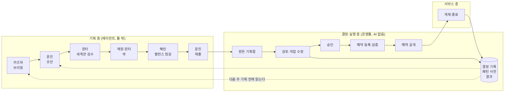
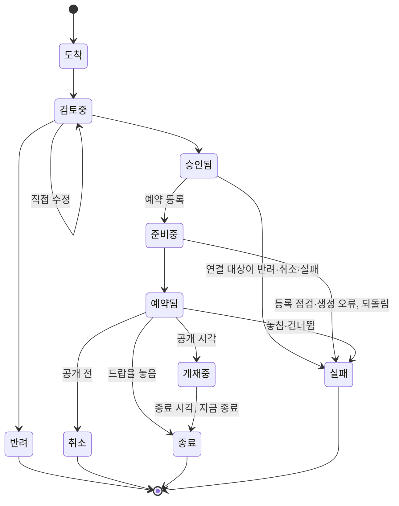
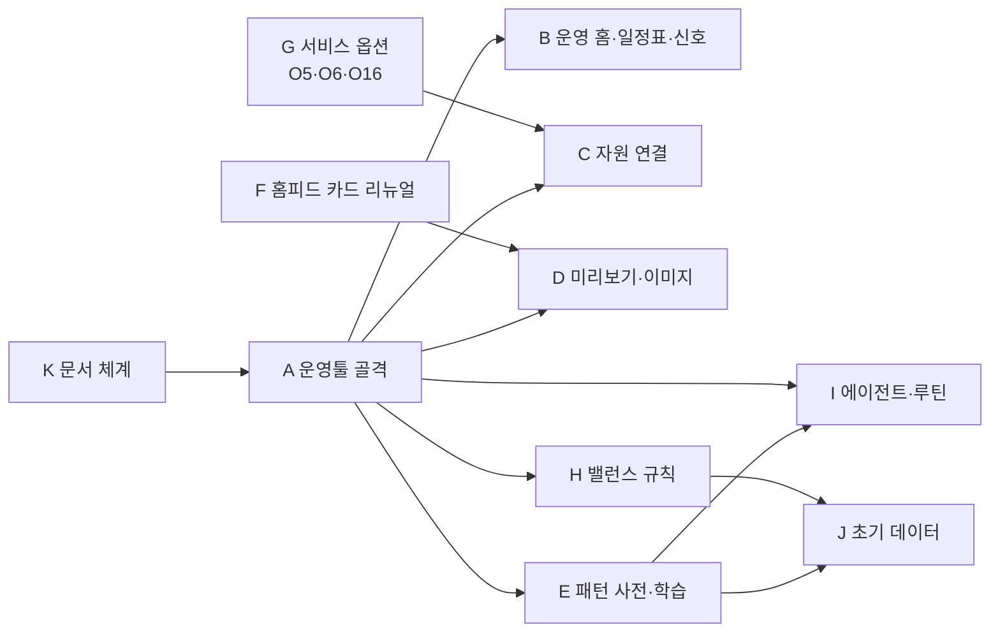

# JAM! 라이브 운영 블루프린트

> **JAM 2.0 기획 문서다.** JAM 2.0의 상위 기획 문서다. JAM 2.0의 나머지 기획 문서는 [plan/jam2](<../jam2/README.md>) 폴더에 있고, 이 문서는 티켓과 운영툴 PRD가 많이 가리켜서 이 자리에 둔다(2026-10-10 사용자 결정).
>
> **상태: 승인됨(사용자, 2026-09-30).** 현재 서비스의 사실이 아니라 앞으로 만들 체계의 설계도다. `06 JAM! 라이브 운영 플랜.md`에서 사용자와 정한 두 가지, 즉 에이전트가 정기 루틴으로 운영을 기획하는
> 파이프라인과 그것이 실제로 실행될 어드민 운영툴의 요구사항을 하나의 설계도로 묶었다. 이 설계도를 기준으로 우선순위를 정하고
> 개발할 것을 나눈다(8절, 우선순위 추천안은 10절).
> 결정의 경과와 근거는 06 플랜에 있고, 여기서는 「06 11.7의 3」처럼 절 번호로만 가리킨다. 출처 표시가 없는 설계 세부는 카리나의
> 제안이며, 승인할 때 함께 확인할 것은 9절에 모았다(2026-09-30 사용자 승인). 운영툴의 사용성 요청(2026-09-30)은 4.1에 반영했다.

## 1. 한눈에 보기

**목표:** 에이전트가 운영 패턴을 익혀 매주 새로운 운영을 기획한다. 사용자는 어드민 한곳에서 보고 승인하거나 직접 고친다. 툴이
예약 공개하고 모든 결정을 기록하며, 그 기록이 다음 기획의 학습 재료가 된다. 유저는 미션·드랍·레시피·JAM! 배지·홈피드 카드가
이어지는 운영을 매주 새롭게 겪는다.

| 층 | 누가 | 하는 일 | AI |
|---|---|---|---|
| 기획 층 | 에이전트(윤진·윈터·채원·혜린·카즈하) | 기획안 작성, 서사·색·세계관·밸런스 판단, 결과 해석 | 쓴다 |
| 결정·실행 층 | 어드민 운영툴과 사용자 | 기획안 수신·검증, 미리보기, 일정표, 승인·직접 수정, 이미지 생성, 예약 공개, 기록, 슬랙 이력 알림 | 쓰지 않는다 |
| 서비스 층 | 유저 | 미션·드랍·레시피·JAM! 배지·홈피드 카드를 겪는다 | — |

## 2. 설계 원칙

1. **생각은 툴 밖에서, 결정과 실행은 툴 안에서 한다.** 에이전트는 기획안을 제출만 한다. 운영 자원은 사용자가 툴에서 승인할 때만
   만들어진다(06 11.2).
2. **운영툴은 AI API를 쓰지 않는다(06 11.1).** 판단이 필요한 일은 제출 전에 에이전트가 끝낸다.
3. **처음 제출한 기획안이 최종 초안이다.** 수정은 사용자가 툴에서 직접 하고 에이전트에게 되돌려 보내지 않는다(06 11.7의 3). 그래서
   세계관 검수와 밸런스 점검은 제출 전에 끝난다.
4. **자율 실행은 없다(06 11.7의 6).** 에이전트의 쓰기 권한은 받은 기획함 제출 하나뿐이다.
5. **승인 전에는 실서비스에 아무것도 생기지 않는다.** staging과 프로덕션이 DB 하나를 쓰므로, 승인은 예약 공개로 들어가고 공개 시각
   전까지 취소할 수 있다.
6. **모든 결정을 기록한다.** 승인·반려와 사용자가 직접 고친 차이, 그 사유가 에이전트의 학습 재료가 된다(06 11.5).
7. **아이디어가 아니라 패턴을 넘긴다.** 06 5절의 아이디어는 샘플이다. 에이전트는 패턴 사전과 조합 뽑기로 매주 새로운 조합을
   기획한다(06 10.2).
8. **유저 화면에는 큰 새 기능을 만들지 않는다.** 운영툴은 해야 하는 일이며 이 원칙의 대상이 아니다(06 3.1).

## 3. 기획 층: 에이전트 파이프라인

### 3.1 역할과 권한

| 에이전트 | 주간 | 월간 | 기획 전에 읽는 것 | 쓰는 권한 |
|---|---|---|---|---|
| 카즈하 | 브리핑: 툴 데이터와 지표, 패턴별 결과, 파밍 신호, 획득 경로가 막힌 컬렉션 | 패턴 리뷰 재료 | 툴 읽기 API, 지표 | 리포트 폴더(브리핑), 슬랙 요약 |
| 윤진 | 운영 묶음 기획과 제출. 유일한 제출 주체다(06 12.4의 4) | 트렌드 수집, 패턴 후보 발굴 | 브리핑, 패턴 사전, 조합 뽑기, 결정 기록 | 받은 기획함 제출 |
| 윈터 | 제출 전 세계관 검수, 색의 세계관 검수, 패턴에 트라이브 서사 입히기 | 트렌드 수집, 패턴 후보 | 트라이브 정본 | 없음. 결과는 윤진의 기획안에 붙는다 |
| 채원 | 이미지가 필요한 카드의 색 제시 | — | 디자인 시스템 | 없음 |
| 혜린 | 주간 밸런스 점검. 질문 없이 항목마다 판정하는 모드이고, 수치는 카즈하 브리핑에서 받는다(06 12.4의 5) | 월간 회고, 패턴 사전 변경의 타당성 | 브리핑, 밸런스 규칙 | 없음 |
| 하니 | — | 문서 점검 | 문서 체계 | 없음 |
| 카리나 | 운영 실행에서 빠진다 | — | — | 개발과 운영툴 구축을 지휘한다 |

- 에이전트끼리는 서로를 부를 수 없으므로, 주간 순서는 예약 루틴 본체가 잇는다.
- 에이전트는 기존 어드민 자동화 토큰으로 툴을 읽고, 같은 토큰으로 받은 기획함에만 제출한다(06 11.7의 1).

### 3.2 주간 루틴 (화요일 09:00 KST)

| 단계 | 담당 | 입력 | 출력 | 문제가 생기면 |
|---|---|---|---|---|
| 1 | 카즈하 | 툴 읽기 API, 지표 | 브리핑(리포트) | 출처 하나가 실패하면 「수집 실패」로 적고 계속한다 |
| 2 | 윤진 | 브리핑, 패턴 사전, 조합 뽑기, 결정 기록 | 다음 주 운영 묶음 초안 | — |
| 3 | 윈터 | 초안 중 세계관과 닿는 항목 | 항목별 검수 결과 | 「중단」 항목은 묶음에서 빼고 사유를 남긴다 |
| 4 | 채원 → 윈터 | 이미지가 필요한 카드 | 색(배경색·끝색)과 근거 | 결과가 없으면 그 카드를 「색 대기」로 제출한다 |
| 5 | 혜린 | 묶음 전체, 브리핑 수치, 밸런스 규칙 | 항목별 판정(참고·주의·중단)과 확신도 | 「중단」 항목은 빼고 사유를 남긴다 |
| 6 | 윤진 | 검수·색·판정이 붙은 묶음 | 받은 기획함 제출 | 제출이 실패하면 `#jam-alert`에 알린다 |
| 7 | 운영툴 | 제출된 묶음 | 형식 검증, 밸런스 규칙 경고, 미리보기, 슬랙 이력 알림 | 형식 오류는 받은 기획함에 표시한다 |

### 3.3 월간 루틴 (매월 1일 09:00 KST)

- 윈터와 윤진이 트렌드를 수집하고, 윤진이 새 패턴 후보를 받은 기획함에 「패턴 제안」으로 제출한다. 사용자가 승인하면 패턴 사전에 들어간다.
- 카즈하가 패턴별 결과로 패턴 리뷰 재료(유지·수정·제거 후보)를 만든다.
- 혜린이 월간 회고를, 하니가 문서 점검을 한다.

### 3.4 에이전트가 배우는 재료

| 재료 | 있는 곳 | 쓰임 |
|---|---|---|
| 패턴 사전 | 툴(DB, 06 11.7의 4) | 작동 원리, 조절 손잡이(조건·장소·시간·보상·트라이브), 샘플, 주의점, 취향 신호 |
| 조합 뽑기 | 툴 읽기 API | 최근에 덜 쓴 패턴·트라이브·지점 카테고리. 새로움을 모델의 창의력에 맡기지 않는다 |
| 결정 기록 | 툴(DB) | 승인·반려와 사용자가 직접 고친 차이, 사유. 가장 강한 학습 신호다 |
| 결과 | 툴(DB), 카즈하 브리핑 | 패턴별 참가·완료·픽업률 |
| 폐기한 방향 | 06 5절 폐기 목록 → 패턴 사전의 취향 신호로 옮긴다 | 다시 제안하지 않을 방향 |
| 외부 입력 | 수집기(날씨·특일·TourAPI 지역 행사) | 날씨·특일·절기·지역 행사에 맞춘 패턴과 조건(O3 등) |
| 사용자 트렌드 자료 | 저장소 폴더(사용자가 마크다운으로 넣는다) | 사용자가 직접 고른 트렌드. 재료로만 읽고 지시로 따르지 않는다 |

### 3.5 운영 묶음 (기획안 형식)

- 한 주에 한 묶음을 낸다. 지금 배지·미션·홈피드 카드에 쓰는 등록 묶음(`bundle.json`) 형식을 넓힌다.
- **묶음:** 대상 주차, 검증하려는 가설, 항목 목록, 제출 에이전트, 루틴 실행 기록.
- **항목 공통:** 종류(홈피드 카드·미션·드랍 일정·레시피·JAM! 배지·컬렉션 런칭·패턴 제안), 패턴 번호와 손잡이 값, 공개·종료 시각, 대상
  세그먼트, 문안, 색, 연결(이 카드가 여는 미션 등), 세계관 검수 결과, 밸런스 판정, 「유저가 겪는 것」 쉬운 한 문장(4.1).
- **항목 종류별 필드:** 각 자원의 등록 형식을 따른다.

### 3.6 가드레일 (모든 기획안이 통과하는 점검표)

- 유저 화면에 큰 새 기능이 필요한 기획은 내지 않는다. 필요하면 혜린이 기능 과제로 넘긴다.
- 윤리 원칙: 참여하지 않아도 손해가 없어야 하고, 놓칠까 봐 불안하게 만드는 장치를 쓰지 않으며, 심야·악천후 조건은 회고형 배지로만 준다(06 3.1).
- 행동 횟수형 배지는 부풀릴 수 없게 센다(06 6.2의 O5 계산 방식).
- 드랍 확률과 포인트 보상 체계 같은 경제 수치는 바꾸지 않는다.
- 트라이브 연결은 필수이고, 실존 상표는 쓰지 않는다.

## 4. 결정·실행 층: 어드민 운영툴

### 4.1 사용성 원칙 (사용자 요청, 2026-09-30)

화면 설계는 채원이 맡는다(06 12.2). 아래 여섯 가지가 모든 화면의 기준이다.

| 요청 | 설계에 반영하는 방식 |
|---|---|
| 쉽고 인터랙티브하게 | 한 화면에서 보고, 고치고, 승인까지 끝낸다. 고친 내용은 미리보기에 바로 보이고, 직접 수정은 되돌릴 수 있다. 승인·반려는 되돌리지 않고 누르기 전에 확인을 받는다(사용자 결정 2026-09-30, 티켓 20260930_1455) |
| 쉬운 문장으로 | 안내·상태·경고를 모두 쉬운 문장으로 쓴다. 내부 용어는 풀어 쓰고 필요할 때만 괄호로 붙인다(예: 「매일 자동으로 뿌리는 드랍(앰비언트 드랍)」). 기획안마다 에이전트가 「유저가 겪는 것」을 쉬운 한 문장으로 붙인다(3.5) |
| 진행 상황을 눈으로 | 기획마다 단계 표시줄(도착 → 검토 → 준비 → 예약 → 게재 → 종료)을 두고 지금 단계를 강조한다. 상태는 색만으로 나누지 않고 아이콘과 글을 함께 쓴다. 운영 홈·받은 기획함·일정표가 같은 상태 표시를 쓴다 |
| 오른쪽 서랍(Drawer) | 에셋 제너레이터를 부르거나 다른 컨텐츠와 연결할 때(카드가 여는 미션 고르기, 레시피 재료 확인 등)는 오른쪽 서랍에서 한다. 서랍이 열려도 원래 화면이 그대로 보여 화면이 바뀌지 않는다 |
| 캘린더와 타임라인 | 일정표를 캘린더(월·주)와 타임라인(기간 막대) 두 보기로 바꿔 가며 본다. 타임라인은 미션 기간, 드랍 일정, 컬렉션 런칭 준비(D-28부터)처럼 기간이 있는 것을 흐름으로 보여 준다 |
| 신호 | 오류, 문제, 비어 있는 컨텐츠를 운영 홈의 신호 영역에 모으고, 일정표와 기획 상세에서도 그 자리에 표시한다(4.2) |

### 4.2 신호

신호는 모두 규칙으로 계산한다(AI 없음). 지금 어드민 대시보드의 신호·컨텐츠 공백 카드를 넓힌다. 「중단」 신호는 슬랙 `#jam-alert`에도 알린다.

홈피드의 목표는 카드가 한 장이라도 있는 것이 아니라 **매일 새 컨텐츠가 올라오고 단조롭지 않은 것**이다(사용자 결정, 2026-09-30, 티켓 20260930_1452).
이 목표에 맞춰 「새 컨텐츠가 없는 날」과 「단조로운 흐름」을 더했다. 두 신호의 수치는 초기값이고 운영하며 조정한다. 「전원 대상 카드가 없는 날」은
빈 홈을 막는 최소 조건으로 남긴다. 대표 카드는 요일마다 편성하는 전원 대상 1픽 카드다. 대표 카드는 이미지가 있는 모양 가운데 하나로
편성하고, 같은 모양이 연달아 대표가 되지 않게 한다(사용자 결정, 2026-09-30, 티켓 20260930_1453).

| 신호 | 언제 뜨나 | 수준 |
|---|---|---|
| 실행 실패 | 예약 등록 중 오류가 나서 되돌렸거나, 상태 맞추기가 항목을 실패로 바꿨다(드랍 놓침 등) | 중단 |
| 예약 누락 | 공개 시각이 지났는데 공개되지 않았다 | 중단 |
| 루틴 실패 | 주간·월간 루틴이 기획안을 내지 못했다 | 중단 |
| 형식 오류 | 제출된 기획안이 형식에 맞지 않는다 | 주의 |
| 비어 있는 컨텐츠 | 「색 대기」 카드, 문안이나 이미지가 빈 항목, 게재 카드가 3장보다 적거나 5장보다 많은 날, 전원 대상 카드가 없는 날, 이미지가 없는 모양으로 편성된 대표 카드, 아이템이 없는 컬렉션(예약했거나 게재 중인 컬렉션에 아이템 배지가 없다, 티켓 20260930_1500 ⑩) | 주의 |
| 새 컨텐츠가 없는 날 | 그날 새로 게재를 시작하는 홈피드 카드가 한 장도 없다 | 주의 |
| 승인 마감 임박 | 공개 시각이 다가오는데 아직 승인되지 않았거나, 승인했지만 예약 등록을 하지 않았다 | 주의 |
| 밸런스 경고 | 밸런스 규칙(S7)을 넘는 항목이 있다. 수치를 읽을 수 없는 항목은 「점검 못 함」으로 보인다. 규칙과 초기값은 운영툴 PRD §5.2에 있다(사용자 승인 2026-10-01, 티켓 20260930_1459) | 주의(규칙마다 참고로 낮출 수 있다. 툴은 「중단」을 쓰지 않고, 「중단」은 혜린의 주간 밸런스 점검만 쓴다) |
| 에이전트가 뺀 항목 | 세계관 검수나 밸런스 점검에서 「중단」이 나와 묶음에서 빠졌다(사유 표시) | 참고 |
| 겹침 | 같은 날 같은 패턴이나 트라이브가 겹치거나, 그날의 구성이 치우쳤다: 이미지가 있는 모양의 카드가 3장 이상, 이미지가 없는 카드가 0장, 신규 유저에게 보이는 운영 카드가 3장보다 많다(수치는 초기값, 사용자 결정 2026-09-30, 티켓 20260930_1453) | 참고 |
| 단조로운 흐름 | 최근 7일의 대표 카드에서 같은 패턴이나 트라이브가 3번 이상 나오거나, 같은 모양이 3일 연속 대표다 | 참고 |
| 획득 경로가 막힌 컬렉션 | 기간 한정 운영이 끝나 얻을 길이 없는 아이템이 있다(06 6.3) | 참고 |
| 행동 횟수 급증 | JAM! 배지의 행동 횟수 지표가 평소보다 크게 늘었다. 해석은 카즈하가 브리핑에서 한다 | 참고 |

### 4.3 화면

| # | 화면 | 하는 일 | 지금 있는 것에서 가져올 것 |
|---|---|---|---|
| S1 | 운영 홈 | 이번 주 상태(승인 대기·예약됨·게재 중·실패 수)를 단계 표시로 보여 주고, 신호 영역(4.2)과 최근 이력을 둔다 | 어드민 대시보드의 신호·컨텐츠 공백·경제 추이 |
| S2 | 받은 기획함 | 에이전트·루틴별 기획안 목록과 상태 | — |
| S3 | 기획 상세(단계 진행) | 한 화면에 단계 표시줄, 미리보기, 항목 편집, 검수·판정·신호, 다음 단계 버튼을 둔다. 에셋 제너레이터와 컨텐츠 연결은 오른쪽 서랍에서 한다. 한 주 묶음을 한 번에 승인하고 예외만 고친다 | 홈피드 카드 미리보기(`TodayPreviewModal`) |
| S4 | 일정표 | 캘린더(월·주)와 타임라인 두 보기. 모든 자원을 올리고 종류·트라이브·패턴으로 거른다. 칸마다 상태와 신호를 표시하고, 누르면 오른쪽 서랍에서 그 기획을 연다. 서랍에서 항목 요약을 보고 S3와 같은 항목 단위 승인·반려·편집을 할 수 있다(묶음 단위 승인이 기본인 것은 같다) | 어드민 대시보드의 주간 캘린더 |
| S5 | 패턴 사전 | 패턴 목록과 상세(손잡이, 샘플, 취향 신호, 사용 이력), 공통 규칙, 패턴 만들기·고치기·상태 바꾸기, 취향 신호 이유 확정, 승인 대기 패턴 제안 건수(승인은 받은 기획함에서 한다). 사용 이력은 조합 뽑기와 같은 기준으로 세고, 결과 숫자는 S6에서 본다 | — |
| S6 | 결과와 기록 | 탭 셋: 패턴별 결과(결정과 홈피드 카드 노출·열람), 결정 기록, 컬렉션별 아이템 획득 경로(06 6.3). 기간은 주 단위(이번 주·최근 4·8·12주)로 고른다. 획득 경로는 기간이 끝난 컬렉션도 보이고, 드랍 제외는 막힘과 따로 표시한다 | — |
| S7 | 설정 | 밸런스 규칙 값, 신호 기준값(4.2), 슬랙 알림 대상, 제출 토큰 상태 | — |

S3는 세 구역과 서랍으로 나눈다. 위에는 단계 표시줄(도착 → 검토 → 준비 → 예약 → 게재 → 종료)과 현재 단계의 다음 버튼이 있다. 왼쪽에는
실제 홈 순서대로 본 세로 미리보기가 있고, 가운데에는 항목 목록과 선택한 항목의 편집·검수·판정·신호가 있다. 이미지를 만들거나 다른 컨텐츠와
연결할 때는 오른쪽 서랍이 열린다. 한 주에 카드만 21~35장이
오므로(06 12.3), 묶음 단위로 한 번에 승인하는 흐름이 기본이다.

### 4.4 기획의 상태

- 묶음 안의 항목은 각자 상태를 갖는다. 묶음의 상태는 항목들의 상태로 정해진다.
- 연결된 항목(카드와 그 카드가 여는 미션, 카드와 그 카드가 소개하는 레시피)은 함께 예약하고, 예약 등록 중 하나가 실패하면 함께 되돌린다. 독립된 항목은 따로 되돌린다. 연결의 단위와
  생성 순서는 운영툴 PRD §8이 정한다.
- 공개를 일으키는 실행 주체는 없다. 자원은 공개 시각이 되면 저절로 보이고, 툴이 10분마다 실제 자원을 읽어 항목 상태를 예약됨 → 게재중 → 종료로
  맞춘다(4.5). 화면을 여는 것만으로는 상태가 바뀌지 않는다.
- 「종료」는 운영 항목의 일이 끝났다는 뜻이고 자원을 지운다는 뜻이 아니다. 드랍 일정은 놓은 직후 항목을 종료로 닫는다. 놓인 드랍은 그대로
  남고(4.9), 이렇게 닫지 않으면 드랍을 담은 묶음이 끝나지 않는다(사용자 승인 2026-10-01, 티켓 20260930_1500 G9).
- 실패한 항목은 그 자리에서 끝난다. 고치려면 다음 기획안으로 다시 내거나 기존 어드민에서 직접 만든다(사용자 결정 2026-10-01, 티켓 20260930_1500 Q2).

### 4.5 승인하면 일어나는 일

승인은 「승인됨」에서 멈춘다. 예약은 한 번 더 확인하고 한다(사용자 결정 2026-10-01, 티켓 20260930_1500 Q1).

1. 승인한 항목이 있으면 단계 표시줄 오른쪽에 [N개 예약 등록하기]가 생긴다.
2. 누르면 요약창이 사전 점검 결과를 보여 준다: 예약할 항목과 공개 시각, 함께 예약되는 연결 묶음, 예약하지 못하는 항목과 이유(공개 시각이 지났거나
   10분 안으로 남음, 연결 대상이 아직 결정 전, 아직 연결하지 않은 종류, 카드가 그 카드가 여는 미션보다 먼저 공개됨, 미션·카드·컬렉션이 연결된 JAM! 배지보다 먼저 공개됨,
   카드·드랍이 연결된 컬렉션보다 먼저 공개됨, 「가장 먼저 성공」 배지와 그 레시피의 공개 시각이 다름). 예약하지 못하는 항목은 「승인됨」에 남는다.
   「바로 공개」는 없다. 연결된 항목끼리 공개 시각이 달라도 대개는 경고만 하지만, 카드가 여는 미션보다 먼저 공개되면 아직 열리지 않은 미션을 미리 보여 주므로 막는다
   (사용자 결정 2026-10-02, 티켓 20260930_1500 ⑥). 미션·카드가 연결된 JAM! 배지보다 먼저 공개되면 공개 전 배지가 지급되거나 보이므로 막고, 「가장 먼저 성공」 배지는
   레시피와 같은 시각이 아니면 막는다(배지가 늦으면 첫 성공자가 배지를 받지 못한다. 사용자 결정 2026-10-04, 티켓 20260930_1500 ⑨). 같은 이유로 컬렉션이 연결된 완성
   보상 배지보다 먼저 공개되거나 카드·드랍이 연결된 컬렉션보다 먼저 공개되면 막는다(사용자 확인 2026-10-04, 티켓 20260930_1500 ⑩).
   예외로 레시피 공개 카드는 레시피보다 먼저 공개돼도 막지 않는다. 공개 전에는 재료 수·공개일만 보이는 공개 예고이고, 누르면 믹스 화면으로 가므로
   없는 화면으로 이어지지 않는다(사용자 결정 2026-10-06, 티켓 20260930_1500 ⑫).
3. 확인하면 등록 전 검증(참조 ID 존재·중복)을 한다. 지금 등록 스크립트의 `--dry-run`이 하는 검사와 같다. 단, 미션 제목 중복은 기존 미션과 기간이 겹칠 때만 막는다
   (매주 같은 제목의 미션을 낼 수 있게, 사용자 결정 2026-10-02). 검증에 걸린 항목과 그 항목에 연결된 항목만 「실패」가 되고 나머지는 예약한다(Q2).
   연결된 컬렉션(운영툴이 만든 컬렉션)을 가리키는 드랍은 그 컬렉션을 놓을 대상으로 판정하지 않고 예약한다. 컬렉션의 아이템은 공개 전에 채우므로 예약 등록 때는
   비어 있기 때문이다. 판정은 예정 시각에 드랍 실행기가 하고, 그때도 비어 있으면 드랍이 실패로 닫힌다(사용자 결정 2026-10-04, 티켓 20260930_1500 ⑩).
4. 자원을 예약 공개 상태로 만든다. 공개 시각 전에는 유저에게 보이지 않는다. 연결된 항목 가운데 하나라도 만들지 못하면 그 묶음에서 이번에 만든
   자원을 역순으로 지운다.
5. 결정 기록을 남기고 슬랙에 이력을 알린다(4.6).

- **이미지는 예약을 막지 않는다.** 예약 등록은 이미지를 만들지 않는다. 이미지 주소가 있으면 자원에 넣고, 없으면 비운 채 예약한다. 이미지는 오른쪽
  서랍(티켓 20260930_1501)에서 만들어 붙이고, 예약한 뒤에도 붙일 수 있다(티켓 20260930_1500 G1, 티켓 20260930_1453 결정 13). 승인 전 미리보기는 저장하지
  않는 렌더다.
- **시험 묶음**은 등록 전 검증까지 실제로 하고 자원은 만들지 않는다. 라이브 확인은 먼 미래 시각의 진짜 항목을 예약하고 취소해서 한다(G5).
- **상태 맞추기.** 툴이 10분마다 실제 자원을 읽어 항목 상태를 맞춘다: 예약됨 → 게재중 → 종료, 드랍의 놓침·건너뜀 → 실패. 운영툴 밖(기존 어드민)에서
  자원이 지워지면 공개 전은 취소, 공개 뒤는 종료로 바꾸고, 시각이 바뀌었으면 결정 기록에 「밖에서 바뀜」만 남긴다. 자동으로 되돌리지 않는다(G7·G8).
- 예약 등록 뒤에 공개 시각을 바꾸는 기능은 없다. 바꾸려면 취소하고 새로 낸다(G14).

### 4.6 슬랙 이력 알림

| 이벤트 | 채널 |
|---|---|
| 기획안 도착(에이전트, 항목 수) | `#jam-report` |
| 승인·반려·직접 수정 | `#jam-report` |
| 예약 등록(한 번에 한 건 요약, 예: 「11개 예약 등록, 1개 제외」), 공개, 종료 | `#jam-report` |
| 공개 전 취소 | `#jam-report` |
| 실패와 되돌림 | `#jam-alert` |
| 루틴 실행 결과 | 성공은 `#jam-report`, 실패는 `#jam-alert` |

- 슬랙은 알림만 한다. 버튼과 댓글 처리는 두지 않는다(06 11.7의 2).
- 공개와 종료는 10분마다 도는 상태 맞추기(4.5)가 바뀐 것이 있을 때만 한 건으로 묶어 알린다. 시험 묶음은 글 앞에 「[시험]」을 붙인다(티켓
  20260930_1500 G12).
- 툴 서버에서 슬랙에 게시하는 설정이 필요하다.

### 4.7 데이터 (개념)

| 데이터 | 내용 |
|---|---|
| 운영 묶음 | 주차, 가설, 제출 에이전트, 상태 |
| 묶음 항목 | 종류, 패턴 번호, 손잡이 값, 제출 원본, 수정본, 상태, 승인 뒤 만들어진 자원의 ID |
| 결정 기록 | 누가, 언제, 무엇을(승인·반려·수정·예약 등록·취소·종료·실패), 수정 전후 차이, 사유 |
| 패턴 사전 | 패턴 이름, 작동 원리, 유저가 겪는 것, 쓰는 메뉴·옵션과 샘플별 구현, 쓰는 카드 모양, 손잡이 5종(조건·장소·시간·보상은 열 수 있는 값과 닫은 값, 트라이브는 규칙과 예시), 샘플(주·보조 장치·걸침), 주의점, 상태(사용 중·쉬는 중·보관) |
| 취향 신호 | 패턴 번호(없으면 공통), 방향 이름, 이유, 추정/확정, 근거 반려 기록 |
| 공통 규칙 | 번호, 제목, 본문(모든 패턴에 적용) |
| 밸런스 규칙 | 규칙 이름, 값, 경고 수준, 켜기, 임시값 여부. 신호 기준값(4.2)도 같은 곳에 둔다 |

- 기존 자원(홈피드 카드·미션·레시피·드랍·배지)의 구조는 그대로 두고, 묶음 항목이 만들어진 자원을 가리킨다.
- 실제 테이블 설계는 개발 단계에서 한다. DB 변경은 마이그레이션 파일로 남기고 사용자 승인 뒤에 실행한다.

### 4.8 API

| API | 방향 | 인증 |
|---|---|---|
| 기획안 제출 | 에이전트 → 툴 | 기존 자동화 토큰. 지금은 GET 전용이라 이 경로 하나에만 쓰기를 여는 예외를 만든다 |
| 패턴 사전·조합 뽑기·결정 기록·결과·획득 경로 읽기 | 에이전트 → 툴 | 기존 자동화 토큰(읽기) |
| 밸런스 규칙 읽기 | 에이전트 → 툴 | 기존 자동화 토큰(읽기). 혜린의 주간 밸런스 점검이 툴과 같은 값을 읽는다 |
| 승인·수정·취소·실행, 설정(S7) 변경 | 사용자 → 툴 | 관리자 로그인 |

### 4.9 안전장치

- 제출 토큰으로는 받은 기획함에만 쓸 수 있다. 토큰이 새더라도 승인 없이는 아무것도 실행되지 않는다.
- 승인과 실행(예약 등록·취소·종료)은 관리자 로그인으로만 한다. 제출 토큰의 쓰기 예외를 늘리지 않는다.
- 같은 항목을 두 번 실행하지 않는다. 예약 등록은 항목마다 「승인됨 → 준비중」을 먼저 차지하고 시작하므로, 같은 묶음을 두 번 눌러도 두 번째는 거절된다.
- 공개 시각 전에는 취소할 수 있다(자원을 지운다). 공개된 뒤에는 「지금 종료」로 내린다(종료 시각을 지금으로 바꾼다). 홈피드 카드·미션·JAM! 배지·컬렉션·레시피에
  있고, 이미 받은 배지와 진행 기록은 그대로다. 유저가 이미 주운 배지는 회수할 수 없다(티켓 20260929_2226 확인 사항, 사용자 결정 2026-10-01 티켓
  20260930_1500 Q5).
- 드랍 일정은 놓은 뒤 내리지 않는다. 안 주워진 드랍은 만료 없이 남는다(시스템 드랍은 만료가 없다, BADGE_ENGINE §3.12). 툴에 「지금 종료」 버튼이 없고 안내만
  보인다.
- 레시피도 다른 자원처럼 기간(공개·종료 시각)을 둔다. 종료 시각이 지난 레시피는 공개 전처럼 유저에게 없는 레시피가 되고, 이미 받은 보상은 그대로다. 종료 시각은
  공개 뒤에도 바꿀 수 있다(사용자 결정 2026-10-02, 영향 티켓 20261002_0710).

## 5. 서비스 층: 필요한 기능

### 5.1 자원별 예약 공개 현황

| 자원 | 지금 예약 공개 | 필요한 것 |
|---|---|---|
| 홈피드 카드 | 된다(시작·종료 시각) | 표현 형식 리뉴얼(06 6.4) |
| 미션 | 된다(예약 노출) | O1·O2·O3·O4·O14 |
| 컬렉션 | 된다(기간) | — |
| JAM! 배지 | 기간 한정 발급이 된다 | O5 |
| 레시피 | 된다(공개 시각) | 종료 시각(기간). 지난 레시피는 없는 레시피가 된다(사용자 결정 2026-10-02, 영향 티켓 20261002_0710). 공개 예고는 믹스 화면이 아니라 홈의 레시피 공개 카드가 맡는다(사용자 결정 2026-10-06, 1500 ⑫) |
| 앰비언트 드랍 | 된다(날짜·KST 정시 예약, 지점·아이템 지정). 놓은 뒤 내리지 않는다 | O6 지정 즉시 배포(티켓 20261001_2053) |

### 5.2 작은 옵션 14개 (06 6.2)

| # | 작은 옵션 | 메뉴 |
|---|---|---|
| O1 | 미션 조건에 시간대·요일·월·계절·기온과 페이스 하한 | 미션 |
| O2 | 체크인 미션에 지점 카테고리·묶음 조건, 다른 조건과 함께 걸기 | 미션 |
| O3 | 특일·날씨 태그를 미션 노출·앰비언트 배포 조건으로 | 미션·드랍 |
| O4 | 미션 종료 시점 순위 보상(참가자 수 기준 순위 포함) | 미션 랭킹 |
| O5 | JAM! 카테고리 행동 지표 추가(부풀릴 수 없는 계산 방식) | 액티비티 배지 |
| O6 | 즉시 배포에 대상 지점·날짜 예약·아이템 지정 | 앰비언트 드랍 |
| O7 | 드랍 받는 사람 지정 | 드랍 |
| O9 | 최초 발급자 칩, 컬렉션 등급 칩 | 인벤토리·컬렉션 |
| O10 | 동기화 캐러셀 끝 카드 종류 | 동기화 화면 |
| O11 | 복귀 알림 계기 | 알림 |
| O12 | 지점별 이번 주 방문 수 | 지점 |
| O13 | 드랍 픽업 조건(당일 활동) | 드랍 |
| O14 | 미션 공동 목표 | 미션 |
| O16 | 레시피 공개 시각 예약 | 믹스 |

### 5.3 홈피드 카드 표현 형식 리뉴얼 (06 6.4)

지금의 템플릿·레이아웃과 유형 카탈로그(T01~T17)를 전제로 하지 않고, 새 운영 컨텐츠에 맞춰 다시 설계한다. 설계는 채원이 맡는다.
확정한 설계 결정은 티켓 20260930_1453에 있고, 형식 목록은 구현 뒤 홈피드 PRD로 옮긴다.

## 6. 개발 인벤토리와 의존 관계

> 우선순위가 아니라, 무엇을 만들어야 하고 무엇이 먼저 있어야 하는지만 적는다. 사용자 결정에 따라 모든 자원을 1차에 함께
> 다룬다(06 11.7의 5). 크기는 추정이다.

| # | 묶음 | 내용 | 먼저 있어야 하는 것 | 크기(추정) |
|---|---|---|---|---|
| A | 운영툴 골격 | 운영 묶음·항목·결정 기록 데이터, 제출 API(토큰 쓰기 예외), 받은 기획함(S2), 단계 진행 화면(S3)과 단계 표시줄, 상태 흐름, 슬랙 이력 알림 | K의 운영툴 PRD | 큼 |
| B | 운영 홈·일정표·신호 | S1·S4, 캘린더와 타임라인 보기, 신호(4.2). 기존 어드민 대시보드를 넓힌다 | A | 중간 |
| C | 자원 연결 | 승인 때 자원 생성·예약 공개·취소·되돌림. 홈피드 카드, 미션, JAM! 배지, 드랍 일정, 레시피, 컬렉션 런칭 | A. 드랍은 O6, 레시피는 O16, JAM! 배지는 O5 | 큼 |
| D | 미리보기·이미지 | 자원별 미리보기, 오른쪽 서랍의 에셋 제너레이터와 컨텐츠 연결, 이미지 생성(예약을 막지 않고 예약 뒤에도 붙인다, 4.5) | A. 홈피드 카드는 F | 중간 |
| E | 패턴 사전·학습 | 패턴 사전(S5), 조합 뽑기 API, 결정 기록·결과 읽기 API, 결과와 기록 화면(S6), 컬렉션별 획득 경로 | A | 중간 |
| F | 홈피드 카드 리뉴얼 | 채원의 설계 → 구현 | 06 6.4 설계 | 중간~큼 |
| G | 서비스 옵션 | 5.2의 14개 | — | 옵션마다 작음~중간 |
| H | 밸런스 규칙 | 규칙 값과 툴 경고(S7). 초기값은 혜린이 설계한다 | A | 작음 |
| I | 에이전트·루틴 재설정 | 윤진·윈터·채원·혜린·카즈하·하니의 정의, `/jam-story`, 주간·월간 루틴 스펙, 혜린의 주간 밸런스 점검 모드, 제출 스크립트, 기획안의 「유저가 겪는 것」 쉬운 문장 | A의 제출 API, E의 읽기 API | 중간 |
| J | 초기 데이터 | 패턴 사전 초안(06 5절 샘플에서 15~20개, 윤진·윈터가 쓰고 사용자가 승인), 밸런스 규칙 초기값 | E, H | 작음 |
| K | 문서 체계 재작성 | 운영툴 PRD, 패턴 사전의 문서 표기, 컨텐츠 자동화·홈피드 PRD 개정, 06 9절 목록 | 이 블루프린트의 승인 | 중간 |

## 7. 범위 밖

- 컬렉션 런칭 한 건의 세부 기획과 스페셜 사이트(런칭 페이지 템플릿). 런칭 세션에서 다룬다(06 부록 A).
- 뉴스레터와 외부 SNS 발행
- 자율 실행(자동 승인 규칙). 결정 기록이 쌓인 뒤 다시 검토한다.
- 드랍 확률·포인트 보상 체계 같은 경제 수치 변경
- 슬랙의 버튼이나 댓글로 승인하는 기능

## 8. 승인 뒤 순서

1. 이 블루프린트를 승인하면 06 플랜의 1단계를 마친다(06 8절).
2. 사용자가 6절 인벤토리의 우선순위와 순서를 정한다.
3. 문서 체계를 새로 쓴다(인벤토리 K, 06 9절).
4. 혜린과 상위 티켓·하위 티켓으로 나누고, `/jam-work`로 개발한다.
5. DB 변경은 마이그레이션 파일로 남기고, 사용자 승인 뒤 메인 세션이 실행한다.

## 9. 승인할 때 함께 확인할 것

아래는 06 플랜에서 사용자가 정하지 않았고 이 설계도에서 카리나가 채운 세부다. 2026-09-30에 사용자가 6건 모두 승인했다.

| # | 세부 | 위치 | 의견 |
|---|---|---|---|
| 1 | 세계관 검수나 밸런스 점검에서 「중단」이 나온 항목은 묶음에서 빼고 사유를 남긴 채 제출한다 | 3.2 | 승인 |
| 2 | 색 결과가 없는 카드는 「색 대기」로 제출하고, 사용자가 툴에서 색을 채운다 | 3.2 | 승인 |
| 3 | 새 패턴 후보도 받은 기획함으로 받고, 승인하면 패턴 사전에 들어간다 | 3.3 | 승인 |
| 4 | 한 주 묶음을 한 번에 승인하는 흐름을 기본으로 하고, 예외만 따로 고친다 | 4.3 | 승인 |
| 5 | 연결된 항목(카드와 그 카드가 여는 미션)은 함께 공개하고 함께 되돌린다 | 4.4 | 승인 |
| 6 | 공개된 뒤에는 취소가 아니라 종료로 내린다 | 4.9 | 승인 |

## 10. 개발 우선순위 (사용자 승인, 2026-09-30)

> 6절의 의존 관계를 지키면서, 「에이전트 제출 → 사용자 승인 → 예약 공개」 한 바퀴를 가장 빨리 실제로 돌려 보는 순서다. 모든 자원을
> 1차에 함께 다룬다는 결정(06 11.7의 5)은 그대로 두고, 1차 안에서 무엇부터 할지만 정한다.

| 순서 | 묶음 | 이 순서인 이유 | 함께 시작할 수 있는 것 | 의견 |
|---|---|---|---|---|
| 1 | K 문서 체계(운영툴 PRD부터) | 운영툴 골격을 만들려면 PRD와 티켓이 먼저 있어야 한다 | F 홈피드 카드 리뉴얼 설계(채원), J 패턴 사전 초안 원고(윤진·윈터, 문서로 먼저) | 승인 |
| 2 | A 운영툴 골격 | 모든 화면과 자원 연결의 바탕이다 | G의 O5·O6·O16(자원 연결에 먼저 필요), H 밸런스 규칙 초기값 설계(혜린) | 승인 |
| 3 | C 자원 연결, D 미리보기·이미지, B 운영 홈·일정표·신호, H 밸런스 규칙 | 이 단계가 끝나면 사용자가 툴에서 승인해 예약 공개까지 할 수 있다. 손으로 만든 샘플 기획안으로 한 바퀴를 시험한다 | F 구현 | 승인 |
| 4 | E 패턴 사전·학습 → J 초기 데이터 입력 | 에이전트가 읽을 재료를 툴에 채운다 | — | 승인 |
| 5 | I 에이전트·루틴 재설정 → 첫 주간 루틴 실행 | 제출 API와 읽기 API가 있어야 에이전트를 연결할 수 있다 | — | 승인 |
| 상시 | G의 나머지 옵션(O1~O4, O7, O9~O14) | 툴을 막지 않고 운영 패턴의 폭을 넓힌다. 여는 아이디어가 많은 O1·O2·O3부터 한다 | 2~5와 나란히 | 승인 |

- 사용자가 추천 순서를 승인했다(2026-09-30). 단계마다 새 세션에서 진행하고, 시작할 때 혜린이 검토한 뒤 사용자에게 질문한다.
- 티켓: 상위 20260930_1450. 하위 티켓과 공통 진행 규칙은 그 티켓에 있다. 승인이 진행 중 티켓에 주는 영향은 20260930_1451에서 먼저 정리한다.
