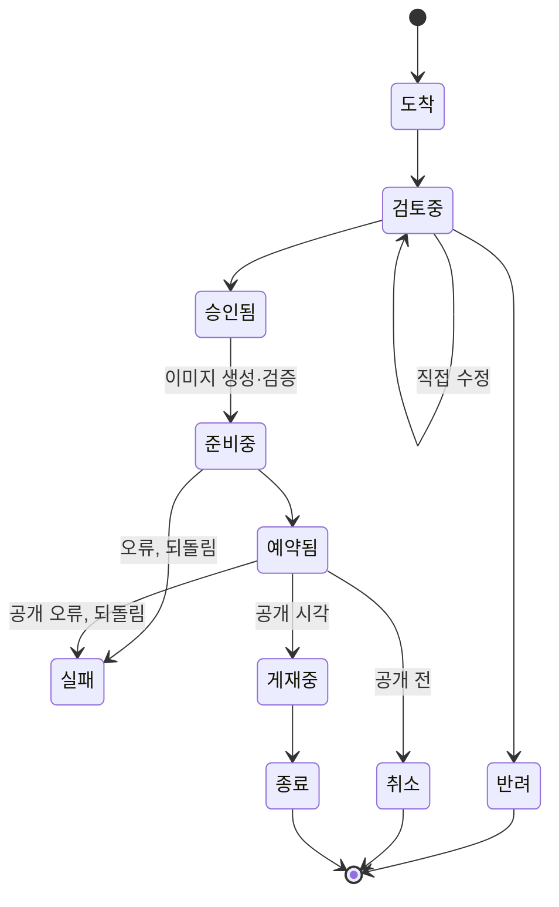

# JAM! 운영툴 PRD

> **상태: draft(2026-09-30 신설, 티켓 [20260930_1452](../../../tickets/p2-normal/20260930_1452_Admin_문서-체계-재작성-운영툴-PRD부터.md)).**
> 아직 만들지 않은 기능의 스펙이다. 현재 사실의 근거로 쓰지 않는다(절 머리에 「구현됨」 표지가 붙은 곳은 예외다). 구현 티켓이 끝날 때마다
> 해당 절을 사실로 바꾸고(§13), 모두 끝나면 `active`로 올린다.
>
> 설계 정본은 `jam-doc/planning/business-plan/07 JAM! 라이브 운영 블루프린트.md`(이하 07)이고, 이 문서는 07의 3.5와 4절을 07 절 순서대로
> 옮긴 스펙이다. 둘이 어긋나면 사용자 승인을 받아 07을 먼저 고친다(상위 티켓
> [20260930_1450](../../../tickets/p2-normal/20260930_1450_Feature_라이브-운영-체계-구현-07-블루프린트-상위.md) 진행 규칙 5).
> 상위 티켓이 닫히면 이 문서가 운영툴 동작의 정본이 된다. 결정의 경과와 근거는 07과 06 플랜에 있다.

## 1. 한 줄 정의

에이전트가 정기 루틴으로 제출한 한 주치 운영 묶음을, 사용자가 AI를 쓰지 않는 어드민 화면에서 보고 직접 고치거나 승인하면, 툴이 필요한
이미지를 만들고 자원을 예약 공개하며 모든 결정을 기록하고 슬랙에 이력을 알리는 도구.

## 2. 범위와 다른 문서의 관계

| 구분 | 이 문서에 담는 것 | 다른 문서가 맡는 것 |
|---|---|---|
| 형식 | 운영 묶음과 항목의 형식(§3) | 자원별 등록 필드: 각 자원의 PRD와 등록 형식 |
| 화면 | 화면 S1~S7의 역할과 구성(§6) | 화면 세부 설계: 채원(07 4.1). 1501·1502·1503이 이 문서의 해당 절에 채운다 |
| 데이터 | 개념 데이터(§10) | 실제 테이블 설계: 1455의 마이그레이션과 `docs/specs/prd/02_DATA_MODEL.md` |
| 기획 층 | 툴이 받는 쪽(제출 API, §11) | 주간·월간 루틴, 가드레일, 에이전트 정의: 07 3.2·3.3·3.6, 티켓 1504 |
| 기존 대시보드 | S1·S4가 가져올 것(§6) | 지금 대시보드의 동작: `docs/specs/prd/admin-ui/ADMIN_PRD.md` §5-7. 넓히는 개정은 1502 |

**전환 전 운영.** 이 툴로 바꾸기 전까지(티켓 1504) 화요일 주간 루틴과 목요일 카드 등록은 `docs/specs/prd/content-automation/PRD.md`의 절차대로
돈다. 그 문서의 해당 절에는 「전환 전까지 현재 절차」 표지를 붙였다.

## 3. 운영 묶음 (07 3.5)

- 한 주에 한 묶음을 낸다. 지금 배지·미션·홈피드 카드에 쓰는 등록 묶음(`bundle.json`) 형식을 넓힌다.
- **묶음:** 대상 주차, 검증하려는 가설, 항목 목록, 제출 에이전트, 루틴 실행 기록.
- **항목 공통:** 종류(홈피드 카드·미션·드랍 일정·레시피·JAM! 배지·컬렉션 런칭·패턴 제안), 패턴 번호와 손잡이 값, 공개·종료 시각, 대상
  세그먼트, 문안, 색, 연결(이 카드가 여는 미션 등), 세계관 검수 결과, 밸런스 판정, 「유저가 겪는 것」 쉬운 한 문장(§4).
- **항목 종류별 필드:** 각 자원의 등록 형식을 따른다.
- 형식에 맞지 않는 묶음은 받되 「형식 오류」 신호를 띄운다(§5).

### 3.1 제출 형식 (구현됨: 티켓 [20260930_1816](../../../tickets/p2-normal/20260930_1816_Admin_운영툴-골격-1-기획이-들어온다.md))

요청 본문은 JSON 한 벌이다. 기존 등록 묶음(`bundle.json`)의 `bundle_id`·`author`·`created_at`·`color_rationale_link`를 그대로 쓰고
`week`·`hypothesis`·`routine_run`·`is_sample`·`items[]`를 더했다. 검증 코드는 `jam-web/src/lib/admin/opsInbox/validate.ts`다.

**받을 수 없는 본문(400):** 본문이 JSON이 아니거나 최상위가 객체가 아님, `bundle_id`·`author`가 없거나 비어 있음, `bundle_id`가 200자·`author`가
100자를 넘음, `is_sample`이 있는데 `true`/`false`가 아님, `items`가 배열이 아님, `items`가 60개를 넘음, 본문이 1MB를 넘음(§11.1).
신원(`bundle_id`·`author`)과 시험 여부는 저장한 뒤 바로잡을 수 없어 받지 않는다(티켓 20260930_2100).
**저장하고 돌려주는 형식 오류:** 아래 표의 「검사」 열이 있는 필드가 틀린 경우다. 「경로: 사유」 해요체 문장(`items[2].kind: …`)으로 모아서 응답
`format_errors`에 담고, 묶음과 해당 항목의 `format_errors`에도 저장한다. 오류가 있어도 받고, 승인을 막지 않는다(§5).

| 위치 | 필드 | 검사 |
|---|---|---|
| 묶음 | `bundle_id`(필수) | 비어 있지 않은 문자열이고 유일하다. 앞뒤 공백은 저장할 때 뗀다 |
| 묶음 | `author`(필수) | 비어 있지 않은 문자열. 제출자가 적는 이름이라 권한 판단에 쓰지 않고 기록에만 남긴다 |
| 묶음 | `items`(필수) | 배열, 최대 60개(빈 배열 가능) |
| 묶음 | `week` | `YYYY-Www`(주 01~53). 예: `2026-W41`. 없어도 오류가 아니다 |
| 묶음 | `is_sample` | `true`/`false`(다른 값이면 400, 없으면 `false`). `true`면 시험 묶음이다(신호·결과·학습용 읽기에서 뺀다, 슬랙 글 앞에 「[시험]」) |
| 묶음 | `hypothesis`·`color_rationale_link`·`routine_run` | 있으면 형식만 본다(문자열·문자열·객체). `created_at`은 원본(`raw`)에만 남고 검사하지 않는다 |
| 항목 | `item_key`(필수) | 비어 있지 않은 문자열이고 묶음 안에서 겹치지 않는다(겹치면 뒤에 나온 항목이 오류) |
| 항목 | `kind`(필수) | `home_feed_card`·`mission`·`drop_schedule`·`recipe`·`jam_badge`·`collection_launch`·`pattern_proposal` 중 하나 |
| 항목 | `pattern_no` | 문자열 또는 숫자 |
| 항목 | `starts_at`·`ends_at` | 시간대가 붙은 ISO 8601(예: `2026-10-05T09:00:00+09:00`). 둘 다 있으면 `ends_at`이 더 늦어야 한다. 없어도 오류가 아니다 |
| 항목 | `user_experience`(필수) | 비어 있지 않은 문자열: 「유저가 겪는 것」 쉬운 한 문장(§4) |
| 항목 | `links` | 배열. 각 값은 같은 묶음 다른 항목의 `item_key`여야 한다(자기 자신과 없는 키는 오류) |
| 항목 | `world_review`(필수) | 객체 `{ world_related, winter_reviewed, reason }`. 셋 다 필수, 앞의 둘은 불리언, `reason`은 한 줄 문자열, `world_related`가 참이면 `winter_reviewed`도 참이어야 한다. 규칙은 홈피드 등록 묶음의 `world_review`와 같다(`registerHomeFeedBundle.mjs`, 테스트가 같은 입력으로 대조) |
| 항목 | `knobs`·`segment`·`balance_check`·`copy`·`colors`·`image_spec`·`resource` | 검사하지 않고 항목 원본(`original`)에 그대로 저장한다. 종류별 세부 검증은 승인 때 등록 전 검증(1500)이 한다 |

- 형식에 이미지 파일 경로(`image.path`)와 `seed`는 없다. 이미지는 승인 때 만들므로 `image_spec`(이미지 지시)을 받는다(§8). 이 두 키가 들어와도 거절하지 않고 검사 없이 항목 원본(`original`)에 그대로 저장한다.
- 항목 배열의 순서는 `position`(0부터)으로 저장한다.

## 4. 사용성 원칙 (07 4.1)

화면 설계는 채원이 맡는다. 아래 여섯 가지가 모든 화면의 기준이다.

| 요청 | 설계에 반영하는 방식 |
|---|---|
| 쉽고 인터랙티브하게 | 한 화면에서 보고, 고치고, 승인까지 끝낸다. 고친 내용은 미리보기에 바로 보이고, 직접 수정은 되돌릴 수 있다. 승인·반려는 되돌리지 않고 누르기 전에 확인을 받는다(사용자 결정 2026-09-30, 티켓 20260930_1455) |
| 쉬운 문장으로 | 안내·상태·경고를 모두 쉬운 문장으로 쓴다. 내부 용어는 풀어 쓰고 필요할 때만 괄호로 붙인다(예: 「매일 자동으로 뿌리는 드랍(앰비언트 드랍)」). 항목마다 「유저가 겪는 것」 한 문장을 보여 준다(§3) |
| 진행 상황을 눈으로 | 기획마다 단계 표시줄(도착 → 검토 → 준비 → 예약 → 게재 → 종료)을 두고 지금 단계를 강조한다. 상태는 색만으로 나누지 않고 아이콘과 글을 함께 쓴다. S1·S2·S4가 같은 상태 표시를 쓴다(§7) |
| 오른쪽 서랍(Drawer) | 에셋 제너레이터를 부르거나 다른 컨텐츠와 연결할 때(카드가 여는 미션 고르기, 레시피 재료 확인 등)는 오른쪽 서랍에서 한다. 서랍이 열려도 원래 화면이 그대로 보인다 |
| 캘린더와 타임라인 | 일정표를 캘린더(월·주)와 타임라인(기간 막대) 두 보기로 바꿔 가며 본다. 타임라인은 미션 기간, 드랍 일정, 컬렉션 런칭 준비(D-28부터)처럼 기간이 있는 것을 흐름으로 보여 준다 |
| 신호 | 오류, 문제, 비어 있는 컨텐츠를 S1의 신호 영역에 모으고, S4와 S3에서도 그 자리에 표시한다(§5) |

## 5. 신호 (07 4.2)

신호는 모두 규칙으로 계산한다(AI 없음). 지금 어드민 대시보드의 신호·컨텐츠 공백 카드를 넓힌다. 「중단」 신호는 슬랙 `#jam-alert`에도 알린다.
신호는 승인을 막지 않는다. 막는 것은 §12의 안전장치뿐이다.

| 신호 | 언제 뜨나 | 수준 |
|---|---|---|
| 실행 실패 | 이미지 생성·등록·공개 중 오류가 나서 되돌렸다 | 중단 |
| 예약 누락 | 공개 시각이 지났는데 공개되지 않았다 | 중단 |
| 루틴 실패 | 주간·월간 루틴이 기획안을 내지 못했다 | 중단 |
| 형식 오류 | 제출된 기획안이 형식에 맞지 않는다 | 주의 |
| 비어 있는 컨텐츠 | 「색 대기」 카드, 문안이나 이미지가 빈 항목, 게재 카드가 3장보다 적거나 5장보다 많은 날, 전원 대상 카드가 없는 날, 이미지가 없는 모양으로 편성된 대표 카드 | 주의 |
| 새 컨텐츠가 없는 날 | 그날 새로 게재를 시작하는 홈피드 카드가 한 장도 없다 | 주의 |
| 승인 마감 임박 | 공개 시각이 다가오는데 아직 승인되지 않았다 | 주의 |
| 밸런스 경고 | 밸런스 규칙(S7)을 넘는 항목이 있다 | 주의 |
| 에이전트가 뺀 항목 | 세계관 검수나 밸런스 점검에서 「중단」이 나와 묶음에서 빠졌다(사유 표시) | 참고 |
| 겹침 | 같은 날 같은 패턴이나 트라이브가 겹치거나, 그날의 구성이 치우쳤다: 이미지가 있는 모양의 카드가 3장 이상, 이미지가 없는 카드가 0장, 신규 유저에게 보이는 운영 카드가 3장보다 많다(수치는 초기값, 사용자 결정 2026-09-30, 티켓 20260930_1453) | 참고 |
| 단조로운 흐름 | 최근 7일의 대표 카드에서 같은 패턴이나 트라이브가 3번 이상 나오거나, 같은 모양이 3일 연속 대표다 | 참고 |
| 획득 경로가 막힌 컬렉션 | 기간 한정 운영이 끝나 얻을 길이 없는 아이템이 있다(06 6.3) | 참고 |
| 행동 횟수 급증 | JAM! 배지의 행동 횟수 지표가 평소보다 크게 늘었다. 해석은 카즈하가 브리핑에서 한다 | 참고 |

### 5.1 홈피드 신호의 목표와 이유

홈피드의 목표는 카드가 한 장이라도 있는 것이 아니라 **매일 새 컨텐츠가 올라오고 단조롭지 않은 것**이다(사용자 결정, 2026-09-30).
대표 카드는 요일마다 편성하는 전원 대상 1픽 카드다.

| 신호 | 이유 |
|---|---|
| 새 컨텐츠가 없는 날 | 어제와 같은 홈을 보면 앱을 열 이유가 줄어든다. 매일 한 장 이상 새로 올라와야 한다 |
| 겹침 | 큰 카드가 같은 높이로 줄지어 서면 하루 홈이 단조롭다. 큰 카드 사이에 작은 카드가 끼고, 신규 유저의 홈이 운영 카드로 가득 차지 않아야 한다. 「신규 유저」의 기준은 1502에서 정한다 |
| 단조로운 흐름 | 한 주 내내 같은 트라이브나 같은 방식의 카드가 대표로 나오거나, 맨 위 대표 카드가 며칠째 같은 모양이면 홈이 단순해 보인다. 07 「겹침」은 같은 날만 보므로 여러 날에 걸친 반복은 이 신호가 본다 |
| 전원 대상 카드가 없는 날 | 빈 홈을 막는 최소 조건이다. 유저 상태에 따라 나오는 카드만 있는 날은 조건에 맞지 않는 유저의 홈이 비고, 날씨·특일 값이 저장되지 않으면 모두의 홈이 빈다. 2026-09-28~10-04 편성에서 10/1과 10/3이 이 위험이었다(티켓 [20260924_0809](../../../tickets/p2-normal/20260924_0809_Feature_매일-전원에게-카드-1장-이상-보장하는-편성-규칙.md)) |

- 「새 컨텐츠가 없는 날」과 「단조로운 흐름」의 수치(0장, 7일 중 3번, 3일 연속)는 초기값이다. 운영하며 조정하고, 조정할 수 있는 위치(S7 등)는 1502에서 정한다.
- 「전원 카드는 큰 카드(`large_thumbnail`)여야 한다」는 요건은 새 형식에서 **「대표 카드는 이미지가 있는 모양 가운데 하나이고, 같은 모양이 연달아
  대표가 되지 않는다」** 로 바꿨다(사용자 결정, 2026-09-30, 티켓 20260930_1453). 미션 소개 카드의 「항상 큰 카드」 규칙도 「이미지가 있는 모양」으로
  완화한다. 옛 요건의 출처는 0809가 아니라 티켓 20260926_1542(사용자 요청 「요일마다 큰 카드 1개 이상」을 전원 카드에 건다고 해석해 반영)와
  content-automation PRD §8 「요일별 큰 카드 규칙」이다. 1504 전환 전까지는 그 절차가 현재 절차로 돈다.
- 이미지가 필요한 모양(`hero`·`poster`·`square`)의 항목에 이미지가 없으면 「이미지 제작 필요」로 표시만 한다. 승인을 막거나 카드 모양을 바꾸지 않는다
  (사용자 결정, 2026-09-30, 티켓 20260930_1453). 카드 모양의 정의는 1453 「확정 설계」에 있고, 구현 뒤 홈피드 PRD로 옮긴다.
- 전환 전 등록 뒤 점검(전원 카드가 없는 날을 찾는 SQL)은 content-automation PRD §8-2에 현재 절차로 남아 있다. 전환 뒤에는 같은 조건을 이 신호가
  승인 전에 보여 준다.

## 6. 화면 (07 4.3)

| # | 화면 | 하는 일 | 지금 있는 것에서 가져올 것 |
|---|---|---|---|
| S1 | 운영 홈 | 이번 주 상태(승인 대기·예약됨·게재 중·실패 수)를 단계 표시로 보여 주고, 신호 영역(§5)과 최근 이력을 둔다 | 어드민 대시보드의 신호·컨텐츠 공백·경제 추이 |
| S2 | 받은 기획함 | 에이전트·루틴별 기획안 목록과 상태 | — |
| S3 | 기획 상세(단계 진행) | 한 화면에 단계 표시줄, 미리보기, 항목 편집, 검수·판정·신호, 다음 단계 버튼을 둔다. 에셋 제너레이터와 컨텐츠 연결은 오른쪽 서랍에서 한다. 한 주 묶음을 한 번에 승인하고 예외만 고친다 | 홈피드 카드 미리보기(`TodayPreviewModal`) |
| S4 | 일정표 | 캘린더(월·주)와 타임라인 두 보기. 모든 자원을 올리고 종류·트라이브·패턴으로 거른다. 칸마다 상태와 신호를 표시하고, 누르면 오른쪽 서랍에서 그 기획을 연다 | 어드민 대시보드의 주간 캘린더 |
| S5 | 패턴 사전 | 패턴 목록, 손잡이, 샘플, 취향 신호, 사용 이력, 결과, 패턴 제안 승인(§10.1) | — |
| S6 | 결과와 기록 | 패턴별 결과, 결정 기록, 컬렉션별 아이템 획득 경로(06 6.3) | — |
| S7 | 설정 | 밸런스 규칙 값, 슬랙 알림 대상, 제출 토큰 상태 | — |

S3는 세 구역과 서랍으로 나눈다. 위에는 단계 표시줄과 현재 단계의 다음 버튼이 있다. 왼쪽에는 실제 홈 순서대로 본 세로 미리보기가 있고,
가운데에는 항목 목록과 선택한 항목의 편집·검수·판정·신호가 있다. 이미지를 만들거나 다른 컨텐츠와 연결할 때는 오른쪽 서랍이 열린다. 한 주에
카드만 21~35장이 오므로(06 12.3), 묶음 단위로 한 번에 승인하는 흐름이 기본이다.

화면별 세부(구성 요소, 빈 상태, 오류 문구)는 채원의 설계를 거쳐 담당 티켓이 이 절 아래에 채운다. S2·S3은 1455, S1·S4는 1502, 서랍과 미리보기는
1501, S5·S6은 1503, S7의 밸런스 규칙은 1459다.

## 7. 기획의 상태 (07 4.4)

- 묶음 안의 항목은 각자 상태를 갖는다. 묶음의 상태는 항목들의 상태로 정해진다. 계산 규칙은 1455에서 정해 이 절에 적는다.
- 연결된 항목(카드와 그 카드가 여는 미션)은 함께 공개하고 함께 되돌린다. 독립된 항목은 따로 되돌린다.

### 7.1 단계 표시줄과 상태의 대응

§4의 단계 표시줄은 6단계이고 상태는 10개다. 07에 대응이 적혀 있지 않아 아래처럼 해석한다(07을 바꾸는 것이 아니라 밝히는 것이다).

| 표시줄 단계 | 상태 |
|---|---|
| 도착 | 도착 |
| 검토 | 검토중 |
| 준비 | 승인됨, 준비중 |
| 예약 | 예약됨 |
| 게재 | 게재중 |
| 종료 | 종료 |
| 표시줄 밖 | 반려, 취소, 실패. 마지막으로 도달한 단계와 함께 아이콘과 글로 표시한다. 표시 방식은 채원이 정한다 |

## 8. 승인하면 일어나는 일 (07 4.5)

1. 이미지가 필요한 항목은 에셋 제너레이터가 기획안의 색·문안·프리셋으로 실제 이미지를 만든다(06 12.4의 3). 승인 전 미리보기는 저장하지 않는 렌더다.
2. 등록 전 검증(참조 ID 존재·중복)을 한다. 지금 등록 스크립트의 `--dry-run`이 하는 검사와 같다.
3. 자원을 예약 공개 상태로 만든다. 공개 시각 전에는 유저에게 보이지 않는다.
4. 결정 기록을 남기고 슬랙에 이력을 알린다(§9).

자원별 생성·예약 공개·취소·되돌림은 1500이 맡는다. 드랍 일정은 O6(1457), 레시피는 O16(1458), JAM! 배지는 O5(1456)가 먼저 있어야 한다.

## 9. 슬랙 이력 알림 (07 4.6)

> 구현됨: 도착 알림(티켓 20260930_1816). 나머지 이벤트는 아래 표의 「구현」 열을 따른다.

| 이벤트 | 채널 | 담당 티켓 | 구현 |
|---|---|---|---|
| 기획안 도착(에이전트, 주차, 항목 수, 형식 오류 수. 시험 묶음이면 앞에 「[시험]」) | `#jam-report` | 20260930_1816 | 구현됨 |
| 승인·반려·직접 수정 | `#jam-report` | 20260930_1818 | 없음 |
| 예약 등록, 공개, 종료 | `#jam-report` | 20260930_1500 | 없음 |
| 실패와 되돌림 | `#jam-alert` | 20260930_1500 | 없음 |
| 루틴 실행 결과 | 성공은 `#jam-report`, 실패는 `#jam-alert` | 20260930_1504 | 없음 |

- 슬랙은 알림만 한다. 버튼과 댓글 처리는 두지 않는다(06 11.7의 2). 지금 절차의 「슬랙 글에 '등록'이라고 답하는 승인」은 이 툴의 승인으로 바뀐다.
- 툴 서버가 슬랙에 게시하는 코드는 `jam-web/src/lib/admin/opsInbox/slack.ts`다. Vercel 환경변수 `SLACK_BOT_TOKEN`, `SLACK_CHANNEL_JAM_REPORT`,
  `SLACK_CHANNEL_JAM_ALERT`를 읽는다(표는 `docs/specs/prd/04_PROJECT_SPEC.md` 환경변수). 값이 없으면 게시를 건너뛰고 결정 기록에 `not_configured`를 남긴다.
- 게시는 DB에 저장한 **뒤에** 응답이 나간 다음(`after`) 한다. 게시가 실패해도(환경변수 없음, 네트워크 오류, 슬랙이 `ok: false`로 답함) 제출은
  성공이고, 결과는 결정 기록의 `slack_result`(`{ channel, ok, error? }`)에 남고 서버 로그에도 남는다. 자동 재시도와 「다시 보내기」 버튼은 두지 않는다.
- 제출 문자열(에이전트 이름 등)은 슬랙 특수문자(`&`·`<`·`>`)를 이스케이프해서 넣고, 길이는 60자로 자른다.
- 채널 ID의 단일 원천은 `.claude/skills/jam-work/references/scheduled-jobs.md`의 「Slack 알림」 절이다.

## 10. 데이터 (07 4.7)

> 구현됨: 받은 기획함 테이블 3개(티켓 20260930_1816, 마이그레이션 198, 2026-09-30 적용). 패턴 사전·밸런스 규칙 테이블은 없다.

| 데이터 | 내용 |
|---|---|
| 운영 묶음 | 주차, 가설, 제출 에이전트, 제출 원본, 시험 표시, 형식 오류. 상태는 저장하지 않고 항목 상태에서 계산한다(§7) |
| 묶음 항목 | 종류, 패턴 번호, 손잡이 값, 제출 원본, 수정본, 상태, 승인 뒤 만들어진 자원의 ID |
| 결정 기록 | 누가, 언제, 무엇을(제출·승인·반려·수정·취소), 수정 전후 차이, 사유, 슬랙 알림 결과 |
| 패턴 사전 | 패턴 이름, 작동 원리, 손잡이, 샘플, 주의점, 취향 신호, 상태 |
| 밸런스 규칙 | 규칙 이름, 값, 경고 수준 |

- 기존 자원(홈피드 카드·미션·레시피·드랍·배지)의 구조는 그대로 두고, 묶음 항목이 만들어진 자원을 가리킨다.
- **받은 기획함 테이블 3개**(운영 묶음 `ops_bundles`, 묶음 항목 `ops_bundle_items`, 결정 기록 `ops_decisions`)는
  `jam-web/supabase/migrations/198_ops_inbox.sql`이다(티켓 20260930_1816). 컬럼은 `docs/specs/prd/02_DATA_MODEL.md` §12가 단일 원천이다.
  RLS는 켜고 정책은 만들지 않는다(서비스 롤 전용). 항목의 제출 원본(`original`)은 바꾸지 않고, 수정본(`edited`)과 만들어진 자원 ID(`created_resource`)는
  뒤 티켓(1818·1500)이 채운다. 결정 기록은 추가만 한다. 제출은 묶음 하나에 결정 기록 `submit` 1행을 남기고, 행위자는 토큰 제출이면
  `token:<author>`, 관리자 로그인이면 관리자 ID다.
- 패턴 사전·밸런스 규칙 테이블은 1503·1459에서 설계한다. DB 변경은 마이그레이션 파일로 남기고 사용자 승인 뒤에 실행한다.

### 10.1 운영 패턴 사전의 원천과 문서 표기

- **원천은 툴(DB)이다**(06 11.7의 4). 에이전트는 툴의 읽기 API로 패턴을 가져오고(§11), 사용자는 S5에서 패턴과 패턴 제안을 승인한다.
- **이 문서에는 구조와 규칙만 둔다.** 패턴 한 건의 항목은 위 표의 「패턴 사전」 행이다. 패턴 본문(이름·원리·손잡이·샘플)은 여기에 적지 않는다.
- **툴이 생기기 전 원고:** 첫 패턴 15~20개(티켓 1454)는 `jam-doc/planning/content/`에 원고 문서로 쓰고 사용자 승인을 받는다. 툴에 입력한 뒤에는
  그 문서의 머리말을 `source_of_truth: db`와 입력일 `snapshot`으로 바꿔 「원천은 툴, 이 문서는 입력일 기준 사본」임을 밝힌다(사용자 결정,
  2026-09-30). 레시피 문서와 같은 방식이다.
- 패턴 상태와 제안 승인 흐름의 세부는 1503에서 정해 이 절에 적는다.

## 11. API (07 4.8)

| API | 방향 | 인증 |
|---|---|---|
| 기획안 제출 | 에이전트 → 툴 | 기존 자동화 토큰. 07 4.8대로 이 경로 하나에만 쓰기를 여는 예외를 만든다 |
| 패턴 사전·조합 뽑기·결정 기록·결과 읽기 | 에이전트 → 툴 | 기존 자동화 토큰(읽기) |
| 승인·수정·취소·실행 | 사용자 → 툴 | 관리자 로그인 |

제출 경로와 요청·응답은 §11.1이다(티켓 20260930_1816). 읽기 API의 경로와 형식은 1503에서 정해 이 절에 적는다.

### 11.1 기획안 제출 `POST /api/admin/ops-inbox` (구현됨: 티켓 20260930_1816)

**인증.** 둘 중 하나다.

1. **읽기 토큰:** 헤더 `x-admin-read-token`이 환경변수 `ADMIN_API_READ_TOKEN`과 같고, 메서드가 `POST`이고, 경로가 `/api/admin/ops-inbox`와 **정확히
   같을 때**(뒤에 `/`나 다른 글자가 붙으면 안 된다) 통과한다. 토큰의 쓰기가 열리는 유일한 곳이다. 경로와 메서드는 상수 하나
   (`jam-web/src/lib/admin/opsInbox/constants.ts`)를 `proxy.ts`와 라우트가 같은 판정 함수(`isOpsInboxTokenRequest`)로 쓴다. 토큰으로 이 경로 밖의
   어드민 경로에 POST·PUT·PATCH·DELETE를 보내면 모두 거부된다(proxy가 로그인으로 리다이렉트한다. 라우트에 닿아도 `requireAdminRead`는 GET만 통과시키고,
   토큰 쓰기 검사를 부르는 라우트가 제출 라우트 하나뿐임을 계약 테스트가 확인한다).
   토큰을 가진 루틴은 어느 것이든 제출할 수 있다.
2. **관리자 로그인 세션.** 그 밖의 요청은 관리자 세션을 확인한다(`requireOpsInboxSubmit`, `jam-web/src/lib/admin/opsInbox/auth.ts`).

**요청.** `Content-Type: application/json` 본문 한 벌. 형식은 §3.1이다.

**처리 순서와 응답.**

| 상태 | 언제 | 본문 |
|---|---|---|
| 201 | 새 묶음을 저장했다 | `{ status: 'created', id, bundle_id, item_count, format_errors }`. `format_errors`는 「경로: 사유」 문자열 배열(비어 있으면 형식 오류 없음) |
| 200 | 같은 `bundle_id`가 이미 있고 내용이 같다(키 순서만 달라도 같다) | `{ status: 'duplicate', message: '이미 받았어요.', id, bundle_id, item_count, format_errors }`. 저장도 슬랙 알림도 다시 하지 않는다 |
| 400 | 본문이 1MB를 넘음(글자 수가 아니라 바이트), JSON이 아님, 필수 형식이 맞지 않음(§3.1) | `{ error }`. 필수 형식이면 `details`에 사유 목록 |
| 307 | 쿠키 없는 요청(에이전트가 보내는 형태)이 토큰 없이, 또는 틀린 토큰으로 왔다. `proxy.ts`가 라우트에 닿기 전에 `/login`(`STAGING_MODE`면 `/api/dev-login`)으로 리다이렉트한다 | 없음. 루틴은 3xx 응답을 인증 실패로 다룬다 |
| 403 | 로그인은 했지만 관리자가 아닌 세션이다 | `{ error }` |
| 409 | 같은 `bundle_id`가 이미 있는데 내용이 다르다 | `{ error, id, bundle_id }`. 기존 묶음을 덮어쓰지 않는다. 고친 내용은 새 `bundle_id`로 보낸다 |
| 429 | 최근 1시간에 받은 묶음이 20건 이상이다 | `{ error }` |
| 500 | 저장하지 못했다 | `{ error }`. 묶음을 넣은 뒤 항목이나 결정 기록 저장이 실패하면 넣은 묶음을 지워 되돌린다 |

- 순서: 인증 → 본문 크기 → JSON → 필수 형식(400) → 시간당 한도(429) → 같은 `bundle_id` 확인(200·409) → 묶음 → 항목 → 결정 기록 저장 → 응답 →
  응답 뒤 슬랙 도착 글(§9).
- 초기 상한은 본문 1MB, 항목 60개, 시간당 20건이다(카드 21~35장 기준 추정값, 상수는 `constants.ts`). 시간당 제출 수는 서버 인스턴스별 메모리가
  아니라 DB(`ops_bundles.received_at`)로 센다.
- 같은 주차에 묶음이 둘 이상 있어도 받는다. 동시 제출은 `bundle_id` 유일 제약으로 막고, 진 쪽은 위 200·409 규칙으로 처리한다.
- 항목은 모두 `arrived`(도착) 상태로 저장한다. 도착 → 검토중 전환은 1817·1818이 한다.

## 12. 안전장치 (07 4.9)

- 제출 토큰으로는 받은 기획함에만 쓸 수 있다. 토큰이 새더라도 승인 없이는 아무것도 실행되지 않는다.
- 승인과 실행은 관리자 로그인으로만 한다.
- 같은 묶음을 두 번 실행하지 않는다.
- 공개 시각 전에는 취소할 수 있다. 공개된 뒤에는 종료로 내린다. 유저가 이미 주운 배지는 회수할 수 없다(티켓 20260929_2226 확인 사항).

## 13. 구현 현황

담당 티켓은 상위 티켓 20260930_1450의 하위 티켓 표를 따르고, 끝나면 이 표의 상태와 해당 절을 사실로 바꾼다. 「없음」이 아닌 행에서
사실로 바뀐 절에는 머리에 「구현됨」 표지가 있다.

| 07 인벤토리 | 이 문서의 절 | 담당 티켓 | 상태 |
|---|---|---|---|
| A 운영툴 골격 | §3, §7, §9, §10(묶음·항목·결정 기록), §11(제출), S2·S3 | 20260930_1455(하위 1816·1817·1818) | 일부: 1816 구현(§3.1 제출 형식, §9 도착 알림, §10 테이블 3개, §11.1 제출 API. 마이그레이션 198은 2026-09-30 적용, 슬랙 환경변수 등록 전). §7 상태 계산, S2·S3, 승인·반려·수정 알림은 없음 |
| B 운영 홈·일정표·신호 | §5, S1·S4 | 20260930_1502 | 없음 |
| C 자원 연결 | §8 | 20260930_1500 | 없음 |
| D 미리보기·이미지 | §8의 1, 서랍, S3 미리보기 | 20260930_1501 | 없음 |
| E 패턴 사전·학습 | §10.1, §11(읽기), S5·S6 | 20260930_1503 | 없음 |
| H 밸런스 규칙 | S7, 「밸런스 경고」 신호 | 20260930_1459 | 없음 |
