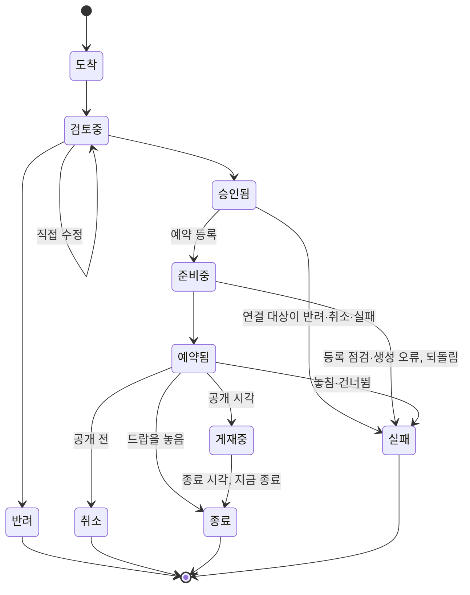

# JAM! 운영툴 PRD

> **상태: draft(2026-09-30 신설, 티켓 [20260930_1452](../../../tickets/p2-normal/20260930_1452_Admin_문서-체계-재작성-운영툴-PRD부터.md)).**
> 아직 만들지 않은 기능의 스펙이다. 현재 사실의 근거로 쓰지 않는다(절 머리에 「구현됨」 표지가 붙은 곳은 예외다). 구현 티켓이 끝날 때마다
> 해당 절을 사실로 바꾸고(§13), 모두 끝나면 `active`로 올린다.
>
> 설계 정본은 `jam-doc/planning/business-plan/07 JAM! 라이브 운영 블루프린트.md`(이하 07)이고, 이 문서는 07의 3.5와 4절을 07 절 순서대로
> 옮긴 스펙이다. 둘이 어긋나면 사용자 승인을 받아 07을 먼저 고친다(상위 티켓
> [20260930_1450](../../../tickets/p2-normal/20260930_1450_Feature_라이브-운영-체계-구현-07-블루프린트-상위.md) 진행 규칙 5).
> 상위 티켓이 닫히면 이 문서가 운영툴 동작의 정본이 된다. 결정의 경과와 근거는 07과 06 플랜에 있다.

## 1. 한 줄 정의

에이전트가 정기 루틴으로 제출한 한 주치 운영 묶음을, 사용자가 AI를 쓰지 않는 어드민 화면에서 보고 직접 고치거나 승인하면, 툴이 필요한
이미지를 만들고 자원을 예약 공개하며 모든 결정을 기록하고 슬랙에 이력을 알리는 도구.

## 2. 범위와 다른 문서의 관계

| 구분 | 이 문서에 담는 것 | 다른 문서가 맡는 것 |
|---|---|---|
| 형식 | 운영 묶음과 항목의 형식(§3) | 자원별 등록 필드: 각 자원의 PRD와 등록 형식 |
| 화면 | 화면 S1~S7의 역할과 구성(§6) | 화면 세부 설계: 채원(07 4.1). 1501·1502·1503이 이 문서의 해당 절에 채운다 |
| 데이터 | 개념 데이터(§10) | 실제 테이블 설계: 1455의 마이그레이션과 `docs/specs/prd/02_DATA_MODEL.md` |
| 기획 층 | 툴이 받는 쪽(제출 API, §11) | 주간·월간 루틴, 가드레일, 에이전트 정의: 07 3.2·3.3·3.6, 티켓 1504 |
| 운영 홈의 기존 구역·일정표 | S1·S4가 가져온 것(§6) | 서비스 점검·주간 핵심 지표·경제 추이·통계의 동작은 `docs/specs/prd/admin-ui/ADMIN_PRD.md` §5-7, 일정표(주간 캘린더가 옮겨 온 것)의 출처별 동작은 같은 문서 §5-8 |

**전환 전 운영.** 이 툴로 바꾸기 전까지(티켓 1504) 화요일 주간 루틴과 목요일 카드 등록은 `docs/specs/prd/content-automation/PRD.md`의 절차대로
돈다. 그 문서의 해당 절에는 「전환 전까지 현재 절차」 표지를 붙였다.

## 3. 운영 묶음 (07 3.5)

- 한 주에 한 묶음을 낸다. 지금 배지·미션·홈피드 카드에 쓰는 등록 묶음(`bundle.json`) 형식을 넓힌다.
- **묶음:** 대상 주차, 검증하려는 가설, 항목 목록, 제출 에이전트, 루틴 실행 기록.
- **항목 공통:** 종류(홈피드 카드·미션·드랍 일정·레시피·JAM! 배지·컬렉션 런칭·패턴 제안), 패턴 번호와 손잡이 값, 공개·종료 시각, 대상
  세그먼트, 문안, 색, 연결(이 카드가 여는 미션 등), 세계관 검수 결과, 밸런스 판정, 「유저가 겪는 것」 쉬운 한 문장(§4).
- **항목 종류별 필드:** 각 자원의 등록 형식을 따른다.
- 형식에 맞지 않는 묶음은 받되 「형식 오류」 신호를 띄운다(§5).

### 3.1 제출 형식 (구현됨: 티켓 [20260930_1816](../../../tickets/p2-normal/20260930_1816_Admin_운영툴-골격-1-기획이-들어온다.md))

요청 본문은 JSON 한 벌이다. 기존 등록 묶음(`bundle.json`)의 `bundle_id`·`author`·`created_at`·`color_rationale_link`를 그대로 쓰고
`week`·`hypothesis`·`routine_run`·`is_sample`·`items[]`를 더했다. 검증 코드는 `jam-web/src/lib/admin/opsInbox/validate.ts`다.

**받을 수 없는 본문(400):** 본문이 JSON이 아니거나 최상위가 객체가 아님, `bundle_id`·`author`가 없거나 비어 있음, `bundle_id`가 200자·`author`가
100자를 넘음, `is_sample`이 있는데 `true`/`false`가 아님, `items`가 배열이 아님, `items`가 60개를 넘음, 본문이 1MB를 넘음(§11.1).
신원(`bundle_id`·`author`)과 시험 여부는 저장한 뒤 바로잡을 수 없어 받지 않는다(티켓 20260930_2100).
**저장하고 돌려주는 형식 오류:** 아래 표의 「검사」 열이 있는 필드가 틀린 경우다. 「경로: 사유」 해요체 문장(`items[2].kind: …`)으로 모아서 응답
`format_errors`에 담고, 묶음과 해당 항목의 `format_errors`에도 저장한다. 오류가 있어도 받고, 승인을 막지 않는다(§5).

| 위치 | 필드 | 검사 |
|---|---|---|
| 묶음 | `bundle_id`(필수) | 비어 있지 않은 문자열이고 유일하다. 앞뒤 공백은 저장할 때 뗀다 |
| 묶음 | `author`(필수) | 비어 있지 않은 문자열. 제출자가 적는 이름이라 권한 판단에 쓰지 않고 기록에만 남긴다 |
| 묶음 | `items`(필수) | 배열, 최대 60개(빈 배열 가능) |
| 묶음 | `week` | `YYYY-Www`(주 01~53). 예: `2026-W41`. 없어도 오류가 아니다 |
| 묶음 | `is_sample` | `true`/`false`(다른 값이면 400, 없으면 `false`). `true`면 시험 묶음이다(신호·결과·학습용 읽기에서 뺀다, 슬랙 글 앞에 「[시험]」) |
| 묶음 | `hypothesis`·`color_rationale_link`·`routine_run` | 있으면 형식만 본다(문자열·문자열·객체). `created_at`은 원본(`raw`)에만 남고 검사하지 않는다 |
| 항목 | `item_key`(필수) | 비어 있지 않은 문자열이고 묶음 안에서 겹치지 않는다(겹치면 뒤에 나온 항목이 오류) |
| 항목 | `kind`(필수) | `home_feed_card`·`mission`·`drop_schedule`·`recipe`·`jam_badge`·`collection_launch`·`pattern_proposal` 중 하나 |
| 항목 | `pattern_no` | 문자열 또는 숫자 |
| 항목 | `starts_at`·`ends_at` | 시간대가 붙은 ISO 8601(예: `2026-10-05T09:00:00+09:00`). 둘 다 있으면 `ends_at`이 더 늦어야 한다. 없어도 오류가 아니다 |
| 항목 | `user_experience`(필수) | 비어 있지 않은 문자열: 「유저가 겪는 것」 쉬운 한 문장(§4) |
| 항목 | `links` | 배열. 각 값은 같은 묶음 다른 항목의 `item_key`여야 한다(자기 자신과 없는 키는 오류) |
| 항목 | `world_review`(필수) | 객체 `{ world_related, winter_reviewed, reason }`. 셋 다 필수, 앞의 둘은 불리언, `reason`은 한 줄 문자열, `world_related`가 참이면 `winter_reviewed`도 참이어야 한다. 규칙은 홈피드 등록 묶음의 `world_review`와 같다(`registerHomeFeedBundle.mjs`, 테스트가 같은 입력으로 대조) |
| 항목 | `shape`·`exposure_tags`·`tribe_id`·`color_pending`, 묶음 `excluded_items` | 아래 「카드 칸과 뺀 항목」 표가 정한다 |
| 항목 | `image_spec`(선택) | 이미지 지시 칸. 객체이고 `preset_id`·`bg`·`end`는 비어 있지 않은 문자열, `values`는 문자열 값을 가진 객체이며 넷 모두 선택이다. 이미지 칸이 있는 종류(`home_feed_card`·`mission`·`jam_badge`·`collection_launch`)에서 비어 있거나 `preset_id`가 없으면, 또는 값이 있는데 모양이 틀리면 **경고만** 낸다. 오류로 만들지 않고 제출은 그대로 받으며, 경고는 제출 응답의 `warnings`에만 싣고 DB에는 저장하지 않는다(`image_spec`은 항목 원본에 그대로 저장한다). 규칙은 `lib/admin/opsInbox/imageSpec.ts` |
| 항목 | `knobs`·`segment`·`balance_check`·`copy`·`colors`·`resource` | 검사하지 않고 항목 원본(`original`)에 그대로 저장한다. 종류별 세부 검증은 예약 등록 때 등록 전 검증(§8.4)이 한다. `segment`는 옛 칸이라 신호가 읽지 않는다(대상은 `exposure_tags`) |

- 형식에 이미지 파일 경로(`image.path`)와 `seed`는 없다. 이미지는 제출 뒤 운영툴이 만들므로 `image_spec`(이미지 지시)을 받는다(§8.8, 티켓 1501). 이 두 키가 들어와도 거절하지 않고 검사 없이 항목 원본(`original`)에 그대로 저장한다. `image_spec`은 위 표대로 모양만 보고 경고한다.
- 항목 배열의 순서는 `position`(0부터)으로 저장한다.

**드랍 일정(`drop_schedule`) 종류별 규칙 (구현됨: 티켓 [20261001_2051](../../../tickets/p1-high/20261001_2051_Service_앰비언트-드랍-예약-1-저장소와-실행.md)).**
제출 때의 형식 검사(`validate.ts`)는 `drop_schedule`의 `resource`를 보지 않고(위 표), 이 규칙은 예약 등록 때 등록 전 검증(§8.4)이 서버 함수로 적용한다.
검증 함수는 `jam-web/src/lib/ambient-drop/scheduleSpec.ts`의 `parseAmbientDropScheduleInput`이고, 항목의 `starts_at`을 `scheduled_at`으로 넘긴다.
- `starts_at`은 필수이고, 시간대가 붙은 ISO 8601이며, 한국 시각(KST) 정시이고, 지금보다 뒤여야 한다.
- `ends_at`이 있으면 형식 오류다. 드랍 일정은 놓은 뒤 내리지 않아 종료 시각이 없다(07 4.4·4.9).
- `resource`의 키는 6개다: `poi_ids`·`poi_category`·`badge_ids`·`collection_ids`·`per_poi_count`·`total_count`(`DROP_SCHEDULE_RESOURCE_KEYS`).
  `rarity_*` 같은 모르는 키는 무시한다. 예약에는 등급 비율을 두지 않는다.
- 지점은 하나만 고른다. `poi_ids`가 비어 있지 않으면 지점 직접 선택이다(`per_poi_count` 필수, `total_count`·`poi_category`가 있으면 오류).
  비어 있으면 지점 종류+개수다(`total_count` 필수, `poi_category`는 없으면 「전체 종류」, `per_poi_count`가 있으면 오류).
- 아이템은 하나만 고른다. `badge_ids`(아이템 직접 선택)와 `collection_ids`(컬렉션 선택) 중 정확히 하나만 비어 있지 않아야 한다.
- 개수(`per_poi_count`·`total_count`)는 1 이상의 정수다. 예약 1건이 놓는 드랍은 합계 100개까지다(지점 직접은 지점 수 × 지점당 개수). 임시값이고 넘으면 오류다.
- ID는 UUID 형식이고 중복은 하나로 합친다. `title`(이름)은 100자까지다.

**카드 칸과 뺀 항목 (구현됨: 티켓 [20261001_1152](../../../tickets/p2-normal/20261001_1152_Admin_운영-묶음-제출-형식에-모양-트라이브-대상-색대기-뺀항목-칸을-정한다.md)).**
§5의 겹침·단조로운 흐름·트라이브 거르기·「이미지 제작 필요」·「색 대기」·「에이전트가 뺀 항목」 신호가 읽는 칸이다. 형식 검사는 `validate.ts`,
칸 읽기는 `jam-web/src/lib/admin/opsInbox/fields.ts` 한 곳이다(신호와 화면은 `original`을 직접 읽지 않고 이 읽기 함수를 쓴다. 수정본이 있으면
수정본을 먼저 읽는다). 카드 모양 상수는 `jam-web/src/lib/today/shape.ts`다. 「모름」은 읽기 함수가 `'unknown'`을 돌려준다는 뜻이다.

| 위치 | 필드 | 형식 | 허용값·원천 | 필수 | 없을 때 읽는 값 | 형식이 틀릴 때 읽는 값 |
|---|---|---|---|---|---|---|
| 항목 | `shape` | 문자열 | `hero`·`poster`·`square`·`brief`·`list`(`lib/today/shape.ts`의 `CARD_SHAPES`). 이미지가 있는 모양은 `hero`·`poster`·`square` | `kind`가 `home_feed_card`면 필수. 다른 종류는 값이 있을 때만 검사 | 모름 | 모름 |
| 항목 | `exposure_tags` | 문자열 배열(1개 이상, 중복 없음) | `jam-web/src/lib/admin/today-sections.ts`의 `TODAY_EXPOSURE_TAG_OPTIONS`(전원 `all`, 신규 `new_user` 등). 오류 문장은 홈피드 등록 묶음 검사와 같다 | `home_feed_card`면 필수. 다른 종류는 값이 있을 때만 검사 | 모름 | 모름 |
| 항목 | `tribe_id` | UUID 문자열(null은 없음) | `tribes.id`. 형식 검사에 더해 제출·수정 때 `tribes` 목록에 있는지 본다 | 선택 | 없음(`null`) | 모름 |
| 항목 | `color_pending` | 불리언 | `true`면 「색 대기」 | 선택 | `false` | 모름 |
| 묶음(`raw`) | `excluded_items` | 객체 배열 | 원소마다 `reason`(필수, 비어 있지 않은 한 줄 — `world_review.reason`과 같은 규칙), `item_key`(선택, 문자열), `kind`(선택, 7종 중 하나), `stage`(선택, `world_review`·`balance_check`) | 선택 | 빈 목록(`[]`) | 모름(배열이 아니거나 원소 하나라도 틀리면 목록 전체) |

- 필수 칸이 없거나 값이 틀리면 「형식 오류」다. 받아서 저장하고 승인을 막지 않는다. `excluded_items` 오류는 묶음 오류에만 담고 어느 항목의
  `format_errors`에도 넣지 않는다.
- **옛 형식 묶음.** 칸이 없는 항목(옛 `segment`만 있는 항목)도 400 없이 받고 새 칸 오류만 붙으며 `segment`는 `original`에 그대로 남는다. 이미 저장된
  묶음(2026-10-01 DB 조회로 확인한 시험 묶음 1개·항목 3개, 실제 묶음은 없음)은 다시 검사하지 않고 읽을 때 모름으로 처리한다(모양·대상 모름, 트라이브
  없음, 색 대기 아님, 뺀 항목 없음). 그런 항목을 직접 고치면(§7.3) 새 규칙으로 다시 검사해 오류를 붙이되 저장은 막지 않는다.
- **트라이브 존재 확인.** 제출(§11.1)과 직접 수정·되돌리기(§7.3)는 `tribes` 테이블의 ID 목록을 조회해(`jam-web/src/lib/admin/opsInbox/tribes.ts`의
  `loadTribeIds`) `tribe_id`가 그 안에 있는지 본다. 같은 목록·같은 규칙이라 두 경로의 판정이 같다. 조회가 실패하면 저장하지 않고 500이다. 읽기 함수는
  형식만 보고 존재는 다시 보지 않는다.
- 07 3.6 「트라이브 연결은 필수」는 기획 층(에이전트)이 지키는 가드레일이고, 이 칸은 선택이다.

## 4. 사용성 원칙 (07 4.1)

화면 설계는 채원이 맡는다. 아래 여섯 가지가 모든 화면의 기준이다.

| 요청 | 설계에 반영하는 방식 |
|---|---|
| 쉽고 인터랙티브하게 | 한 화면에서 보고, 고치고, 승인까지 끝낸다. 고친 내용은 미리보기에 바로 보이고, 직접 수정은 되돌릴 수 있다. 승인·반려는 되돌리지 않고 누르기 전에 확인을 받는다(사용자 결정 2026-09-30, 티켓 20260930_1455) |
| 쉬운 문장으로 | 안내·상태·경고를 모두 쉬운 문장으로 쓴다. 내부 용어는 풀어 쓰고 필요할 때만 괄호로 붙인다(예: 「매일 자동으로 뿌리는 드랍(앰비언트 드랍)」). 항목마다 「유저가 겪는 것」 한 문장을 보여 준다(§3) |
| 진행 상황을 눈으로 | 기획마다 단계 표시줄(도착 → 검토 → 준비 → 예약 → 게재 → 종료)을 두고 지금 단계를 강조한다. 상태는 색만으로 나누지 않고 아이콘과 글을 함께 쓴다. S1·S2·S4가 같은 상태 표시를 쓴다(§7) |
| 오른쪽 서랍(Drawer) | 에셋 제너레이터를 부르거나 다른 컨텐츠와 연결할 때(카드가 여는 미션 고르기, 레시피 재료 확인 등)는 오른쪽 서랍에서 한다. 서랍이 열려도 원래 화면이 그대로 보인다 |
| 캘린더와 타임라인 | 일정표를 캘린더(월·주)와 타임라인(기간 막대) 두 보기로 바꿔 가며 본다. 타임라인은 미션 기간, 드랍 일정, 컬렉션 런칭 준비(D-28부터)처럼 기간이 있는 것을 흐름으로 보여 준다 |
| 신호 | 오류, 문제, 비어 있는 컨텐츠를 S1의 신호 영역에 모으고, S4와 S3에서도 그 자리에 표시한다(§5) |

## 5. 신호 (07 4.2)

신호는 모두 규칙으로 계산한다(AI 없음). 지금 어드민 대시보드의 신호·컨텐츠 공백 카드를 넓힌다. 「중단」 신호는 슬랙 `#jam-alert`에도 알린다: 예약 누락·루틴 실패는 매시 점검이 직전 한 시간에 새로 걸린 것만 한 번 알리고(구현됨, §11.9), 실행 실패는 예약 등록과 상태 맞추기가 알린다(§9).
신호는 승인을 막지 않는다. 막는 것은 §12의 안전장치뿐이다.

| 신호 | 언제 뜨나 | 수준 |
|---|---|---|
| 실행 실패 | 예약 등록 중 오류가 나서 되돌렸거나, 상태 맞추기가 항목을 실패로 바꿨다(드랍 놓침 등, §8.6) | 중단 |
| 예약 누락 | 공개 시각이 지났는데 공개되지 않았다 | 중단 |
| 루틴 실패 | 주간·월간 루틴이 기획안을 내지 못했다 | 중단 |
| 형식 오류 | 제출된 기획안이 형식에 맞지 않는다 | 주의 |
| 비어 있는 컨텐츠 | 「색 대기」 카드, 문안이나 이미지가 빈 항목, 게재 카드가 3장보다 적거나 5장보다 많은 날, 전원 대상 카드가 없는 날, 이미지가 없는 모양으로 편성된 대표 카드, 아이템이 없는 컬렉션(예약됨·게재중인 컬렉션 항목이 만든 컬렉션에 아이템 배지가 없다, 구현됨: 티켓 [20261004_2242](../../../tickets/p2-normal/20261004_2242_Admin_운영툴-자원-연결-10b-연결-컬렉션을-가리키는-드랍과-빈-컬렉션-신호.md), §8.4) | 주의 |
| 새 컨텐츠가 없는 날 | 그날 새로 게재를 시작하는 홈피드 카드가 한 장도 없다 | 주의 |
| 승인 마감 임박 | 공개 시각이 다가오는데 아직 승인되지 않았다. 승인했지만 예약 등록을 하지 않은 항목(§8.2)도 같은 마감으로 본다(구현됨: 티켓 [20261001_2204](../../../tickets/p2-normal/20261001_2204_Admin_승인됨-예약-등록-전-항목의-마감-신호.md)) | 주의 |
| 밸런스 경고 | 밸런스 규칙(§5.2, S7)을 넘는 항목이 있다. 수치를 읽을 수 없는 항목은 「점검 못 함」(참고)으로 보인다 | 주의(규칙마다 참고로 낮출 수 있다) |
| 에이전트가 뺀 항목 | 세계관 검수나 밸런스 점검에서 「중단」이 나와 묶음에서 빠졌다(사유 표시) | 참고 |
| 겹침 | 같은 날 같은 패턴이나 트라이브가 겹치거나, 그날의 구성이 치우쳤다: 이미지가 있는 모양의 카드가 3장 이상, 이미지가 없는 카드가 0장, 신규 유저에게 보이는 운영 카드가 3장보다 많다(수치는 초기값, 사용자 결정 2026-09-30, 티켓 20260930_1453) | 참고 |
| 단조로운 흐름 | 최근 7일의 대표 카드에서 같은 패턴이나 트라이브가 3번 이상 나오거나, 같은 모양이 3일 연속 대표다 | 참고 |
| 획득 경로가 막힌 컬렉션 | 기간 한정 운영이 끝나 얻을 길이 없는 아이템이 있다(06 6.3) | 참고 |
| 행동 횟수 급증 | JAM! 배지의 행동 횟수 지표가 평소보다 크게 늘었다. 해석은 카즈하가 브리핑에서 한다 | 참고 |

**신호 계산 (구현됨, 화면 없음: 티켓 [20261001_1155](../../../tickets/p2-normal/20261001_1155_Admin_운영-홈-일정표-신호-1-신호-엔진.md)).** 코드는 `jam-web/src/lib/admin/opsSignals/`다.
`loadOpsSignals`가 데이터를 읽기만 하고(`today_cards`·`missions`·`ops_bundles`·`ops_bundle_items`(`created_resource` 포함)·`badges`(「아이템이 없는 컬렉션」이 볼 컬렉션이 있을 때만, `item_book_id`만)·행동 건수), `computeOpsSignals`가 13종을 이 표의 순서로 돌려준다.
날짜별 구성(`buildDayCompositions`: 실제 카드·미션·운영 묶음 항목)도 함께 돌려주며 일정표(S1·S4)가 그것을 쓴다. 화면은 이 계산을 읽기만 한다.

- **신호의 세 상태.** 「뜸」(결과가 한 건 이상)·「안 뜸」·「확인 안 함」 가운데 하나다. 확인 안 함의 사유는 셋이다: 계산 규칙을 아직 만들지 않음(밸런스 경고는 티켓
  20260930_1459, 획득 경로가 막힌 컬렉션은 20260930_1503이 채운다), 점검을 아직 시작하지 않음(루틴 실패), 데이터를 읽지 못함. 조회가 실패하면 그 데이터에
  기대는 신호만 「확인하지 못했어요」가 되고 나머지는 계산한다. 컬렉션별 아이템 배지 수(`badges`)를 읽지 못하면 「비어 있는 컨텐츠」 전체가 「확인하지 못했어요」다. 신호가 안 뜬 것과 확인하지 못한 것을 섞지 않는다.
- **시험 묶음.** 기본은 모든 계산에서 뺀다. 포함 인자를 주면 들어가고 결과에 「시험」 표식이 붙는다. 루틴 실패는 인자와 관계없이 시험 묶음을 루틴 결과로 세지 않는다.
- **시작 시각(`onsetAt`).** 결과마다 「걸리기 시작한 시각」(ISO)을 칸으로 가진다. 예약 누락은 공개 시각 + 기준 분(`missedScheduleMinutes`, S7 값이 반영된다), 루틴 실패는 주간·월간 마감 시각, 실행 실패는 항목이 바뀐 시각(`updated_at`)이고, 그 밖의 신호는 없다(null). 매시 점검(§11.9)이 직전 한 시간 창에 새로 걸린 결과를 고르는 데 쓴다.
- **날짜 기준.** KST 달력이다. 하루 겹침은 `/admin/today`와 같다(시작 ≤ 그날 끝, 끝 ≥ 그날 시작). 검사 날짜는 이번 주 오늘부터 일요일까지이고, 다음 주는 금요일부터 본다.
  다음 주 기획(묶음의 `week`가 다음 주 ISO 주)이 이미 도착했으면 금요일 전에도 다음 주를 본다.
- **날짜 구성에 넣는 항목.** 실제 카드는 활성 카드 전부(노출 대상과 관계없이), 운영 묶음 항목은 반려·취소·실패를 뺀 나머지다(승인 전 항목도 센다). 공개 시각이 없으면 날짜에 올리지
  않는다. 종료 시각이 없으면 공개한 날 하루만 걸친다. 「패턴 제안」 항목은 넣지 않는다. 옛 카드의 모양은 `resolveShape`(`jam-web/src/lib/today/shape.ts`)가 정한 값이다.
  운영툴이 만든 실제 카드·미션과 그 운영 항목은 `created_resource`(홈피드 카드는 `today_card_id`, 미션은 `mission_id`)로 이어 한 칸으로 합쳐 한 번만 센다(구현됨, 티켓 20261006_1339).
  합치는 것은 센 항목이 가리키는 활성 실제 카드·미션뿐이다: 멈춘 항목(반려·취소·실패)과 `{ "sample": true }`처럼 ID가 없는 값은 합치지 않고, ID는 대소문자를 가리지 않고 비교하며, 같은 자원을 가리키는 항목이 둘이면 먼저 나온 항목만 합친다.
  합친 칸의 값은 키·상태·시험·묶음 연결·트라이브·패턴·색 대기는 운영 항목, 날짜 겹침·제목·모양·노출 대상·커버·정렬은 실제 카드(미션은 제목·기간)다. 신호 계산과 기간을 받는 읽기 `loadDayCompositions`(최대 92일)가 같은 합치기를 쓴다.

| 신호 | 판정 규칙 |
|---|---|
| 실행 실패 | 최근 7일 안에 「실패」로 바뀐 항목(`updated_at` 기준) |
| 예약 누락 | 「예약됨」·「준비중」 항목의 공개 시각 + 30분이 지났다. 「승인됨」은 예약 등록 전이라 뺀다(예약 등록을 잊은 항목은 「승인 마감 임박」이 본다, 티켓 20261001_2204). 상태 맞추기(§8.6)가 10분마다 게재중으로 바꾸므로, 정상 공개된 항목은 30분 안에 이 신호에서 빠진다 |
| 루틴 실패 | 주간: 이번 주 화요일 0시 이후 받은 실제 묶음 가운데 「패턴 제안」이 아닌 항목이 있는 묶음이 화요일 12시까지 없다. 월간: 이번 달 1일 0시 이후 받은 실제 묶음 가운데 「패턴 제안」 항목이 있는 묶음이 1일 12시까지 없다. `routine_run`은 읽지 않는다. 점검 시작 시각이 정해지기 전(지금)은 「아직 확인하지 않아요」이고, 정해진 뒤에는 시작 시각 이후에 시작한 구간만 본다 |
| 형식 오류 | 끝나지 않은 묶음(받은 기획함 「결정할 것」·「진행 중」 탭)만 본다. 묶음이나 항목에 형식 오류 문장이 있으면 묶음 하나가 한 건이다 |
| 에이전트가 뺀 항목 | 끝나지 않은 묶음의 `excluded_items`. 목록을 읽을 수 없으면(「모름」) 그 묶음에 「뺀 항목 목록을 읽지 못했어요」를 띄운다 |
| 승인 마감 임박 | 결정 전(도착·검토중)이거나 승인했지만 예약 등록을 하지 않은(승인됨) 항목의 공개 시각이 지금부터 48시간 안이다. 이미 지났어도 같은 신호로 「공개 시각이 지났어요」라고 보이며, 문구는 「아직 승인되지 않았어요」와 「승인했지만 아직 예약 등록을 하지 않았어요」로 갈린다 |
| 비어 있는 컨텐츠 | 검사 날짜마다 본다: 게재 카드(그날 걸치는 활성 카드 전부)가 3장 미만·5장 초과, 전원 대상 카드가 없음(노출 대상을 읽을 수 없는 카드가 있으면 띄우지 않는다), 대표 카드의 모양이 이미지 없는 모양. 항목마다 본다(처음 걸치는 검사 날짜에 한 번): 「색 대기」 카드, 문안이 빈 항목(운영 묶음 카드는 `copy`에 비어 있지 않은 문자열이 하나도 없음, 실제 카드는 제목이 빔), 이미지가 빈 항목. 컬렉션마다 본다(검사 날짜와 무관): 「예약됨」·「게재중」인 컬렉션 항목이 만든 컬렉션(`created_resource.item_book_id`)에 아이템 배지(`badges.type = 'item'`, 삭제되지 않음)가 0개이면 한 건이다. 날짜 구성은 종료 시각이 없는 컬렉션을 공개한 날 하루에만 걸쳐 먼 미래·이미 공개된 컬렉션을 놓치므로 날짜와 무관하게 본다. 준비중·승인 전·종료·시험 묶음 항목과 만든 컬렉션이 없는 항목은 보지 않는다. 결과의 날짜는 항목 공개 시각의 KST 날짜다 |
| 새 컨텐츠가 없는 날 | 그날 새로 게재를 시작하는 활성 카드가 0장이다 |
| 겹침 | 그날 시작하는 운영 묶음 항목끼리 같은 패턴이나 같은 트라이브가 두 건 이상(4주짜리 미션이 기간 내내 겹침으로 뜨지 않게 하고, 실제 카드에는 패턴·트라이브 칸이 없어 세지 않는다). 그날 보이는 홈피드 카드 가운데 이미지가 있는 모양이 3장 이상, 모양을 아는 카드가 있는데 이미지 없는 모양이 0장(모양을 모르는 카드는 세지 않는다), 신규 유저에게 보이는 카드(노출 대상에 `all`·`new_user`·`time_*`)가 3장 초과 |
| 단조로운 흐름 | 검사 날짜마다 그날까지 7일의 대표 카드를 본다. 같은 패턴이나 트라이브가 3번 이상 나오거나, 같은 모양이 3일 연속 대표다. 같은 값은 한 번만 알린다 |
| 행동 횟수 급증 | 지표 5개(믹스 시도·유저 드랍·픽업·미션 완료·컬렉션 완성)의 전체 유저 원시 건수다. 최근 7일 합계가 직전 4주 주평균의 2배 이상이고 지표별 최소 건수 이상이다. 믹스 시도는 성공·실패 로그를 더하고, 유저 드랍은 `poi_drops`에서 유저가 놓은 것(`source = 'user'`), 픽업은 `picked_up_at`이 기간 안인 `poi_drops`다 |
| 밸런스 경고 · 획득 경로가 막힌 컬렉션 | 계산 규칙 없음. 항상 「아직 확인하지 않아요」 |

- **대표 카드.** 그날 전원 대상(`all`) 카드 가운데 정렬이 가장 앞인 카드다. 실제 카드는 지금 정렬(`sort_order` 오름차순 → `starts_at` 내림차순), 운영 묶음 카드는
  `resource.sort_order`를 같은 줄에 놓고 값이 없으면 실제 카드 뒤에 제출 순서로 둔다. 노출 대상을 읽을 수 없는 카드는 대표가 될 수 없다.
- **「이미지 제작 필요」.** 신호가 아니라 표시다. 승인됨·준비중 운영 묶음 항목(승인 직후 자동 제작이 실패했거나 `image_spec`이 비어 만들지 못한 것)의 모양이 이미지가 있는 모양(`hero`·`poster`·`square`)인데 이미지가 없으면 붙는다. 도착·검토중은 아직 만들 때가 아니라 「이미지는 승인 뒤 만들어요」다. 승인을 막지 않고 새로 고쳐도 데이터로 다시 계산돼 남는다.
  예약·게재 중인 항목이나 모양이 저장된 실제 카드가 이미지 모양인데 이미지가 없으면 「비어 있는 컨텐츠」의 「이미지가 빈 항목」이다. 모양 칸이 빈 옛 카드는 `resolveShape`가
  커버 유무를 이미 반영하므로 표시하지 않는다. 운영 묶음 항목의 「이미지가 있다」는 `resource.cover_image_url`이 비어 있지 않은 문자열인 경우다(제출 형식에 이미지 칸이 따로 없다).

### 5.1 홈피드 신호의 목표와 이유

홈피드의 목표는 카드가 한 장이라도 있는 것이 아니라 **매일 새 컨텐츠가 올라오고 단조롭지 않은 것**이다(사용자 결정, 2026-09-30).
대표 카드는 요일마다 편성하는 전원 대상 1픽 카드다.

| 신호 | 이유 |
|---|---|
| 새 컨텐츠가 없는 날 | 어제와 같은 홈을 보면 앱을 열 이유가 줄어든다. 매일 한 장 이상 새로 올라와야 한다 |
| 겹침 | 큰 카드가 같은 높이로 줄지어 서면 하루 홈이 단조롭다. 큰 카드 사이에 작은 카드가 끼고, 신규 유저의 홈이 운영 카드로 가득 차지 않아야 한다. 「신규 유저」의 기준은 1502에서 정한다 |
| 단조로운 흐름 | 한 주 내내 같은 트라이브나 같은 방식의 카드가 대표로 나오거나, 맨 위 대표 카드가 며칠째 같은 모양이면 홈이 단순해 보인다. 07 「겹침」은 같은 날만 보므로 여러 날에 걸친 반복은 이 신호가 본다 |
| 전원 대상 카드가 없는 날 | 빈 홈을 막는 최소 조건이다. 유저 상태에 따라 나오는 카드만 있는 날은 조건에 맞지 않는 유저의 홈이 비고, 날씨·특일 값이 저장되지 않으면 모두의 홈이 빈다. 2026-09-28~10-04 편성에서 10/1과 10/3이 이 위험이었다(티켓 [20260924_0809](../../../tickets/p2-normal/20260924_0809_Feature_매일-전원에게-카드-1장-이상-보장하는-편성-규칙.md)) |

- 「새 컨텐츠가 없는 날」과 「단조로운 흐름」의 수치(0장, 7일 중 3번, 3일 연속)는 초기값이다. 운영하며 조정하고, 조정할 수 있는 위치(S7 등)는 1502에서 정한다.
- 「전원 카드는 큰 카드(`large_thumbnail`)여야 한다」는 요건은 새 형식에서 **「대표 카드는 이미지가 있는 모양 가운데 하나이고, 같은 모양이 연달아
  대표가 되지 않는다」** 로 바꿨다(사용자 결정, 2026-09-30, 티켓 20260930_1453). 미션 소개 카드의 「항상 큰 카드」 규칙도 「이미지가 있는 모양」으로
  완화한다. 옛 요건의 출처는 0809가 아니라 티켓 20260926_1542(사용자 요청 「요일마다 큰 카드 1개 이상」을 전원 카드에 건다고 해석해 반영)와
  content-automation PRD §8 「요일별 큰 카드 규칙」이다. 1504 전환 전까지는 그 절차가 현재 절차로 돈다.
- 이미지가 필요한 모양(`hero`·`poster`·`square`)의 항목에 이미지가 없으면 「이미지 제작 필요」로 표시만 한다. 승인을 막거나 카드 모양을 바꾸지 않는다
  (사용자 결정, 2026-09-30, 티켓 20260930_1453). 카드 모양의 정의는 1453 「확정 설계」에 있고, 구현 뒤 홈피드 PRD로 옮긴다.
- 전환 전 등록 뒤 점검(전원 카드가 없는 날을 찾는 SQL)은 content-automation PRD §8-2에 현재 절차로 남아 있다. 전환 뒤에는 같은 조건을 이 신호가
  승인 전에 보여 준다.

**신호 기준값 표 (구현됨: 티켓 [20261001_1155](../../../tickets/p2-normal/20261001_1155_Admin_운영-홈-일정표-신호-1-신호-엔진.md), S7에서 바꾸는 부분은 티켓 [20260930_1459](../../../tickets/p2-normal/20260930_1459_Admin_밸런스-규칙-설계와-툴-경고.md) 조각 C).** 신호 규칙이 쓰는 숫자·시각의 전부다.
**이 표는 기본값이다.** 코드 원천은 `jam-web/src/lib/admin/opsSignals/thresholds.ts` 한 파일이고, `thresholds.test.ts`가 이 표와 코드 값을 대조한다(기본값을 바꾸면 둘을 함께 바꾼다).
S7(§6.2의 「신호 기준값」 구역)에서 바꾼 값만 DB(`ops_rules`, `rule_group = 'signal'`)에 남고 **바꾼 값이 이 표의 기본값보다 우선한다**. 기본값 행은 DB에 없고, 기본값으로 되돌리면 그 행을 지운다(사용자 결정, 2026-10-01).
신호 계산(`opsSignals/load.ts`)은 `overrides.ts`가 읽은 바꾼 값을 얹어 쓰고, 카드·미션을 읽는 범위(`monotonyWindowDays`)와 직전 기간 주 수(`actionSpikeBaselineWeeks`)도 그 값을 따른다.
「실측 아님」은 혜린이 추정한 초기값이라 운영하며 실제 값을 보고 조정한다. 행동 횟수 급증의 최소 건수는 카즈하가 2026-10-01에 실제 주간 값(9월 완료 3주)을
읽고 정했고 확신도가 보통이라 10월 말에 다시 본다. 조정하는 화면은 S7이다. 날짜·시각은 KST, 요일 번호는 0=일 … 6=토다.

| 기준값 | 값 | 단위 | 실측 | 신호 | 뜻 | 출처 |
|---|---|---|---|---|---|---|
| `failureLookbackDays` | 7 | 일 | 정한 값 | 실행 실패 | 「실패」로 바뀐 항목을 되돌아보는 기간 | 1155 A2 |
| `missedScheduleMinutes` | 30 | 분 | 실측 아님 | 예약 누락 | 공개 시각이 지난 뒤 누락으로 보기까지의 시간 | 혜린 추정(1502 Q5) |
| `weeklyRoutineWeekday` | 2 | 요일 번호 | 실측 아님 | 루틴 실패 | 주간 루틴 마감 요일(2=화요일) | 혜린 추정(1502 Q5) |
| `weeklyRoutineDeadlineHour` | 12 | 시 | 실측 아님 | 루틴 실패 | 주간 루틴 마감 시각(마감 요일의 몇 시) | 혜린 추정(1502 Q5) |
| `monthlyRoutineDay` | 1 | 일 | 실측 아님 | 루틴 실패 | 월간 루틴 마감 날짜(매월 며칠) | 혜린 추정(1502 Q5) |
| `monthlyRoutineDeadlineHour` | 12 | 시 | 실측 아님 | 루틴 실패 | 월간 루틴 마감 시각(마감 날짜의 몇 시) | 혜린 추정(1502 Q5) |
| `routineCheckStartsAt` | 없음 | 시각(ISO 8601) | 정한 값 | 루틴 실패 | 루틴 점검을 시작하는 시각(없으면 「아직 확인하지 않아요」, 1504가 첫 주간 루틴을 돌릴 때 채운다) | 1155 A1 |
| `approvalDeadlineHours` | 48 | 시간 | 실측 아님 | 승인 마감 임박 | 공개 시각 몇 시간 전까지 승인·예약 등록되지 않으면 띄우는지 | 혜린 추정(1502 Q5) |
| `nextWeekCheckFromWeekday` | 5 | 요일 번호 | 정한 값 | 비어 있는 컨텐츠 | 다음 주 편성을 검사하기 시작하는 요일(5=금요일, 그 전에도 다음 주 기획이 도착했으면 검사한다) | 0912, 1502 가정 15 |
| `minLiveCards` | 3 | 장 | 정한 값 | 비어 있는 컨텐츠 | 하루에 게재할 카드의 최소 장수(이보다 적으면 뜬다) | 07 4.2, 1502 가정 5 |
| `maxLiveCards` | 5 | 장 | 정한 값 | 비어 있는 컨텐츠 | 하루에 게재할 카드의 최대 장수(이보다 많으면 뜬다) | 07 4.2, 1502 가정 5 |
| `minNewContentCards` | 1 | 장 | 정한 값 | 새 컨텐츠가 없는 날 | 그날 새로 게재를 시작하는 홈피드 카드의 최소 장수(0장이면 뜬다) | PRD §5.1, 1502 가정 4 |
| `overlapImageShapeCards` | 3 | 장 | 정한 값 | 겹침 | 이미지가 있는 모양의 카드가 이만큼 이상이면 뜬다 | 07 4.2, 1502 가정 5 |
| `minNonImageShapeCards` | 1 | 장 | 정한 값 | 겹침 | 이미지가 없는 모양의 카드 최소 장수(0장이면 뜬다) | 07 4.2, 1502 가정 5 |
| `maxNewUserCards` | 3 | 장 | 정한 값 | 겹침 | 신규 유저에게 보이는 카드가 이보다 많으면 뜬다 | 07 4.2, 1502 가정 5 |
| `monotonyWindowDays` | 7 | 일 | 정한 값 | 단조로운 흐름 | 대표 카드를 되돌아보는 기간 | PRD §5.1, 1502 가정 4 |
| `monotonySamePatternCount` | 3 | 번 | 정한 값 | 단조로운 흐름 | 기간 안에서 같은 패턴·트라이브가 이만큼 이상 나오면 뜬다 | PRD §5.1, 1502 가정 4 |
| `monotonySameShapeDays` | 3 | 일 | 정한 값 | 단조로운 흐름 | 같은 모양이 이만큼 이상 연속 대표이면 뜬다 | PRD §5.1, 1502 가정 4 |
| `actionSpikeMultiplier` | 2 | 배 | 실측 아님 | 행동 횟수 급증 | 최근 7일 합계가 직전 주평균의 몇 배 이상이면 뜨는지 | 혜린 추정(1502 Q5) |
| `actionSpikeBaselineWeeks` | 4 | 주 | 실측 아님 | 행동 횟수 급증 | 주평균을 내는 직전 기간 | 혜린 추정(1502 Q5) |
| `actionSpikeMinMixAttempt` | 5 | 건 | 실측 아님 | 행동 횟수 급증 | 믹스 시도의 최소 건수(최근 7일 합계) | 카즈하 2026-10-01(1155 A10) |
| `actionSpikeMinUserDrop` | 15 | 건 | 실측 아님 | 행동 횟수 급증 | 유저 드랍의 최소 건수(최근 7일 합계) | 카즈하 2026-10-01(1155 A10) |
| `actionSpikeMinPickup` | 23 | 건 | 실측 아님 | 행동 횟수 급증 | 픽업의 최소 건수(최근 7일 합계) | 카즈하 2026-10-01(1155 A10) |
| `actionSpikeMinMissionComplete` | 2 | 건 | 실측 아님 | 행동 횟수 급증 | 미션 완료의 최소 건수(최근 7일 합계) | 카즈하 2026-10-01(1155 A10) |
| `actionSpikeMinCollectionComplete` | 2 | 건 | 실측 아님 | 행동 횟수 급증 | 컬렉션 완성의 최소 건수(최근 7일 합계) | 카즈하 2026-10-01(1155 A10) |

### 5.2 밸런스 규칙 (설계 승인: 티켓 [20260930_1459](../../../tickets/p2-normal/20260930_1459_Admin_밸런스-규칙-설계와-툴-경고.md), 2026-10-01)

07 3.6 가드레일 가운데 숫자로 잴 수 있는 것을 규칙으로 옮겼다. 툴은 AI 없이 이 규칙으로 「밸런스 경고」(§5)를 계산하고, 경고는 승인을 막지
않는다. 규칙은 묶음이 넘지 말아야 할 선이고, 드랍 확률과 포인트 보상 체계 자체는 바꾸지 않는다. 공개 전 판단은 혜린의 주간 밸런스 점검(1504)이,
공개 뒤 결과(과다 발급·파밍)는 카즈하가 맡는다(06 12.4의 5).

**규칙표.** 값은 S7에서 바꾸고, 배포 없이 다음 평가부터 반영된다. 「임시값」은 실측 없이 정한 값이라 화면에 「임시값·실측 전」 칩을 붙이고(R5는 종류마다 따로 표시한다),
실측 티켓 [20261001_1220](../../../tickets/p2-normal/20261001_1220_BadgeEngine_컬렉션-개방-속도와-완성-소요-실측.md)이 끝나면 다시 정한다. 경고 수준은 모두 「주의」로 시작하고 규칙마다 「참고」로 낮출 수 있다. 툴은 「중단」을 쓰지 않는다.

| # | 규칙 키 | 규칙 | 경고 조건 | 초기값 | 근거 |
|---|---|---|---|---|---|
| R1 | `open_collections_max` | 동시 개방 컬렉션 수 | 새 컬렉션을 여는 항목마다, 그 공개 시각에 노출 중일 컬렉션 수가 값을 넘는다 | 6 | 임시값(혜린 가정 6, 윈터안 9. 티켓 20260929_2226) |
| R2 | `weekly_new_collections_max` | 한 주 신규 개방 수 | 공개 시각이 같은 주(월~일 KST)에 드는 신규 개방 수가 값을 넘는다 | 1 | 임시값 |
| R3 | `rolling_new_collections_max` | 28일 신규 개방 수 | 공개 시각부터 거슬러 28일 안의 신규 개방 수가 값을 넘는다 | 2 | 임시값 |
| R4 | `launch_lead_days_min` | 개방 리드타임 | 공개 시각까지 남은 날이 값보다 적다 | 28 | 사용자 결정(06 3.2) |
| R5 | `point_reward_max` | 항목별 포인트 | 항목의 포인트가 종류별 값을 넘는다 | 횟수형 JAM! 배지 10, 달성형 JAM! 배지 100, 미션 50, 컬렉션 완성 20, 레시피 30 | 100·20·30은 2026-10-01 서비스의 같은 종류 최댓값, 10·50은 임시값(06 3.1 「기존 범위 안」) |
| R6 | `single_action_points` | 한 번의 행동으로 받는 포인트 합 | 미션·컬렉션 완성의 포인트와 그 보상 배지 포인트의 합이 같은 종류의 R5 값을 넘는다 | R5 값(따로 저장하지 않는다) | 보상이 겹쳐 지급된다(`docs/specs/prd/point-system/OBJECT_MODEL.md` 1.6) |
| R7 | `count_ladder_points` | 파밍 방지(횟수형 사다리 합) | 같은 계열(`family_key`) 횟수형 JAM! 배지의 단계별 포인트 합(이미 있는 단계 포함)이 R5의 달성형 값을 넘는다 | R5 값(따로 저장하지 않는다) | 계열 레벨형 배지는 단계마다 따로 발급된다(BADGE_ENGINE 2.14). 지표 부풀림은 O5 계산 방식이 막는다 |
| R8 | `economy_keys` | 경제 수치 불변 | 항목의 `resource`·`knobs`에 경제 정책 키가 들어 있다 | `drop_policy`·`combine_policy`에서 `id`·`updated_at`을 뺀 컬럼 이름(2026-10-01 기준 23개). S7에서는 읽기 전용이다 | 07 3.6 |

- 묶음 포인트 합계와 드랍 대상 컬렉션 수 규칙은 정할 근거가 없어 만들지 않았다. 등급 비율 규칙도 만들지 않았다(아이템이 모두 common이라 지금은 효과가 없다).

**평가 방식.**
- 기획 상세(S3)를 열 때와 운영 홈(S1)·일정표(S4)를 그릴 때 그 순간의 규칙 값과 서비스 상태로 계산하고, 결과를 저장하지 않는다. 직접 수정으로
  공개 시각이 바뀌거나 그사이 다른 컬렉션이 열려도 경고가 낡지 않는다.
- 항목 값은 수정본이 있으면 수정본, 없으면 제출 원본을 읽는다(§7.3). 반려된 항목은 세지 않는다. 끈 규칙은 계산하지 않는다.
- 다른 묶음의 항목까지 세는 규칙(R1~R3)은 시험이 아닌 묶음의 항목과 지금 평가하는 묶음의 항목만 센다. 시험 묶음끼리는 서로 세지 않는다.
- 수치를 읽을 수 없으면(필드가 없음, 숫자가 아님, 시각 형식 오류) 통과로 보지 않고 「점검 못 함」(참고)으로 보인다.
- 경고 문장은 무엇이, 얼마나 넘었는지, 기준이 무엇인지의 순서로 쓴다. 예: 「이번 주(10/12~10/18)에 새 컬렉션을 2개 열어요(10/12, 10/15). 한 주에
  1개까지가 기준이에요.」 임시값 규칙의 경고에는 문장 대신 「임시값·실측 전」 칩이 붙는다.
- 평가가 실패하면(규칙이나 서비스 상태를 읽지 못함, 규칙 테이블이 비어 있음) 기획 상세는 그대로 열리고 「밸런스를 확인하지 못했어요」 알림만
  보인다. 승인은 막지 않는다. 일부 규칙만 서비스 상태를 읽지 못하면 그 규칙만 「점검 못 함」이다.
- 시험 묶음의 경고는 기획 상세에서는 늘 보이고, 운영 홈·일정표에서는 「시험 묶음 포함해서 보기」 스위치를 켰을 때 「시험」 표시를 달고 보인다(1502와 같은 규칙).

**규칙이 읽는 자리.** 예약 등록 때의 등록 전 검증(§8.4)도 이 경로를 따른다. `resource`의 키 이름은 만들 자원 테이블의 컬럼 이름과
같다. 드랍 일정(`drop_schedule`)은 R8만 적용된다(아래 표에 행이 없다). 새 밸런스 규칙은 만들지 않았고, 예약 1건의 100개 상한은 밸런스 경고가 아니라 입력 검증이다(§3.1). 보상 배지는 `resource`의 배지 ID가 가리키는 기존 배지이거나, `links`로 이어진 같은 묶음의 `jam_badge` 항목이다.

| 종류(`kind`) | 읽는 자리 | 규칙 |
|---|---|---|
| `collection_launch` | `starts_at`(공개 시각), `ends_at`(종료 시각), `resource.reward_points`, 보상 배지(`resource.reward_badge_id`)의 `point_reward` | R1~R4, R5(컬렉션 완성), R6 |
| `mission` | `resource.reward_points`, 보상 배지(`resource.reward_badge_ids`)의 `point_reward` | R5(미션), R6 |
| `jam_badge` | `resource.point_reward`, `resource.condition_json`, `resource.family_key` | R5(횟수형·달성형), R7 |
| `recipe` | `resource.reward_points` | R5(레시피) |
| 모든 종류 | `resource`·`knobs`의 키 이름 | R8 |

- 횟수형 JAM! 배지는 `condition_json`에 JAM! 행동 지표 키(`JAM_ACTION_CONDITION_KEYS`) 가운데 `recipe_first_success`가 아닌 키가 있는 배지다.
  그 밖의 JAM! 배지는 달성형이다.
- R1의 「노출 중」은 컬렉션 노출 판정(`jam-web/src/lib/itembook/visibility.ts`의 노출 중)을 공개 시각 기준으로 쓴다. 이미 만들어진 컬렉션은 DB에서
  세고, 아직 만들어지지 않은 신규 개방(만들어진 자원 ID가 없는 `collection_launch` 항목)은 묶음 항목에서 센다. 열린 컬렉션 총수는 S7과 항목 상세에
  참고로 보인다.
- R2·R3의 신규 개방은 `collection_launch` 항목 수다. 기존 컬렉션에는 공개일 기록이 없어 툴이 기록한 항목부터 센다.
- R4의 기준 시각은 승인 전이면 지금, 승인 뒤면 승인 시각이다.
- R8의 키 목록은 23개로 확정이다(2026-10-01, 티켓 20261001_2051). 드랍 일정의 `resource` 키 6개(§3.1)와 겹치지 않으며, 겹침 방지 테스트 `jam-web/src/lib/ambient-drop/__tests__/schedule-r8-keys.test.ts`가 `207_ops_rules.sql`에서 키를 읽어 대조한다.

**조각 A 구현에서 정한 읽기 규칙 (티켓 20260930_1459).** 구현하며 모호한 곳을 이렇게 읽었다. 틀리면 이 문서와 코드(`balance/evaluate.ts`)를 함께 고친다.
- 결과의 「항목 키」는 항목 행 ID(`ops_bundle_items.id`)다. 제출자가 정하는 `item_key`는 겹칠 수 있어 쓰지 않는다. 반려·취소·실패한 항목은 세지도 점검하지도 않고, 다른 묶음의 항목에도 같다.
- 포인트 칸(`resource.reward_points`·`point_reward`)이 없으면 「점검 못 함」이고, 값이 `null`이면 포인트 없음(0)으로 읽는다. 숫자가 아니면 「점검 못 함」이다.
- R1은 이 항목의 공개 시각과 종료 시각을 모두 읽어야 한다(없으면 「점검 못 함」). 다른 개방의 종료 시각을 읽지 못하면 계속 열려 있는 것으로 센다. R2·R3·R4는 공개 시각만 본다.
- R4의 남은 일수는 소수점 아래를 버린다(10일 21시간이면 「10일」). 값과 같으면 통과다. 승인 뒤에는 「승인할 때 공개까지 N일이 남아 있었어요」로 쓴다.
- R6은 보상 배지(`resource`의 배지 ID 또는 `links`로 이어진 같은 묶음의 `jam_badge` 항목)가 있을 때만 따로 경고한다. 없으면 합이 항목 자신의 포인트와 같아 R5가 이미 본다. R6·R7은 R5가 꺼져 있어도 R5의 값을 따른다.
- R7은 계열 이름(`resource.family_key`)이 있는 횟수형 배지만 본다(계열이 없으면 사다리가 아니다). 이미 있는 같은 계열 배지는 횟수형으로 판정되는 것만 더한다. 항목이 이미 배지를 만들었으면(`created_resource.badge_id`) 그 배지는 DB의 같은 계열 배지로 세고 항목에서 다시 더하지 않는다(두 번 세지 않는다. ⑨-a).
- R8은 `resource`·`knobs`의 키를 안쪽 객체·배열까지(깊이 4) 훑는다. 키가 여러 개면 한 줄로 모은다.
- 묶음 알림 건수는 항목 줄과 묶음 줄을 모두 센 값이고 주의는 주의 줄, 참고는 참고 줄과 「점검 못 함」 줄이다. 5번째 탭은 항목 줄이 있는 항목 수다.

**조각 B 구현에서 정한 읽기 규칙 (티켓 20260930_1459).** 조각 A의 게이트가 넘긴 두 곳을 이렇게 바로잡았다.
- 다른 묶음의 신규 개방(`collection_launch`)은 만들어진 자원 ID가 있든 없든 모두 목록에 넣는다(시험이 아닌 묶음, 반려·취소·실패 항목 제외). **R2·R3은 이 목록을 모두 센다** — 이미 만든 개방이 주·28일 개수에서 빠지지 않는다. **R1은 DB의 열린 컬렉션과, 만들어진 자원 ID가 없는 개방 항목만** 더한다(만들어진 컬렉션은 DB에서 이미 세므로 두 번 세지 않는다).
- 평가할 `collection_launch` 항목이 없는 묶음(반려한 개방만 있는 묶음 포함)은 컬렉션·다른 묶음 조회를 건너뛴다. R1~R3은 그런 묶음에서 돌지 않으므로 「점검 못 함」이 되지 않는다.
- 설정 화면(S7)이 값을 바꿀 때의 확인 규칙은 §6.2·§11.5다. R6·R7·R8은 값을 바꾸지 않는다.

**⑩-a에서 바로잡은 것 (티켓 20261004_2039).** 위 R1의 「만들어진 자원 ID가 없는 개방 항목만」은 다른 묶음의 개방에만 구현돼 있었고, 이 묶음의 개방 항목은 `created_resource.item_book_id`가 있어도 항목에서 한 번 더 세고 있었다(예약 등록 뒤 같은 묶음을 다시 평가하면 한 컬렉션이 DB와 항목에서 두 번 센다). 이제 이 묶음의 항목도 `created_resource.item_book_id`가 있으면 DB의 열린 컬렉션에서만 센다(R7의 `created_resource.badge_id`와 같은 방식). R2·R3은 개방을 항목에서 한 번씩 세므로 바뀌지 않았다.

**1502와 나누는 자리.** 1459가 평가 함수와 결과 형식을 만들고, 1502의 운영 홈·일정표는 그 결과를 읽어 「밸런스 경고」 신호로 보여 준다. 규칙
계산을 따로 만들지 않는다.
- 결과 한 건: 규칙 키, 수준(참고·주의), 항목 키(묶음 전체면 비움), 쉬운 문장, 잰 값, 기준값, 임시값 여부.
- 평가 함수: 유효 항목(수정본 우선), 규칙 값, 현재 서비스 상태, 지금 시각을 받아 경고 목록, 「점검 못 함」 목록, 항목마다 확인한 켜 둔
  규칙 수를 돌려준다.
- 표시 부품: 경고 한 줄을 그리는 어드민 부품 하나를 기획 상세와 운영 홈·일정표·서랍이 함께 쓴다(1459 조각 A가 만든다).

## 6. 화면 (07 4.3)

| # | 화면 | 하는 일 | 지금 있는 것에서 가져올 것 |
|---|---|---|---|
| S1 | 운영 홈 | 이번 주 상태 다섯 칸(승인 대기 › 예약 등록 대기 › 예약됨 › 게재중 \| 실패), 신호 영역(§5), 서비스 점검, 최근 이력을 구역으로 보여 주고 시험 묶음 스위치를 둔다. 구성은 §6.3 | 어드민 대시보드의 서비스 점검·주간 핵심 지표·경제 추이·통계(주간 캘린더는 S4로 옮겼다) |
| S2 | 받은 기획함 | 에이전트·루틴별 기획안 목록과 상태 | — |
| S3 | 기획 상세(단계 진행) | 한 화면에 단계 표시줄, 미리보기, 항목 편집, 검수·판정·신호, 다음 단계 버튼을 둔다. 에셋 제너레이터와 컨텐츠 연결은 오른쪽 서랍에서 한다. 한 주 묶음을 한 번에 승인하고 예외만 고친다 | 홈피드 카드 미리보기(`TodayPreviewModal`) |
| S4 | 일정표 | 캘린더(월·주)와 타임라인 두 보기. 모든 자원을 올리고 종류·트라이브·패턴으로 거른다. 칸마다 상태와 신호를 표시하고, 누르면 오른쪽 서랍에서 그 기획을 연다. 구성은 §6.4 | 어드민 대시보드의 주간 캘린더(옮겨 왔다) |
| S5 | 패턴 사전 | 패턴 목록, 손잡이, 샘플, 취향 신호, 사용 이력, 결과, 패턴 제안 보기(승인은 S2·S3, §10.1) | — |
| S6 | 결과와 기록 | 패턴별 결과, 결정 기록, 컬렉션별 아이템 획득 경로(06 6.3) | — |
| S7 | 설정 | 밸런스 규칙 값(§5.2), 신호 기준값(§5), 슬랙 알림 대상, 제출 토큰 상태 | — |

S3는 세 구역과 서랍으로 나눈다. 위에는 단계 표시줄과 현재 단계의 다음 버튼이 있다. 왼쪽에는 실제 홈 순서대로 본 세로 미리보기가 있고,
가운데에는 항목 목록과 선택한 항목의 편집·검수·판정·신호가 있다. 이미지를 만들거나 다른 컨텐츠와 연결할 때는 오른쪽 서랍이 열린다. 한 주에
카드만 21~35장이 오므로(06 12.3), 묶음 단위로 한 번에 승인하는 흐름이 기본이다.

화면별 세부(구성 요소, 빈 상태, 오류 문구)는 채원의 설계를 거쳐 담당 티켓이 이 절 아래에 채운다. S2·S3은 1455(하위 1817·1818), S1·S4는 1502(S1은 §6.3, S4는 §6.4), 서랍과
미리보기는 1501, S5·S6은 1503, S7의 밸런스 규칙과 신호 기준값은 1459, S7의 슬랙 알림 대상과 제출 토큰 상태는 20261001_1221이다. S2·S3의 읽기 화면은 §6.1이고, S3의 결정 행동은 §7.3이다. S7의 밸런스 규칙·신호 기준값 구역은 §6.2다.

### 6.1 받은 기획함(S2)과 기획 상세(S3) 읽기 화면 (구현됨: 티켓 [20260930_1817](../../../tickets/p2-normal/20260930_1817_Admin_운영툴-골격-2-볼-수-있다.md))

**경로.** S2 `/admin/ops-inbox`, S3 `/admin/ops-inbox/[bundleId]`(`[bundleId]`는 운영 묶음의 DB 행 ID다. 제출자가 정한 `bundle_id`가 아니다).
사이드바 맨 위에 그룹 「라이브 운영」 › 「받은 기획함」이 있다. 두 화면은 서버에서 렌더하고 `loading.tsx`가 없다. 읽기만 한다 — 화면을 열거나 새로 고치는 것만으로
상태가 바뀌지 않는다(도착 → 검토중 전환은 §11.2가 따로 한다). 조회 코드는 `jam-web/src/lib/admin/opsInbox/query.ts`다.

**S2 받은 기획함.**

| 구성 요소 | 내용 |
|---|---|
| 머리 | 제목 「받은 기획함」, 부제 「에이전트가 보낸 한 주 기획을 확인하고 승인해요」 |
| 상태 탭 4개 | 전체 · 결정할 것(묶음 단계 도착·검토) · 진행 중(준비·예약·게재) · 끝남·멈춤(종료·반려·취소·실패). 탭 제목에 묶음 수가 붙는다. 탭을 바꾸면 1쪽으로 돌아간다. 검색·전체 선택·일괄 처리·내보내기는 없다 |
| 열 6개 | ① 주차·가설(주차 「41주차 (10/5~10/11)」와 가설 한 줄, 시험 묶음은 앞에 「시험」 칩. 주차가 없거나 형식이 틀리면 「주차 없음」) ② 에이전트(제출자가 적은 이름을 글자로만) ③ 상태(묶음 단계 칩, 검토 단계는 아랫줄 「결정 3/12」, 실패 항목이 있으면 「일부 실패」 칩) ④ 항목 수 ⑤ 형식 오류(묶음 오류 수 「3건」, 없으면 「없음」) ⑥ 받은 시각(KST 「10/1(목) 09:12」) |
| 새로 도착 | 묶음 단계가 도착이면 상태 칩이 「새로 도착」이고 그 행의 글자가 굵다 |
| 정렬·쪽 | 기본은 받은 시각 최신순. 머리 칸을 눌러 주차·항목·받은 시각으로 정렬한다(URL `sort`는 `received_at_desc`처럼 `열_asc`·`열_desc`이고 `-received_at` 표기도 읽는다). 묶음 상태는 항목에서 계산하므로 서버가 계산한 뒤 거르고 정렬하고 50건씩 자른다. 주차가 없는 묶음은 방향과 무관하게 맨 끝이다 |
| 행 | 행 어디를 눌러도 같은 탭에서 기획 상세로 간다 |
| 빈 상태 | 받은 기획이 0건: 「아직 받은 기획이 없어요」 / 「에이전트가 기획을 보내면 여기에 나타나요.」. 탭 결과가 0건: 「이 조건에 맞는 기획이 없어요」와 [전체 보기] |
| 오류 | 조회에 실패하면 어드민 오류 화면(`error.tsx`)이 받는다. 오류를 빈 목록으로 보이지 않는다 |

**S3 기획 상세.**

| 구성 요소 | 내용 |
|---|---|
| 머리 | [받은 기획함] 돌아가기 링크, 제목(대상 주차. `author`·`bundle_id`·`item_key`는 자기 신고라 제목으로 쓰지 않는다), 시험 묶음이면 「시험」 칩, 「에이전트 {이름}」, 가설(2줄까지) |
| 단계 표시줄 | 도착 → 검토 → 준비 → 예약 → 게재 → 종료 6단계(§7.1). 지난 단계는 채운 원과 체크, 지금 단계는 굵은 테두리 원과 굵은 글자(`aria-current="step"`, 숨은 글 「지금 단계」), 아직은 점선 원이고 지난 구간의 연결선만 실선이다. 단계 아래에 그 단계 항목 수(0이면 「-」). 오른쪽(`barAction` 슬롯)에 [N개 승인하기](결정 전 항목이 있을 때, §7.3)와 그 오른쪽 [N개 예약 등록하기](「승인됨」 항목이 있을 때, 구현됨: 티켓 [20261002_1648](../../../tickets/p2-normal/20261002_1648_Admin_운영툴-자원-연결-5a-예약-등록-버튼과-요약창-실패-사유-표시.md), §8.2)가 놓인다 |
| 표시줄 밖 | 표시줄 아래 한 줄에 「검토에서 반려 2개」·「예약 단계에서 취소 1개」·「실패 1개」 칩(0인 것은 숨김, 아이콘과 글자). 묶음이 전부 반려·취소이면 표시줄 자리에 배너(「이 기획은 모두 반려됐어요」·「모두 취소됐어요」·「모두 반려되거나 취소됐어요」)이고, 전부 실패이면 모든 단계를 점선으로 그린다 |
| 알림 | 위에서 아래로: 형식 오류 요약(warning, 5건까지 보이고 나머지는 「더 보기」, 「n번째 항목」을 누르면 그 항목이 선택된다) / 밸런스 알림(§5.2: 「밸런스 경고 N건이 있어요」, 주의가 있으면 warning·참고뿐이면 기본 색, 항목 키가 없는 줄만 5건까지 문장으로 보이고 「경고 있는 항목만 보기」가 5번째 탭으로 옮긴다. 평가가 실패하면 「밸런스를 확인하지 못했어요…」 한 줄) / 전환 실패 「검토중으로 바꾸지 못했어요. 화면은 그대로 볼 수 있고, 새로 고치면 다시 시도해요.」 |
| 세 구역 | 카드 미리보기(구현됨: 티켓 20261006_1802, 아래 「카드 미리보기」) · 가운데(탭 + 항목 목록 \| 상세) · 서랍 빈 틀. 서랍은 URL `?drawer=empty`일 때만 열리고(여는 버튼은 티켓 1501), 딤·포커스 가둠 없이 Esc와 「서랍 닫기」로 닫힌다. 서랍이 열려도 목록·상세는 그대로 보인다 |
| 카드 미리보기 | 왼쪽 칸(`aside`「미리보기」)과 일정표·기획 상세 서랍의 항목 안(상세 위)이 같은 부품 `OpsCardPreview`를 쓴다. 선택한 항목이 홈피드 카드이면 공용 `TodayCardPreview`로 카드 한 장을 그리고 기기 폭 360·430을 전환한다(고른 폭은 항목을 옮겨도 남는다). 표시 데이터는 `lib/admin/opsInbox/cardPreview.ts`가 만든다: 저장 전 초안(`draft.values`)을 `applyDraftToItem`으로 덮은 항목에서 `copy`(없으면 `resource`)의 글자 칸·`resource`의 템플릿·레이아웃·커버 이미지·`shape`·노출 대상·시각을 관대하게 읽고, 없는 칸은 비우며 제목이 비면 「(제목 미입력)」이다. 연결된 미션·배지·컬렉션은 읽지 않는다. `tracking`을 싣지 않아 노출·클릭 기록과 링크가 없다. **색은 카드 틀에 반영하지 않고** `colors.*`를 `#rrggbb`일 때만 「색 견본」 칩으로 보여 준다(색은 이미지에 구워지므로 색이 담긴 이미지 미리보기는 ③·④, 사용자 결정 2026-10-06 Q9). 이미지형 카드(`hero`·`poster`·`square`)에 이미지가 없으면 도착·검토중은 「이미지는 승인 뒤 만들어요」, 승인됨·준비중은 「이미지 제작 필요」, 카드가 아닌 종류는 「이 종류의 미리보기는 곧 열려요」 한 줄(⑤가 채운다). 서랍 폭은 그대로 두고 미리보기 판이 가로로 스크롤한다(Q10) |
| 반응형 | 컨테이너 폭 기준. 56rem 미만은 1열(표시줄 → 알림 → 목록 → 상세 → 미리보기 → 서랍), 68rem 이상에서 서랍이 열리면 3열로 밀어내고 그보다 좁으면 가운데 열 아래에 쌓인다. 가운데 열은 40rem 이상이면 목록 \| 상세 2단이다 |
| 가운데 탭 | 전체 · 결정할 것(도착·검토중) · 형식 오류(항목 오류가 있는 것) · 멈춘 것(반려·취소·실패) · 밸런스 경고(항목 줄이 있는 항목, 묶음 줄은 세지 않는다). 숫자가 붙는다 |
| 항목 목록 | 공개 시각(KST) 날짜별 묶음(머리줄 「10/6(화) · 3개」), 같은 날은 공개 시각 순, 공개 시각이 없는 항목은 맨 끝 「공개 시각이 없어요」. 행은 종류(아이콘과 글자) · 시각 · 상태 칩 · 형식 오류 칩 · 밸런스 칩(하나만: 주의가 있으면 「밸런스 주의 N」, 없고 참고·점검 못 함만 있으면 「밸런스 참고 N」) · 상태가 「실패」인 행은 칩 아래에 가장 최근 `fail` 사유 한 줄(줄임, 결정 기록에서 모은다. 구현됨: 티켓 20261002_1648) · 「유저가 겪는 것」 2줄이고, 누르면 선택된다(`?item={항목 ID}`). 선택 행은 왼쪽 굵은 선·배경·chevron·`aria-current`. 처음 선택은 결정 전 첫 항목(없으면 첫 행) |
| 상세 카드 | ① 종류·상태 칩·패턴 번호·손잡이 값 ② 형식 오류(경로는 쉬운 이름표로, 사유를 본문으로. 「형식 오류가 있어도 승인할 수 있어요…」 안내) ②′ 밸런스 경고(§5.2, 줄이 있을 때만. 수준 칩 「주의」·「참고」·「점검 못 함」과 문장, 임시값 규칙이면 「임시값·실측 전」 칩. 「경고가 있어도 승인할 수 있어요.」, 「밸런스 규칙 보기」(새 탭으로 §6.2의 그 규칙 카드 `#rule-<규칙 키>`), 편집 중이면 「고치는 중이에요…」) ③ 유저가 겪는 것 ④ 내용(문안·색 견본·공개/종료 시각·대상·연결. 연결은 눌러서 그 항목을 고른다) ⑤ 검수와 판정(세계관·윈터 검수, 「에이전트가 적은 밸런스 판정」은 「이름: 값」 글, 「툴 점검」 줄은 켜 둔 규칙 N개를 확인한 결과 — 경고 없음·경고 있음·적용 규칙 없음·반려·취소·실패한 항목·평가 실패를 말로 알리고, 컬렉션 런칭 항목에는 「지금 열린 컬렉션은 N개예요」) ⑥ 제출 원본(접힘) ⑦ 결정 기록(제출·승인·반려·수정·되돌림 줄, §7.3. 예약 등록 줄: `execute` 「관리자가 예약 등록했어요」, `fail` 「예약 등록에 실패했어요」(「관리자가」를 붙이지 않고 사유 줄 앞에 「실패 사유」), `cancel` 「관리자가 공개 전에 취소했어요」(사유 줄 앞에 「취소 사유」), §10. 행위자가 `system:`으로 시작하는 줄(상태 맞추기, §8.6)은 「시스템이 …」로 쓴다: `end` 「시스템이 종료했어요」(사유 줄 앞에 「종료 사유」), `external_change` 「시스템이 밖에서 바뀐 것을 찾았어요」(아래에 「공개 시각: 항목 시각 → 자원 시각」·「종료 시각: …」(KST, 없으면 「(없음)」)·「자원이 비활성이에요」 줄. 바뀐 칸만), `fail` 「시스템이 실패로 닫았어요」(사유 줄 앞에 「실패 사유」), `cancel` 「시스템이 공개 전에 취소했어요」. 토큰 제출은 「에이전트(이름)가 제출했어요」, 슬랙 알림이 실패했으면 「슬랙 알림 실패」) |
| 빈 상태·오류 | 항목 0개 「이 기획에는 항목이 없어요」 / 탭 결과 0건 「이 조건에 맞는 항목이 없어요」와 [전체 보기] / 없는 ID 「찾을 수 없는 기획이에요」와 [받은 기획함으로] / 조회 실패는 어드민 오류 화면 |

- 상태는 색만으로 나누지 않는다. 칩은 아이콘과 글자이고, 반려·실패는 붉은 테두리와 글자뿐이다. 「형식 오류」는 처음 나올 때 「제출 형식에 맞지 않는 곳」이라는 툴팁이 풀어 준다.
- 제출 문자열은 HTML로 그리지 않는다(React 텍스트 노드로만). 색 견본은 값이 `#rrggbb`일 때만 그린다. 테스트가 소스를 훑어 지킨다.
- 결정 행동(승인·반려·일괄 승인·직접 수정·수정 되돌리기)과 그 확인창은 §7.3이고 경로는 §11.3·§11.4다. 카드 미리보기는 티켓 1802가 채웠고 서랍의 이미지 내용은 1501의 나머지 조각이 채운다. 셸(`OpsBundleWorkspace`)은 그 자리를
  슬롯 7개(`barAction`·`rowLead`·`listHeader`·`notices`·`detailFooter`·`detailEdit`·`detailHistoryAction`)와 편집 초안(`draft`)으로 비워 두고, 슬롯은 함수라 서버 화면이 아니라
  client 래퍼(`OpsDecisionWorkspace`)가 채운다.
- 상세 카드 아래 고정 줄(`detailFooter`)은 선택한 항목의 상태로 갈린다. 검토중이면 버튼 [반려하기]·[수정하기]·[승인하기]를 둔다(§7.3). 「예약됨」이면 안내 「예약된 항목이에요. 공개 시각 전에는 취소할 수 있어요.」와 외곽선
  [공개 전 취소하기]와 그 확인창(구현됨: 티켓 [20261002_1649](../../../tickets/p2-normal/20261002_1649_Admin_운영툴-자원-연결-5b-공개-전-취소-확인창.md), §8.7). 「게재중」이고 종류가 홈피드 카드·미션·JAM! 배지·컬렉션·레시피이면 안내
  「게재 중인 항목이에요. 지금 종료하면 유저 화면에서 바로 내려가요.」와 외곽선 [지금 종료하기]와 그 확인창(구현됨: 티켓 [20261006_1038](../../../tickets/p2-normal/20261006_1038_Admin_운영툴-자원-연결-11b-지금-종료-버튼과-확인창.md), §8.7)이다. 그 밖의 상태·종류(드랍 예약의 게재중 포함)는 안내 글만이고,
  「종료」는 「종료한 항목은 여기서 고칠 수 없어요」다.

### 6.2 운영 설정(S7)의 밸런스 규칙·신호 기준값 구역 (구현됨: 티켓 [20260930_1459](../../../tickets/p2-normal/20260930_1459_Admin_밸런스-규칙-설계와-툴-경고.md) 조각 B·C)

**경로.** `/admin/ops-settings`. 사이드바 그룹 「라이브 운영」의 마지막 항목 「운영 설정」이고 헤더 제목도 「운영 설정」이다. 서버 컴포넌트가 규칙(`ops_rules`)과 지금 열린 컬렉션 수를
읽고(읽기만 한다), 값을 바꾸는 것은 구역 안의 카드(클라이언트)이며 §11.5의 `PATCH`로 저장한다. 구역은 탭이 아니라 세로로 쌓이고(`max-w-3xl` 한 열), 구역 목록은
`jam-web/src/app/admin/ops-settings/sections.tsx`의 배열 하나다(지금 「밸런스 규칙」 `balance`와 「신호 기준값」 `signals`). 구역을 더하는 일은 배열 한 줄과 구역 본문 컴포넌트 하나다(다음은 20261001_1221의 슬랙 알림 대상·제출 토큰 상태).
구역 이동 링크([밸런스 규칙] [신호 기준값])는 구역이 2개 이상일 때만 헤더 아래에 붙어 따라온다. 구역과 카드 앵커(`#rule-<규칙 키>`·`#signal-<신호 키>`)는 `scroll-mt-32`라서 이동할 때 제목이 헤더와 이동 링크 아래에 가려지지 않는다.
구역마다 `Suspense`와 `skeleton`으로 따로 읽어서 한 구역이 실패해도 다른 구역은 보인다.

| 구성 요소 | 내용 |
|---|---|
| 머리 | 제목 「운영 설정」, 부제 「운영툴이 알려 주는 기준을 확인하고 바꿔요」. 구역 「밸런스 규칙」(h2)과 설명 세 줄(기준을 넘으면 기획 상세에 경고가 뜨고 승인을 막지 않는다 / 값을 바꾸면 기획 상세를 다음에 열 때부터 반영되고 에이전트의 주간 밸런스 점검도 같은 값을 읽는다 / 주의는 눈에 띄게, 참고는 가볍게) |
| 그룹 3개(h3) | 컬렉션 개방(R1~R4) · 포인트 크기(R5~R7) · 경제 수치 불변(R8). 규칙 카드 8장은 규칙 순서이고 카드 앵커는 `#rule-<규칙 키>`다(S3의 「밸런스 규칙 보기」가 새 탭으로 이 앵커에 온다. 구역이 늦게 그려져도 그 카드로 스크롤한다) |
| 규칙 카드 | 카드 하나가 작은 `<form>`(Enter로 저장)이다. 제목 줄에 규칙 이름·「임시값·실측 전」 칩(임시값 표시가 켜진 칸이 있을 때)·「저장 전」 칩(바꾼 칸이 있을 때)·켜기 스위치와 글자 「켜짐」·「꺼짐」. 쉬운 설명, 값 칸, 경고 수준 선택(주의·참고), 값 아래 결과 문장, 임시값 체크, 마지막으로 바꾼 사람·시각과 직전 값, [저장하기]·[바꾼 내용 취소]·[직전 값으로 되돌리기] |
| 값 칸 | R1 「열어 둘 수 있는 컬렉션 최대 수」(개) · R2 「한 주에 새로 열 수 있는 컬렉션 최대 수」(개) · R3 「28일 동안 새로 열 수 있는 컬렉션 최대 수」(개) · R4 「공개까지 남아 있어야 하는 최소 일수」(일) · R5 종류 5줄(횟수형 JAM! 배지·달성형 JAM! 배지·미션·컬렉션 완성·레시피, 포인트, 줄마다 임시값 체크). R2·R3의 값은 허용하는 최대 수다 |
| 결과 문장 | 값을 고치는 동안 바로 바뀐다. R1 「열려 있을 컬렉션이 7개째가 되면 알려요」(값 6), R2 「한 주(월~일)에 2개째부터 알려요」(값 1), R3 「공개 시각부터 거슬러 28일 안에 3개째부터 알려요. 예약·게재 중인 다른 기획도 같이 세요」(값 2), R4 「공개까지 28일보다 적게 남으면 알려요」, R5 「N 포인트를 넘으면 알려요」. 칸이 잘못되면 문장 대신 오류 문장이 나온다 |
| R1 「지금 서비스」 상자 | 「지금 열린 컬렉션은 30개예요. 기준(6개)보다 24개 많아서 새 컬렉션을 여는 기획에는 주의가 계속 떠요.」 고치는 중인 값으로 바로 바뀐다. 기준과 같으면 「…새 컬렉션을 하나 더 열면 주의가 떠요.」, 기준보다 적으면 「…기준(N개)까지 K개 더 열 수 있어요.」. 열린 수를 못 읽으면 「열린 컬렉션 수를 읽지 못했어요」이고 저장은 막지 않는다 |
| R6·R7·R8 | 값 칸이 없다. R6은 「미션 50 포인트 · 컬렉션 완성 20 포인트」, R7은 「100 포인트」(달성형 값)를 읽기 전용으로 보이고 「항목별 포인트(R5)에서 바꿔요」 앵커가 R5 카드로 간다(R5를 저장하면 따라 바뀐다). R8은 경제 정책 키 이름 칩 목록과 「드랍 확률·믹스 정책의 값 키 이름이 항목에 있으면 알려요」. 세 규칙은 켜기와 경고 수준만 바꾼다 |
| 꺼짐 | 카드를 흐리게 하지 않고 「꺼 두면 이 규칙은 경고를 만들지 않아요」를 보인다. R8은 「꺼 두면 항목에 드랍 확률 같은 경제 수치가 들어 있어도 알려 주지 않아요」, R5는 더해서 「R5를 끄면 보상 배지가 없는 항목의 포인트 초과는 알려 주지 않아요」(R6만 켜 두면 보상 배지가 없는 항목은 어느 규칙에도 걸리지 않는다) |
| 구역 상태 | 로딩은 skeleton 카드 4장. 구역 조회 실패는 이 구역만 「밸런스 규칙을 불러오지 못했어요」 / 「서버에 문제가 있었을 수 있어요. 새로 고쳐 다시 불러와 주세요」와 [새로 고치기]. 규칙이 하나도 없으면 「밸런스 규칙이 아직 등록되지 않았어요」 / 「개발 쪽에 마이그레이션 적용을 요청해 주세요」 |

**저장 흐름.** 저장 전 확인창은 없다(서비스를 바꾸지 않고 직전 값으로 되돌릴 수 있다. 1818 원칙).
- 값 오류 문구: 빈 칸 「값을 적어 주세요」, 정수가 아님 「정수로 적어 주세요 (예: 6)」, R1~R4 「1 이상의 정수로 적어 주세요」, R5 「0 이상의 정수로 적어 주세요 (0이면 포인트가 있는 항목은 모두 알려요)」. 입력을 떠날 때 칸 아래에 한 줄(`aria-invalid`, `border-destructive`)로 보이고 [저장하기]는 비활성이다. 저장된 값부터 형식이 틀린 칸은 처음부터 문구가 보이고, 오류가 있는 채로 Enter로 저장을 시도하면 오류가 있는 칸의 문구가 모두 보인다. 서버 400의 칸별 오류도 같은 자리에 나온다. 서버와 화면이 같은 검증 함수(`balance/rules.ts`의 `validateRuleValue`)를 쓴다.
- 저장 중에는 「저장하는 중」이고 입력이 비활성이다. 성공하면 토스트(제목 「<규칙 이름> 기준을 바꿨어요」 / 「기획 상세를 다음에 열 때부터 반영돼요」), 1.2초 `bg-muted` 잔상, 마지막 변경·직전 값 줄 갱신, 화면 읽기 전용 알림 「저장했어요」다. 서버가 같은 값으로 본 저장(예: 「6」을 「06」으로 고친 경우, 응답 `changed: false`)은 아무것도 쓰지 않으므로 토스트·잔상·알림을 띄우지 않는다.
- 실패하면 카드 안 알림 「저장하지 못했어요」에 서버 문장(또는 서버에 닿지 못했을 때의 고정 문장)과 「입력한 값은 그대로 있어요」가 나오고 버튼이 「다시 저장하기」가 된다.
- 409(그사이 다른 곳에서 이 규칙이 바뀜)는 「그사이 다른 곳에서 이 규칙이 바뀌었어요. 최신 값을 불러온 뒤 다시 바꿔 주세요」와 [최신 값 불러오기](규칙을 다시 읽고 초안을 새 값으로 바꾼다)다.
- 임시값 표시가 켜진 칸의 값을 바꾸면 「값을 바꿨어요. 실측으로 정한 값이면 임시값 표시를 꺼 주세요」 힌트가 뜬다(저장은 막지 않는다).
- 마지막 줄은 「마지막으로 바꾼 사람 관리자 · 10/1(목) 15:20」과 「직전 값 6개」다. 한 번도 안 바꿨으면 「처음 값 그대로예요」 한 줄이고, 켜기·수준만 바꿨으면 직전 값 줄은 「값은 처음 그대로예요」다. 직전 값이 있으면 [직전 값으로 되돌리기]가 직전 값을 새 값으로 보내는 같은 저장을 한다.

**기기·접근성.** 스위치·체크박스 `<label>`은 `min-h-11`(44px), 입력은 `h-10`(카드 폭 40rem 미만 `h-11`)이고 카드 안은 컨테이너 쿼리로 40rem 미만에서 한 열(값 → 수준 → 임시값)이다. 입력은 `<label htmlFor>`, 오류·결과 문장은 `aria-describedby`로 잇는다. 탭 순서는 스위치 → 값 → 수준 → 임시값 → 저장하기다. 게이지·진행 막대·카드별 장식 아이콘·그라디언트·이모지는 쓰지 않고, 붉은색은 저장 실패와 잘못된 값에만 쓴다. 새 토큰과 MODULAR 컴포넌트는 없다(어드민 shadcn 시맨틱 토큰과 `Alert` 색만).

**신호 기준값 구역 (`signals`, 조각 C).** 신호 13종 가운데 기준값이 있는 신호 9장이 카드 한 장씩이다. 기본값은 §5.1 표가 원천이고 이 구역은 **바꾼 값만** 저장한다(§5.1).
서버 컴포넌트(`SignalSection`)가 기준값 25개의 현재 상태를 읽고(읽기만 한다), 값을 바꾸는 것은 카드(`OpsSignalCard`, 클라이언트)다. 화면의 검증과 서버의 검증은 같은 함수(`opsSignals/thresholdSettings.ts`)를 쓴다.

| 구성 요소 | 내용 |
|---|---|
| 머리 | 구역 「신호 기준값」(h2)과 설명 세 줄(운영 신호가 언제 뜨는지 정하는 숫자와 시각이고 신호는 승인을 막지 않는다 / 바꾼 값만 저장하고 나머지는 기본값을 쓰며 바꾼 값은 다음 신호 계산부터 반영된다 / 밸런스 경고의 기준은 「밸런스 규칙」 구역에서 바꾼다) |
| 그룹 3개(h3) | 신호 수준으로 나눈다. 「중단 신호」(실행 실패·예약 누락·루틴 실패) · 「주의 신호」(비어 있는 컨텐츠·새 컨텐츠가 없는 날·승인 마감 임박) · 「참고 신호」(겹침·단조로운 흐름·행동 횟수 급증) |
| 카드 | 앵커 `#signal-<신호 키>`, 카드 하나가 작은 `<form>`(Enter로 저장)이고 **저장은 카드 한 번에** 한다. 제목 줄에 신호 이름 · 「실측 아님」 칩 · 「바꾼 값 N」 칩 · 「저장 전」 칩. 결과 문장(값을 고치는 동안 바로 바뀌고, 칸이 하나라도 틀리면 문장 대신 칸 오류만 보인다) · 칸들(카드 폭 40rem 이상 2열) · 마지막 줄 · [저장하기]·[바꾼 내용 취소]. 신호를 끄는 칸은 두지 않는다 |
| 칸 | 기준값 25개 가운데 24개가 편집 칸, 1개(`routineCheckStartsAt`)가 읽기 전용이다. 이름표는 `thresholds.ts`의 `label`이고 요일 2칸·읽기 전용 시각·지표별 최소 건수 5칸만 화면용 문구다. 요일 칸은 Select, 나머지는 숫자 입력(`type="text"`, 배수 칸만 소수 키보드)이고 단위가 오른쪽에 붙는다. 지표별 최소 건수 5칸은 `<fieldset>` + `<legend>` 「지표별 최소 건수(최근 7일 합계)」 |
| 「실측 아님」 | 예약 누락·루틴 실패·승인 마감 임박·행동 횟수 급증 4장에만 칩(`muted` + 자 아이콘)과 안내 「기본값은 추정한 값이에요. 운영하면서 실제 수치를 보고 조정해요」가 붙는다. 칸의 성질이라 값을 바꿔도 남고 체크박스나 힌트는 없다(밸런스 규칙의 「임시값」과 다르다). 한 카드 안에서 섞이지 않는다 |
| 바꾼 칸 | 바꾼 칸에만 「바꾼 값이에요 · 기본값 30분」 줄(직전 값이 있고 기본값과 다르면 「 · 직전 값 45분」)과 [기본값으로 되돌리기](확인창 없이 그 칸의 행만 지운다. 변경 기록도 함께 사라진다)가 보인다. 제목 줄의 「바꾼 값 N」은 읽을 수 있는 바꾼 칸의 수다. 마지막 줄은 「마지막으로 바꾼 사람 관리자 · 10/1(목) 15:20」(바꾼 칸 가운데 가장 늦은 시각)이고, 바꾼 칸이 없으면 칸이 하나인 카드는 「기본값 그대로예요」, 여럿이면 「모두 기본값 그대로예요」다 |
| 읽기 전용 시각 | `routineCheckStartsAt`. 글만 보이고(값 있음 「10/6(화) 09:00」 · 없음 「아직 정해지지 않았어요」 · 못 읽음 「시각을 읽을 수 없어요」) 입력·되돌리기·저장·「바꾼 값 N」·마지막 변경의 대상이 아니다. 1504가 첫 주간 루틴을 돌릴 때 정한다 |

**칸 범위와 검증.** 정수 칸은 아래 범위(양 끝 포함)를 지킨다. 허용 범위의 코드 원천은 `thresholdSettings.ts`의 `FIELD_RULES`이고, `thresholdSettings.test.ts`가 이 표와 같은 범위를 고정한다(범위를 바꾸면 이 표와 테스트를 함께 바꾼다).

| 칸 | 범위 | 칸 | 범위 |
|---|---|---|---|
| `failureLookbackDays` | 1~30일 | `minNonImageShapeCards` | 1~20장 |
| `missedScheduleMinutes` | 1~1440분 | `overlapImageShapeCards` | 1~20장 |
| `weeklyRoutineWeekday` | 월~일(저장값 1~6·0) | `maxNewUserCards` | 1~20장 |
| `weeklyRoutineDeadlineHour`·`monthlyRoutineDeadlineHour` | 0~23시(한국 시각 24시간제, 0은 자정) | `monotonyWindowDays` | 2~14일 |
| `monthlyRoutineDay` | 1~28일(29일부터는 없는 달이 있다) | `monotonySamePatternCount` | 2~14번 |
| `approvalDeadlineHours` | 1~168시간 | `monotonySameShapeDays` | 2~14일 |
| `nextWeekCheckFromWeekday` | 월~토 6개(일요일 없음. 일요일에는 늘 다음 주도 검사한다) | `actionSpikeMultiplier` | 1.1~10배, 소수 첫째 자리까지 |
| `minLiveCards`·`maxLiveCards` | 1~20장 | `actionSpikeBaselineWeeks` | 1~12주 |
| `minNewContentCards` | 1~10장 | `actionSpikeMin*` 5개 | 1~10000건 |

- 값 오류 문구: 빈 칸 「값을 적어 주세요」, 정수가 아님 「정수로 적어 주세요 (예: <기본값>)」, 범위 밖 「<최소> 이상 <최대> 이하의 정수로 적어 주세요」(월간 날짜는 끝에 「 (29일부터는 없는 달이 있어요)」), 배수 「1.1 이상 10 이하의 숫자로 적어 주세요 (소수 첫째 자리까지, 예: 1.5)」, 요일 「요일을 골라 주세요」(다음 주 검사 요일은 「월요일부터 토요일 중에서 골라 주세요」).
- **맞물린 값**은 두 칸 이상을 함께 본다. 최소 장수 ≤ 최대 장수(「최소 장수는 최대 장수(5장)보다 클 수 없어요」 / 「최대 장수는 최소 장수(3장)보다 작을 수 없어요」), 같은 패턴 횟수·같은 모양 연속 일수 ≤ 되돌아보는 기간(「되돌아보는 기간(7일)보다 클 수 없어요」 / 「되돌아보는 기간은 <큰 값>일보다 짧을 수 없어요」). 관련 칸 모두에 오류가 나고 [저장하기]가 막힌다. 서버는 요청의 값과 저장된 값(없거나 읽을 수 없으면 기본값)을 합쳐서 확인하므로 한쪽만 따로 저장하는 요청도 400이다.
- 칸 확인은 **고친 칸만** 한다. 저장된 값을 읽을 수 없는 칸(범위 밖·0·모양 틀림)은 처음부터 「저장된 값을 읽을 수 없어요. 새 값을 적거나 기본값으로 되돌려 주세요」와 [기본값으로 되돌리기]가 보이지만 같은 카드의 다른 칸 저장을 막지 않는다. 신호 계산은 읽을 수 없는 행을 버리고 그 칸만 기본값을 쓴다.

**결과 문장 9개**(고치는 동안 바뀐다): 실행 실패 「최근 7일 안에 실패로 바뀐 항목이 있으면 알려요」 · 예약 누락 「공개 시각이 지나고 30분이 지나도 공개되지 않으면 알려요」 · 루틴 실패 「주간 루틴은 화요일 12시까지, 월간 루틴은 매월 1일 12시까지 기획안이 나오지 않으면 알려요」 · 비어 있는 컨텐츠 「하루에 게재하는 카드가 3장보다 적거나 5장보다 많은 날을 알려요. 다음 주 편성은 금요일부터 검사해요」 · 새 컨텐츠가 없는 날 「그날 새로 게재를 시작하는 홈피드 카드가 1장보다 적으면 알려요」 · 승인 마감 임박 「공개 시각 48시간 전까지 승인하지 않았거나 예약 등록하지 않은 항목이 있으면 알려요」 · 겹침 「같은 날 이미지가 있는 모양의 카드가 3장 이상이거나, 이미지가 없는 모양의 카드가 1장보다 적거나, 신규 유저에게 보이는 카드가 3장보다 많으면 알려요」 · 단조로운 흐름 「최근 7일의 대표 카드에서 같은 패턴·트라이브가 3번 이상 나오거나 같은 모양이 3일 연속 대표이면 알려요」 · 행동 횟수 급증 「최근 7일 합계가 직전 4주 주평균의 2배 이상이고 지표별 최소 건수 이상이면 알려요」(숫자는 기본값 기준이다).

**저장 흐름.** 밸런스 규칙 카드와 같은 방식이고(저장 전 확인창 없음, 저장 중 입력 비활성, 실패·409 알림, 임시값 힌트만 없다) 다른 점만 적는다.
- 저장은 **고친 칸만** 보낸다(`PATCH /api/admin/ops-rules/signals/[signalKey]`, §11.5). 기본값과 같은 값은 행을 만들지 않고, 행이 있던 칸을 기본값으로 적으면 그 행을 지운다. 성공하면 토스트(제목 「<신호 이름> 기준을 바꿨어요」 / 「다음 신호 계산부터 반영돼요」), 1.2초 잔상, 「바꾼 값 N」·마지막 줄 갱신, 화면 읽기 전용 알림 「저장했어요」다. 서버가 같은 값으로 본 저장(`changed: false`)은 알리지 않는다.
- [기본값으로 되돌리기]는 그 칸의 행만 지우고(`DELETE …/signals/[signalKey]/[thresholdKey]`) **같은 카드 다른 칸의 입력 중 값은 남긴다**. 성공하면 토스트 「<신호 이름> 기준을 기본값으로 되돌렸어요」와 알림 「기본값으로 되돌렸어요」다.
- 409는 「그사이 다른 곳에서 이 신호의 기준값이 바뀌었어요. 최신 값을 불러온 뒤 다시 바꿔 주세요」와 [최신 값 불러오기](카드 초안 전체를 새로 만든다)다. 행이 없던 칸에 그사이 행이 생긴 경우도 같다.
- 구역 상태: 로딩은 skeleton 카드. 조회 실패는 이 구역만 「신호 기준값을 불러오지 못했어요」 / 「서버에 문제가 있었을 수 있어요. 새로 고쳐 다시 불러와 주세요」와 [새로 고치기]이고 **기본값을 현재 값처럼 보이지 않는다**. 바꾼 값 행이 없는 것이 정상이라 빈 상태는 없다. 밸런스 구역은 영향을 받지 않는다.

**기기·접근성.** Select에 `<label htmlFor>`를 잇고 오류·안내는 `aria-describedby`다. [기본값으로 되돌리기]와 Select 트리거는 44px(`min-h-11`·`h-11`)이다. 탭 순서는 칸 순서(입력 → 되돌리기) → [저장하기] → [바꾼 내용 취소]다. 320px 폭에서 가로 스크롤이 없고 게이지·그라디언트·이모지는 쓰지 않으며 붉은색은 잘못된 값과 저장 실패에만 쓴다. 새 토큰과 MODULAR 컴포넌트는 없다.

### 6.3 운영 홈(S1) 화면 (구현됨: 티켓 [20261006_1341](../../../tickets/p2-normal/20261006_1341_Admin_운영-홈-2c-페이지-조립과-이름.md) ②-c. 부품은 ②-a 20261006_1339·②-b 20261006_1340)

**경로.** `/admin`. 사이드바 맨 위 항목·상단 바·화면 제목이 모두 「운영 홈」이다. 서버에서 렌더하고 `loading.tsx`가 없으며, 구역마다 `Suspense`와 스켈레톤(`role="status"`, `aria-label="불러오는 중"`)으로
따로 읽는다. 읽기만 한다. 서비스 점검·주간 핵심 지표·경제 추이·통계·빠른 실행의 동작은 `docs/specs/prd/admin-ui/ADMIN_PRD.md` §5-7이 정본이고 여기에 옮겨 적지 않는다. 주간 캘린더는 일정표(§6.4)로 옮겼다.
구역 순서는 이번 주 상태 → 신호 → 서비스 점검 → 최근 이력 → 주간 핵심 지표 → 경제 추이 → 통계 → 빠른 실행이다. 쿼리는 `sample`·`trend`만 읽고 옛 `?week=`는 무시한다.

| 구성 요소 | 내용 |
|---|---|
| 머리 | 제목 「운영 홈」, 부제 「이번 주 라이브 운영의 진행과 신호를 한눈에 봐요」, 오른쪽에 스위치 「시험 묶음 포함해서 보기」와 「켜짐」·「꺼짐」 글자. 값은 URL `?sample=1`뿐이다(꺼짐이면 키가 없고 localStorage를 쓰지 않으며, 바꿀 때 다른 쿼리 키는 유지한다). 스위치 도움말은 「슬랙은 어떤 경우에도 가지 않아요」, 시험 묶음이 0개면 스위치 옆에 「지금 시험 묶음이 없어요」다(개수를 못 읽으면 보이지 않는다). 라벨 안에 스위치를 넣어 `min-h-11`이고, 바꾸는 동안 스위치는 비활성이며 아래 구역 영역은 `aria-busy`와 `opacity-60`이다 |
| 이번 주 상태 | 「이번 주」는 기간이 월~일(KST)에 하루라도 걸치는 항목이다. 다섯 칸: 승인 대기(새로 도착 + 검토중, 아랫줄 「새로 도착 N · 검토중 M」) › 예약 등록 대기(승인됨 + 준비중, 아랫줄 「승인됨 N · 준비중 M」, 단계 매핑은 `stageOfItemStatus` 한 곳) › 예약됨 › 게재중 \| 실패. 숫자는 왼쪽 정렬 `text-3xl`이고 칸에 큰 장식 아이콘이 없으며 칸은 링크가 아니다. 실패가 1 이상이면 그 칸만 `border-destructive`다(연한 붉은 배경 없음). 시험을 켜면 숫자는 시험을 더한 합계이고 시험이 있는 칸 아래에 「시험 N개 포함」이다. 승인 대기가 있으면 [받은 기획함에서 결정하기](`/admin/ops-inbox?tab=decide`). 각주(해당될 때만, muted): 「이번 주 종료 N · 반려 N · 취소 N」, 「공개 시각이 없는 항목 N개는 빠져 있어요」, 「패턴 제안 N개는 빠져 있어요」. 다음 주 줄은 같은 다섯 칸을 한 줄로 작게 보이며, S7의 `nextWeekCheckFromWeekday`(기본 금요일)부터 또는 다음 주 기획이 이미 도착했을 때(신호 검사 범위와 같은 판정 `checksNextWeek`)만 있다. 이번 주 기획이 0이면 칸 대신 「이번 주에 올라온 기획이 없어요」와 [받은 기획함 보기]. 1024px 이상 5열, 좁으면 2열. 머리 오른쪽에 [일정표 보기 →](`/admin/ops-schedule`, 시험을 켜고 있으면 `sample=1`)가 늘 있다 |
| 합치는 규칙 | 계산은 `jam-web/src/lib/admin/opsHome/homeView.ts`다. 날짜별 구성(§5)의 칸을 읽고, 실제 카드·미션과 합친 항목은 합친 칸의 값(날짜 겹침은 **실제 카드의 기간**, 키·상태·시험·묶음 연결은 운영 항목)으로 센다. 멈춘 상태(실패·반려·취소)는 구성에 올라가지 않아 항목 자기 기간으로 겹침을 본다. 같은 항목은 여러 날에 걸쳐도 한 번만 센다. 공개 시각을 읽을 수 없는 항목과 패턴 제안은 그 주 묶음(묶음의 `week`가 그 주)의 것만 각주로 센다. 이번 주와 다음 주 14일치를 한 번에 읽고(`loadDayCompositions`), 재료(카드·미션·묶음) 하나라도 못 읽으면 숫자를 틀리게 보이지 않도록 구역이 안내 카드다 |
| 신호 | 신호 13종(§5)을 **한 구역에만** 둔다: 뜬 신호 · 이상 없는 신호 · 아직 확인하지 않은 신호. 머리 「중단 N · 주의 N · 참고 N」은 「종」 단위다. 뜬 신호는 중단 → 주의 → 참고(같은 수준은 §5 표 순서)이고 신호마다 접이식 한 칸이다(중단·주의는 펼침, 참고는 접힘, 이름과 건수는 접어도 보인다). 한 신호는 결과를 3건까지 보이고 나머지는 「N건 더 보기」다. 한 줄은 `[수준 칩] 신호 이름 · 문장 · 날짜 · [시험] · [이동 링크]`이고 문장은 React 텍스트 노드로만 그린다. 이상 없는 신호는 「이상 없는 신호 N종」 접힘에 이름만 둔다. 확인 안 함은 점선 칩이고, 재료를 못 읽은 것(`load_failed`)은 「확인하지 못했어요」와 [다시 시도]다. 뜬 신호가 0이면 「뜬 신호가 없어요」이고 확인 안 함이 있으면 「뜬 신호가 없어요. 아직 확인하지 않은 신호가 N종 있어요」다(「이상 없어요」라고 쓰지 않는다). 붉은색은 중단 칩에만 쓴다. 구역 전체의 읽기가 던지면 안내 카드다 |
| 이동 링크 | 신호·이력의 링크는 `jam-web/src/lib/admin/opsHome/links.ts` 한 곳에서만 만든다. 항목이 있으면 기획 상세의 그 항목(`/admin/ops-inbox/{묶음}?item={항목}`), 묶음만 있으면 기획 상세, 날짜만 있으면 그날(일정표 S4의 주간 보기에서 그날의 날짜 서랍: `/admin/ops-schedule?view=week&date=…&drawer=day`), 셋 다 없으면 링크 없음이다. 시험을 켜고 있으면 `sample=1`을 이어 붙인다 |
| 최근 이력 | 결정 기록 `ops_decisions`의 최신 10건(`created_at` 내림차순). 한 줄: 결정 문장(기획 상세의 결정 기록과 같은 함수 `decisionLineText`, 에이전트 이름이 비면 「에이전트가 …」) · 종류 이름 · 패턴 · 시각(KST) · [시험]. 줄 어디를 눌러도 그 항목의 기획 상세로 가고 묶음 단위 결정은 그 기획 상세로 간다. 시험 묶음의 기록은 시험을 켰을 때만 온다. 0건이면 「아직 기록이 없어요」. 머리 오른쪽 [받은 기획함]은 목록으로 간다 |
| 구역 상태 | 로딩: 구역마다 스켈레톤. 읽기 실패: 그 구역만 안내 카드(「이번 주 상태를 불러오지 못했어요」·「신호를 불러오지 못했어요」·「최근 이력을 불러오지 못했어요」 등 구역 이름 + 「서버에 문제가 있었을 수 있어요. 새로 고쳐 다시 불러와 주세요」와 [새로 고치기])이고 나머지는 그대로다. 실패를 0이나 빈 상태로 보이지 않는다. 한 구역 안의 출처 일부만 못 읽은 것은 그 칸의 기존 오류 표시만 남는다(ADMIN_PRD §5-7) |
| 기기·접근성 | 데스크톱 우선. 컨테이너 40rem 미만에서만 버튼·링크·스위치 라벨이 44px(`min-h-11`·`h-11`). 상태는 칩이 아이콘과 글자로 나누고 색만으로 나누지 않는다. 신호·결정 문장·에이전트 이름은 HTML로 해석하지 않는다(`no-html.test.ts`가 소스를 훑는다) |

- 읽기 코드: 이번 주 상태 `app/admin/_home/sections.tsx`의 `WeekStatusSection`(`loadDayCompositions`·`computeWeekStatus`·`showsNextWeekRow`), 신호 `loadOpsSignals`(§5), 최근 이력 `listRecentOpsDecisions`(`lib/admin/opsDecisions/read.ts`).
  `unstable_cache`·`revalidate`·React `cache`를 쓰지 않는다(지금 상태를 보는 화면이라 캐시하지 않는다).
- 「카드 편성 공백」 카드는 없다. 카드 편성의 이상은 이 절의 신호가 맡는다(§5 「비어 있는 컨텐츠」·「새 컨텐츠가 없는 날」).

### 6.4 일정표(S4) 화면 (구현됨: 티켓 [20261006_1536](../../../tickets/p2-normal/20261006_1536_Admin_운영-홈-일정표-3a-주간-보기.md) ③-a 주간 · [20261006_1537](../../../tickets/p2-normal/20261006_1537_Admin_운영-홈-일정표-3b-서랍.md) ③-b 서랍 · [20261006_1538](../../../tickets/p2-normal/20261006_1538_Admin_운영-홈-일정표-3c-월간-타임라인.md) ③-c 월간·타임라인 · [20261006_1539](../../../tickets/p2-normal/20261006_1539_Admin_운영-홈-일정표-3d-거르기와-마무리.md) ③-d 거르기·이동)

**경로.** `/admin/ops-schedule`. 사이드바 「라이브 운영」의 「받은 기획함」 아래 「일정표」와 운영 홈 「이번 주 상태」 머리의 [일정표 보기 →]로 들어간다. 서버에서 렌더하고 캐시하지 않는다.
화면의 상태는 주소가 전부다(새로고침해도 유지, 주소를 공유하면 같은 화면): `view=week|month|timeline`(기본 주간), `date`(기본 오늘, 보기를 바꿔도 유지), `kind`·`tribe`·`pattern`(여러 개),
`drawer=item|day`·`item`·`day`, `sample=1`. 옛 `?week=`는 `date`가 없을 때만 읽는다. 잘못된 값은 기본값으로 떨어진다. 읽기만 한다(상태 변경은 서랍이 결정 API로 한다).

| 구성 요소 | 내용 |
|---|---|
| 머리 | 제목 「일정표」, 부제, 오른쪽에 시험 묶음 스위치(S1과 같은 부품·같은 `?sample=1`) |
| 도구줄 | `[주간 \| 월간 \| 타임라인]` 탭, `[‹] [오늘] [›]`와 기간 글자(월간은 한 달, 타임라인은 4주 격자 한 칸씩). 타임라인 창은 월요일 기준 4주 격자에 고정한 6주라 날짜를 눌러도 창이 흔들리지 않는다. 링크는 `scheduleHref` 한 함수로만 만들어 시험·기준일·거르기를 잃지 않고, 기간을 옮기면 서랍은 닫는다 |
| 거르기 줄 | `[종류] [트라이브] [패턴]` 단추(각각 Popover + Command + Checkbox 다중 선택), 고른 값은 칩(×로 하나씩 지움), [거르기 지우기], 월간·타임라인에서는 오른쪽에 [상태 아이콘 보기]. 바꾸면 주소만 갈아 끼운다(`router.replace`, 스크롤 유지). 종류는 일정표에 오르는 6개(패턴 제안 제외), 트라이브는 `tribes`, 패턴은 보관하지 않은 패턴(`listOpsPatterns`)이다. 선택지를 못 읽으면 트라이브·패턴 단추를 막고 이유를 알린다 |
| 거르기 규칙 | 같은 종류의 값끼리는 하나라도 맞으면 남고(OR) 종류가 다른 거르기끼리는 모두 맞아야 남는다(AND). 트라이브·패턴은 운영 항목만 안다 — 거르면 옛 카드·미션이 빠지고 「트라이브·패턴으로 거르면 운영툴로 받은 항목만 보여요. 옛 카드와 미션은 빠져요」가 뜬다. 거르기가 하나라도 켜지면 자동 실행 줄을 숨기고, 장기 카드 줄은 종류 거르기에 「홈피드 카드」가 있을 때(트라이브·패턴 거르기가 없을 때)만 남는다. **신호 칩은 거르기와 무관하게 그날 전체 기준이다.** 남는 항목이 0건이면 「이 조건에 맞는 항목이 없어요」와 [거르기 지우기]다. 판정은 `lib/admin/opsSchedule/filters.ts` |
| 주간 | 월~일 7칸(좁으면 날짜별 가로 줄). 칸 머리는 날짜·「오늘」·신호 칩 하나(가장 높은 수준 + 건수, 건수 0·확인 기간 밖에는 칩이 없다 — 「이상 없음」을 말하지 않는다). 칸 항목: 운영 카드는 걸치는 날마다, 그 밖의 운영 항목은 시작일 칸에만(시작이 주 앞이면 첫 칸), 실제 단기 카드는 걸치는 날마다(비활성은 흐리게), 장기 카드는 「장기 카드 N장 · 비활성 M장」 한 줄. 항목은 종류 아이콘·시각·제목 + 상태 칩·시험 칩 두 줄이다. 기간 미션은 상태와 함께 막대에 두고, 크론·루틴은 「자동 실행 N개 ▸」 접힘 줄이다. 「미편성」 표시는 없다(승인 #15 — 그 역할은 신호 칩이 한다). 규칙의 상세는 `weekView.ts` |
| 월간 | 월요일 시작 달력(앞뒤 달 날짜 포함, 흐리게). 칸은 주간과 같은 항목 규칙이고 3개까지 한 줄씩, 넘치면 「+N개 더」. 좁은 칸(컨테이너 40rem 미만)은 날짜 숫자와 항목 수만 보인다. 자동 실행·카드 노출 줄은 없다 |
| 타임라인 | 6주 창의 세로 눈금에 줄 3개(미션·드랍 일정·컬렉션 런칭)와 신호 줄. 막대 색은 상태 색(`ITEM_STATUS_TONES`), 승인 전은 점선, 컬렉션은 앞에 준비 구간(점선, 리드일은 R4 `launch_lead_days_min`, 꺼졌거나 못 읽으면 28일). 시작이 창 뒤인 컬렉션도 준비 구간이 창과 겹치면 그 부분만 점선 칸으로 그린다(막대는 없고 그 칸이 서랍·관리 화면을 연다). 실패 항목은 「실패」 색으로 남고 반려·취소는 올리지 않는다. 상시 미션은 막대가 아니라 주간처럼 개수 줄이 맡는다 |
| 항목 서랍 | 항목(운영 항목·옛 카드·옛 미션)을 누르면 달력 옆(좁으면 아래)에 열린다. 딤·`fixed`가 없고 달력은 그대로다. 운영 항목의 서랍은 상세 위에 카드 미리보기(§6.1 「카드 미리보기」, 티켓 20261006_1802)를 둔다. 운영 항목은 §11.13 API로 그 항목의 묶음을 받아 받은 기획함 상세와 같은 결정 API·결정 기록 줄을 쓴다(승인·반려·수정·되돌리기). 묶음 단위 일(일괄 승인·예약 등록)은 하지 않는다 — 승인됨은 「예약 등록은 기획 상세에서 해요」 + 링크, 새로 도착은 「기획 상세를 열면 검토중으로 바뀌어요」 + 링크(서랍은 검토중 전환을 요청하지 않는다). 옛 카드·미션은 요약과 [카드 상세 열기]뿐이다 |
| 날짜 서랍 | 칸 머리를 누르면 열린다. 「10월 7일(화)」 · 신호 줄(중단 → 주의 → 참고) · 그날 항목 목록 · 대표 카드. 이미 읽은 데이터로 그린다. 검사 범위 밖 날짜는 「이 날짜는 신호를 확인하는 기간이 아니에요」다. 서랍은 `date`를 그 날짜로 맞추되, 보이는 기간 밖 날짜(월간의 앞뒤 달 칸·타임라인 창 뒤쪽 칸)는 `date`를 두고 `day`에 담는다 — 새로고침해도 보던 달·창이 그대로다. 닫으면 `drawer`·`item`·`day`를 지우고 `date`는 남긴다 |
| 상태 아이콘 | 좁은 월간 칸·타임라인 막대는 상태를 아이콘만 보이고(글자는 화면 읽기용), [상태 아이콘 보기](`OpsStatusLegend`)가 항목 상태 10개·시험·신호 수준 3개를 실제 칩 그대로 짝지어 보여 준다 |
| 읽기·오류 | 재료(카드·미션·운영 항목·신호·카드 노출 수, 타임라인은 드랍 일정·컬렉션·준비 기간 규칙도)는 출처마다 격리해 읽는다. 일부만 못 읽으면 달력은 그대로 그리고 위에 「일부 일정을 불러오지 못했어요」와 못 읽은 재료 목록(「…를 읽지 못해 빠져 있어요」)을 알린다 — 「없다」·「미편성」으로 단정하지 않는다. 카드·미션·운영 항목을 **모두** 못 읽으면 본문은 안내 카드 하나(「일정을 불러오지 못했어요」)다. 기간이 비고 못 읽은 재료도 없을 때만 「이 기간에는 올라온 항목이 없어요」와 [오늘로 이동](오늘이 그 기간에 있으면 없음)이다 |
| 기기·접근성 | 데스크톱 우선. 컨테이너 40rem 미만에서만 버튼·탭·칸 머리가 44px(`min-h-11`·`h-11`). 상태·신호는 색만이 아니라 아이콘과 글자로 말한다. 운영 항목의 제목·문장은 React 텍스트 노드로만 그린다(`no-html.test.ts`가 소스를 훑는다) |

- 읽기 코드: `lib/admin/opsSchedule/`(`load.ts` 주간·월간 읽기, `timelineLoad.ts`, 계산 `weekView.ts`·`monthView.ts`·`timeline.ts`, 신호 `signalDays.ts`, 거르기 `filters.ts`, 서랍 주소 `drawerParams.ts`). 화면은 `app/admin/ops-schedule/`와 `components/admin/ops/OpsSchedule*.tsx`다.
- 칸에 올라오는 출처(실제 카드·미션·크론·루틴·카드 노출)의 동작은 `docs/specs/prd/admin-ui/ADMIN_PRD.md` §5-8이 정본이다.

## 7. 기획의 상태 (07 4.4)

- 묶음 안의 항목은 각자 상태를 갖는다. 묶음의 상태는 저장하지 않고 항목들의 상태로 계산한다(§7.2).
- 연결된 항목(카드와 그 카드가 여는 미션)은 함께 예약하고, 예약 등록 중 하나가 실패하면 함께 되돌린다. 독립된 항목은 따로 되돌린다. 연결 그룹과 생성
  순서는 §8.3이다.
- 상태를 바꾸는 주체는 셋이다: 사람의 결정(§7.3), 예약 등록·취소·지금 종료(§8, §11.7), 10분마다 도는 상태 맞추기(§8.6). 화면 읽기는 상태를 바꾸지 않는다(§6.1).
- 「종료」는 운영 항목의 일이 끝났다는 뜻이고 자원을 지운다는 뜻이 아니다. 드랍 일정은 놓은 직후 종료로 닫는다(§8.6, 07 4.4).

### 7.1 단계 표시줄과 상태의 대응

§4의 단계 표시줄은 6단계이고 상태는 10개다. 07에 대응이 적혀 있지 않아 아래처럼 해석한다(07을 바꾸는 것이 아니라 밝히는 것이다).

| 표시줄 단계 | 상태 |
|---|---|
| 도착 | 도착 |
| 검토 | 검토중 |
| 준비 | 승인됨, 준비중 |
| 예약 | 예약됨 |
| 게재 | 게재중 |
| 종료 | 종료 |
| 표시줄 밖 | 반려, 취소, 실패. 마지막으로 도달한 단계와 함께 아이콘과 글로 표시한다. 표시 방식은 §6.1이다 |

### 7.2 묶음 상태 계산 (구현됨: 티켓 [20260930_1817](../../../tickets/p2-normal/20260930_1817_Admin_운영툴-골격-2-볼-수-있다.md))

묶음 상태는 항목 상태에서 계산한다(`jam-web/src/lib/admin/opsInbox/bundleStatus.ts`의 `computeBundleStatus`). 묶음 단계는 §7.1의 6단계이거나
표시줄 밖의 셋(반려·취소·실패)이다.

1. 반려·취소·실패 항목은 단계 계산에서 뺀다. 10개 밖 상태 값도 뺀다.
2. 남은 항목에 결정 전(도착·검토중)이 있으면, 전부 도착일 때만 「도착」이고 아니면 「검토」다.
3. 남은 항목이 모두 결정됐으면, 승인됨·준비중이 하나라도 있을 때 「준비」, 없고 게재중이 있으면 「게재」, 없고 예약됨이 있으면 「예약」, 전부 종료면 「종료」다.
4. 실패 항목이 있으면 단계와 별개로 「일부 실패」를 붙인다.
5. 남은 항목이 없으면(전부 반려·취소·실패), 실패가 있을 때 「실패」, 없고 취소가 있으면 「취소」(반려와 섞여도), 나머지는 「반려」다. 이때 「일부 실패」는 붙이지 않는다.
6. 계산에 쓸 항목이 없으면(항목 0개, 또는 전부 10개 밖 값) 「도착」이다.

- 1~3·4의 뼈대는 상위 티켓 20260930_1455의 가정 7이고, 5·6은 그 가정이 정하지 않은 빈틈을 티켓 1817이 메운 것이다.
- 가장 뒤처진 항목을 기준으로 삼지 않는 이유: 월요일 카드가 게재 중이고 일요일 카드가 예약 상태인 묶음을 뒤처진 항목 기준으로 잡으면 한 주 내내 「예약」으로 보인다.
- 묶음 목록의 상태 탭(§6.1)은 묶음 단계로 나눈다: 결정할 것=도착·검토, 진행 중=준비·예약·게재, 끝남·멈춤=종료·반려·취소·실패.
- 상태 열의 「결정 3/12」는 도착·검토중이 아닌 항목 수 / 전체 항목 수다.

### 7.3 결정 행동 (구현됨: 티켓 [20260930_1818](../../../tickets/p2-normal/20260930_1818_Admin_운영툴-골격-3-결정할-수-있다.md))

기획 상세(S3)에서 **검토중** 항목에 할 수 있는 행동이다. 그 밖의 상태에서는 버튼 자리에 「승인한 항목은 여기서 고칠 수 없어요」 같은 안내 글만 나온다(「예약됨」 항목만 [공개 전 취소하기]가 나온다, §8.7).
모든 행동은 결정 기록에 남고(§10), 응답 뒤 슬랙 `#jam-report`에 알린다(§9). 처리 코드는 `jam-web/src/lib/admin/opsInbox/decide.ts`(서버 전용)와 `edit.ts`(순수 계산)다.

| 행동 | 상태 전이 | 결정 기록 `action` | 사유 | 확인 |
|---|---|---|---|---|
| 승인 | 검토중 → 승인됨(여기서 멈춘다. 예약은 [N개 예약 등록하기]로 한 번 더 확인하고 한다, §8.2) | `approve` | 없음 | 확인창 「이 항목을 승인할까요?」 |
| 반려 | 검토중 → 반려 | `reject` | 필수. 공백을 뗀 1~500자 | 확인창(이유 입력). 반려는 되돌릴 수 없다 |
| 일괄 승인 | 체크한 검토중 항목 전부 검토중 → 승인됨 | `approve`(항목마다 1행, 같은 `batch_id`) | 없음 | 요약 창 「11개 승인, 1개 제외」가 곧 확인이다 |
| 직접 수정 | 검토중 유지 | `edit`(`diff`에 바뀐 칸 전후) | 선택. 500자까지 | 없음(저장 뒤 10초 동안 토스트의 [되돌리기]) |
| 수정 되돌리기 | 검토중 유지 | `revert`(`diff`는 이번에 실제로 바뀐 전 → 후) | 없음 | 없음 |

- **승인은 되돌릴 수 없다.** 승인됨에서 준비중으로 가는 것은 예약 등록(§8.2)이고, 승인한 뒤 단계 표시줄의 [N개 예약 등록하기]에서 한다. 승인 창은 「예약은 승인한 뒤 [예약 등록하기]에서 해요.」로, 일괄 승인 요약은 「승인은 되돌릴 수 없어요. 예약은 승인한 뒤 [예약 등록하기]에서 해요.」로 알린다(구현됨: 티켓 [20261002_1648](../../../tickets/p2-normal/20261002_1648_Admin_운영툴-자원-연결-5a-예약-등록-버튼과-요약창-실패-사유-표시.md)). 승인한 뒤 예약 등록 전에 고치거나 거둘 방법은 없다. 예약하지 않고 두면 「승인 마감 임박」 신호가 알린다(§5).
- **형식 오류가 있는 항목도 승인할 수 있다.** 승인 창이 오류 목록을 warning 상자로 보여 주고 「그래도 승인할 수 있어요」라고 알린다(상위 티켓 결정 Q3).
- **일괄 승인의 체크.** 체크박스는 검토중 항목에만 있다. 기본 체크는 형식 오류가 없는 검토중 항목이고, 형식 오류 항목은 기본 해제(제외)다. 사람이 바꾼 체크는 그 항목이 서버에서 바뀌기
  전까지만 유지된다(수정으로 형식 오류가 사라지면 기본값으로 돌아간다). 요약 창의 「제외할 것」은 체크하지 않은 검토중 항목이고 이유는 「형식 오류가 있어요」 또는 「체크를 풀었어요」다.
- **같은 항목을 두 번 결정해도 한 번만 반영된다.** 상태 바꾸기는 `status = 'reviewing'` 조건부 update라서 나중에 온 요청은 바뀐 행이 없어 409 「이미 다른 곳에서 처리한 항목이에요.」이고
  결정 기록도 1행이다. 결정 기록 저장이 실패하면 방금 바꾼 상태를 되돌리고 500이다.
- **결정 기록은 추가만 한다.** insert만 하고, 슬랙 결과 열(`slack_result`)만 뒤에 채운다. 행위자(`actor`)는 관리자 ID이고 화면은 「관리자가 …」로 그린다.
- **일괄 승인의 결과.** 응답 `approved`(실제로 승인한 수)·`skipped`(요청했지만 그 사이 이미 처리된 수)·`excluded`(요청하지 않은 검토중 항목 수). 하나도 바뀌지 않으면 409다.
  결과 토스트는 「11개를 승인했어요」, 건너뛴 것이 있으면 「10개 승인, 1개는 이미 처리돼 건너뛰었어요」다.
- **결정 뒤 화면.** 창이 닫히고 토스트가 뜨고 행 칩이 바뀐다. 항목 하나를 결정했으면 상세가 목록 순서상 다음 결정 전(검토중) 항목으로 넘어간다. 실패는 창 안 인라인이고 창은 그대로 둔다.

**직접 수정.** 상세 카드가 그 자리에서 편집 모드가 된다(모달·서랍이 아니다). 초안은 셸의 `draft`에 둔다.

- 고칠 수 있는 칸은 여섯 갈래뿐이다(상위 티켓 가정 13): 문안(`copy.<키>`, 제출된 문안 키마다 한 칸), 색(`colors.<키>`, `#rrggbb`), 공개 시각(`starts_at`), 종료 시각(`ends_at`),
  대상(`segment`, 글로 제출된 것만), 「유저가 겪는 것」(`user_experience`). 그 밖의 경로는 400으로 거절한다. 새 키를 더할 수 없다(이미 제출된 키의 값만 바꾼다). 종류·패턴·손잡이·연결·검수·판정은
  읽기 전용이고 「고칠 수 없어요」 툴팁이 붙는다. 시각은 KST로 보여 주고 서버에는 UTC ISO 문자열로 보낸다. 시각을 비우는 수정은 받지 않는다.
- **제출 원본(`original`)은 어떤 경우에도 바뀌지 않는다.** 수정은 수정본(`edited`)에만 쓴다. 수정본은 **최상위 키 덮어쓰기**다: `copy`·`colors`는 합친 객체 전체를 넣고, 값이 원본과 같아지면
  그 키를 뺀다. `starts_at`·`ends_at` 열도 함께 갱신한다.
- 바뀐 칸이 없으면 [저장하기]가 비활성이고, 서버도 400 「바뀐 내용이 없어요.」다. 수정 전후 차이는 「문안 · body: 전 → 후」 한 줄씩 보인다.
- **저장 때 형식을 다시 검사한다.** 고친 칸에 걸린 오류(공개·종료 시각은 한 묶음으로 본다)는 저장을 막고 400 `fieldErrors`로 칸별 문장을 돌려준다. 그 밖의 오류는 항목 형식 오류를
  새 결과로 바꾸고, 묶음 형식 오류 목록에서 그 항목의 줄(`items[n].`로 시작)을 새 결과로 바꾼다. 그래서 이미 있던 오류를 고치면 형식 오류 표시가 사라진다.
- **동시 수정.** 항목 update는 `updated_at`이 화면이 본 값(`expectedUpdatedAt`)일 때만 한다. 어긋나면 409다. 초안을 연 뒤 항목이 바뀌었으면 화면이 저장을 막고 다시 열도록 안내한다.

**수정 되돌리기.** 같은 동작이 두 곳이다: 저장 토스트의 [되돌리기] 버튼(10초 동안)과 상세 결정 기록 머리의 「마지막 수정 되돌리기」(되돌릴 수정이 남은 검토중 항목만). 확인창은 없다.

- 그 항목의 결정 기록을 오래된 순으로 훑어 `edit`는 쌓고 `revert`는 꺼낸다. 남은 맨 위 `edit`가 되돌릴 대상이다(`findRevertTarget`). 한 번에 한 단계이고 다시 하기는 없다.
- 대상 수정의 「전」 값을 지금 값 위에 적용하고 `revert` 결정 기록을 남긴다. 화면에는 「수정을 되돌렸어요」와 「되돌림」 태그의 줄이 새로 생기고 그 줄에는 버튼이 없다.
- 검토중이 아니거나 되돌릴 수정이 없으면 409다. 슬랙에도 수정 글로 알린다(「수정했어요(되돌림)」).

**시험 묶음 지우기.** 시험 묶음(`is_sample`)일 때만 기획 상세 머리 오른쪽 「...」 메뉴에 「시험 묶음 지우기」가 있고, 확인 문구(「시험 묶음 삭제」)를 직접 입력해야 지워진다. 묶음 행을
지우면 항목과 결정 기록이 함께 지워진다. 시험이 아닌 묶음은 지울 수 없다(결정 기록은 에이전트의 학습 재료다). 경로는 §11.4다.

## 8. 승인하면 일어나는 일 (07 4.5)

> **설계 확정, 조각별로 구현 중(티켓 [20261001_2205](../../../tickets/p2-normal/20261001_2205_Infra_운영툴-자원-연결-1-문서-계약-선행-수정.md), 상위 1500 ①).** 1500 시작 검토의 사용자 결정 Q1~Q5와
> 가정 G1~G15(티켓 [20260930_1500](../../../tickets/p2-normal/20260930_1500_Admin_운영툴-자원-연결-예약-공개-취소-되돌림.md) 「주요 의사결정」)를 계약으로 옮겼다. 구현은 1500의 조각 ②~⑫가
> 하고, 조각이 끝날 때마다 해당 하위 절 머리에 「구현됨」을 붙인다(§13 C행). 구현된 것은 §8.5의 서버 함수와, 하위 절 머리에 「구현됨」이 붙은 부분이다
> (지금까지: 사전 점검·연결 그룹 ③-a, 카드·미션 등록 형식 ②-2b, 예약 등록 실행 ③-b, 홈피드 카드 핸들러 ④-a, 미션 핸들러 ⑥, 레시피 핸들러 ⑧-a, 드랍 예약 핸들러 ⑧-b, JAM! 배지 핸들러 ⑨-a, 컬렉션 핸들러 ⑩-a, 연결 컬렉션을 가리키는 드랍·빈 컬렉션 신호 ⑩-b). 예약 등록 대상 여섯 종류가 모두 레지스트리에 붙었다(§8.2). 연결로 채운 컬렉션을 가리키는 드랍은 등록 판정을 예정 시각으로 미룬다(§8.4).

승인은 「승인됨」에서 멈춘다. 사용자가 [N개 예약 등록하기]로 한 번 더 확인해야 자원이 만들어진다(Q1).

1. **사전 점검**(쓰기 없음): 예약할 항목, 기다리는 항목, 못 하는 항목과 이유를 요약창에 보인다(§8.2).
2. **선점**: 예약할 항목마다 「승인됨 → 준비중」을 조건부로 바꾼다. 이미 바뀐 항목은 건너뛴다(§12).
3. **등록 전 검증**: 지금 등록 스크립트의 `--dry-run`과 같은 DB 검사(참조 ID 존재·중복)와 종류별 형식 검사(§8.4)를 한다. 단, 미션 제목 중복은 같은 제목의 기존 미션과
   기간(공개~종료, 종료 시각이 없으면 끝없음)이 겹칠 때만 막는다(사용자 결정 2026-10-02, 구현됨: ⑥, §8.1).
4. **생성**: 연결 그룹(§8.3)마다 참조당하는 쪽부터 자원을 하나씩 만들고, 만든 자원의 ID를 `created_resource`에 적는다(§8.5). 하나라도 실패하면 그 그룹에서
   이번에 만든 자원을 역순으로 지우고 그룹 전체를 「실패」로 둔다.
5. **결과**: 성공한 항목은 「예약됨」이다. 결정 기록을 남기고(§10) 슬랙에 알린다(§9). 그 뒤의 상태는 10분마다 도는 상태 맞추기가 맞춘다(§8.6).

### 8.1 종류별 생성 표

| 종류(`kind`) | 만드는 자원 | 만드는 방법 | 공개 시각이 들어가는 칸 | 종료 시각(G10) | 공개 전 취소(§8.7) | 공개 뒤(§8.7) | 조각 |
|---|---|---|---|---|---|---|---|
| `home_feed_card` | `today_cards` 1행 | insert. 카드 등록 스크립트의 변환(`buildTodayCardInsertPayload`)과 같다 | `starts_at` | `ends_at`. 없으면 공개한 날 23:59:59 KST로 채운다(`ends_at`이 NOT NULL이고, §5의 신호도 하루로 본다) | 행 삭제 | 지금 종료(`ends_at` = 지금) | ④ 구현됨(핸들러 ④-a, 티켓 [20261002_1255](../../../tickets/p2-normal/20261002_1255_Admin_운영툴-자원-연결-4a-홈피드-카드-핸들러와-실패로-닫기-보정.md). 공개 전 취소 ④-b, 티켓 [20261002_1256](../../../tickets/p2-normal/20261002_1256_Admin_운영툴-자원-연결-4b-공개-전-취소-API.md)) |
| `mission` | `missions` 1행 | insert. 미션 등록 스크립트의 변환(`buildMissionInsertPayload`)과 같다 | `starts_at`(`exposure_mode = 'start_date'` 고정) | `ends_at`. 없으면 상시(NULL) | 행 삭제 | 지금 종료(`ends_at` = 지금) | ⑥ 구현됨(핸들러 티켓 [20261002_1944](../../../tickets/p2-normal/20261002_1944_Admin_운영툴-자원-연결-6-미션-핸들러와-카드-미션-연결.md)) |
| `jam_badge` | `badges` 1행(`type = 'activity'`, `admin_category = 'jam'`) | insert. 어드민 배지 생성 API의 변환(`jam-web/src/lib/admin/badge-insert-payload.ts`)과 같다 | `valid_from` | `valid_until`. 없으면 상시 | 행 삭제 | 지금 종료(`valid_until` = 지금) | ⑨-a 구현됨(핸들러 티켓 [20261004_1756](../../../tickets/p2-normal/20261004_1756_Admin_운영툴-자원-연결-9a-JAM-배지-핸들러.md). ⑨-b 구현됨(요약창의 「공개되면 약 N명에게 P포인트」 미리 세기, 티켓 [20261005_1607](../../../tickets/p2-normal/20261005_1607_Admin_운영툴-자원-연결-9b-요약창-JAM-배지-소급-미리-세기.md)). 규칙은 §8.2 「구현됨(JAM! 배지 소급 미리 세기)」) |
| `collection_launch` | `item_books` 1행. 틀만 만든다(Q4) | insert | `valid_from` | `valid_until`. 없으면 상시 | 행 삭제 | 지금 종료(`valid_until` = 지금) | ⑩-a 구현됨(핸들러 티켓 [20261004_2039](../../../tickets/p2-normal/20261004_2039_Admin_운영툴-자원-연결-10a-컬렉션-틀-핸들러.md)). ⑩-b 구현됨(연결 컬렉션을 가리키는 드랍의 등록 판정 미루기·빈 컬렉션 신호, 티켓 [20261004_2242](../../../tickets/p2-normal/20261004_2242_Admin_운영툴-자원-연결-10b-연결-컬렉션을-가리키는-드랍과-빈-컬렉션-신호.md)) |
| `recipe` | `combination_recipes` 1행과 슬롯 | 서버 함수 `createRecipeWithSlots`(§8.5) | `valid_from` | `valid_until`. 없으면 상시(마이그레이션 213, 영향 티켓 20261002_0710) | `cancelScheduledRecipe`(삭제, 삭제 가드를 거친다) | 지금 종료(`valid_until` = 지금) | ⑧-a 구현됨(핸들러 티켓 [20261002_2221](../../../tickets/p2-normal/20261002_2221_Admin_운영툴-자원-연결-8a-레시피-핸들러.md)) |
| `drop_schedule` | `ambient_drop_schedules` 1행 | 서버 함수 `createAmbientDropSchedule`(§8.5) | `scheduled_at` | 없다. 있으면 형식 오류 | `cancelScheduledAmbientDrop`(행을 지우지 않고 「취소」 상태로 남긴다) | 놓은 직후 항목을 종료로 닫는다(§8.6). 버튼 없음 | ⑧-b 구현됨(핸들러 티켓 [20261002_2306](../../../tickets/p2-normal/20261002_2306_Admin_운영툴-자원-연결-8b-앰비언트-드랍-핸들러.md)) |
| `pattern_proposal` | 예약 등록 대상이 아니다. 승인할 때 패턴 사전에 들어간다(§10.1, 1503 ⑪) | — | — | — | — | — | — |

- 행 삭제는 지우기 전에 참조를 확인한다. 참조가 하나라도 있거나 확인하지 못하면 지우지 않는다. 확인하는 참조 목록은 등록 스크립트 `--undo`와 같고,
  원본은 `jam-web/src/lib/admin/registerChecks/references.ts`다(배지 `BADGE_UNDO_REFERENCE_TABLES`·`BADGE_UNDO_ARRAY_REFERENCE_COLUMNS`, 미션 `MISSION_UNDO_REFERENCE_TABLES`,
  홈피드 `HOME_FEED_UNDO_REFERENCE_TABLES`와 판별 함수 `findBadgeUndoReferences`·`findMissionUndoReferences`·`findHomeFeedUndoReferences`. 컬렉션은 `ITEM_BOOK_UNDO_REFERENCE_TABLES`·`ITEM_BOOK_UNDO_ARRAY_REFERENCE_COLUMNS`와
  `findItemBookUndoReferences`로 운영툴만 쓴다(⑩-a, 등록 스크립트가 없다)). 등록 전 DB 검사 세 함수도 같은 폴더에 있고
  스크립트가 그것을 부른다(티켓 20261002_0827, G2의 앞 절반. 컬렉션 검사 `runCollectionDbChecks`는 `registerChecks/collection.ts`에 있고 운영툴만 쓴다). 순수 검사·페이로드 함수의 이전은 ②-2다.
- 핸들러가 없는 종류는 사전 점검에서 「아직 연결하지 않은 종류」로 막는다(§8.2. 지금은 예약 등록 대상 여섯 종류가 모두 붙어 있어 실제 레지스트리에는 남지 않는다). 그 항목은 「승인됨」에 남는다.

> **구현됨(홈피드 카드 핸들러, 티켓 [20261002_1255](../../../tickets/p2-normal/20261002_1255_Admin_운영툴-자원-연결-4a-홈피드-카드-핸들러와-실패로-닫기-보정.md), 상위 1500 ④-a).**
> `jam-web/src/lib/admin/opsInbox/execute/homeFeedCard.ts`의 `HOME_FEED_CARD_HANDLER`가 승인된 카드 항목을 `today_cards` 1행(공개 전)으로 만든다. 순수 모듈이다(Supabase·서버 모듈을 값으로 가져오지 않는다).
> - `prepare`는 §8.4의 `toTodayCardRegisterInput`, `check`는 `runHomeFeedDbChecks`(연결로 채운 칸은 `withoutLinkedFields`로 뺀 사본), `undo`는 `findHomeFeedUndoReferences`를 감싼다.
> - `create`는 정한 ID(`idFirst`)로 insert하고 같은 ID를 돌려준다. insert가 오류를 받으면 같은 ID로 delete를 한 번 시도한다(오류 응답인데 행이 생긴 경우 대비).
>   `undo`는 참조(노출·열람 기록)를 확인한 뒤 ID로 지운다. 등록 스크립트의 `image_source` 확인은 쓰지 않는다(운영툴 카드의 `image_source`는 null). 공개 전 여부 확인은 취소가 한다(§8.7 「구현됨」).
> - 응답·결정 기록·슬랙에 나가는 사유는 고정 문장이다. DB 오류 원문·기존 카드 ID·칼럼 이름은 서버 로그에만 남는다.
>
>   | 단계 | 경우 | 사유 |
>   |---|---|---|
>   | 변환 | 형식 오류 | 「카드 형식이 맞지 않아요: (첫 오류 문장)」, 2건 이상이면 끝에 「 (외 N건)」 |
>   | 검사 | 제목·시작 일시 중복 | 「같은 제목·같은 공개 시각의 카드가 이미 있어요」 |
>   | 검사 | 미션·컬렉션·배지·랭킹 모드 없음 | 「연결한 미션을 찾을 수 없어요」·「연결한 컬렉션을 찾을 수 없어요」·「연결한 배지가 없거나 삭제됐어요」·「연결한 랭킹 모드를 찾을 수 없어요」 |
>   | 검사 | DB를 읽지 못함 / 표에 없는 검사 | 「등록 전 확인 중 DB를 읽지 못했어요」 / 「등록 전 확인을 통과하지 못했어요」 |
>   | 생성 | insert 오류 | 「카드를 만들지 못했어요」 |
>   | 되돌림 | 기록이 있거나 읽지 못함 / delete 오류 | 「노출 기록이 있거나 확인하지 못해 카드를 지우지 않았어요」 / 「카드를 지우지 못했어요」 |
>
> 레지스트리는 `execute/registry.ts`다(`handlers.ts`는 핸들러를 가져오지 않는다. 순환 import 방지).

> **구현됨(미션 핸들러, 티켓 [20261002_1944](../../../tickets/p2-normal/20261002_1944_Admin_운영툴-자원-연결-6-미션-핸들러와-카드-미션-연결.md), 상위 1500 ⑥).**
> `jam-web/src/lib/admin/opsInbox/execute/mission.ts`의 `MISSION_HANDLER`(`idFirst: true`, `resourceKey: 'mission_id'`)가 승인된 미션 항목을 `missions` 1행(공개 전)으로 만든다. 순수 모듈이다(Supabase·서버 모듈을 값으로 가져오지 않는다. 공개 판정은 순수 모듈 `lib/missions/visibility.ts`의 `isMissionExposed`를 쓴다).
> - `prepare`는 §8.4의 `toMissionRegisterInput`, `check`는 `runMissionDbChecks`(연결로 채운 보상 배지는 `withoutLinkedFields`로 뺀 사본), `undo`는 `findMissionUndoReferences`를 감싼다.
>   「제목 중복」은 같은 제목의 기존 미션을 모두 읽어 기간 [공개, 종료)이 겹치는 것이 있을 때만 건다(사용자 결정 2026-10-02). 종료가 없으면 끝없음이고, 한쪽의 종료 시각과 다른 쪽의 공개 시각이 같으면 겹치지 않는다.
>   같은 실행에서 앞 그룹이 만든 미션은 DB에 이미 있어 이 검사가 잡는다. 등록 스크립트도 같은 함수를 부르고 규칙이 같다(모드 인자는 없다. 티켓 [20261002_2024](../../../tickets/p2-normal/20261002_2024_Admin_미션-등록-스크립트의-제목-중복-규칙을-운영툴과-같게-기간-겹침으로-바꾼다.md)).
> - `create`는 정한 ID(`idFirst`)로 insert하고 같은 ID를 돌려준다. insert가 오류를 받으면 같은 ID로 delete를 한 번 시도한다. `undo`는 참조(사용자 기록 3곳·포인트·카드 연결·랭킹 모드 연결)를 확인한 뒤 ID로 지운다.
>   등록 스크립트의 `undoMissionRegistration`은 `image_source` 조건이 있어 쓰지 않는다(운영툴 미션의 `image_source`는 null). 카드가 미션을 가리키는 동안은 미션이 지워지지 않으므로 되돌림·취소는 카드를 먼저 지운다(§8.3·§8.7).
> - `cancel`·`observe`는 §8.7·§8.6의 「구현됨」에 있다.
> - 응답·결정 기록·슬랙에 나가는 사유는 고정 문장이다. DB 오류 원문·기존 미션 ID·칼럼 이름은 서버 로그에만 남는다.
>
>   | 단계 | 경우 | 사유 |
>   |---|---|---|
>   | 변환 | 형식 오류 | 「미션 형식이 맞지 않아요: (첫 오류 문장)」, 2건 이상이면 끝에 「 (외 N건)」 |
>   | 검사 | 제목 중복(기간 겹침) | 「같은 제목의 미션이 이미 있고 기간이 겹쳐요」 |
>   | 검사 | 보상 배지·조건 배지·조건 지점 없음 | 「보상으로 정한 배지가 없거나 삭제됐어요」·「달성 조건의 배지가 없거나 삭제됐어요」·「달성 조건의 지점을 찾을 수 없어요」 |
>   | 검사 | DB를 읽지 못함 / 표에 없는 검사 | 「등록 전 확인 중 DB를 읽지 못했어요」 / 「등록 전 확인을 통과하지 못했어요」 |
>   | 생성 | insert 오류 | 「미션을 만들지 못했어요」 |
>   | 되돌림·취소 | 참조가 있거나 읽지 못함 / delete 오류 | 「참여 기록이나 연결이 있거나 확인하지 못해 미션을 지우지 않았어요」 / 「미션을 지우지 못했어요」 |
>   | 취소 | 공개 시각이 지남 | 「공개 시각이 지나 취소할 수 없어요」 |

> **구현됨(레시피 핸들러, 티켓 [20261002_2221](../../../tickets/p2-normal/20261002_2221_Admin_운영툴-자원-연결-8a-레시피-핸들러.md), 상위 1500 ⑧-a).**
> `jam-web/src/lib/admin/opsInbox/execute/recipe.ts`의 `RECIPE_HANDLER`(`idFirst: true`, `resourceKey: 'recipe_id'`)가 승인된 레시피 항목을 `combination_recipes` 1행(공개 전)과 슬롯으로 만든다. 순수 모듈이다(Supabase·서버 모듈을 값으로 가져오지 않는다. 레시피 서버 함수 `lib/admin/recipe-write.ts`는 서비스 클라이언트를 인자로 받는다).
> - **핸들러 계약 확장.** `prepare`·`check`·`create`가 현재 시각 `now`를 받는다(`context: { now: Date }`). 실행(`run.ts`)이 `executeBundle`의 `now()`를 한 번 읽어 한 번 실행 안의 모든 호출에 같은 값을 넘긴다.
>   레시피 정규화(`normalizeRecipePayload`)가 공개 시각이 미래인지 현재 시각과 견주기 때문이다. 카드·미션 핸들러는 받지 않는다. 이제 모든 종류가 ID를 먼저 적는다. 만든 직후 적는 `idFirst: false` 분기는 가짜 핸들러 테스트가 쓰므로 남긴다.
> - `prepare`는 §8.4의 `toRecipeRegisterInput`으로 서버 함수의 입력(`RecipePayloadInput`)을 만들고 `normalizeRecipePayload(payload, now)`로 형식(슬롯 개수·후보·보상·시각 형식, 공개 시각이 지금보다 미래인지)을 본다.
> - `check`는 `buildRecipeRow`(슬롯 후보·보상 배지의 존재·삭제 여부·타입, 보상은 아이템 배지만) → `assertValidPeriod`(종료 시각이 공개 시각보다 늦은지) → 안 열린 컬렉션 검사(§8.4) 순이다. 앞 둘의 오류 문장은 이미 쉬운 문장이라 사유로 그대로 쓴다.
> - `create`는 정한 ID(`idFirst`)로 `createRecipeWithSlots(service, payload, now, { id })`를 불러 행과 슬롯을 만들고 같은 ID를 돌려준다(§8.5). 검증 오류(400)는 그 문장을 사유로 싣는다. 서버 오류(500)는 고정 문장이고 같은 ID로 delete를 한 번 시도한다(슬롯은 CASCADE).
>   `undo`는 이 레시피를 가리키는 배지(`recipe_first_success`)를 `collectRecipeReferences`로 확인한 뒤 ID로 지운다. 있거나 읽지 못하면 지우지 않는다. 시각 조건은 걸지 않는다(상태 맞추기의 멈춘 준비중 정리는 공개 시각이 지난 뒤에 올 수 있다).
> - `cancel`·`observe`는 §8.7·§8.6의 「구현됨」에 있다.
> - 응답·결정 기록·슬랙에 나가는 사유는 고정 문장과 레시피 서버 함수의 쉬운 문장뿐이다. DB 오류 원문·배지·컬렉션·레시피 ID·칼럼 이름은 서버 로그에만 남는다.
>
>   | 단계 | 경우 | 사유 |
>   |---|---|---|
>   | 변환 | 형식 오류 | 「레시피 형식이 맞지 않아요: (첫 오류 문장)」, 2건 이상이면 끝에 「 (외 N건)」 |
>   | 검사 | 슬롯 후보·보상 배지 없음·타입 어긋남, 종료 시각이 공개 시각보다 늦지 않음 | 서버 함수의 문장 그대로(예: 「슬롯에 지정한 후보 중 삭제되었거나 존재하지 않는 배지가 있어요. 다시 선택해 주세요.」) |
>   | 검사 | 안 열린 컬렉션의 배지 | 「아직 열리지 않은 컬렉션의 배지가 들어 있어요」 |
>   | 검사 | 컬렉션을 읽지 못함 | 「등록 전 확인 중 DB를 읽지 못했어요」 |
>   | 생성 | insert·슬롯 저장 오류(500) | 「레시피를 만들지 못했어요」 |
>   | 되돌림 | 가리키는 배지가 있거나 읽지 못함 / delete 오류 | 「연결된 배지가 있거나 확인하지 못해 레시피를 지우지 않았어요」 / 「레시피를 지우지 못했어요」 |
>   | 취소 | 공개 시각이 지남 / 가장 먼저 성공 배지나 운영툴 밖 카드가 가리킴 | 「공개 시각이 지나 취소할 수 없어요」 / 「가장 먼저 성공 배지나 카드가 이 레시피를 가리키고 있거나 확인하지 못해 지우지 않았어요」 |

> **구현됨(드랍 예약 핸들러, 티켓 [20261002_2306](../../../tickets/p2-normal/20261002_2306_Admin_운영툴-자원-연결-8b-앰비언트-드랍-핸들러.md), 상위 1500 ⑧-b).**
> `jam-web/src/lib/admin/opsInbox/execute/dropSchedule.ts`의 `DROP_SCHEDULE_HANDLER`(`idFirst: true`, `resourceKey: 'ambient_drop_schedule_id'`)가 승인된 드랍 항목을 `ambient_drop_schedules` 1행(`scheduled`)으로 만든다. 예정 시각은 항목의 공개 시각(`starts_at`)이다.
> 순수 모듈이다(Supabase·서버 모듈을 값으로 가져오지 않는다). 드랍 서버 함수가 거쳐 끌어오던 서버 전용 import를 풀려고 페이징 도우미(`fetchAllRows`·`fetchAllRowsIn`)를 순수 파일 `jam-web/src/lib/db/fetchAllRows.ts`로 옮겼다(`notifications/batch/shared.ts`는 같은 이름을 다시 내보내 기존 호출부는 그대로다. 동작은 같다).
> 실제로 놓는 일은 이 핸들러가 하지 않는다. 예정 시각에 드랍 실행기가 놓는다.
> - `prepare`는 §8.4의 `toDropScheduleRegisterInput`으로 서버 함수의 입력(평평한 키)을 만들고 `parseAmbientDropScheduleInput(payload, now)`로 형식(지점·아이템 방식, 개수 상한, 제목 길이, 공개 시각이 한국 시각 정시이고 지금보다 뒤인지)을 본다. `created_by`에는 예약 등록을 실행한 관리자 ID를 넣는다(카드와 같다. 어드민 화면은 이 칸을 그리지 않는다).
> - `check`는 지점 종류 확인(`poi_categories`) → 「예정 시각」 기준 대상 판정(`loadScheduleTargets` → `describeScheduleTargetProblems`) 순이다. 걸린 대상이 하나라도 있거나 놓을 대상이 없으면 그 문장(쉬운 문장, ID 없음)이 사유이고, 읽지 못하면 통과시키지 않는다.
>   연결로 채운 `collection_ids`(같은 묶음의 컬렉션 항목이 만들 컬렉션과 이전 실행이 만든 컬렉션)는 판정을 건너뛴다(구현됨: ⑩-b, 티켓 20261004_2242). 아직 DB에 없거나 아이템이 비어 있을 수 있어서다. `check`와 `create`가
>   `prepared.linkedIds.collection_ids`를 `loadScheduleTargets`의 선택 인자 `deferredCollectionIds`와 `createAmbientDropSchedule`의 선택 인자로 넘긴다(§8.4). `resource`에 직접 적은 컬렉션과 지점 쪽 판정은 지금처럼 한다.
> - `create`는 정한 ID(`idFirst`)로 `createAmbientDropSchedule(service, payload, actorId, now, { id })`를 불러 행을 만들고 같은 ID를 돌려준다(§8.5). 검증 오류(400)는 그 문장을 사유로 싣는다. 서버 오류(500)는 고정 문장이고 같은 ID로 정리 delete(`status = 'scheduled'` 조건)를 한 번 시도한다.
>   `undo`는 방금 만든 예약이라 기록 없이 `status = 'scheduled'` 조건으로 행을 지운다(드랍 예약을 가리키는 외래 키가 없어 참조 확인이 없다). 지운 행이 없을 때 다시 읽어 없거나 밖에서 취소됐으면 성공, 실행이 시작됐거나 끝났으면 지우지 않고 실패한다.
> - `cancel`·`observe`는 §8.7·§8.6의 「구현됨」에 있다.
> - 응답·결정 기록·슬랙에 나가는 사유는 고정 문장과 드랍 파서·대상 판정의 쉬운 문장뿐이다. DB 오류 원문·예약·지점·배지·컬렉션 ID·칼럼 이름은 서버 로그에만 남는다.
>
>   | 단계 | 경우 | 사유 |
>   |---|---|---|
>   | 변환 | 형식 오류 | 「드랍 예약 형식이 맞지 않아요: (첫 오류 문장)」, 2건 이상이면 끝에 「 (외 N건)」. 문장은 변환 오류(`drop_schedule.ends_at: …`)와 드랍 파서의 쉬운 문장이다 |
>   | 검사 | 예정 시각에 놓을 수 없는 대상이 있음 / 놓을 대상이 없음 | 대상 판정의 문장 그대로(예: 「예정 시각에 놓을 수 없는 대상이 있어요(노출 중이 아닌 컬렉션 1건). …」) |
>   | 검사 | 지점 종류를 찾을 수 없음 | 「지점 종류를 찾을 수 없어요」 |
>   | 검사 | 대상을 읽지 못함 | 「드랍 대상을 확인하지 못했어요」 |
>   | 생성 | 서버 오류(500) | 「드랍 예약을 만들지 못했어요」 |
>   | 되돌림 | 실행이 시작돼 지우지 않음 / delete 오류 | 「이미 실행이 시작돼 드랍 예약을 지우지 않았어요」 / 「드랍 예약을 지우지 못했어요」 |
>   | 취소 | 공개 시각(예정 시각)이 지났거나 실행이 시작됨 / 취소 오류 | 「공개 시각이 지나 취소할 수 없어요」 / 「드랍 예약을 취소하지 못했어요」 |

> **구현됨(JAM! 배지 핸들러, 티켓 [20261004_1756](../../../tickets/p2-normal/20261004_1756_Admin_운영툴-자원-연결-9a-JAM-배지-핸들러.md), 상위 1500 ⑨-a).**
> `jam-web/src/lib/admin/opsInbox/execute/jamBadge.ts`의 `JAM_BADGE_HANDLER`(`idFirst: true`, `resourceKey: 'badge_id'`)가 승인된 JAM! 배지 항목을 `badges` 1행(공개 전, `type = 'activity'`, `admin_category = 'jam'`, `activity_types = []`)으로 만든다.
> 순수 모듈이다(Supabase·서버 모듈을 값으로 가져오지 않는다). 어드민 배지 검증(`badge-validation.ts`)과 등록 전 검사(`registerChecks/badge.ts`)가 서버 모듈을 거쳐 끌어오지 않도록 상수 셋을 순수 파일로 옮겼다(동작은 그대로다):
> `badge-validation.ts`는 누적 조건 상수를 `drop-engine/cumulativeConditionFields.ts`에서 가져오고, JAM! 행동 지표 키·보조 키는 `badge-engine/jamActionKeys.ts`(`jamActionBadges.ts`가 다시 내보낸다), 계열 키 형식 판정 `isValidFamilyKey`는 `admin/familyKey.ts`(`badge-families.ts`가 다시 내보낸다)에 있다.
> 기존 호출부와 어드민 배지 생성·수정·검증 동작은 바뀌지 않았다. `execute/__tests__/pureModules.test.ts`가 값 import를 끝까지 따라가 서버 전용 모듈에 닿지 않는지 본다.
> - `prepare`는 §8.4의 `toJamBadgeRegisterInput` 뒤 조건 저장 규칙(어드민 배지 저장 검사 `findBadgeConditionSaveError`)과 발급 조건 유무를 본다. 희귀도·레벨은 정확히 하나(`findRarityLevelError`), 계열 키는 "종목:이름" 형태(`isValidFamilyKey`)여야 한다(변환이 본다).
>   **발급 조건이 없는 배지**는 형식 오류다: `condition_json`에 사용량 지표(`USAGE_METRIC_CONDITION_KEYS`)·JAM! 행동 지표(`JAM_ACTION_CONDITION_KEYS`)·`recipe_first_success` 가운데 하나도 없고 `mission_reward: true`도 아니면 막는다
>   (메인 엔진은 `admin_category = 'jam'`을 후보에서 빼므로 이런 배지는 영원히 발급되지 않는다. 단, 같은 그룹의 컬렉션이 보상 칸으로 가리키는 배지는 이 검사만 건너뛴다: ⑩-a, 아래 「구현됨(컬렉션 핸들러)」). 연결 없이 직접 적은 `recipe_first_success`의 레시피 ID는 UUID여야 한다.
> - `check`는 이름 중복(소프트 삭제된 배지는 뺀다)·체크인 배지 이름 목록(`runBadgeDbChecks`)을 고정 문장으로 바꾼다. 트라이브·컬렉션은 변환이 읽지 않아 검사하지 않는다.
>   연결 없이 `condition_json`에 직접 적은 레시피는 DB의 레시피(`combination_recipes.valid_from`)를 읽어 배지와 같은 시각(밀리초 비교)이어야 한다(사용자 결정 2026-10-04): 레시피가 없으면 「가장 먼저 성공할 레시피가 없어요」,
>   이미 열려 있거나(`valid_from` 없음) 시각이 다르면 「가장 먼저 성공 배지는 레시피와 같은 시각에 공개돼야 해요」, 읽지 못하면 실패다. 연결로 채운 레시피(같은 실행이나 이전 실행이 만든 것)는 건너뛴다(시각은 사전 점검이 항목으로 본다, §8.2).
> - `create`는 정한 ID(`idFirst`)로 `{ id, ...payload }`를 insert하고 같은 ID를 돌려준다. insert가 오류를 받으면 같은 ID로 delete를 한 번 시도한다.
>   `undo`는 참조(획득 기록·연결·배열 칸, `findBadgeUndoReferences`)를 확인한 뒤 ID로 지운다. 하드 삭제이고(등록 스크립트 `--undo`와 같다) 시각 조건은 걸지 않는다(멈춘 준비중 정리는 공개 시각 뒤에 올 수 있다).
> - `cancel`·`observe`는 §8.7·§8.6의 「구현됨」에 있다.
> - 응답·결정 기록·슬랙에 나가는 사유는 고정 문장이고 DB 오류 원문·기존 배지나 레시피 ID·칼럼 이름은 서버 로그에만 남는다. 형식 오류만 변환·검사 문장의 첫 문장을 싣고, 어드민 저장 검사 문장 앞의 「저장할 수 없습니다.」는 뗀다.
>
>   | 단계 | 경우 | 사유 |
>   |---|---|---|
>   | 변환·검사 | 형식 오류 | 「배지 형식이 맞지 않아요: (첫 오류 문장)」, 2건 이상이면 끝에 「 (외 N건)」 |
>   | 검사 | 이름 중복 / 체크인 배지 이름 없음 | 「같은 이름의 배지가 이미 있어요」 / 「체크인 배지 이름 목록에 없는 이름이 있어요」 |
>   | 검사 | 직접 적은 레시피 없음 / 공개 시각이 다름 | 「가장 먼저 성공할 레시피가 없어요」 / 「가장 먼저 성공 배지는 레시피와 같은 시각에 공개돼야 해요」 |
>   | 검사 | DB를 읽지 못함 / 표에 없는 검사 | 「등록 전 확인 중 DB를 읽지 못했어요」 / 「등록 전 확인을 통과하지 못했어요」 |
>   | 생성 | insert 오류 | 「배지를 만들지 못했어요」 |
>   | 되돌림·취소 | 획득 기록이나 연결이 있거나 읽지 못함 / delete 오류 | 「획득 기록이나 연결이 있거나 확인하지 못해 배지를 지우지 않았어요」 / 「배지를 지우지 못했어요」 |
>   | 취소 | 공개 시각이 지남 | 「공개 시각이 지나 취소할 수 없어요」 |
> - 밸런스 R7은 `created_resource.badge_id`가 있는 항목을 DB의 같은 계열 배지에서 세고 항목에서 다시 세지 않는다(§5.2, §8.5).

> **구현됨(컬렉션 핸들러, 티켓 [20261004_2039](../../../tickets/p2-normal/20261004_2039_Admin_운영툴-자원-연결-10a-컬렉션-틀-핸들러.md), 상위 1500 ⑩-a).**
> `jam-web/src/lib/admin/opsInbox/execute/collectionLaunch.ts`의 `COLLECTION_LAUNCH_HANDLER`(`idFirst: true`, `resourceKey: 'item_book_id'`)가 승인된 컬렉션 항목을 `item_books` 1행(공개 전, `is_active = true`, `valid_from` = 항목 공개 시각)으로 만든다.
> **틀만** 만든다(Q4): 이름·설명·이야기·대표 이미지·보상 포인트·보상 배지·트라이브·공개/종료 시각이다. 컬렉션의 아이템 배지는 기존 어드민에서 공개 전에 채운다. 순수 모듈이다(Supabase·서버 모듈을 값으로 가져오지 않는다. `execute/__tests__/pureModules.test.ts`가 값 import를 끝까지 따라가 확인한다).
> - **핸들러 계약 확장.** `prepare`가 `pointedBy`(이 항목을 연결 칸으로 가리키는 항목의 종류·칸, 예: `[{ kind: 'collection_launch', field: 'reward_badge_id' }]`)를 받는다. 실행(`run.ts`)이 그룹의 `linkPlan`에서 계산해 넘긴다(가리키는 항목이 이번 실행의 예약할 항목일 때만 들어 있다).
>   JAM! 배지 핸들러만 읽는다. 사전 점검·요약창은 바뀌지 않는다. 다른 핸들러는 쓰지 않는다.
> - `prepare`는 §8.4의 `toCollectionLaunchRegisterInput`으로 틀 칸을 만든다(이름·설명·공개 시각 필수, `reward_points` 형식, 종료 시각 순서는 형식 오류).
> - `check`는 연결로 채운 칸을 뺀 사본(`withoutLinkedFields`)으로 `runCollectionDbChecks`(`registerChecks/collection.ts`)를 돌린다: 같은 이름의 기존 컬렉션(정확히 같은 이름. `item_books`에는 이름 UNIQUE가 없어 직접 막는다)·트라이브 존재·`resource`에 직접 적은 보상 배지의 존재·삭제 여부·`type = 'activity'`(완성 보상 지급이 활동 배지를 전제한다).
>   연결로 채우는 보상 배지(같은 실행에서 만들 배지)는 존재 확인을 건너뛴다(생성 순서가 보장한다). 읽지 못하면 실패다.
> - `create`는 정한 ID(`idFirst`)로 `{ id, ...payload }`를 insert하고 같은 ID를 돌려준다. insert가 오류를 받으면 같은 ID로 delete를 한 번 시도한다. `undo`는 참조(`findItemBookUndoReferences`)를 확인한 뒤 ID로 지운다. 시각 조건은 걸지 않는다(멈춘 준비중 정리는 공개 시각 뒤에 올 수 있다).
>   확인하는 참조는 `badges.item_book_id`(소프트 삭제된 배지도 센다. 아이템 배지가 붙은 컬렉션은 기존 어드민에서 아이템을 먼저 빼야 지울 수 있다)·`today_cards.item_book_id`·`user_item_book_slots`·`user_item_book_completions`·`user_drop_state.last_drop_book_id`·`point_transactions.source_item_book_id`와,
>   배열 칸 `ambient_drop_config.collection_ids`·`ambient_drop_schedules.collection_ids`(끝나지 않은 예약 `scheduled`·`running`만. 공개 전에 취소된 드랍은 행이 「취소」로 남으므로 세지 않는다)다. 어드민 삭제 가드(`reference-guards.ts`)는 이 표와 달리 `point_transactions`·드랍 배열 칸이 빠져 있고 이 조각에서 고치지 않았다.
> - `cancel`·`observe`는 §8.7·§8.6의 「구현됨」에 있다.
> - **컬렉션 완성 보상 JAM! 배지(사용자 결정 2026-10-04).** 같은 그룹에서 컬렉션이 `reward_badge_id` 칸으로 가리키는 JAM! 배지는 발급 조건이 없어도 형식 오류가 아니다(발급 경로가 컬렉션 완성이다). JAM! 배지 핸들러가 `pointedBy`로 알아 「발급 조건이 없는 배지예요」 검사만 건너뛴다.
>   조건 저장 규칙과 `condition_json` 필수(빈 객체 `{}`는 된다)는 그대로다. 그 연결이 없으면(가리키던 컬렉션이 반려되는 등) 지금처럼 형식 오류다.
> - **새 컬렉션을 가리키는 드랍은 등록 판정을 미룬다**(구현됨: ⑩-b, 위 드랍 핸들러·§8.4). 컬렉션을 만들기 전에 그룹의 모든 항목을 검사하므로 만들 컬렉션은 그때 DB에 없지만, 연결로 채운 컬렉션은 판정을 건너뛰어 같은 실행에서 컬렉션과 드랍이 함께 예약된다.
> - 밸런스 R1은 `created_resource.item_book_id`가 있는 이 묶음의 항목을 DB의 컬렉션에서 세고 항목에서 다시 세지 않는다(§5.2, §8.5).
> - 실제 컬렉션 예약은 만들지 않았다(테스트의 메모리 DB뿐). 첫 실제 컬렉션은 영향 티켓 [20261004_2041](../../../tickets/p2-normal/20261004_2041_API_공개-전-컬렉션이-로그인-유저의-직접-조회에-보인다.md)(공개 전 컬렉션이 로그인 유저의 직접 조회에 보임)·[20261004_2043](../../../tickets/p2-normal/20261004_2043_Admin_어드민-컬렉션-배지-폼의-기간-입력이-날짜만-받아-저장하면-공개-시각이-바뀐다.md)(어드민 폼의 기간 입력이 날짜만 받음)을 고친 뒤 PC 세션에서 사용자 승인을 받고 만든다.
>
>   | 단계 | 경우 | 사유 |
>   |---|---|---|
>   | 변환 | 형식 오류 | 「컬렉션 형식이 맞지 않아요: (첫 오류 문장)」, 2건 이상이면 끝에 「 (외 N건)」 |
>   | 검사 | 이름 중복 | 「같은 이름의 컬렉션이 이미 있어요」 |
>   | 검사 | 트라이브 없음 | 「트라이브를 찾을 수 없어요」 |
>   | 검사 | 보상 배지 없음·삭제 / 활동 배지가 아님 | 「보상으로 정한 배지가 없거나 삭제됐어요」 / 「완성 보상 배지는 활동 배지여야 해요」 |
>   | 검사 | DB를 읽지 못함 / 표에 없는 검사 | 「등록 전 확인 중 DB를 읽지 못했어요」 / 「등록 전 확인을 통과하지 못했어요」 |
>   | 생성 | insert 오류 | 「컬렉션을 만들지 못했어요」 |
>   | 되돌림·취소 | 아이템 배지나 유저 기록·연결이 있거나 읽지 못함 / delete 오류 | 「아이템 배지나 유저 기록·연결이 있거나 확인하지 못해 컬렉션을 지우지 않았어요」 / 「컬렉션을 지우지 못했어요」 |
>   | 취소 | 공개 시각이 지남 | 「공개 시각이 지나 취소할 수 없어요」 |
> - 응답·결정 기록·슬랙에 나가는 사유는 고정 문장이다. DB 오류 원문·컬렉션·배지·트라이브 ID·칼럼 이름은 서버 로그에만 남는다. 형식 오류만 변환 오류 문장의 첫 문장을 싣는다.

### 8.2 예약 등록과 사전 점검

> **구현됨(사전 점검, 티켓 [20261002_1122](../../../tickets/p2-normal/20261002_1122_Admin_운영툴-자원-연결-3a-연결-그룹과-사전-점검.md), 상위 1500 ③-a).**
> `jam-web/src/lib/admin/opsInbox/execute/precheck.ts`의 `precheckBundle(items, { now, handlers })`가 아래 표대로 「승인됨」 항목을 나눈다. DB에 접근하지 않는 순수 함수이고, ③-b의 실행 API와 ⑤의 화면(N)이 같은
> 함수를 쓴다. 결과는 `{ ready, waiting, blocked: [{ id, reasons }], failClose: [{ id, reason }], excluded, groups, warnings }`다. `groups`는 그룹마다 생성 순서(`itemIds`), 이번에 만들 항목(`executeIds`),
> 채울 칸 계획(`linkPlan`: 가리키는 항목 ID → `{ field, mode, targetItemIds }`)을 싣는다. 종류별 핸들러 계약은 같은 폴더의 `handlers.ts`, 레지스트리 `EXECUTE_HANDLERS`는 `registry.ts`다.
> 지금 레지스트리에는 홈피드 카드 핸들러(④-a)·미션 핸들러(⑥)·JAM! 배지 핸들러(⑨-a)·컬렉션 핸들러(⑩-a)·레시피 핸들러(⑧-a)·드랍 예약 핸들러(⑧-b)가 붙어 예약 등록 대상 여섯 종류가 모두 연결돼 있다. 핸들러가 없는 종류가 생기면(앞으로의 종류, 가짜 레지스트리 테스트) 그 승인 항목은 「아직 연결하지 않은 종류예요」로 막힌다.
> - 한 항목에 둘 이상이 걸리면 **실패로 닫을 항목 > 못 하는 항목 > 기다리는 중** 순으로 정한다(사용자 확정 2026-10-02, 티켓 [20261002_1123](../../../tickets/p2-normal/20261002_1123_Admin_운영툴-자원-연결-3b-실행-API와-선점-되돌림-결정-기록.md) 가정 6). 반려된 대상을 가리키는 항목은 어차피 예약될 수 없으니
>   「승인됨」에 남기지 않고 실패로 닫는다. 그룹에 못 하는 항목이 있으면 나머지 승인 항목은 「연결된 항목을 예약할 수 없어요」로 막힌다.
>   실패로 닫을 항목은 그룹 전체로 퍼지지 않는다(그 항목과, 그 항목을 가리키는 항목만이다). 실패로 닫을 항목이 혼자 갖는 못 하는 이유도 같은 그룹의 다른 항목을 막지 않는다.
> - 제출 때 남은 형식 오류(`format_errors`)만으로는 막지 않는다. §8.4 변환·검사가 실행 때 걸러 낸다.
> - `pattern_proposal` 승인 항목은 네 분류 밖이다. `excluded`로 따로 돌려주고 N에 세지 않는다(최종 상태는 1503 ⑪이 정한다).
> - G6 경계는 공개 시각 − 지금 ≤ 10분이면 막는다. 정확히 10분 남아도 막는다(`EXECUTE_LEAD_MS`, 사유 문장은 「공개 시각까지 10분보다 많이 남아야 해요」). 공개 시각은 밸런스 평가의 `readTimeValue`와 같은 규칙으로 읽는다(항목 값이 ISO면 그 값, 비었으면 행 칸).
> - 그룹 안 공개 시각이 서로 달라도 막지 않고 경고만 한다(G4). 단, 카드의 공개 시각이 그 카드가 여는 미션(`mission_id` 쌍의 대상)보다 이르면 못 하는 항목이다(사용자 결정 2026-10-02, 구현됨: ⑥, 티켓 [20261002_1944](../../../tickets/p2-normal/20261002_1944_Admin_운영툴-자원-연결-6-미션-핸들러와-카드-미션-연결.md)). 이 이유 문장은 「카드가 여는 미션보다 먼저 공개돼요」다. 대상 미션이 아직 만들기 전이거나 예약된 항목이면 그 항목의 공개 시각과 견주고(같은 시각은 통과),
>   이미 게재 중이거나 종료된 항목은 이 비교에서 뺀다. 두 시각 중 하나라도 읽을 수 없으면 견주지 않는다(읽을 수 없는 쪽이 따로 이유를 갖는다). 카드가 `resource.mission_id`를 직접 갖고 있어 연결로 채우지 않는 경우도 견주지 않는다.
>   같은 그룹에 이미 예약·게재 중인 항목은 실행 대상이 아니고 연결 대상으로만 쓰며, 만든 ID는 `created_resource`에서 읽는다.
>   그 ID를 읽을 수 없으면 칸을 채울 수 없는 것이라 막는다. 못 하는 이유 문장에는 DB 칼럼 이름을 싣지 않는다.
> - 같은 묶음에서 이번에 예약할 미션(승인된 미션 항목) 둘이 같은 제목이고 기간 [공개, 종료)이 겹치면 제출 순서가 뒤(`position`이 큰 쪽)인 미션이 못 하는 항목이다(사용자 결정 2026-10-02, 구현됨: ⑥).
>   이유 문장은 「같은 기획 안에 기간이 겹치는 같은 제목의 미션이 있어요」다. 제목은 등록 전 DB 검사와 같게 글자 그대로 견주고, 변환(`toMissionRegisterInput`)이 값을 읽는 항목만 센다(형식 오류 항목은 실행 때 변환이 걸러 낸다).
>   실패로 닫을 항목과 이미 예약된 미션은 견주지 않는다(이미 예약된 미션과의 겹침은 실행 때 DB 검사가 본다). 기존 미션과의 겹침도 같은 DB 검사가 본다(§8.1).
> - JAM! 배지가 붙은 뒤(⑨-a, 사용자 결정 2026-10-04)의 두 규칙도 못 하는 항목 이유다. 미션·카드가 연결된 JAM! 배지보다 먼저 공개되면 그 미션·카드가, 「가장 먼저 성공」 배지(`jam_badge` → `recipe` 쌍)와 연결된 레시피의 공개 시각이 다르면 그 배지가 못 한다.
>   문장은 「연결된 JAM! 배지보다 먼저 공개돼요」·「가장 먼저 성공 배지는 레시피와 같은 시각에 공개돼야 해요」다. 자세한 조건은 아래 「사전 점검」 표 뒤의 설명이다.
> - 컬렉션이 붙은 뒤(⑩-a, 사용자 확인 2026-10-04)의 두 규칙도 못 하는 항목 이유다. 컬렉션이 연결된 완성 보상 JAM! 배지(`reward_badge_id` 쌍)보다 먼저 공개되면 그 컬렉션이(이유는 JAM! 배지 규칙과 같은 「연결된 JAM! 배지보다 먼저 공개돼요」),
>   카드가 연결된 컬렉션(`item_book_id` 쌍)보다 먼저 공개되면 그 카드가 못 한다(새 이유 「연결된 컬렉션보다 먼저 공개돼요」). 조건은 기존 두 규칙과 같다(아래 「사전 점검」 표 뒤의 설명).
> - 드랍이 붙은 뒤(⑩-b, 사용자 확인 2026-10-04)의 규칙도 같다. 드랍이 연결로 채운 컬렉션(`drop_schedule` → `collection_launch` 쌍, `collection_ids`)보다 먼저 공개되면 그 드랍이 못 한다(이유는 카드 규칙과 같은 「연결된 컬렉션보다 먼저 공개돼요」).
>
> **구현됨(실행, 티켓 [20261002_1123](../../../tickets/p2-normal/20261002_1123_Admin_운영툴-자원-연결-3b-실행-API와-선점-되돌림-결정-기록.md), 상위 1500 ③-b).**
> `jam-web/src/lib/admin/opsInbox/execute/run.ts`의 `dryRunExecution`(사전 점검 요청)과 `executeBundle`(실행 요청)이 아래 「실행」 규칙대로 처리하고, 라우트는 §11.7이다. 지금 핸들러 레지스트리(`EXECUTE_HANDLERS`, `registry.ts`)에는
> 홈피드 카드(④-a)·미션(⑥)·JAM! 배지(⑨-a)·컬렉션(⑩-a)·레시피(⑧-a)·드랍 예약(⑧-b) 핸들러가 붙어 있다(핸들러가 없는 종류가 생기면 그 승인 항목은 「아직 연결하지 않은 종류예요」로 건너뛴다). 이 조각은 가짜 핸들러로 흐름을 시험했고, ⑥은 실제 카드·미션 핸들러로 함께 예약·함께 되돌림을, ⑧-a는 실제 레시피 핸들러로 예약·안 열린 컬렉션 검사·연결된 카드와 함께 되돌림을, ⑧-b는 실제 드랍 예약 핸들러로 예약·예정 시각 기준 대상 판정·연결된 카드와 함께 되돌림을, ⑨-a는 실제 JAM! 배지 핸들러로 예약·미션 보상 칸과 카드 배지 칸 채우기·레시피 칸 덮기·함께 되돌림을, ⑩-a는 실제 컬렉션 핸들러로 예약·카드의 컬렉션 칸과 컬렉션의 보상 배지 칸 채우기·컬렉션 보상 배지의 발급 조건 예외·함께 되돌림을 시험했다. 착수 전에 정한 것(티켓 가정 1~6):
> 1. 자원을 만든 뒤 결정 기록 insert가 실패하면 자원과 상태를 그대로 두고, 서버 로그와 응답 `decisionLogFailed: true`, `#jam-alert`로 알린다(결정 처리의 「되돌리고 500」은 만든 자원을 지워야 해서 쓰지 않는다).
> 2. 슬랙은 실행 한 번에 `#jam-report` 요약 한 건(예: 「11개 예약 등록, 1개 제외, 1개 실패」)과, 실패가 있을 때 `#jam-alert` 한 건(항목 이름과 사유, 5건까지)이다. 「제외」는 기다리는 중·못 하는 항목과 그사이 바뀌어
>    건너뛴 항목의 합이다(항목 ID로 한 번만 센다). `slack_result`는 `batch_id`와 `action`으로 나눠 채운다(요약은 `execute` 행, 실패 글은 `fail` 행).
> 3. 선점이 그룹 일부에서만 되면(동시 실행) 그 그룹의 차지한 항목을 「승인됨」으로 되돌리고 그룹을 건너뛴다(응답의 건너뛴 항목).
> 4. 실패로 닫을 항목은 요청의 `itemIds`에 없어도 실행 때 함께 「실패」로 닫고 `fail` 기록을 남긴다. 실행할 그룹이 없어도 닫는다(④-a가 고쳤다: 아래 「④-a 보정」).
> 5. 응답·결정 기록·슬랙에는 핸들러의 `reason`(쉬운 문장)만 싣는다. DB 오류 원문과 `detail`은 서버 로그에만 남긴다.
> 6. 한 항목이 여러 분류에 걸리면 실패로 닫을 항목 > 못 하는 항목 > 기다리는 중이다(위).
>
> 그 밖에 구현이 정한 것: 연결 그룹의 예약할 항목이 요청에 다 있지 않으면 그 그룹은 건너뛴다(대상이 만든 ID를 채울 수 없다). 핸들러가 던져도 그룹 실패로 바꾸고 항목을 「준비중」에 남기지 않는다.
>
> **④-a 보정(티켓 [20261002_1255](../../../tickets/p2-normal/20261002_1255_Admin_운영툴-자원-연결-4a-홈피드-카드-핸들러와-실패로-닫기-보정.md) 가정 6, 사용자 확정 2026-10-02 「④에서 고친다」).** 실행할 그룹이 하나도 없어도(선점할 항목 없음·동시 실행으로 다 건너뜀) 실패로 닫을 항목 블록을 탄다. 결과는 둘이다.
> - 예약한 항목도 실패로 닫은 항목도 없으면 409이고 `extra`에 `skipped`·`excludedCount`를 싣는다.
> - 하나라도 닫았으면 200(`scheduled: []`)이고, `fail` 결정 기록과 `#jam-alert` 실패 글을 남긴다.
>
> 직접 요청한 실패로 닫을 항목은 응답의 `failed`(닫음) 또는 `skipped`(그사이 바뀜) 중 한 곳에 반드시 나온다.
>
> **구현됨(버튼·요약창·결과·실패 사유, 티켓 [20261002_1648](../../../tickets/p2-normal/20261002_1648_Admin_운영툴-자원-연결-5a-예약-등록-버튼과-요약창-실패-사유-표시.md), 상위 1500 ⑤-a).**
> 화면은 `components/admin/ops/OpsExecuteBundle.tsx`(버튼과 요약창), 구역 만들기·결과 문장·실패 사유 모으기는 순수 함수 `lib/admin/opsInbox/executeView.ts`, 요청은 `executeClient.ts`의 `postExecute`다(던지지 않고
> `{ ok, status, error, data }`를 돌려준다). 화면은 레지스트리·카드 핸들러를 값으로 가져오지 않는다 — 사전 점검은 서버 로더와 `{ dryRun: true }` 요청으로만 한다. 착수 전에 정한 것(티켓 가정 1~7):
> 1. **N은 서버 로더가 센다.** `getOpsBundleDetail`이 항목의 `created_resource`까지 읽어 `precheckBundle`을 돌리고 `execution: { approvedCount, readyCount }`만 상세에 싣는다. 사전 점검이 던져도 기획 상세는 열리고 그때는 예약할 항목 0개다.
>    핸들러가 없는 종류는 사전 점검이 요약창에서 「예약할 수 없는 항목」으로 막는다(알림 줄은 없다).
> 2. **버튼.** 일괄 승인 버튼이 함께 있으면 그 오른쪽에 둔다. 「승인됨」 항목이 하나라도 있으면 보이고, 문구는 `readyCount > 0`이면 「N개 예약 등록하기」, 0이면 「예약 등록하기」다(눌러서 왜 못 하는지 볼 수 있게 끄지 않는다).
> 3. **요약창.** 열 때 사전 점검 요청(`{ dryRun: true }`)을 새로 보내 지금 결과로 그린다(로더 값은 버튼 문구에만 쓴다). 목록이 길면 창 안에서 스크롤한다. 순서: 제목 「예약 등록 전에 확인해 주세요」 →
>    「예약할 항목 N개」(공개 시각 순, 연결 묶음은 한 덩어리) → 「기다리는 항목 N개」(「연결된 항목이 아직 결정 전이에요」) → 「예약할 수 없는 항목 N개」(항목마다 사전 점검 이유) →
>    「실패로 닫을 항목 N개」(이유와 「예약 등록하면 실패로 닫혀요」) → 경고 줄 → 시험 묶음이면 「시험 묶음이라 자원은 만들지 않아요」. 비어 있는 구역은 그리지 않는다. 항목 이름은 목록 행과 같은 표시(종류 · 공개 시각 KST · 유저가 겪는 것)다.
>    버튼은 보조 「닫기」와 주 「N개 예약 등록하기」(진행 중 「예약 등록하는 중」)이다. 예약할 항목이 0개이고 실패로 닫을 항목도 0개면 주 버튼이 꺼지고 「지금 예약할 수 있는 항목이 없어요」가 보인다.
>    예약할 항목이 0개여도 실패로 닫을 항목이 있으면 주 버튼은 「실패로 닫기」(진행 중 「실패로 닫는 중」)다(실행 API는 이 경우 200으로 닫는다, ④-a 보정).
> 4. **실행과 결과.** 주 버튼은 `{ itemIds }`(요약창이 보인 예약할 항목, 없으면 실패로 닫을 항목)로 실행 요청을 보낸다. 성공하면 창을 닫고 토스트를 띄운 뒤 화면을 새로 읽는다: 「N개를 예약 등록했어요」,
>    실패가 있으면 「N개를 예약 등록했고 M개는 실패했어요」, 예약 없이 닫기만 했으면 「M개를 실패로 닫았어요」, 건너뛴 항목이 있으면 「K개는 그사이 바뀌어 건너뛰었어요」를 덧붙인다(실패·건너뜀이 있으면 경고 토스트).
>    `decisionLogFailed`면 경고 토스트 「결정 기록을 남기지 못했어요. 예약은 그대로예요.」를 따로 띄운다. 409는 창 안에 서버 문장과 「화면을 새로 불러왔어요.」를 보이고 화면을 새로 읽는다. 그 밖의 실패는 창 안에 서버 문장을,
>    네트워크 오류는 고정 문장을 보인다. 창은 유지한다.
> 5. **실패 사유.** 셸이 결정 기록에서 항목별 가장 최근 `fail` 사유를 모아 목록에 넘긴다. 상태가 「실패」인 행에만 칩 아래 한 줄(줄임)로 보인다.
> 6. **결정 기록 이름표.** 상세 카드의 결정 기록에 `execute`·`fail`·`cancel` 줄과 사유 이름표(「실패 사유」·「취소 사유」)가 있다(§6.1).
> 7. **안내 문장.** 늘 떠 있던 공개 연결 전 안내는 없다(알림 줄 슬롯 `notices`가 채우는 알림도 지금은 없다). 승인 확인창·일괄 승인 요약은 「예약은 승인한 뒤 [예약 등록하기]에서 해요.」로 알린다(§7.3).
>
> **구현됨(JAM! 배지 소급 미리 세기, 티켓 [20261005_1607](../../../tickets/p2-normal/20261005_1607_Admin_운영툴-자원-연결-9b-요약창-JAM-배지-소급-미리-세기.md), 상위 1500 ⑨-b).** 예약 공개되는 JAM! 배지는 공개 시각에 옛 기록으로 소급 지급되고 회수할 수 없어서, 요약창이 예약할 JAM! 배지마다 「공개되면 약 N명에게 P포인트」를 미리 센다.
> 읽기 전용이고, 서버 `lib/admin/opsInbox/execute/badgePreview.ts`가 세고 요청은 `executeClient.ts`의 `fetchBadgePreview`다.
> 1. **따로 요청한다.** 요약창은 사전 점검(`{ dryRun: true }`)으로 바로 열리고, 예약할 항목에 JAM! 배지가 있을 때만 두 번째 요청(`{ badgePreview: true }`, 같은 실행 라우트의 세 번째 모드)을 보내 「예약할 항목」 구역 바로 뒤의
>    「공개되면 바로 획득하는 유저」 구역을 채운다. 구역은 「미리 세는 중이에요」로 시작해 배지마다 한 줄로 바뀐다. 느리거나 실패해도(구역 안 「미리 세지 못했어요」) 요약창과 예약 등록 버튼은 영향을 받지 않고 예약 등록을 막지도 않는다.
>    창을 닫았다 다시 열면 앞선 응답은 버린다. 미리 세기는 DB에 쓰지 않고 결정 기록도 슬랙 글도 남기지 않는다. 시험 묶음에서도 센다.
> 2. **센 대상과 정의.** 사전 점검의 「예약할 항목」에 든 `jam_badge`만 센다(기다리는 중·못 하는 항목은 세지 않는다). 배지 정의는 실행과 같은 `JAM_BADGE_HANDLER.prepare`로 만들고(`id`는 운영 항목 ID, 아직 만들지 않은 연결 대상은 자리표시 UUID,
>    DB 검사 `check`는 부르지 않는다) 이 묶음의 정의를 `previewUpcomingJamBadges`의 `candidateBadges`로 넘겨 DB 배지와 함께 판정한다(기존 계열에 새로 붙는 Lv.2 이상을 바르게 세려는 것이다). `badgeIds`로 좁히지 않고 결과에서 이 묶음 배지만 고른다.
>    배지마다 한 줄이고 여러 배지의 유저 수는 합치지 않는다.
> 3. **줄 구분.** 형식 오류(`prepare` 실패)는 「형식이 맞지 않아 세지 않았어요」다. 그 밖에는 JAM! 행동 지표 키가 하나라도 있으면 센다: 「공개되면 약 N명에게 P포인트」(N·P는 천 단위로 끊고, 배지 포인트가 0이면 「공개되면 약 N명이 획득해요」, 0명이면 「공개돼도 바로 획득하는 유저는 없어요」).
>    JAM! 행동 지표가 없으면 같은 그룹 컬렉션의 완성 보상일 때 「컬렉션을 완성하면 획득해요」, `mission_reward: true`이거나 미션 보상(미션의 `reward_badge_ids`)일 때 「미션 보상으로 획득해요」, 그 밖(사용량 지표 등)은 「이 조건은 미리 세지 않아요」다.
>    세는 도중 실패한 줄은 「미리 세지 못했어요」다.
> 4. **표본 추정.** 전체 유저 ID를 읽어 무작위로 섞고 20명씩 센다. 다 셌거나, 센 유저가 500명에 닿았거나, 40초가 지나면 멈춘다(첫 덩어리는 늘 센다. 센 배지가 없으면 유저를 읽지 않는다). 다 세지 못했으면 배지별 유저 수를
>    `센 유저 수 대비 전체 유저 수`로 환산하고(반올림) 「유저 M명 중 K명을 세어 추정했어요」를 보인다. 유저 단위 오류는 센 유저 수에서 빼고 「N명은 세지 못해 빼고 셌어요」를 보인다. 덩어리가 던지거나 센 유저가 한 명도 없으면 센 배지 줄은 모두 「미리 세지 못했어요」다.
>    숫자는 미리 센 시점의 기록 기준이라 공개 시각까지 기록이 쌓이면 늘어난다(그래서 「약」이다).
>
> 공개 전 취소 확인창은 ⑤-b(티켓 20261002_1649)가 구현했다(§8.7).

**버튼.** 기획 상세의 단계 표시줄 오른쪽(`barAction` 슬롯, §6.1)에 「승인됨」 항목이 하나라도 있으면 [N개 예약 등록하기]가 생긴다. N은 사전 점검의 「예약할 항목」 수다(구현됨: ⑤-a).

**사전 점검(쓰기 없음).** 이 묶음의 「승인됨」 항목을 넷으로 나눈다. 판정은 연결 그룹(§8.3) 단위다. 그룹의 한 항목이 기다리거나 막히면 같은 그룹의 승인됨 항목도
모두 기다리거나 막힌다.

| 분류 | 조건 | 결과 |
|---|---|---|
| 예약할 항목 | 아래 셋에 해당하지 않는다 | 실행 대상 |
| 기다리는 중 | 그룹 안에 결정 전(도착·검토중) 항목이 있다(G4) | 「승인됨」 유지. 요약창에 「연결된 항목이 아직 결정 전이에요」 |
| 못 하는 항목 | 공개 시각이 없다, 공개 시각이 지났거나 지금부터 10분 안이다(G6), 아직 연결하지 않은 종류다, 연결 쌍의 칸을 채울 수 없다(§8.3), 카드가 여는 미션보다 먼저 공개된다, 미션·카드·컬렉션이 연결된 JAM! 배지보다 먼저 공개된다, 카드·드랍이 연결된 컬렉션보다 먼저 공개된다, 「가장 먼저 성공」 배지와 그 레시피의 공개 시각이 다르다, 같은 기획 안에 기간이 겹치는 같은 제목의 미션이 앞에 있다 | 「승인됨」 유지. 요약창에 이유. 「바로 공개」는 없다 |
| 실패로 닫을 항목 | 가리키는 연결 대상이 반려·취소·실패다 | 실행하면 「실패」(사유 예: 「연결된 미션이 반려됐어요」) |

- 그룹 안의 공개 시각이 서로 달라도 막지 않고 요약창에 경고만 보인다(G4). 단, 카드가 그 카드가 여는 미션보다 먼저 공개되면 못 하는 항목이다. 진행 독려 카드가 공개 전 미션의
  기간·보상을 미리 보여 주고 404로 이어지기 때문이다(사용자 결정 2026-10-02, 구현됨: ⑥). 이미 예약된 미션을 가리킬 때는 그 항목의 공개 시각과 견주고, 이미 게재 중이면 견주지 않는다.
- 미션(`reward_badge_ids` 쌍)·카드(`badge_ids` 쌍)의 공개 시각이 연결된 JAM! 배지보다 이르면 그 미션·카드가 못 하는 항목이다. 미션 보상 지급과 카드는 배지의 공개 시각을 보지 않아,
  공개 전 배지가 지급되거나 보이기 때문이다(사용자 결정 2026-10-04, 구현됨: ⑨-a, 티켓 [20261004_1756](../../../tickets/p2-normal/20261004_1756_Admin_운영툴-자원-연결-9a-JAM-배지-핸들러.md)). 이유 문장은 「연결된 JAM! 배지보다 먼저 공개돼요」다. 같은 시각은 통과이고, 대상 배지 항목이 아직 만들기 전이거나 예약됐으면 그 항목의 공개 시각과 견주며 게재 중·종료된 항목은 견주지 않는다(카드→미션 규칙과 같다).
  두 시각 중 하나라도 읽을 수 없으면 견주지 않는다. `resource`가 직접 가진 기존 배지 ID는 견주지 않는다(사전 점검은 DB를 읽지 않는다).
- 컬렉션(`collection_launch` → `jam_badge` 쌍, `reward_badge_id`)의 공개 시각이 연결된 완성 보상 배지보다 이르면 그 컬렉션이 못 하는 항목이다. 완성 보상 지급(`issueItemBookRewardBadges`)이 배지의
  공개 시각을 보지 않기 때문이다. 이유 문장은 위와 같은 「연결된 JAM! 배지보다 먼저 공개돼요」다. 카드(`home_feed_card` → `collection_launch` 쌍, `item_book_id`)의 공개 시각이 연결된 컬렉션보다 이르면
  그 카드가 못 하는 항목이다(카드가 아직 열리지 않은 컬렉션으로 이어진다). 이유 문장은 「연결된 컬렉션보다 먼저 공개돼요」다. 비교 조건(같은 시각 통과, 예약된 대상은 그 공개 시각과 견줌, 게재 중·종료된 대상과
  읽을 수 없는 시각·`resource`에 직접 적은 ID는 견주지 않음)은 위 두 규칙과 같다(사용자 확인 2026-10-04, 구현됨: ⑩-a, 티켓 [20261004_2039](../../../tickets/p2-normal/20261004_2039_Admin_운영툴-자원-연결-10a-컬렉션-틀-핸들러.md)).
- 드랍 예약(`drop_schedule` → `collection_launch` 쌍, `collection_ids`)의 공개 시각이 연결로 채운 컬렉션보다 이르면 그 드랍이 못 하는 항목이다. 드랍 등록은 연결 컬렉션의 노출 판정을 예정 시각으로 미루므로(§8.4),
  컬렉션이 열리기 전에 드랍이 먼저 열리면 놓을 수 있는 컬렉션이 없어 드랍 실행기가 건너뛰기 때문이다. 이유 문장은 카드 규칙과 같은 「연결된 컬렉션보다 먼저 공개돼요」다. 비교 조건은 위와 같고,
  연결 대상이 여럿이면 하나라도 늦게 열리면 막는다(사용자 확인 2026-10-04, 구현됨: ⑩-b, 티켓 [20261004_2242](../../../tickets/p2-normal/20261004_2242_Admin_운영툴-자원-연결-10b-연결-컬렉션을-가리키는-드랍과-빈-컬렉션-신호.md)).
- `jam_badge` → `recipe` 쌍의 배지(「가장 먼저 성공」)와 레시피의 공개 시각이 다르면 배지가 못 하는 항목이다. 이 배지는 믹스에 성공할 때만 판정해, 배지가 늦게 열리면 첫 성공자가 받지 못하고
  일찍 열리면 레시피보다 먼저 보인다(사용자 결정 2026-10-04, 구현됨: ⑨-a. 앞서 적었던 「레시피 시각으로 덮고 경고」를 바꿨다). 이유 문장은 「가장 먼저 성공 배지는 레시피와 같은 시각에 공개돼야 해요」다.
  밀리초로 견주고 대상 레시피 항목의 상태와 관계없이 견준다(이미 게재 중인 레시피에 나중에 여는 배지는 첫 성공을 놓친다). 두 시각 중 하나라도 읽을 수 없으면 견주지 않는다.
  연결이 아니라 `resource.condition_json.recipe_first_success.recipe_id`에 기존 레시피를 직접 적은 배지는 사전 점검이 DB를 읽지 않으므로 등록 전 검사가 같은 규칙으로 막는다(§8.1 「구현됨(JAM! 배지 핸들러)」).
  **카드 → 레시피 쌍에는 이 검사도 공개 순서 검사도 없다**(⑫-b, 티켓 20261006_1218). 레시피 공개 카드는 레시피가 공개되기 전에 먼저 공개돼 예고할 수 있다(07 §4.5 예외). 두 쌍의 칸 이름이 같은 `recipe_id`라서
  `precheck.ts`의 `differsFromLinkedRecipe`는 가리키는 쪽이 JAM! 배지(`jam_badge`)일 때만 견준다.
- 같은 기획 안에서 기간이 겹치는 같은 제목의 미션이 둘 이상이면 뒤 항목이 못 하는 항목이다(사용자 결정 2026-10-02, 구현됨: ⑥). 이미 있는 미션과의 겹침은 실행 때 등록 전 검증이 본다(§8.1).
- 글자 수 상한(1453 확정 설계: `hero` 22·`poster` 18·`square` 22·`brief` 28·`list` 22자, 홈피드 PRD §6)은 경고만 한다(G15).
- `pattern_no`가 사전 번호 형식(`^P[0-9]{2,}$`)이 아니면 카드의 `pattern_no` 칸을 비우고 경고한다(G11). 제출 때 거르는 일은 영향 티켓 20261001_2057이 한다.
- 표에 없는 `copy`·`resource` 키와 툴이 정하는 칸에 들어온 값은 경고만 한다(§8.4).

**요약창.** 공개 시각 순 목록, 함께 예약되는 연결 묶음(한 덩어리로 보인다), 기다리는 항목과 못 하는 항목의 이유, 실패로 닫을 항목, 경고가 있다. 예약할 JAM! 배지가 있으면
배지마다 「공개되면 약 N명에게 P포인트」를 미리 센다(Q3. 공개 예정 배지를 세는 재평가 미리보기는 영향 티켓 20261001_2203). 시험 묶음이면 「시험 묶음이라 자원은 만들지 않아요」(§8.8).
[예약 등록하기]가 확인이다(구현됨: ⑤-a. 구역·문구는 위 가정 3, JAM! 배지 구역·따로 요청·표본 추정은 위 「구현됨(JAM! 배지 소급 미리 세기)」).

**실행.**
- 단위는 요약창이 보인 「예약할 항목」 전부다(G13). 요청이 그 항목 ID 목록을 싣고, 서버는 사전 점검을 다시 해서 지금도 예약할 수 있는 항목만 실행한다. 그사이 바뀐 항목은
  건너뛰고 응답에 알린다.
- **선점.** 항목마다 `status = 'approved'` 조건부 update로 「준비중」을 차지한다. 하나도 차지하지 못했고(같은 묶음을 두 번 눌렀을 때) 실패로 닫은 항목도 없으면 409다.
  실패로 닫은 항목이 있으면 200이다(위 「④-a 보정」).
- **등록 전 검증.** 종류별 형식(§8.4)과 DB 검사다. 승인 때 경고만 하고 넘어간 형식 오류(1455 결정 Q3)도 여기서 걸린다. 걸린 항목이 있는 그룹 전체가 「실패」이고 다른
  그룹은 계속한다(Q2. 1500 완료 조건 4번의 답).
- **생성.** 그룹마다 §8.3의 순서로 하나씩 만든다. 한 트랜잭션이 아니다(G3). 실패하면 그 그룹에서 이번 실행이 만든 자원만 역순으로 지운다(지우기 전 참조 확인은 §8.1).
  이전 실행에서 이미 예약된 연결 대상은 건드리지 않는다.
- **한도.** 한 번에 60개까지이고 요청 시간 60초(`maxDuration`) 안에서 끝낸다(G13). 끝나지 못해 「준비중」에 남은 항목은 상태 맞추기가 정리한다(§8.6).
- **실패 사유**는 항목 옆(상태가 「실패」인 목록 행의 칩 아래 한 줄), 결정 기록(`fail`, §10. 「실패 사유」 줄), 슬랙 `#jam-alert`(§9)에 남는다(항목 옆·결정 기록은 구현됨: ⑤-a). 실패한 항목은 그 자리에서 끝난다. 고치려면 다음 기획안으로 다시 내거나 기존 어드민에서
  직접 만든다(Q2).

### 8.3 연결 그룹과 생성 순서

> **구현됨(연결 그룹·생성 순서, 티켓 [20261002_1122](../../../tickets/p2-normal/20261002_1122_Admin_운영툴-자원-연결-3a-연결-그룹과-사전-점검.md), 상위 1500 ③-a).**
> `jam-web/src/lib/admin/opsInbox/execute/groups.ts`가 아래 표를 데이터로 갖는다(`LINK_PAIRS`: 가리키는 종류·대상 종류·채우는 칸·단일/덧붙임, `CREATION_KIND_ORDER`). `buildLinkGroups(items)`가 그룹을,
> `orderForCreation(group)`·`orderForUndo(group)`가 생성·되돌림 순서를, `planLinkFills(group)`이 가리키는 항목마다 채울 칸과 충돌(§8.2 「못 하는 항목」)을, `referencersOf(items, stoppedIds)`가 실패로 닫을 항목을 만든다.
> - 반려·취소·실패한 항목은 그룹을 만들 때 뺀다. 멈춘 항목을 직접 또는 다른 항목을 거쳐 가리키는 승인 항목은 「실패로 닫을 항목」이고, 멈춘 항목이 가리키기만 하는(참조당하는) 항목은 실패가 아니다
>   (반려된 카드가 여는 미션은 그대로 예약할 수 있다). 가리키는 쪽은 `links`를 누가 적었는지가 아니라 종류 쌍으로 정한다.
> - `item_key`가 겹치거나 `links`가 없는 키·자기 자신·겹친 키를 가리키는 항목은 못 하는 항목이고, 그 그룹 전체가 「연결을 읽을 수 없어요」로 함께 막힌다. 제출 때는 형식 오류로만 남는다(`validate.ts`).
> - 표의 단일 칸에 대상이 둘 이상이면 못 한다. `jam_badge` → `recipe`는 대상의 `recipe_id`로 덮는 칸이라 `resource`의 같은 값은 충돌이 아니지만, 레시피가 둘 이상이면 못 한다.
> - 표의 `jam_badge` → `recipe` 쌍에서 배지와 레시피의 공개 시각이 다르면 막는 일은 ⑨-a가 구현했다(§8.2, 사용자 결정 2026-10-04).
> - 카드 → 레시피 쌍(⑫-b, 티켓 [20261006_1218](../../../tickets/p2-normal/20261006_1218_Admin_운영툴-자원-연결-12b-카드-레시피-칸과-운영툴-연결.md))이 `today_cards.recipe_id`를 채운다. 카드 하나가 레시피 둘 이상을 가리키거나 `resource.recipe_id`도 있으면 못 하는 항목이다.
>   `resource.recipe_id`만 있으면(연결 없음) 기존 레시피를 직접 가리킨다(등록 전 검사가 레시피 존재를 본다). 카드가 레시피보다 먼저 공개돼도 막지 않는다(공개 예고, 07 §4.5 예외). 레시피 칸은 레시피 공개 카드(`recipe_reveal`)만 받는다.
> - 배지의 `condition_json.recipe_first_success.recipe_id`는 `toJamBadgeRegisterInput`이 대상 레시피의 ID로 덮고(항목에 같은 값이 있어도 충돌이 아니다. 항목에 `recipe_first_success`가 없으면 칸을 만든다) 결과의 `linkFields`에 `condition_json.recipe_first_success.recipe_id`로 알린다(⑨-a).

`links`로 이어진 항목끼리 한 그룹이다. 방향과 관계없이 이어진 항목을 모두 모은다. 그룹은 함께 예약하고, 예약 등록 중 하나가 실패하면 함께 되돌린다(07 4.4).

**종류 쌍 표.** `links`에는 그 항목이 가리키는 항목을 적는다(카드가 여는 미션이면 카드의 `links`에 미션의 `item_key`). 쌍은 두 항목의 종류로 정해지므로 반대쪽 항목에
적어도 같은 쌍으로 읽는다. 표에 있는 쌍은 가리키는 쪽 자원의 칸을 대상이 만든 ID로 채운다. 표에 없는 쌍은 그룹으로만 묶고 칸을 채우지 않는다.

| 가리키는 항목 | 가리키는 대상 | 채우는 칸 | 채우는 방식 |
|---|---|---|---|
| `home_feed_card` | `mission` | `today_cards.mission_id` | 대상의 `mission_id`. 카드 하나가 미션 둘 이상을 가리키거나 `resource.mission_id`도 있으면 못 하는 항목 |
| `home_feed_card` | `jam_badge` | `today_cards.badge_ids` | `resource.badge_ids` 뒤에 대상의 `badge_id`를 더한다 |
| `home_feed_card` | `collection_launch` | `today_cards.item_book_id` | 대상의 `item_book_id`. 둘 이상이거나 `resource.item_book_id`도 있으면 못 하는 항목 |
| `home_feed_card` | `recipe` | `today_cards.recipe_id` | 대상의 `recipe_id`. 둘 이상이거나 `resource.recipe_id`도 있으면 못 하는 항목. 카드가 레시피보다 먼저 공개돼도 막지 않는다(07 §4.5 예외, 사전 점검에 공개 순서 검사 없음) |
| `mission` | `jam_badge` | `missions.reward_badge_ids` | `resource.reward_badge_ids` 뒤에 더한다 |
| `collection_launch` | `jam_badge` | `item_books.reward_badge_id` | 대상의 `badge_id`. 둘 이상이거나 `resource.reward_badge_id`도 있으면 못 하는 항목 |
| `drop_schedule` | `collection_launch` | 드랍 예약의 `collection_ids` | 컬렉션 선택(`resource.collection_ids`)이면 뒤에 더한다. 아이템 직접 선택(`resource.badge_ids`)이면 못 하는 항목 |
| `jam_badge` | `recipe` | `badges.condition_json.recipe_first_success.recipe_id` | 대상의 `recipe_id`로 덮는다. 배지와 레시피의 공개 시각이 다르면 사전 점검이 막는다(§8.2, 사용자 결정 2026-10-04. 1458 메모의 「같은 `valid_from`」을 맞추는 방법) |

- 밸런스 규칙의 보상 배지 읽기(§5.2 「규칙이 읽는 자리」)도 이 표의 `mission`·`collection_launch` → `jam_badge` 쌍과 같은 뜻이다.

**생성 순서.** 참조당하는 쪽이 먼저다. 종류 순서로 정한다: `recipe` → `jam_badge` → `collection_launch` → `mission` → `drop_schedule` → `home_feed_card`. 같은 종류끼리는
제출 순서(`position`)다. 되돌림은 그 역순이다.
- 드랍 예약이 컬렉션 뒤인 이유: 드랍의 대상 판정이 예정 시각 기준이라 그 시각에 노출 중인 컬렉션이어야 한다(§8.5).
- 이 순서는 표의 쌍을 모두 만족한다. 쌍을 더할 때는 순서도 함께 확인한다.

**그룹이 적용되는 곳.** 예약 등록과 그 실패의 되돌림이다. 공개 전 취소와 지금 종료는 §8.7의 참조 규칙을 따른다.

### 8.4 종류별 등록 형식

운영 항목에서 자원 칸을 읽는 규칙이다. ②(등록 전 검증 공용화)가 항목을 등록 형식으로 바꾸는 함수를 만들고, 검증은 지금의 등록 스크립트·어드민 API와 같은 함수를 쓴다.

> **구현됨(카드·미션, 티켓 [20261002_1028](../../../tickets/p2-normal/20261002_1028_Admin_운영툴-자원-연결-2-2b-운영-항목을-카드-미션-등록-형식으로-바꾼다.md), 상위 1500 ②-2b).**
> `jam-web/src/lib/admin/opsInbox/registerInput.ts`의 `toTodayCardRegisterInput`(카드)·`toMissionRegisterInput`(미션)이 아래 표대로 읽어 `today_cards`·`missions` insert 값을 만든다.
> 결과는 `{ payload, errors, warnings, linkFields }`이고, 오류가 하나라도 있으면 `payload`는 null이다. DB에 접근하지 않는다(쓰기는 ③·④·⑥). 컬렉션·JAM! 배지·레시피·드랍 일정은 아래 「구현됨(컬렉션)」·「구현됨(JAM! 배지)」·「구현됨(레시피)」·「구현됨(드랍 일정)」이 읽는다.
> - 이미지: 운영툴이 만드는 행의 `image_source`는 null이다. 대표 이미지 주소(`resource.cover_image_url`·`resource.image_url`)가 없으면 null이다. 이미지 제작 경로 표시는 1501이 정한다.
> - 카드의 `created_by`는 예약 등록을 실행한 관리자 ID다(변환 함수의 인자 `actorId`).
> - 카드의 `pattern_no`는 등록 스크립트 페이로드의 키가 아니라 이 변환이 덧붙인다(G11). 사전 번호 형식이면 쓰고, 아니면 비우고 경고한다.
> - 카드 종료 시각이 없으면 공개한 날의 끝(23:59:59.999 KST)으로 채운다. 신호 계산(§5 「날짜 구성에 넣는 항목」)과 같은 값이다.
> - 검사 오류 문장(`card.title: …`·`mission.condition_json: …`)은 등록 스크립트와 같고, 함수는 문장을 그대로 두고 운영 항목 경로(`copy.title`·`resource.template_type`·`starts_at`·`shape` 등)를 함께 돌려준다. 화면 표기는 ⑤가 정한다.
> - 연결로 채우는 칸(`mission_id`·`badge_ids`·`item_book_id`·`recipe_id`·`reward_badge_ids`, §8.3)은 호출부가 `linkedIds`로 넘기고, 결과의 `linkFields`가 채운 칸을 알린다. 등록 전 DB 검사에는 `withoutLinkedFields(payload, linkFields, linkedIds)`로 그 칸을 뺀 사본을 넘겨
>   (배열 칸은 `linkedIds`의 연결 몫만 빼고 `resource` 몫은 남긴다)
>   그 ID의 존재 확인을 건너뛴다(같은 실행에서 만들어질 ID라 생성 순서가 존재를 보장한다). 형식·필수 참조 검사에는 미리 정한 UUID를 `linkedIds`로 넘겨 통과시킨다(G3).
> - 제목 글자 수가 모양별 상한(`jam-web/src/lib/today/shape.ts`의 `CARD_TITLE_MAX_LENGTH`)을 넘으면 경고만 한다(G15).
> - `jam_badge` 행의 `activity_types`는 읽지 않고 툴이 빈 배열로 정한다(JAM! 배지는 종목과 함께 쓰지 않는다는 어드민 폼 규칙, ⑨-a). 항목에 값이 있으면 「툴이 정하는 값이라 읽지 않아요」 경고다.

> **구현됨(레시피, 티켓 [20261002_2221](../../../tickets/p2-normal/20261002_2221_Admin_운영툴-자원-연결-8a-레시피-핸들러.md), 상위 1500 ⑧-a).**
> `registerInput.ts`의 `toRecipeRegisterInput(item)`이 아래 표의 레시피 행대로 읽어 레시피 서버 함수의 입력(`RecipePayloadInput`)을 만든다. 결과는 `{ payload, errors, warnings, linkFields }`이고 `linkFields`는 늘 빈 배열이다(연결로 채우는 칸이 없다. `jam_badge` → `recipe` 쌍은 배지 쪽 칸이다). DB에 접근하지 않는다.
> - 공통 칸 `starts_at`은 `valid_from`으로(필수. 비우면 서버 함수가 「바로 공개」로 읽어 예약이 아니게 되므로 변환 오류다), `ends_at`은 `valid_until`로 읽는다. `ends_at`이 없으면 `valid_until` 칸을 넣지 않는다(상시).
>   `name`은 `copy` 먼저, 없으면 `resource`(필수). `resource`의 `slots`(필수)·`reward_points`·`reward_badge_ids`는 값 그대로 넘긴다.
> - 값의 형식(슬롯 개수·후보·보상·시각 형식, 공개 시각이 미래인지)은 변환이 보지 않는다. 핸들러의 `prepare`가 `normalizeRecipePayload(payload, now)`로 현재 시각과 함께 본다(§8.1 「구현됨(레시피 핸들러)」). 표에 없는 키는 경고하고 읽지 않는다.
> - 변환 오류 문장은 `recipe.<칸>: 필수 항목이 없어요.` 모양이고 경로는 `copy.name`·`starts_at`·`resource.slots`다.

> **구현됨(드랍 일정, 티켓 [20261002_2306](../../../tickets/p2-normal/20261002_2306_Admin_운영툴-자원-연결-8b-앰비언트-드랍-핸들러.md), 상위 1500 ⑧-b).**
> `registerInput.ts`의 `toDropScheduleRegisterInput(item, { linkedIds })`가 아래 표의 드랍 행대로 읽어 드랍 예약 서버 함수의 입력(평평한 키 `scheduled_at`·`title`과 `DROP_SCHEDULE_RESOURCE_KEYS` 6개)을 만든다.
> 결과는 `{ payload, errors, warnings, linkFields }`이고 `linkFields`는 연결로 `collection_ids`를 채웠을 때만 `['collection_ids']`다. DB에 접근하지 않는다.
> - 공통 칸 `starts_at`은 `scheduled_at`으로 읽는다(필수. 비어 있으면 변환 오류다). 공통 칸 `ends_at`이 있으면(항목 값이든 행 칸이든) 변환 오류다(드랍은 놓은 뒤 내리지 않는다). `title`은 `copy` 먼저, 없으면 `resource`다.
> - `resource`의 6개 키(`poi_ids`·`poi_category`·`badge_ids`·`collection_ids`·`per_poi_count`·`total_count`)는 값 그대로 넘긴다. 연결로 채우는 `collection_ids`는 `resource` 몫 뒤에 `linkedIds.collection_ids`를 더한다(§8.3). 대상이 아이템 직접 선택이면 사전 점검이 이미 막는다(`directSelectKey`).
> - 값의 형식(시각 형식·정시·미래, 지점·아이템 방식, 개수 상한, 제목 100자)은 변환이 보지 않는다. 핸들러의 `prepare`가 `parseAmbientDropScheduleInput(payload, now)`로 현재 시각과 함께 본다(§8.1 「구현됨(드랍 예약 핸들러)」). 표에 없는 키는 경고하고 읽지 않는다.
> - 변환 오류 문장은 `drop_schedule.scheduled_at: 필수 항목이 없어요(공개 시각 starts_at이 필요해요).`·`drop_schedule.ends_at: 드랍 일정은 놓은 뒤 내리지 않아서 종료 시각이 없어요. 종료 시각을 빼 주세요.` 모양이고 경로는 `starts_at`·`ends_at`이다.

> **구현됨(JAM! 배지, 티켓 [20261004_1756](../../../tickets/p2-normal/20261004_1756_Admin_운영툴-자원-연결-9a-JAM-배지-핸들러.md), 상위 1500 ⑨-a).**
> `registerInput.ts`의 `toJamBadgeRegisterInput(item, { id, linkedIds })`가 아래 표의 JAM! 배지 행대로 읽어 `badges` insert 값을 만든다. 값은 어드민 배지 생성 API와 등록 스크립트가 쓰는 `buildBadgeInsertPayload`로 만들고 정한 ID를 더한다(`{ id, ...payload }`).
> 결과는 `{ payload, errors, warnings, linkFields }`이고 DB에 접근하지 않는다.
> - 공통 칸 `starts_at`(필수)은 `valid_from`으로, `ends_at`은 `valid_until`로 읽는다(없으면 상시, null). 둘 다 시간대가 붙은 ISO여야 하고 종료는 공개보다 늦어야 한다.
>   `name`·`description`(필수)은 `copy` 먼저, 없으면 `resource`다(공백뿐이면 없는 것으로 본다). `resource`의 `condition_json`(필수, 객체)·`point_reward`·`sort_order`(0 이상의 정수. 문자열·음수가 조용히 0이 되지 않게 오류다)·
>   `rarity`·`level`(정확히 하나)·`family_key`("종목:이름" 형태)·`image_url`(없으면 null, G1)을 읽는다.
> - 툴이 정하는 값은 `type = 'activity'`·`admin_category = 'jam'`·`activity_types = []`이다. `resource`에 있어도 읽지 않고 「툴이 정하는 값이라 읽지 않아요」 경고다. 표에 없는 키(`tribe_id`·`item_book_id` 등)는 「표에 없는 칸이라 읽지 않아요」 경고다.
> - 연결로 채우는 칸은 `condition_json.recipe_first_success.recipe_id`다(§8.3): `linkedIds.recipe_id`가 있으면 항목에 적은 값 위에 **덮고** `linkFields`에 알린다. 등록 전 DB 검사는 레시피 ID를 읽지 않아 연결 칸을 뺀 사본이 필요 없다(`withoutLinkedFields`는 최상위 칸만 다룬다).
> - 조건 저장 규칙과 발급 조건 유무는 핸들러의 `prepare`가 본다(§8.1 「구현됨(JAM! 배지 핸들러)」). 변환 오류 문장은 `badge.<칸>: …` 모양이고 경로는 `copy.name`·`starts_at`·`resource.condition_json` 등이다.

> **구현됨(컬렉션, 티켓 [20261004_2039](../../../tickets/p2-normal/20261004_2039_Admin_운영툴-자원-연결-10a-컬렉션-틀-핸들러.md), 상위 1500 ⑩-a).**
> `registerInput.ts`의 `toCollectionLaunchRegisterInput(item, { linkedIds })`가 아래 표의 컬렉션 행대로 읽어 `item_books` insert 값에서 `id`를 뺀 틀 칸(`CollectionLaunchRegisterPayload`)을 만든다. 정한 ID는 핸들러의 `create`가 `{ id, ...payload }`로 더한다.
> 결과는 `{ payload, errors, warnings, linkFields }`이고 DB에 접근하지 않는다.
> - 공통 칸 `starts_at`(필수)은 `valid_from`으로, `ends_at`은 `valid_until`로 읽는다(없으면 상시, null). 둘 다 시간대가 붙은 ISO여야 하고 종료는 공개보다 늦어야 한다. `tribe_id`는 항목 공통 칸에서 읽는다(없으면 null, UUID 형식이 아니면 오류).
> - `name`·`description`(둘 다 필수, 빈 문자열은 없는 것으로 본다)·`story_text`는 `copy` 먼저, 없으면 `resource`다. `resource`의 `image_url`(대표 이미지 주소, 없으면 null, G1)·`reward_points`(0 이상의 정수, 없으면 0. 문자열·음수·소수가 조용히 0이 되지 않게 오류다)·`reward_badge_id`를 읽는다.
> - 툴이 정하는 값은 `is_active = true`와 `id`다. `required_activity_badge_id`·`image_source`·배경 칸·`drop_condition_json`·`drop_excluded`는 쓰지 않는다(어드민 표시 전용이거나 DB 기본값이 맞다). 값이 들어오면 「표에 없는 칸이라 읽지 않아요」 경고다.
> - 연결로 채우는 칸은 `reward_badge_id`다(§8.3). `linkedIds.reward_badge_id`가 있으면 그 값이고 결과의 `linkFields`에 알린다. `resource`에 같은 칸이 있으면 오류다(카드·미션과 같다). 연결이 없으면 `resource`에 직접 적은 보상 배지는 UUID 형식이어야 한다.
> - 변환 오류 문장은 `collection.<칸>: …` 모양이고 경로는 `copy.name`·`copy.description`·`starts_at`·`resource.reward_points` 등이다. 핸들러는 「컬렉션 형식이 맞지 않아요: (첫 오류 문장)」으로 싣는다(§8.1).

**공통 규칙.**
- 값은 수정본이 있으면 수정본, 없으면 제출 원본에서 읽는다(§7.3).
- **항목 공통 칸이 먼저다.** 공개·종료 시각은 항목의 `starts_at`·`ends_at`, 카드의 모양·노출 대상과 컬렉션의 트라이브는 §3.1의 칸(`shape`·`exposure_tags`·`tribe_id`)에서
  읽는다. `resource`에 같은 칸이 또 있으면 공통 칸을 쓰고 경고한다.
- **글자 칸은 `copy`에서 읽는다.** S3의 직접 수정이 고칠 수 있는 문안이 `copy`이기 때문이다(§7.3). `copy`의 키 이름은 자원의 칸 이름이다. `copy`에 없으면 `resource`의 같은
  키를 읽는다.
- **그 밖의 칸은 `resource`에서 읽는다.** 키 이름은 자원 테이블의 칼럼 이름이고(§5.2와 같다), 레시피와 드랍 일정은 서버 함수의 입력 키다.
- 표에 없는 키는 무시하고 경고한다. 툴이 정하는 값(아래 표의 마지막 열, `id`, `created_at`)은 `resource`에 있어도 무시하고 경고한다. 연결로 채우는 칸은 §8.3을 따른다.
- `colors`·`image_spec`은 이미지 제작(1501)이 읽고 예약 등록은 읽지 않는다(`image_spec`은 제출 때 모양만 확인해 경고하고, 칸 규칙은 §3.1). `knobs`·`segment`·`balance_check`·`world_review`도 읽지 않는다.

| 종류 | 공통 칸 | `copy` | `resource` | 툴이 정하는 값 |
|---|---|---|---|---|
| `home_feed_card` | `starts_at`(필수), `ends_at`(없으면 G10), `shape`(필수), `exposure_tags`(필수), `pattern_no`(G11) | `title`(필수), `subtitle`, `description`(40자), `body_markdown`, `region_label` | `template_type`(필수), `layout_type`, `title_in_image`, `cover_image_url`, `badge_ids`, `mission_id`, `item_book_id`, `ranking_mode_id`, `recipe_id`, `content_type_id`, `target_href`, `sort_order` | `is_active = true`. `layout_type`이 없으면 템플릿의 추천값 |
| `mission` | `starts_at`(필수), `ends_at` | `title`(필수), `description`(필수), `condition_text` | `mission_type`(필수), `condition_json`(필수), `reward_points`, `reward_badge_ids`, `status_display_type`, `visible_rank_count`, `max_completions`, `gate_axis`, `gate_stage`, `visibility_rule_json`, `image_url` | `exposure_mode = 'start_date'`, `exposure_at`·`reward_type`·`reward_id`·`gated_badge_id`는 NULL(미션 등록 스크립트와 같다) |
| `jam_badge` | `starts_at`(필수, `valid_from`으로), `ends_at`(`valid_until`로) | `name`(필수), `description`(필수) | `condition_json`(필수), `point_reward`, `rarity`, `level`, `family_key`, `sort_order`, `image_url` | `type = 'activity'`, `admin_category = 'jam'`, `activity_types = []` |
| `collection_launch` | `starts_at`(필수, `valid_from`으로), `ends_at`(`valid_until`로), `tribe_id` | `name`(필수), `description`(필수), `story_text` | `image_url`(대표 이미지 주소), `reward_points`, `reward_badge_id` | `is_active = true` |
| `recipe` | `starts_at`(필수, `valid_from`으로), `ends_at`(`valid_until`로) | `name`(필수) | `slots`(필수, `[{ badge_type, allowed_badge_ids }]`), `reward_points`, `reward_badge_ids`(아이템 배지만) | — |
| `drop_schedule` | `starts_at`(필수, `scheduled_at`으로). `ends_at`이 있으면 형식 오류 | `title`(100자) | §3.1의 6개 키 | — |

- **레시피 공개 카드의 칸(⑫-b, 티켓 20261006_1218).** `recipe_id`는 `recipe_reveal` 카드만 받는다(다른 템플릿에 적으면 형식 오류, 어드민 폼이 저장할 때 비우는 칸이라 «적은 대로 등록된다»를 지킨다). `target_href`도 받는다
  (운영자가 지정한 주소가 레시피 공개 카드의 기본 `/combine`보다 앞선다). 레시피 칸은 비어도 카드가 그려진다(레시피 줄 없이). 등록 전 검사는 `recipe_id`가 있으면 `combination_recipes`에 그 레시피가 있는지 본다
  (공개 전 레시피도 가리킬 수 있다). 연결로 채운 `recipe_id`는 같은 실행에서 만들 레시피라 존재 확인에서 뺀다. 사유는 「연결한 레시피를 찾을 수 없어요」다.
- **종류별 검사.** 카드는 홈피드 등록 묶음의 카드 검사(`jam-web/src/lib/admin/registerChecks/homeFeedFields.ts`의 `validateCard`: 템플릿별로 쓰지 않는 칸과 필수 참조, 노출 태그, 설명문 40자)이고
  이미지는 보지 않는다(§8.8). 미션은 미션 등록 묶음 검사(`registerChecks/missionFields.ts`의 `validateMission`)다. 두 검사가 쓰는 정규식·보조 함수는 `registerChecks/bundleRules.ts`에 있고,
  등록 스크립트(`registerHomeFeedBundle.mjs`·`registerMissionBundle.mjs`)는 같은 함수를 부른다(티켓 20261002_1027). JAM! 배지는 어드민 배지 검증(`jam-web/src/lib/admin/badge-validation.ts`의 조건 저장 규칙)과 발급 조건 유무, 연결 없이 직접 적은 `recipe_first_success`의 레시피 존재·공개 시각(DB를 읽는 등록 전 검사, §8.1), 레시피는
  `normalizeRecipePayload`와 슬롯 후보 배지 존재 확인, 드랍 일정은 `parseAmbientDropScheduleInput`(§3.1)이다. 컬렉션 틀은 트라이브와 보상 배지의 존재를 본다.
- 레시피 보상·슬롯 배지가 레시피의 공개 시각에 아직 열리지 않은 컬렉션 소속이면 등록 전 검증에서 막는다(1458 메모, 사용자 결정 2026-10-02, 구현됨: ⑧-a). 레시피만 열려도 그 배지를 얻을 수 있기 때문이다.
  사전 점검은 DB를 읽지 않아 이 검사를 하지 못한다. 걸린 레시피는 그 연결 그룹과 함께 예약 등록 때 「실패」로 닫히고, 사유 「아직 열리지 않은 컬렉션의 배지가 들어 있어요」가 항목 옆·결정 기록·슬랙에 남는다(Q2).
  검사는 `jam-web/src/lib/admin/registerChecks/recipe.ts`의 `findUnlaunchedCollectionBadges(client, badgeIds, atIso)`다. 슬롯 후보(`slots[].allowed_badge_ids`)와 보상(`reward_badge_ids`) 배지 가운데 `item_book_id`가 있는 배지의 컬렉션이
  레시피 공개 시각(`valid_from` = 항목 `starts_at`)에 `isItemBookLaunched`(`lib/itembook/visibility.ts`: 활성이고 `valid_from`이 비었거나 기준 시각 이전)가 거짓이면 걸린다. 같은 시각이면 통과하고 컬렉션 종료 시각은 보지 않는다.
  컬렉션이 없는 배지는 상관없고, 컬렉션 행이 없거나 읽지 못하면 걸린다(안전 쪽). 배지·컬렉션 ID는 서버 로그에만 남는다. 같은 묶음의 `collection_launch` 항목이 만들 컬렉션은 예약 등록 때 아이템이 없어
  어떤 배지도 그 컬렉션 소속일 수 없으므로 이 검사와 엮이지 않는다(⑩ 시작 검토 2026-10-04). 아이템을 채운 뒤 그 배지를 쓰는 레시피는 다음 실행에서 이 검사를 그대로 받는다.
- 컬렉션의 아이템 배지는 지금처럼 기존 어드민에서 공개 전에 채운다(Q4). 그래서 예약 등록 때 새 컬렉션은 늘 비어 있다. 아이템 배지가 없는 컬렉션은 운영 신호 「비어 있는 컨텐츠」가
  「아이템이 없는 컬렉션」으로 알린다(⑩ 시작 검토 2026-10-04, 구현됨: ⑩-b, 판정은 §5).
- **컬렉션 틀(⑩ 시작 검토 2026-10-04, 구현됨: ⑩-a).** `copy.name`·`copy.description`은 필수다(`item_books.description`이 NOT NULL이고 유저 화면에 나온다). `required_activity_badge_id`는 비운다
  (어드민 표시에만 쓰이고 서비스 로직이 읽지 않는다). `image_source`는 비우고(G1) `drop_excluded`는 기본값이다. 등록 전 검사는 같은 이름의 기존 컬렉션(있으면 막음), 트라이브 존재, `resource`에 직접 적은
  보상 배지의 존재·삭제 여부·`type = 'activity'`다. 연결로 채우는 보상 배지(같은 실행에서 만들 배지)는 존재 확인을 건너뛴다(생성 순서가 보장).
- **컬렉션 완성 보상 JAM! 배지(사용자 결정 2026-10-04, 구현됨: ⑩-a).** 같은 그룹에서 `collection_launch` → `jam_badge` 쌍으로 컬렉션 보상 칸(`reward_badge_id`)에 연결되는 JAM! 배지는
  발급 조건이 없어도 형식 오류가 아니다. 발급 경로가 컬렉션 완성이기 때문이다. 그 연결이 없으면(가리키던 컬렉션이 반려되는 등) 지금처럼 「발급 조건이 없는 배지」로 막는다. DB 변경은 없다.
- **연결된 컬렉션을 가리키는 드랍(사용자 결정 2026-10-04, 구현됨: ⑩-b, 티켓 20261004_2242).** `drop_schedule` → `collection_launch` 쌍의 연결로 채운 컬렉션(같은 실행에서 만들 컬렉션과 이전 실행이 만든 컬렉션 모두,
  ⑩-b 착수 때 사용자 결정)을 가리키는 드랍은 등록 때 그 컬렉션의 대상 판정을 건너뛰고 예약한다(드랍 핸들러 `check`와 `createAmbientDropSchedule` 양쪽). 이전 실행이 만든 컬렉션도 아이템을 공개 전에 채우므로(Q4)
  비어 있을 수 있기 때문이다. `resource`에 직접 적은 컬렉션과 지점 쪽 판정은 지금처럼 한다. 예정 시각의 판정은 드랍 실행기가 지금처럼 다시 하므로, 그때도 비어 있으면 건너뛰어지고 상태 맞추기가 「실패」로 닫으며
  `#jam-alert`로 알린다. 드랍이 연결된 컬렉션보다 먼저 공개되면 사전 점검이 「연결된 컬렉션보다 먼저 공개돼요」로 막는다(그 시각에는 노출 중인 컬렉션이 아니다. 같은 시각은 통과, 연결 대상이 여럿이면 하나라도 늦게 열리면 막고,
  게재 중·종료된 대상과 `resource`에 직접 적은 ID는 견주지 않는다, §8.2).
  - **건너뛰는 방식.** `loadScheduleTargets(supabase, spec, atIso, options)`의 `options.deferredCollectionIds`와 `createAmbientDropSchedule(…, options)`의 같은 칸이 연결 ID를 받는다(소문자로 견준다). 넘기지 않으면 동작이 이전과 같다.
    미룬 ID는 노출 판정과 후보 배지 읽기에서 빠지고, 미룬 컬렉션이 하나라도 있으면 「노출 중인 컬렉션이 없어요」·「놓을 수 있는 아이템이 없어요」를 내지 않는다(후보 풀이 예정 시각에 그 컬렉션에서 생길 수 있다).
    직접 적은 컬렉션이 노출 중이 아니면 지금처럼 「놓을 수 없는 대상이 있어요」로 막는다. 미룬 ID를 빼서 남은 목록이 비면 컬렉션·배지 조회를 하지 않는다(빈 목록은 「전체」로 읽힌다). 저장되는 `collection_ids`는 미룬 ID를 포함한 전체다.
  - **바뀌지 않는 곳.** 어드민 드랍 만들기·시각 수정(`rescheduleAmbientDrop`)·미리보기와 드랍 실행기는 이 인자를 넘기지 않아 지금과 같다. 그래서 운영툴이 만든, 빈 컬렉션을 가리키는 드랍은 아이템을 채우기 전까지
    어드민에서 시각을 고칠 수 없다(대상 판정이 「놓을 수 있는 아이템이 없어요」로 거절한다). 아이템을 채운 뒤에는 고칠 수 있다.

### 8.5 `created_resource` 키 계약과 서버 함수

`ops_bundle_items.created_resource`(JSONB)는 그 항목이 만든 자원을 가리킨다. 신호(§5)·밸런스(§5.2)·일정표·미리보기·상태 맞추기(§8.6)는 모두 이 키로 실제 자원을 찾는다.

| 종류 | 키 | 값 |
|---|---|---|
| `home_feed_card` | `today_card_id` | `today_cards.id` |
| `mission` | `mission_id` | `missions.id` |
| `jam_badge` | `badge_id` | `badges.id` |
| `collection_launch` | `item_book_id` | `item_books.id` |
| `recipe` | `recipe_id` | `combination_recipes.id` |
| `drop_schedule` | `ambient_drop_schedule_id` | `ambient_drop_schedules.id` |
| 시험 묶음의 모든 종류 | `sample` | `true`. 자원 ID 키는 없다(§8.8) |

- 키는 종류마다 하나이고 값은 UUID 문자열이다. 다른 키를 더하지 않는다. 레시피의 「가장 먼저 성공」 배지는 레시피 항목에 두지 않고, 그 배지를 만드는 `jam_badge` 항목의
  `badge_id`다(§8.3의 `jam_badge` → `recipe` 쌍). 밸런스 규칙 R5·R7이 그 배지를 `jam_badge` 항목으로 세기 때문이다(§5.2).
- **ID를 먼저 적는다(G3).** 카드·미션·배지·컬렉션은 만들기 전에 UUID를 정해 `created_resource`에 적고 그 ID로 insert한다(등록 스크립트가 이미지 경로 때문에 ID를 먼저 정하는
  것과 같다). 그래서 생성 도중에 요청이 끊겨도 「준비중」 항목이 가리키는 ID로 남은 자원을 찾아 지울 수 있다(§8.6).
- 레시피와 드랍 예약도 ID를 먼저 적는다(⑧ 결정 2026-10-02). 서버 함수(`createRecipeWithSlots`·`createAmbientDropSchedule`)에 ID를 선택 인자로 더하고, 기존 어드민 호출은 그대로 둔다.
  레시피는 구현됐다(⑧-a: `createRecipeWithSlots(supabase, body, now, { id })`, 어드민 `POST /api/admin/recipes`는 인자를 넘기지 않아 동작이 같다). 드랍도 구현됐다(⑧-b: `createAmbientDropSchedule(supabase, body, createdBy, now, { id })`,
  어드민 `POST /api/admin/ambient-drop/schedules`는 인자를 넘기지 않아 `id` 칸 없이 DB가 정하는 기존 동작 그대로다).
  만든 직후 적는 방식은 적기 전에 요청이 끊기면 상태 맞추기가 그 자원을 찾지 못하고, 드랍이면 아무도 모르는 예약이 실제로 놓이기 때문이다.
- NULL은 아직 만들지 않았다는 뜻이다. 취소·실패로 자원을 지운 뒤에도 키는 남긴다(무엇을 만들었다가 지웠는지 남는다). 자원이 지금 있는지는 항목 상태와 자원 조회로 판단한다.
- **이 키를 읽는 곳.** 날짜별 구성(`buildDayCompositions`)은 센 항목의 `today_card_id`·`mission_id`가 가리키는 활성 실제 카드·미션을 그 항목과 한 칸으로 합쳐 한 번만 센다(§5 「날짜 구성에 넣는 항목」, 구현됨: 티켓 20261006_1339. 1153·1156이 같은 구성을 쓴다). 밸런스
  평가는 지금 평가하는 묶음의 `collection_launch` 항목도 `item_book_id`가 있으면 DB에서 세므로 항목에서 다시 세지 않는다(`jam-web/src/lib/admin/opsInbox/balance/evaluate.ts`, 구현됨: ⑩-a, 1459 메모. R1만 해당한다. R2·R3은 이 묶음의 개방을 항목에서 한 번씩 센다). JAM! 배지도 같다: R7은 `jam_badge` 항목의 `created_resource.badge_id`가 있으면 그 배지를 DB의 같은 계열 배지에서 세고 항목에서 다시 세지 않는다(⑨-a. 평가 호출부 `evaluateOpsBundleBalance`가 `created_resource`를 평가 입력에 따로 붙이고, 화면 항목에는 싣지 않는다). 1501은 이미지를 이 키가 가리키는 자원에 쓴다(§8.8).

**구현된 서버 함수.** 드랍 일정과 레시피는 HTTP가 아니라 서버 함수를 부른다.
- 드랍 일정(O6, 티켓 20261001_2051): `jam-web/src/lib/ambient-drop/scheduleStore.ts`의 `createAmbientDropSchedule`(만들기: 검증 → 예정 시각 기준 대상 판정 → 저장),
  `cancelScheduledAmbientDrop`(공개 전 취소, 실행 중·뒤는 409), `rescheduleAmbientDrop`(공개 전 시각 수정, 놓침으로 읽히면 409), `getAmbientDropSchedule`(상태 읽기, 파생 상태
  `missed`·`stalled` 포함). 1500은 시각 수정을 부르지 않는다(G14). 같은 묶음이면 컬렉션 생성이 드랍 예약보다 먼저다(등록 판정이 예정 시각 기준이라 그 시각에 노출 중인 컬렉션이어야 한다).
  드랍 핸들러(⑧-b)가 만들기에는 `{ id }`와 만든 사람 `created_by`(실행한 관리자 ID)를 넘기고, 이 서버 함수들이 거쳐 가져오는 페이징 도우미는 서버 전용 모듈을 거치지 않는 순수 파일 `jam-web/src/lib/db/fetchAllRows.ts`에 있다.
  `cancelScheduledAmbientDrop`은 예정 시각이 지났는지 보지 않는다(`status = 'scheduled'` 조건뿐이라 실행기가 선점하기 전의 지난 예약도 취소한다). 핸들러가 예정 시각이 지난 예약을 먼저 막는다(§8.7).
- 레시피(O16, 티켓 20261001_1158): `jam-web/src/lib/admin/recipe-write.ts`의 `createRecipeWithSlots`(공개 시각을 넣어 생성), `cancelScheduledRecipe`(공개 전 취소 = 삭제, 삭제 가드를
  거치고 공개된 뒤에는 409), `recipeReleaseState`(공개 중 / 공개 예정 / 종료됨 판정). 종료 시각(`valid_until`, 마이그레이션 213)과 「종료됨」 판정은 영향 티켓 20261002_0710이 더했다(사용자 결정 2026-10-02).
  `createRecipeWithSlots`는 `valid_until`을 받아 공개 시각보다 늦은지 확인하고(어기면 400, `assertValidPeriod`), 레시피 핸들러(⑧-a)가 레시피 항목의 `ends_at`을 `valid_until`로 넘긴다.

### 8.6 상태 맞추기 (10분)

- **주체.** 공개를 일으키는 실행 주체는 없다. 자원은 공개 시각이 되면 저절로 보인다. 크론이 10분마다 실제 자원을 읽어 항목 상태를 맞추고 공개·종료를 슬랙에 알린다(G7).
  매시가 아니라 10분인 이유: 「예약 누락」 신호가 공개 시각 + 30분이라(§5), 한 시간마다 맞추면 정상 공개를 누락으로 잘못 알린다. 크론 경로·일정·응답은 §11.8이고,
  `docs/specs/prd/04_PROJECT_SPEC.md`의 크론 표가 같은 경로를 가리킨다.
- **대상.** 「준비중」·「예약됨」·「게재중」 항목이다. 시험 묶음은 §8.8의 규칙을 따른다.
- **화면 읽기와 나눈다.** 화면을 열거나 새로 고치는 것만으로 상태가 바뀌지 않는다(§6.1). 1502의 매시 점검(구현됨: 티켓 20261001_1154, §11.9)은 이 맞추기를 먼저 부르고 신호를 계산한다(그러지
  않으면 정상 공개를 예약 누락으로 오판한다). 맞추기가 실패한 회차에는 예약 누락 알림만 건너뛴다. 매시 점검은 실행 실패를 따로 알리지 않는다(여기서 알린다).

| 지금 상태 | 읽은 자원 | 바꾸는 상태 | 결정 기록 |
|---|---|---|---|
| 예약됨 | 자원이 있고 유저 화면의 공개 판정이 참이다(카드 `starts_at`, 미션 `isMissionExposed`, 배지·컬렉션 `valid_from`, 레시피 `recipeReleaseState`) | 게재중 | 남기지 않는다 |
| 게재중 | 자원의 종료 시각이 지났다 | 종료 | 남기지 않는다 |
| 예약됨(드랍) | 드랍 예약의 `status`가 `done`(놓음) | 종료(G9). 놓인 드랍은 그대로다 | 남기지 않는다 |
| 예약됨(드랍) | `skipped`·`failed`·`missed`(파생 포함) | 실패 | `fail`. 사유는 「드랍을 놓지 못했어요」와 상태 이름 |
| 예약됨 | 자원이 없다(드랍은 `canceled`). 운영툴 밖에서 지웠거나 취소했다 | 취소 | `cancel`. 사유 「운영툴 밖에서 지워졌어요」 |
| 게재중 | 자원이 없다 | 종료 | `end`. 같은 사유 |
| 예약됨·게재중 | 자원의 공개·종료 시각이 항목의 시각과 다르다(기존 어드민이나 2154 화면에서 바꿈) | 바꾸지 않는다(G8) | `external_change`. `diff`에 전후 시각. 같은 차이는 한 번만 남긴다 |
| 예약됨·게재중 | 자원이 있지만 운영툴 밖에서 비활성·숨김이 됐다(카드 `is_active = false`, 미션 `exposure_mode = 'hidden'`) | 바꾸지 않는다(사용자 결정 2026-10-02 「기록만 하고 상태 유지」) | `external_change`. `diff`에 `is_active` 전후 값. 같은 차이는 한 번만 남긴다 |
| 준비중 | 「준비중」으로 바뀐 지 10분이 지났다(요청 60초 안에 끝나지 못함) | 실패 | `fail`. 사유 「예약 등록이 끝나지 않았어요」. `created_resource`가 가리키는 자원이 있으면 지운다(지우기 전 참조 확인) |

- 결정 기록을 남기지 않는 전이(게재 시작, 종료 시각 도달, 드랍 놓음)는 사람의 결정이 아니라 자원의 시각이 정한 일이다. 상태 맞추기가 남기는 행의 행위자는 `system:reconcile`이다.
- 자동으로 되돌리지 않는다. 밖에서 바뀐 자원을 운영 항목에 맞춰 고치지도, 운영 항목을 자원에 맞춰 고치지도 않는다(G8).
- **「지금 종료」와 겹친 회차(구현됨: ⑪-a, 티켓 20261006_0950).** 항목을 읽은 뒤 「지금 종료」(§8.7)가 먼저 닫으면 계획한 전이(`live → ended`)는 0행이다. 그 항목의 `external_change`(자원의 종료 시각이 항목과 다름)는
  낡은 상태를 읽은 결과라(항목은 그 API가 종료 시각과 함께 맞춰 뒀다) 그 회차에 남기지 않는다. 전이를 계획하지 않은 항목의 차이와 전이가 오류로 던진 항목은 지금처럼 남긴다.
- 종료 시각이 없는 미션·JAM! 배지·컬렉션·레시피는 상시라 「지금 종료」(§8.7)를 누를 때까지 게재중이다. 레시피의 종료 시각(`valid_until`)은 영향 티켓 20261002_0710이
  더했다(사용자 결정 2026-10-02). 레시피 항목이 그 칸을 채운다(구현됨: ⑧-a, `ends_at` → `valid_until`).
- **슬랙.** 한 번 돌 때 공개·종료가 있으면 `#jam-report`에 요약 한 건(예: 「3개 공개, 2개 종료」), 실패와 밖에서 지워짐이 있으면 `#jam-alert`에 한 건이다. 바뀐 것이 없으면 보내지
  않는다. 결과는 서버 로그와, 결정 기록이 있는 전이에서는 그 행의 `slack_result`에 남는다.

> **구현됨(상태 맞추기 엔진, 카드만, 티켓 [20261002_1813](../../../tickets/p2-normal/20261002_1813_Admin_운영툴-자원-연결-7a-상태-맞추기-엔진.md), 상위 1500 ⑦-a).** 서버 함수는 `jam-web/src/lib/admin/opsInbox/execute/reconcile.ts`의 `planReconcile`(순수 판정)·`reconcileOpsItems`(한 회차)·`notifyReconcile`(응답 뒤 슬랙)이다.
> 크론 라우트·`vercel.json`·화면 이름표(`end`·`external_change`·「시스템이」)는 ⑦-b(티켓 20261002_1814)가 붙였다(§11.8·§6.1). 위 표의 카드 행이 구현됐고,
> 미션의 자원 읽기는 ⑥이 붙였다(아래 「구현됨(미션 `observe`)」). 레시피의 자원 읽기는 ⑧-a가 붙였다(아래 「구현됨(레시피 `observe`)」). 드랍 행(놓음·`skipped`·`failed`·`missed`·`canceled`)은 ⑧-b가 붙였다(아래 「구현됨(드랍 `observe`)」). 배지의 자원 읽기는 ⑨-a가 붙였다(아래 「구현됨(JAM! 배지 `observe`)」). 컬렉션의 자원 읽기는 ⑩-a가 붙였다(아래 「구현됨(컬렉션 `observe`)」). DB 변경은 없다(`ops_decisions.action`·`actor`는 CHECK가 없다).
> 1. **자원 상태 읽기.** 핸들러 계약에 `observe(service, resourceId, { now })`를 더했다(`handlers.ts`). 결과는 `missing`(자원 없음)·`present { published, ended, startsAt, endsAt, inactive }`(`published`는 지금 유저 화면에 보이는지,
>    `ended`는 자원의 종료 시각이 지났는지, `inactive`는 밖에서 비활성이 됐는지)·`failed { reason }`(공개되지 못하고 끝남, 사유는 쉬운 문장)·`error { detail }`(읽지 못함) 넷 중 하나다. 카드는 `today_cards`에서 `id, is_active, starts_at, ends_at`을 읽고
>    `published = is_active && starts_at <= 지금 <= ends_at`(`lib/today/cards.ts`와 같은 판정, 양 끝 포함), `ended = 지금 > ends_at`이다. 읽지 못하거나 시각을 읽을 수 없으면 `error`다.
> 2. **판정 보충.** 예약됨 + 공개 시각·종료 시각이 모두 지난 늦은 회차는 게재중을 거치지 않고 곧바로 종료한다(기록 없음). 자원 ID가 `created_resource`에 없는 예약됨 항목은 읽지 않고 자원이 없는 것으로 보아 취소하고(④-b와 같은 해석),
>    게재중이면 종료(`end`)한다. 예약됨의 `failed`는 실패(`fail`, 사유는 `observe`가 준 문장)이고 게재중의 `failed`는 바꾸지 않는다. 읽지 못한 항목(`error`)·핸들러나 `observe`가 없는 종류는 그 회차에서 건너뛰고 서버 로그와 결과의 오류 수에 남긴다.
> 3. **밖에서 바뀜.** `diff`는 다른 칸만 담는다: `{ starts_at?: { item, resource }, ends_at?: { item, resource }, is_active?: { item: true, resource: false } }`(시각은 ISO 문자열, 밀리초로 비교). 상태는 위 규칙대로 두고 따로 남기며,
>    그 항목의 가장 최근 `external_change`의 `diff`와 같으면 다시 남기지 않는다. 종료 시각이 없는 카드 항목은 등록 때 공개한 날의 끝(KST 23:59:59.999)이 되므로(`registerInput.ts`) 그 값과 견준다.
>    비활성 카드는 공개 판정이 거짓이라 예약됨에 남고 「예약 누락」 신호(공개 시각 + 30분)가 드러낸다. 다시 켜면 그대로 이어진다.
> 4. **멈춘 준비중.** `updated_at`으로부터 10분 이상이면 실패(`fail`)로 닫는다. 실제 묶음이고 `created_resource`에 자원 ID가 있으면 **상태를 차지한 뒤** 핸들러 `undo`(참조 확인 포함)로 지운다(차지하지 못한 쪽이 방금 예약된 항목의 자원을 지우지 않게).
>    지우지 못하면(참조 있음·읽기 실패) 자원은 남기고 사유에 「만든 자원이 남아 있어요」를 덧붙이며 알림 글에 자원 ID를 싣는다. 자원을 지우는 항목끼리는 생성 순서의 역순(`orderForUndo`, 카드가 미션보다 먼저)으로 부른다(⑥) —
>    카드와 미션이 함께 멈췄을 때 미션을 먼저 지우려다 카드의 `mission_id` 참조에 걸려 미션이 남는 일을 막는다. 그 항목의 가장 최근 결정 기록이 이미 `fail`이면(실행 API가 닫기에 실패하며 남김, 티켓 20261002_1123) 상태만 닫고 기록은 새로 남기지 않는다.
> 5. **시험 묶음(§8.8).** 자원을 읽지 않고 항목의 `starts_at`·`ends_at`만 본다: 예약됨 + `starts_at <= 지금` → 게재중(드랍 항목은 곧바로 종료), 게재중 + `ends_at < 지금` → 종료, 예약됨인데 두 시각이 다 지났으면 곧바로 종료.
>    멈춘 준비중은 `undo` 없이 닫는다. `external_change`·「지워짐」은 없다.
> 6. **실행.** 한 회차가 대상 항목(준비중·예약됨·게재중)과 묶음의 `is_sample`, 항목마다 가장 최근 결정 기록을 읽고, 자원을 읽고, 판정하고, 항목마다 `status = 지금 상태` 조건부 update(준비중은 읽은 때의 `updated_at`도 건다)로 바꾼다. 돌아온 id로 실제 바뀐 항목만 센다.
>    결정 기록은 바뀐 항목에만(`external_change`는 차이가 새로울 때) 한 번의 insert로 남기고 행위자는 `system:reconcile`, 회차마다 `batch_id` 하나다. 크론이 겹쳐 돌아도 상태는 한 번만 바뀌고 `cancel`·`end`·`fail` 기록도 한 번이다(잠금 없음).
>    새 `external_change`는 조건부로 막지 못해 겹친 회차가 같은 차이를 두 번 남길 수 있다(정보 기록이라 허용). 항목 하나의 오류가 회차를 멈추지 않는다. 결과는 공개·종료·취소·실패·밖에서 바뀜 목록과 오류 수다. 항목·묶음·결정 기록을 읽지 못하면 아무것도 바꾸지 않고 500이다.
> 7. **슬랙(§9).** 응답 뒤 `notifyReconcile`이 보낸다. 공개·종료(종료 시각 도달)는 요약 한 건(`#jam-report`), 취소·종료(밖에서 지워짐)·실패는 알림 한 건(`#jam-alert`)이고 바뀐 것이 없으면 보내지 않는다.
>    시험 묶음 항목은 따로 모아 「[시험]」을 붙인 글로 보낸다. `external_change`는 글을 보내지 않는다. 알림 글은 그 글이 다룬 `cancel`·`end`·`fail` 행(`batch_id`와 항목 ID로 고른다)의 `slack_result`를 채운다.

> **구현됨(미션 `observe`, 티켓 [20261002_1944](../../../tickets/p2-normal/20261002_1944_Admin_운영툴-자원-연결-6-미션-핸들러와-카드-미션-연결.md), 상위 1500 ⑥).** `mission.ts`의 `observe`가 `missions`에서 `id, starts_at, ends_at, exposure_mode, exposure_at`을 읽는다.
> - `ended = ends_at이 있고 지금 > ends_at`, `published = isMissionExposed(미션, 지금)이고 ended가 아님`(`lib/missions/visibility.ts`: `start_date`는 `starts_at <= 지금`, `scheduled`는 `exposure_at <= 지금`, `hidden`은 늘 거짓), 종료 시각이 없는 상시 미션은 끝나지 않는다.
> - `startsAt`은 `exposure_mode`가 `scheduled`면 `exposure_at`, 아니면 `starts_at`이고 `endsAt`은 `ends_at`이다. 운영툴이 만든 미션은 늘 `start_date`라 항목의 공개 시각과 같다. 밖에서 노출일 지정으로 바뀌었으면 시각 차이가 `external_change`로 남는다.
> - `inactive = exposure_mode가 'hidden'`. 카드의 `is_active = false`와 같게 상태는 두고 `external_change`(`is_active` 전후)만 남긴다(사용자 결정 2026-10-02 「기록만 하고 상태 유지」의 적용). 숨김 미션은 공개 판정이 거짓이라 예약됨에 남고 「예약 누락」 신호가 드러낸다.
> - 읽지 못하거나 시각을 읽을 수 없으면 `error`다.

> **구현됨(레시피 `observe`, 티켓 [20261002_2221](../../../tickets/p2-normal/20261002_2221_Admin_운영툴-자원-연결-8a-레시피-핸들러.md), 상위 1500 ⑧-a).** `recipe.ts`의 `observe`가 `combination_recipes`에서 `id, valid_from, valid_until`을 읽는다.
> - `state = recipeReleaseState(레시피, 지금)`(`lib/combine/visibility.ts`)으로 `published = (state === 'released')`, `ended = (state === 'ended')`다. 공개 기간은 `valid_from <= 지금 < valid_until`이라 종료 시각 그 순간부터 끝이다(카드·미션은 종료 시각까지 포함해 그 뒤부터 끝).
>   `valid_from`이 비었으면(바로 공개) 공개 중이고 `valid_until`이 없으면 상시라 끝나지 않는다. 공개 전이면 종료 시각이 어떻든 공개 전이다.
> - `startsAt = valid_from`, `endsAt = valid_until`이다. 레시피에는 비활성 칸이 없어 `inactive`는 늘 `false`이고 `is_active` 차이는 생기지 않는다. 밖에서 공개·종료 시각이 바뀌면 시각 차이가 `external_change`로 남는다.
> - 시각을 읽을 수 없으면 서버 함수의 판정이 공개 전·종료 쪽으로 기울어 상태가 바뀔 수 있으므로 판정하지 않고 `error`다. 읽지 못해도 `error`다.
> - 멈춘 준비중 레시피는 핸들러 `undo`가 참조(가리키는 배지)를 확인한 뒤 지운다(위 4번). 슬롯은 CASCADE로 함께 지워진다.

> **구현됨(드랍 `observe`, 티켓 [20261002_2306](../../../tickets/p2-normal/20261002_2306_Admin_운영툴-자원-연결-8b-앰비언트-드랍-핸들러.md), 상위 1500 ⑧-b).** `dropSchedule.ts`의 `observe`가 `getAmbientDropSchedule(service, id, now)`로 예약 행과 파생 상태(`missed`·`stalled` 포함)를 읽어 나눈다.
> - `canceled` → `missing`(밖에서 취소됨. 자원이 없는 것과 같아 예약됨 항목은 취소로 닫고 `cancel`, 사유 「운영툴 밖에서 지워졌어요」). 행이 없어도 `missing`이다.
> - `done`(놓음) → `present { published: true, ended: true }`. 예약됨 항목은 곧바로 종료로 닫고 결정 기록은 남기지 않는다. 놓인 드랍은 그대로 둔다.
> - `skipped`·`failed`·`missed` → `failed { reason }`. 예약됨 항목은 실패(`fail`)로 닫고 사유는 「드랍을 놓지 못했어요(건너뜀)」·「드랍을 놓지 못했어요(실패)」·「드랍을 놓지 못했어요(놓침)」다(상태 이름은 화면의 `SCHEDULE_STATE_LABEL`).
>   예정 시각 + 3시간이 지났는데 cron이 아직 표시하지 못한 `scheduled`도 파생 상태가 `missed`라 같다. 정확히 3시간이 지난 때는 아직 공개 전이다.
> - `scheduled`·`running`·`stalled` → `present { published: false, ended: false }`. 예정 시각이 지났어도 실행기가 놓기 전에는 공개 전이다(게재중으로 넘기면 뒤의 실패가 무시된다. 상태 맞추기는 게재중의 `failed`를 바꾸지 않는다). 멈춘(`stalled`) 예약도 바꾸지 않는다.
> - `startsAt = scheduled_at`, `endsAt = null`, `inactive = false`다. 드랍 항목에는 종료 시각이 없고 비활성 칸이 없어 `ends_at`·`is_active` 차이는 생기지 않는다. 밖에서 예정 시각이 바뀌면(`rescheduleAmbientDrop`) `starts_at` 차이가 `external_change`로 남는다.
> - 읽지 못하거나 예정 시각을 읽을 수 없으면 `error`다. 멈춘 준비중 드랍 예약은 핸들러 `undo`가 `status = 'scheduled'` 조건으로 지운다(위 4번). 이미 실행이 시작됐으면 지우지 않고 사유에 「만든 자원이 남아 있어요」를 덧붙인다.

> **구현됨(JAM! 배지 `observe`, 티켓 [20261004_1756](../../../tickets/p2-normal/20261004_1756_Admin_운영툴-자원-연결-9a-JAM-배지-핸들러.md), 상위 1500 ⑨-a).** `jamBadge.ts`의 `observe`가 `badges`에서 `id, valid_from, valid_until, deleted_at`을 읽는다.
> - 행이 없거나 `deleted_at`이 있으면(소프트 삭제) `missing`이다(운영툴 밖에서 지워짐. 예약됨 항목은 취소로, 게재중 항목은 종료로 닫는다).
> - `published = valid_from <= 지금 <= valid_until`(종료 시각이 없으면 끝없음. 발급 엔진과 같게 양 끝을 포함한다), `ended = valid_until이 있고 지금 > valid_until`이다. 공개·종료 시각이 모두 지난 늦은 회차는 곧바로 종료한다(위 2번).
>   `startsAt = valid_from`, `endsAt = valid_until`이다.
> - 배지에는 비활성 칸이 없어 `inactive`는 늘 `false`이고 `is_active` 차이는 생기지 않는다. 밖에서 공개·종료 시각이 바뀌면 시각 차이가 `external_change`로 남는다.
> - 공개 시각이 없거나 시각을 읽을 수 없으면 `error`다(상태를 바꾸지 않는다). 읽지 못해도 `error`다.
> - 멈춘 준비중 배지는 핸들러 `undo`가 참조를 확인한 뒤 지운다(위 4번). 카드·미션·배지가 함께 멈추면 카드 → 미션 → 배지 순으로 지운다(가리키는 쪽이 남으면 배지의 참조 확인에 걸린다).

> **구현됨(컬렉션 `observe`, 티켓 [20261004_2039](../../../tickets/p2-normal/20261004_2039_Admin_운영툴-자원-연결-10a-컬렉션-틀-핸들러.md), 상위 1500 ⑩-a).** `collectionLaunch.ts`의 `observe`가 `item_books`에서 `id, is_active, valid_from, valid_until`을 읽는다. 카드 `observe`(`is_active`가 있는 자원)를 따른다.
> - 행이 없으면 `missing`이다(운영툴 밖에서 지워짐. 예약됨 항목은 취소로, 게재중 항목은 종료로 닫는다). 컬렉션에는 소프트 삭제가 없다.
> - `ended = valid_until이 있고 지금 > valid_until`, `published = is_active이고 (valid_from이 없거나 valid_from <= 지금)이고 ended가 아님`이다(공개 시각이 없으면 이미 공개, 종료 시각이 없으면 끝없음. 양 끝을 포함한다).
>   공개·종료 시각이 모두 지난 늦은 회차는 곧바로 종료한다(위 2번). `startsAt = valid_from`, `endsAt = valid_until`이다.
> - `inactive = !is_active`. 카드의 `is_active = false`와 같게 상태는 두고 `external_change`(`is_active` 전후)만 남긴다(사용자 결정 2026-10-02 「기록만 하고 상태 유지」의 적용). 비활성 컬렉션은 공개 판정이 거짓이라 예약됨에 남고 「예약 누락」 신호가 드러낸다.
> - 공개·종료 시각이 시각으로 읽히지 않으면 `error`다(상태를 바꾸지 않는다). 읽지 못해도 `error`다. 밖에서 공개 시각이 바뀌면(비워지면 공개 중으로 읽는다) 시각 차이가 `external_change`로 남는다.
> - 멈춘 준비중 컬렉션은 핸들러 `undo`가 참조를 확인한 뒤 지운다(위 4번). 카드·컬렉션·보상 배지가 함께 멈추면 카드 → 컬렉션 → 배지 순으로 지운다(가리키는 쪽이 남으면 컬렉션·배지의 참조 확인에 걸린다).

### 8.7 공개 전 취소와 지금 종료

**공개 전 취소**(항목이 「예약됨」이고 자원이 아직 공개 전).
- 자원을 지운다(§8.1의 「공개 전 취소」 열). 레시피·드랍은 서버 함수를 부르고, 나머지는 참조를 확인한 뒤 행을 지운다.
- **가리키는 항목도 함께 취소한다.** 취소하는 항목을 `links`로 가리키는 항목은 칸이 대상을 잃으므로 함께 취소한다(미션을 취소하면 그 미션을 여는 카드도). 확인창이 함께 취소될
  항목을 보인다. 그 가운데 이미 게재 중인 항목이 있으면 아무것도 취소하지 않고 409다(예: 「이 미션을 여는 카드가 이미 게재 중이에요. 카드를 먼저 종료해 주세요.」). 가리키는 대상은
  그대로 둔다(카드를 취소해도 미션은 남는다).
- 운영툴 밖의 자원이 참조하고 있으면(기존 어드민에서 만든 카드가 이 미션·레시피를 가리키는 등) 지우지 않고 409다. 어드민의 레시피 삭제·예약 취소는 카드가 가리켜도 막지 않는다(카드는 남고 레시피 줄만 빈다, 미션의 어드민 삭제와 같다).
- 공개 시각이 지났는데 상태 맞추기가 아직 「게재중」으로 바꾸지 않은 항목은 취소하지 않는다. 서버가 자원의 공개 판정을 다시 보고 409로 돌려보낸다.
- 확인창은 되돌릴 수 없다는 것을 알린다. 사유는 선택이고 500자까지다. 결정 기록은 `cancel`(함께 취소한 항목마다 1행, 같은 `batch_id`), 슬랙은 `#jam-report`다.

> **구현됨(공개 전 취소 API, 카드만, 티켓 [20261002_1256](../../../tickets/p2-normal/20261002_1256_Admin_운영툴-자원-연결-4b-공개-전-취소-API.md), 상위 1500 ④-b).** 흐름은 `jam-web/src/lib/admin/opsInbox/execute/cancel.ts`, 경로는 §11.7이다.
> 레지스트리에 핸들러가 붙은 종류(카드, 미션은 ⑥, JAM! 배지는 ⑨-a, 컬렉션은 ⑩-a, 레시피는 ⑧-a, 드랍은 ⑧-b)만 취소할 수 있고 핸들러가 없는 종류의 항목은 409 「아직 취소를 연결하지 않은 종류예요」로 막힌다. 핸들러 계약에 `cancel(service, resourceId, { now })`(`CancelResult`)를 더했다.
> `undo`(실행 중 되돌림)와 나눈 이유는 공개 전 확인이 취소에만 필요해서다.
> - **카드 `cancel`.** 행을 다시 읽는다(`id, starts_at`). 행이 없으면 밖에서 지워진 것이라 성공(`missing`)이다. `starts_at <= 지금`이면 409 「공개 시각이 지나 취소할 수 없어요」다.
>   `findHomeFeedUndoReferences`가 던지면(노출·열람 기록이 있거나 읽지 못함. 둘을 문장으로 가를 수 없다) 409 「노출 기록이 있거나 확인하지 못해 카드를 지우지 않았어요」다.
>   지울 때 `starts_at > 지금` 조건을 함께 건다(읽은 뒤 공개 시각이 지나는 경합). 지운 행이 없으면 다시 읽어 행이 있으면 공개된 것(409), 없으면 `missing`이다. 오류는 500 「카드를 지우지 못했어요」다.
> - **함께 취소할 항목**(`groups.ts`의 `cancelSetOf`). 취소하는 항목을 종류 쌍(§8.3)으로 직접 또는 다른 항목을 거쳐 가리키는 항목을 상태로 나눈다. 예약됨은 함께 취소하고 그 너머도 따라간다.
>   게재중이 하나라도 있으면 아무것도 취소하지 않고 409 「이 항목을 가리키는 항목이 이미 게재 중이에요. 그 항목을 먼저 종료해 주세요.」, 준비중이면 409 「예약 등록이 진행 중인 항목이 있어요. 잠시 뒤 다시 시도해 주세요.」다
>   (둘 다 있으면 게재중 문장을 보이고 두 항목을 모두 알린다). 그 밖(결정 전·승인됨·종료·반려·취소·실패)은 건드리지 않는다. 승인됨 항목은 다음 사전 점검이 「실패로 닫을 항목」으로 닫는다(§8.2). 가리키는 대상은 그대로 둔다.
> - **순서와 실패.** 되돌림 순서(`orderForUndo`, 가리키는 항목 먼저)로 `cancel`을 부르고 첫 실패에서 멈춘다. 첫 항목에서 실패하면 아무것도 지우지 않은 것이라 공개됨·기록 있음은 409, 오류는 500이다.
>   앞 항목을 지운 뒤 실패하면 지운 항목만 「취소」로 두고 500 `{ error, cancelled }`와 `#jam-alert` 글을 남긴다.
> - **시험 묶음.** 자원 단계를 건너뛰고 상태만 바꾼다(§8.8). 실제 묶음에서도 `created_resource`에 자원 ID가 없는 예약됨 항목은 자원이 이미 없는 것으로 보고(`missing`) 상태만 바꾼다.
> - **상태와 결정 기록.** 지운 항목만 `scheduled` → `cancelled` 조건부 update(`updated_at` 포함)로 바꾸고, 바뀌지 않은 항목은 서버 로그만 남긴다. 바뀐 항목마다 `cancel` 1행, 같은 `batch_id`, `reason`은 운영자가 적은 사유(없으면 null)다.
>   insert가 실패하면 자원과 상태는 그대로 두고 응답에 `decisionLogFailed: true`를 싣고 `#jam-alert`에 알린다. `created_resource`는 지운 뒤에도 지우지 않는다.
> - 응답·결정 기록·슬랙에는 고정 문장만 싣고 DB 오류 원문·카드 ID는 서버 로그 `[ops-inbox/cancel]`에만 남는다.

> **구현됨(미션 `cancel`, 티켓 [20261002_1944](../../../tickets/p2-normal/20261002_1944_Admin_운영툴-자원-연결-6-미션-핸들러와-카드-미션-연결.md), 상위 1500 ⑥).** `mission.ts`의 `cancel`은 카드 `cancel`과 같은 흐름이다.
> - 미션을 다시 읽는다(`id, starts_at, ends_at, exposure_mode, exposure_at`). 행이 없으면 밖에서 지워진 것이라 성공(`missing`)이다. `isMissionExposed(미션, 지금)`이면 409 「공개 시각이 지나 취소할 수 없어요」다.
> - `findMissionUndoReferences`가 던지면(참여·완료·순위 기록, 포인트 내역, 이 미션을 가리키는 카드, 랭킹 모드 연결이 있거나 읽지 못함) 409 「참여 기록이나 연결이 있거나 확인하지 못해 미션을 지우지 않았어요」다.
> - 지울 때 `starts_at > 지금` 조건을 함께 건다. 지운 행이 없으면 다시 읽어 행이 있으면 409(공개됨), 없으면 `missing`이다. 숨김(`hidden`)이어도 공개 시각이 지났으면 이 조건에 걸려 지우지 않는다. 오류는 500 「미션을 지우지 못했어요」다.
> - 미션을 취소하면 그 미션을 가리키는 예약됨 카드가 함께 취소되고, 되돌림 순서(`orderForUndo`)가 카드를 먼저 지운다. 카드가 남아 있으면 미션의 참조 확인에 걸리기 때문이다.
>   운영툴 밖에서 만든 카드가 이 미션을 가리키면 위 참조 확인에서 409다. 미션의 공개 시각이 지났는데 카드는 공개 전이면 카드를 먼저 지운 뒤 미션에서 막히므로 지운 카드만 「취소」로 두고 500 `{ error, cancelled }`가 된다(앞 항목을 지운 뒤 실패하는 경우, 위 「순서와 실패」).

> **구현됨(레시피 `cancel`, 티켓 [20261002_2221](../../../tickets/p2-normal/20261002_2221_Admin_운영툴-자원-연결-8a-레시피-핸들러.md), 상위 1500 ⑧-a).** `recipe.ts`의 `cancel`은 레시피를 다시 읽고(`id, valid_from, valid_until`) 지우기를 서버 함수 `cancelScheduledRecipe`에 맡긴다.
> - 행이 없으면 밖에서 지워진 것이라 성공(`missing`)이다. `recipeReleaseState`가 공개 전(`scheduled`)이 아니면(공개 중·종료됨·`valid_from`이 비어 바로 공개) 409 「공개 시각이 지나 취소할 수 없어요」다.
> - `cancelScheduledRecipe(service, id, 지금, { blockOnCards: true })`가 이 레시피를 가리키는 배지(`recipe_first_success`)와 레시피 공개 카드(`today_cards.recipe_id`)를 확인하고(있거나 읽지 못하면 지우지 않는다) `valid_from > 지금` 조건으로 지운다. 슬롯은 CASCADE로 함께 지워진다. 성공이면 지운 것이고 404이면 `missing`이다.
>   409(참조 있음 또는 그사이 공개됨)는 핸들러가 레시피를 다시 읽어 가른다: 공개됐으면 409 「공개 시각이 지나 취소할 수 없어요」, 아직 공개 전이면 409 「가장 먼저 성공 배지나 카드가 이 레시피를 가리키고 있거나 확인하지 못해 지우지 않았어요」, 다시 읽어도 행이 없으면 `missing`이다.
>   500(참조를 읽지 못한 경우 포함)은 500 「레시피를 지우지 못했어요」다. 서버 함수의 문장은 어드민 화면용이라 사유로 쓰지 않고 상태 코드로만 가른다.
> - 운영툴 밖에서 만든 배지가 이 레시피를 가리키면 위 참조 확인에서 409다.
> - **카드가 가리키는 레시피(⑫-b, 티켓 [20261006_1218](../../../tickets/p2-normal/20261006_1218_Admin_운영툴-자원-연결-12b-카드-레시피-칸과-운영툴-연결.md), 가정 A).** 레시피를 취소하면 그 레시피를 여는 예약됨 카드가 함께 취소되고, 되돌림 순서(`orderForUndo`)가 카드를 먼저 지운다.
>   게재 중 카드가 가리키면 아무것도 취소하지 않고 409다(위 「가리키는 항목도 함께 취소한다」). 같은 묶음의 카드가 먼저 지워진 뒤에도 카드가 남아 있으면 운영툴 밖(어드민)에서 만든 카드이므로 레시피를 지우지 않고 409다.
>   막는 쪽은 서버 함수 `cancelScheduledRecipe`의 선택 인자 `blockOnCards`이고 운영툴 핸들러만 켠다 — 어드민의 예약 취소(`POST /api/admin/recipes/[id]/cancel-release`)와 삭제(`DELETE /api/admin/recipes/[id]`·일괄 삭제)는 카드가 가리켜도
>   막지 않는다(가정 B). 대신 어드민 화면의 확인 단계에서 가리키는 카드 수를 안내한다(티켓 [20261006_1342](../../../tickets/p2-normal/20261006_1342_Admin_어드민-레시피-삭제-때-가리키는-카드-안내가-화면에-없다.md)).
>   - 목록의 일괄 삭제 확인창(`RecipeTable.tsx`): 미리보기(`dry_run`) 응답의 `impact.cardCount`(삭제 대상을 가리키는 `today_cards.recipe_id` 수)가 0보다 크면 「홈 카드 N장이 지울 레시피를 가리켜요. 지우면 그 카드는 레시피 정보 없이 남아요.」를 더한다(카드 수가 고른 레시피 전체의 합이라 「지울 레시피를」이다). 영향 안내 묶음은 표시 컴포넌트 `RecipeDeleteImpact.tsx`가 그린다. 카드 수를 읽지 못하면 미리보기가 500이다(fail-closed).
>   - 편집 화면의 「예약 취소」 확인 문구(`RecipeForm.tsx`): 로더가 이 레시피를 가리키는 카드 수를 읽어 넘기고, 0보다 크면 「홈 카드 N장이 이 레시피를 가리켜요. …」를 덧붙인다(문구 조립은 `cancelReleaseConfirmMessage`). 읽지 못하면 안내만 빠지고 화면은 그대로 열린다.
>   - 문구는 두 곳이 `recipeCardNoticeMessage`(`recipe-bulk.ts`) 하나를 쓰고(대상 표현만 `single`·`bulk`로 갈린다), 0장이면 없다. 단건 삭제 응답(`DELETE /api/admin/recipes/[id]`)은 카드가 있었으면 `notice`로 알린다(이 응답을 읽는 화면은 없다).
>
>   카드 → 레시피에는 공개 순서 검사가 없으므로 취소 순서 때문에 막히는 일은 없다.

> **구현됨(드랍 `cancel`, 티켓 [20261002_2306](../../../tickets/p2-normal/20261002_2306_Admin_운영툴-자원-연결-8b-앰비언트-드랍-핸들러.md), 상위 1500 ⑧-b).** `dropSchedule.ts`의 `cancel`은 예약을 지우지 않고 서버 함수 `cancelScheduledAmbientDrop`으로 「취소」 상태(`canceled`, 취소 시각)를 남긴다. 행이 남아 예약 목록에서 취소된 예약으로 보인다.
> - `getAmbientDropSchedule`로 읽는다. 행이 없으면 `missing`이다. 상태가 `canceled`면 밖에서 취소된 것이라 성공(`missing`)이다.
> - 상태가 `scheduled`가 아니거나(실행 중·멈춤·완료·건너뜀·실패·놓침) 예정 시각이 지금 이전이면(정확히 지금도 포함) 409 「공개 시각이 지나 취소할 수 없어요」다. `cancelScheduledAmbientDrop`은 `status = 'scheduled'` 조건뿐이고 예정 시각이 지났는지 보지 않으므로
>   아직 실행기가 선점하지 않은 지난 예약은 핸들러가 먼저 막는다. 실행이 시작된 예약은 멈출 수 없고, 놓인 드랍은 내리지 않는다.
> - 그다음 `cancelScheduledAmbientDrop(service, id, 지금)`: 성공이면 취소한 것이고 404이면 `missing`이다. 409(그사이 실행이 시작됐거나 밖에서 취소됨)는 핸들러가 다시 읽어 가른다: `canceled`면 `missing`, 그 밖이면 409 「공개 시각이 지나 취소할 수 없어요」다.
>   500(읽기·쓰기 오류)은 500 「드랍 예약을 취소하지 못했어요」다. 서버 함수의 문장은 어드민 화면용이라 사유로 쓰지 않고 상태 코드로만 가른다.
> - 예약 행을 지우지 않으므로 되돌림(`undo`, 방금 만든 예약을 기록 없이 지움, §8.1)과 다르다. 취소된 예약을 가리키는 항목은 함께 취소하는 규칙(위)을 따른다.

> **구현됨(JAM! 배지 `cancel`, 티켓 [20261004_1756](../../../tickets/p2-normal/20261004_1756_Admin_운영툴-자원-연결-9a-JAM-배지-핸들러.md), 상위 1500 ⑨-a).** `jamBadge.ts`의 `cancel`은 미션 `cancel`과 같은 흐름이다.
> - 배지를 다시 읽는다(`id, valid_from, valid_until, deleted_at`). 행이 없거나 소프트 삭제됐으면 밖에서 지워진 것이라 성공(`missing`)이다. `valid_from`이 없거나 읽을 수 없거나 지금 이전(정확히 지금 포함)이면 409 「공개 시각이 지나 취소할 수 없어요」다(종료 시각이 지났어도 같다).
> - `findBadgeUndoReferences`가 던지면(획득 기록·인벤토리·포인트 내역·컬렉션 연결 등 외래 키 10곳, 미션 보상·카드·레시피 보상·슬롯 후보의 배열 칸 4곳에 있거나 읽지 못함) 409 「획득 기록이나 연결이 있거나 확인하지 못해 배지를 지우지 않았어요」다.
> - 지울 때 `valid_from > 지금` 조건을 함께 건다. 지운 행이 없으면 다시 읽어 행이 있고 소프트 삭제가 아니면 409(공개됨), 없으면 `missing`이다. 오류는 500이다(응답은 취소 공통 고정 문장이고, 핸들러의 「배지를 지우지 못했어요」는 서버 로그에 남는다).
> - 배지를 취소하면 그 배지를 가리키는 예약됨 미션·카드가 함께 취소되고, 되돌림 순서(`orderForUndo`)는 카드 → 미션 → 배지다. 가리키는 항목이 게재 중이면 아무것도 취소하지 않고 409다. 운영툴 밖에서 만든 미션·카드가 이 배지를 가리키면 위 참조 확인에서 409다.
>   배지의 공개 시각이 지났는데 미션·카드는 공개 전이면 카드·미션을 지운 뒤 배지에서 막히므로 지운 항목만 「취소」로 두고 500 `{ error, cancelled }`가 된다(앞 항목을 지운 뒤 실패하는 경우).

> **구현됨(컬렉션 `cancel`, 티켓 [20261004_2039](../../../tickets/p2-normal/20261004_2039_Admin_운영툴-자원-연결-10a-컬렉션-틀-핸들러.md), 상위 1500 ⑩-a).** `collectionLaunch.ts`의 `cancel`은 JAM! 배지 `cancel`과 같은 흐름이다.
> - 컬렉션을 다시 읽는다(`id, is_active, valid_from, valid_until`). 행이 없으면 밖에서 지워진 것이라 성공(`missing`)이다. `valid_from`이 없거나 읽을 수 없거나 지금 이전(정확히 지금 포함)이면 409 「공개 시각이 지나 취소할 수 없어요」다(종료 시각이 지났어도 같다. 공개 시각이 미래이면 비활성이어도 지운다).
> - `findItemBookUndoReferences`가 던지면(아이템 배지(소프트 삭제 포함)·카드·유저 장착·완성 기록·포인트 내역·드랍 상태, 자동 드랍 설정과 끝나지 않은 드랍 예약의 배열 칸에 있거나 읽지 못함) 409 「아이템 배지나 유저 기록·연결이 있거나 확인하지 못해 컬렉션을 지우지 않았어요」다. 공개 전에 취소된 드랍 예약(「취소」로 남은 행)은 막지 않는다.
> - 지울 때 `valid_from > 지금` 조건을 함께 건다. 지운 행이 없으면 다시 읽어 행이 있으면 409(공개됨), 없으면 `missing`이다. 오류는 500이다(응답은 취소 공통 고정 문장이고, 핸들러의 「컬렉션을 지우지 못했어요」는 서버 로그에 남는다).
> - 컬렉션을 취소하면 그 컬렉션을 가리키는 예약됨 카드가 함께 취소된다(되돌림 순서 카드 → 컬렉션). 컬렉션을 보상으로 가리키는 배지를 취소하면 그 컬렉션(과 그 컬렉션을 가리키는 카드)이 함께 취소된다(되돌림 순서 카드 → 컬렉션 → 배지. 컬렉션이 남아 있으면 배지의 참조 확인에 걸린다).
>   컬렉션만 취소하면 보상 배지는 남는다. 가리키는 항목이 게재 중이면 아무것도 취소하지 않고 409다. 운영툴 밖에서 만든 카드나 기존 어드민에서 아이템 배지를 붙인 컬렉션은 위 참조 확인에서 409다.
>   컬렉션의 공개 시각이 지났는데 카드는 공개 전이면 카드를 지운 뒤 컬렉션에서 막히므로 지운 카드만 「취소」로 두고 500 `{ error, cancelled }`가 된다(앞 항목을 지운 뒤 실패하는 경우).

> **구현됨(⑤-b 화면: 공개 전 취소 줄과 확인창, 티켓 [20261002_1649](../../../tickets/p2-normal/20261002_1649_Admin_운영툴-자원-연결-5b-공개-전-취소-확인창.md), 상위 1500 ⑤).**
> 화면은 `components/admin/ops/OpsCancelItem.tsx`(줄과 확인창, 알맹이는 포털 밖 `OpsCancelPanel`), 문장·미리 보기 읽기·결과 토스트는 순수 함수 `lib/admin/opsInbox/executeView.ts`, 요청은 `executeClient.ts`의 `postCancel`이다
> (`{ ok, status, error, data }`를 돌려주고 던지지 않는다). 서버와 경로는 위 「구현됨(공개 전 취소 API)」·§11.7이고 바뀌지 않았다. 착수 전에 정한 것(티켓 가정 1~5):
> 1. **자리.** `OpsDecisionWorkspace`의 `detailFooter`가 항목이 「예약됨」이면 `OpsCancelItem`을, 아니면 지금처럼 `OpsItemActions`를 그린다(`OpsItemActions`는 바뀌지 않았다). 줄은 안내
>    「예약된 항목이에요. 공개 시각 전에는 취소할 수 있어요.」와 외곽선 변형 [공개 전 취소하기]다. 붉은 면은 확인창의 확인 버튼 하나뿐이다.
> 2. **확인창.** 열 때 미리 보기(`{ dryRun: true }`)를 새로 보내 그 결과로 그린다(불러오는 동안 「함께 취소될 항목을 확인하는 중이에요」). 목록이 길면 창 안에서 스크롤한다. 순서: 제목 「이 항목을 공개 전에 취소할까요?」 →
>    설명(이 항목의 한 줄 요약) → 「함께 취소될 항목 N개」(미리 보기의 `cancelIds`에서 이 항목을 뺀 것이 있을 때만, 항목마다 한 줄 요약) → 「취소를 막는 항목 N개」(`blockers`가 있을 때만, 한 줄 요약과 서버 이유. 이때 확인 버튼이 꺼진다) →
>    「취소 사유(선택)」(500자 카운터, 도움말 「결정 기록에 남아요」. 비워도 된다. §8.7은 사유를 선택으로 정했다) → 마지막 줄 「공개 전 취소는 되돌릴 수 없어요. 예약해 둔 자원도 지워져요.」(시험 묶음이면 둘째 문장이
>    「시험 묶음이라 지울 자원은 없어요.」). 버튼은 보조 「닫기」(기본 「취소」가 확인 버튼과 겹쳐서 바꿨다)와 주 「공개 전 취소하기」(함께 취소될 항목이 있으면 「N개 공개 전 취소하기」, N은 이 항목 포함. 진행 중 「취소하는 중」)다.
>    미리 보기가 실패하면 창 안에 서버 문장을 보이고 확인 버튼을 끈다.
> 3. **결과.** 성공하면 창을 닫고 토스트를 띄운 뒤 화면을 새로 읽는다: 「공개 전에 취소했어요」(1개), 「N개를 공개 전에 취소했어요」(2개 이상). `decisionLogFailed`면 경고 토스트 「결정 기록을 남기지 못했어요. 취소는 그대로예요.」를 따로 띄운다.
>    409(미리 보기 요청 포함)는 창 안에 서버 문장과 「화면을 새로 불러왔어요.」를 보이고 화면을 새로 읽는다. 500에 `cancelled`가 있으면(일부만 취소, 상태 저장 실패) 창 안에 서버 문장을 보이고 화면을 새로 읽는다.
>    그 밖의 500과 네트워크 오류는 창 안에 문장만 보인다. 창은 유지한다. 새로 읽은 뒤 항목이 더는 「예약됨」이 아니면 줄이 `OpsItemActions`의 안내 글로 바뀌며 창도 함께 사라진다.
> 4. **요청 코드 합치기.** `decisionClient.ts`의 던지지 않는 공용 도우미 `postOpsJson(url, body)`(fetch → 네트워크 오류 → JSON 읽기 → 오류 문장)를 `postDecision`·`postExecute`·`postCancel`이 쓴다.
>    `postDecision`은 `fieldErrors`를 덧붙인다. 반환 모양과 문장은 바뀌지 않았다.
> 5. **실렌더 확인.** 머지 뒤 PC 세션에서 카리나가 한다(⑤-a와 함께, 시험 묶음으로 「예약 → 취소」 한 바퀴).

**지금 종료**(Q5, ⑪. 항목이 「게재중」).
- 홈피드 카드·미션·JAM! 배지·컬렉션·레시피에 있다. 자원의 종료 시각 칸을 지금으로 바꾼다(§8.1의 「공개 뒤」 열). 받은 배지와 진행 기록은 그대로다.
- 드랍에는 버튼이 없고 안내만 보인다(놓인 드랍은 내리지 않는다).
- 그 항목만 종료한다. 그 항목을 가리키는 게재 중 항목이 있으면 확인창이 알리고(예: 「이 미션을 여는 카드 1장은 계속 보여요」) 함께 종료하지는 않는다.
- 결정 기록은 `end`, 슬랙은 `#jam-report`다. 확인창을 거친다.
- 미션을 일찍 끝내도 종료 결과 알림은 그대로 간다(사용자 결정 2026-10-06). 알림 배치(`jam-web/src/lib/notifications/batch/missions.ts`)의 #24(`ends_at <= 지금`이고 2일 안)는 다음 18시(KST) 배치에서 참가자
  전원에게 한 번 가고, #21 마감 임박(`ends_at`의 날짜가 오늘 + 2일)은 더 가지 않으며 이미 보낸 것은 그대로다. #23 순위 상승은 끝나면 멈춘다. 순위 확정 알림과 종료 뒤 정산 배치는 없다. 코드 변경은 없다.

> **구현됨(지금 종료 API, 티켓 [20261006_0950](../../../tickets/p2-normal/20261006_0950_Admin_운영툴-자원-연결-11a-지금-종료-API.md), 상위 1500 ⑪-a).** 서버 함수는 `jam-web/src/lib/admin/opsInbox/execute/end.ts`의 `previewEnd`(미리 보기)·`endItem`(종료)·`notifyEnd`(응답 뒤 슬랙)이고,
> 라우트는 `app/api/admin/ops-inbox/[bundleId]/items/[itemId]/end/route.ts`다(§11.7). 화면(게재중 줄의 버튼·확인창·옛 안내 걷어 내기)은 아래 「구현됨(⑪-b 화면)」이다. DB 변경은 없다. 착수 전에 정한 것:
> 1. **⑪을 둘로 나눴다**(사용자 결정 2026-10-06). 이 조각은 서버, ⑪-b는 화면이다.
> 2. **컬렉션을 일찍 끝내면 완성 판정이 멈춘다**(사용자 결정). 예정대로 끝날 때와 같은 규칙이다(`02_DATA_MODEL` 「노출 중」). 채우던 유저는 더는 완성 보상을 받을 수 없고, ⑪-b 확인창이 알린다.
> 3. **확인창의 영향 유저 수**(사용자 결정). 미리 보기 응답이 미션은 `participants`(참가한 유저)·`inProgressUsers`(참가 − 완료, 미션 일괄 처리의 세기와 같다), 컬렉션은 `fillingUsers`(`user_item_book_slots`에 칸을 넣은 유저에서
>    `user_item_book_completions`의 완성 유저를 뺀 수, 같은 유저의 여러 칸은 한 명)를 준다. 체크인 배지 획득 이력은 세지 않아 화면 문구는 「약 N명」이다. 카드·배지·레시피와 시험 묶음은 숫자 없이 `impact: {}`이고,
>    세기가 실패하면 `impact: null`로 200이다(미리 보기는 막지 않는다).
> 4. **미션 알림은 그대로 간다**(사용자 결정, 위 문단). 레시피도 대상이다(영향 티켓 20261002_0710의 사용자 결정).
> 5. **처리 순서는 §11.7 그대로다.** 선점(`status = 'live'` 조건으로 `ended`, 운영 항목의 `ends_at`도 지금) → 핸들러 `end`(자원의 종료 시각을 지금으로) → 결정 기록 `end`(`diff` = `{ ends_at: { before, after } }`) → 응답 → 응답 뒤 슬랙.
>    운영 항목의 `ends_at`도 바꾸는 것은 날짜별 구성(`opsSignals/composition.ts`)이 「종료」 항목도 항목 기간으로 세기 때문이다.
> 6. **자원 종료가 실패하면 항목을 되돌린다.** 항목을 `live`와 원래 `ends_at`으로 되돌리고(`status = 'ended'` 조건) 500이다(자원이 아직 공개 전이면 409). 되돌림도 실패하면 500과 `#jam-alert` 글이
>    「항목은 종료로 바뀌었지만 자원은 아직 게재 중」을 알린다. 상태 맞추기는 「종료」 항목을 읽지 않으므로 사람이 기존 어드민에서 종료 시각을 확인해야 한다. 이 500 응답에는 `itemEnded: true`가 함께 실린다(⑪-b).
> 7. **자원이 이미 끝났거나 없으면 항목만 닫는다.** 핸들러 `end`가 `alreadyEnded`(종료 시각이 이미 지났고 상태 맞추기가 아직 돌지 않음)·`missing`(행 없음, 배지는 `deleted_at`, 자원 ID가 비어 있는 항목도)를 돌려주면 성공이다(공개 전 취소의 「이미 없음」과 같은 해석).
> 8. **그 항목만 끝낸다.** 미리 보기의 `pointedByLive`는 이 항목을 연결 칸으로 직접 가리키는 게재 중 항목(같은 묶음)이고 함께 끝내지 않는다. 막는 항목도 없다.
> 9. **시험 묶음**은 자원 읽기·쓰기 없이 상태만 바꾸고 결정 기록은 같게 남기며 슬랙 글 앞에 「[시험]」이 붙는다(§8.8). **드랍**은 핸들러에 `end`가 없어 409다(놓이는 순간 예약됨 → 종료로 가므로 게재중이 되지 않는다).
> 10. **핸들러 `end`**(선택 메서드, `handlers.ts`)는 자원을 다시 읽어 종료 시각이 이미 지났으면 `alreadyEnded`, 없으면 `missing`, 공개 전이면 `not_published`로 돌려주고, 그 밖에는 `endColumn.ts`의 `endResourceNow`로 종료 칼럼을 지금으로 바꾼다.
>     쓸 때 읽은 종료 시각을 조건으로 걸어(상시면 `IS NULL`) 읽은 뒤 바뀐 자원은 0행(`changed`)이다. 카드·미션은 `ends_at`, 배지·컬렉션·레시피는 `valid_until`이다. 종료 시각은 「지금 > 종료 시각」부터 지난 것이고
>     (레시피만 `valid_until`의 그 순간부터), 공개 판정은 `observe`와 같다(카드 `starts_at`, 배지·컬렉션 `valid_from`, 레시피 `recipeReleaseState`. 미션은 `observe`와 달리 시작 시각으로 가른다: `exposure_mode = 'scheduled'`이고 `exposure_at`이 있으면 `exposure_at`, 그 밖에는 `starts_at`이고 그 시각이 지금보다 뒤이면 공개 전이다.
>     운영툴 밖에서 숨긴(`hidden`) 게재 중 미션도 끝낼 수 있다. ⑪-b가 바꿨고 `is_active = false`인 카드를 끝낼 수 있는 것과 같다). `is_active`는 보지 않는다. 레시피는 DB의
>     `valid_until > valid_from` 제약에 걸리면 `error`로 돌아온다(공개 시각과 같은 순간에 끝낼 때).
> 11. **서버 문장**(응답 `error`, 화면에 그대로 나간다. DB 오류 원문은 싣지 않는다): 게재중이 아님·선점 0행·자원이 아직 공개 전 「게재중인 항목만 지금 종료할 수 있어요.」(409면 화면 쪽이 「화면을 새로 불러왔어요.」를 덧붙이므로 새로 고침 안내는 서버 문장에 없다, ⑪-b),
>     지금 종료가 없는 종류 「이 종류는 지금 종료가 없어요. 놓인 드랍은 그대로 둬요.」, 자원 종료 실패(되돌림 성공) 「지금 종료하지 못했어요. 자원은 그대로 게재 중이에요. 잠시 뒤 다시 눌러 주세요.」,
>     되돌림 실패 「지금 종료하지 못했어요. 항목은 종료로 바뀌었지만 자원은 아직 게재 중이에요. 기존 어드민에서 종료 시각을 확인해 주세요.」, 미리 보기 실패 「지금 종료할 항목을 확인하지 못했어요. 잠시 뒤 다시 눌러 주세요.」

> **구현됨(⑪-b 화면: 지금 종료 줄과 확인창, 티켓 [20261006_1038](../../../tickets/p2-normal/20261006_1038_Admin_운영툴-자원-연결-11b-지금-종료-버튼과-확인창.md), 상위 1500 ⑪).**
> 화면은 `components/admin/ops/OpsEndItem.tsx`(줄과 확인창, 알맹이는 포털 밖 `OpsEndPanel`), 문장·보이는 조건·미리 보기 읽기·결과 토스트는 순수 함수 `lib/admin/opsInbox/executeView.ts`(`canEndItem`·`readEndPreview`·`endEffectLines`·`buildEndPreview`·`endToast`·`endNeedsRefresh`·`endItemEnded`),
> 요청은 `executeClient.ts`의 `postEnd`다(던지지 않고 `{ ok, status, error, data }`를 돌려준다). 서버와 경로는 위 「구현됨(지금 종료 API)」·§11.7이다. 착수 전에 정한 것(티켓 가정 1~9):
> 1. **자리와 조건.** `OpsDecisionWorkspace`의 `detailFooter`가 항목이 「게재중」이고 종류가 `END_SUPPORTED_KINDS`(홈피드 카드·미션·JAM! 배지·컬렉션·레시피)이면 `OpsEndItem`을, 「예약됨」이면 `OpsCancelItem`을, 아니면 `OpsItemActions`를 그린다.
>    줄은 안내 「게재 중인 항목이에요. 지금 종료하면 유저 화면에서 바로 내려가요.」와 외곽선 변형 [지금 종료하기]다. 붉은 면은 확인창의 확인 버튼 하나뿐이다. 드랍의 게재중은 지금처럼 기본 안내다. 「종료」 항목은 `OpsItemActions`가
>    「종료한 항목은 여기서 고칠 수 없어요」를 보인다.
> 2. **확인창.** 열 때 미리 보기(`{ dryRun: true }`)를 새로 보내 그 결과로 그린다(불러오는 동안 「종료 영향을 확인하는 중이에요」). 목록이 길면 창 안에서 스크롤한다. 순서: 제목 「이 항목을 지금 종료할까요?」 → 설명(이 항목의 한 줄 요약) →
>    종류별 문단 → 「계속 보이는 항목 N개」(이 항목을 가리키는 게재 중 항목이 있을 때만, 설명 「이 항목을 가리키는 게재 중 항목은 함께 종료되지 않아요」, 줄은 화면의 한 줄 요약이고 화면에 없으면 서버 `label`) →
>    시험 묶음이면 「시험 묶음이라 실제 자원은 바뀌지 않아요.」 → 「종료 사유(선택)」(500자 카운터, 도움말 「결정 기록에 남아요」, 비워도 된다) → 마지막 줄 「지금 종료는 되돌릴 수 없어요.」.
>    버튼은 보조 「닫기」와 주 「지금 종료하기」(진행 중 「종료하는 중」)다. 미리 보기가 불러오는 중이거나 실패하면 확인 버튼이 꺼진다.
> 3. **종류별 문단**(`endEffectLines`). 카드: 「홈피드와 카드 상세에서 바로 내려가요.」 미션: 「참가와 진행 집계가 바로 멈춰요.」·「진행 중인 유저 N명은 더는 달성할 수 없어요.」·「받은 보상은 그대로예요.」·「다음 18시 알림에서 참가자 M명에게 종료 결과 알림이 가요.」
>    JAM! 배지: 「이 배지를 더는 획득할 수 없어요.」·「이미 획득한 배지는 그대로예요.」 컬렉션: 「새 드랍과 완성 판정이 바로 멈춰요.」·「아직 완성하지 못한 유저 약 N명은 더는 완성 보상을 받을 수 없어요.」·「장착한 배지는 그대로예요.」
>    레시피: 「믹스 화면에서 바로 사라지고 더는 믹스할 수 없어요.」·「이미 받은 결과물은 그대로예요.」 숫자는 `toLocaleString('ko-KR')`다. `impact`가 `null`(세기 실패)이거나 그 칸이 없으면 숫자 없는 문장
>    (「진행 중인 유저는 더는 달성할 수 없어요.」·「다음 18시 알림에서 참가자에게 종료 결과 알림이 가요.」·「아직 완성하지 못한 유저는 더는 완성 보상을 받을 수 없어요.」)이고, 그 수가 0이면 그 문장을 뺀다. 시험 묶음은 `impact`가 `{}`라 숫자 없는 문장이다.
> 4. **결과.** 성공하면 창을 닫고 토스트를 띄운 뒤 화면을 새로 읽는다: `ended` 「지금 종료했어요」, `alreadyEnded` 「이미 끝나 있어서 운영 항목만 종료로 닫았어요」, `missing` 「자원이 이미 없어서 운영 항목만 종료로 닫았어요」.
>    `decisionLogFailed`면 경고 토스트 「결정 기록을 남기지 못했어요. 종료는 그대로예요.」를 따로 띄운다. 409(미리 보기 요청 포함)는 창 안에 서버 문장과 「화면을 새로 불러왔어요.」를 보이고 화면을 새로 읽는다.
>    500에 `itemEnded: true`가 있으면(되돌림 실패) 항목이 「종료」로 바뀌어 창이 사라지므로 창을 닫고 서버 문장을 오류 토스트로 보인 뒤 화면을 새로 읽는다. 그 밖의 500과 네트워크 오류는 창 안에 문장만 보이고 창을 유지한다.
> 5. **숨긴 미션도 끝낼 수 있다**(사용자 결정 2026-10-06). 미션 핸들러 `end`의 「아직 공개 전」 판정을 공개 판정이 아니라 시작 시각으로 한다(위 ⑪-a 10번). `observe`는 바꾸지 않는다.
> 6. **서버 문장.** 「게재중인 항목만 지금 종료할 수 있어요.」에는 새로 고침 안내가 없다(409면 화면이 「화면을 새로 불러왔어요.」를 덧붙인다). 되돌림 실패 500에는 `itemEnded: true`가 실린다
>    (`end.ts`의 `fail`의 선택 인자 `extra`, `route.ts`가 `extra`를 본문에 펼친다).
> 7. **예약 등록을 연결하지 않은 종류를 알리는 알림 줄은 없다.** 예약 등록 대상 여섯 종류가 모두 레지스트리에 있다. 사전 점검의 방어 문장 「아직 연결하지 않은 종류예요」(§8.2)는 있다.
>    셸의 알림 줄 슬롯 `notices`는 있고 채우는 알림은 없다.
> 8. **실제 DB의 종료 시각 조건.** 읽은 시각 값을 그대로 건 조건(`endColumn.ts`의 `.eq(칼럼, 읽은 값)`)은 실제 DB에서 소수점 6자리 초 값까지 같은 행을 찾는다(2026-10-06 읽기 전용 조회로 확인, 티켓 20261006_1038 완료 기록).

**공통.** 관리자 로그인만 한다(G13). 예약 등록 뒤에 공개 시각을 바꾸는 기능은 없다. 바꾸려면 취소하고 새로 낸다(G14).

### 8.8 시험 묶음과 이미지

- **시험 묶음(`is_sample`).** 예약 등록은 사전 점검과 등록 전 검증까지 실제로 하고 자원은 만들지 않는다(G5). 성공한 항목은 「예약됨」이 되고 `created_resource`는
  `{ "sample": true }`다. 상태 맞추기는 자원 대신 항목의 시각만 보고 바꾼다(공개 시각에 게재중, 종료 시각에 종료, 드랍은 공개 시각에 종료). 취소는 자원 작업 없이 상태만 바꾼다.
  결정 기록은 같게 남고 슬랙 글 앞에 「[시험]」이 붙는다.
- 라이브 확인은 시험 묶음이 아니라 먼 미래 시각의 진짜 항목을 예약하고 바로 취소해서 한다(1500 ⑤ 직후의 사용자 확인 지점).
- **이미지는 예약을 막지 않는다(G1).** 예약 등록은 이미지를 만들지 않는다. 카드는 `resource.cover_image_url`, 미션·배지·컬렉션은 `resource.image_url`이 있으면 넣고 없으면 비운 채
  예약한다. 이미지가 필요한 모양인데 비어 있으면 「이미지가 빈 항목」 신호가 알린다(§5, 승인을 막지 않는다).
- **이미지는 항목 먼저, 예약 뒤 자원에도 쓴다.** 이미지는 오른쪽 서랍(1501)에서 만든다. 항목의 `edited.resource`(카드 `cover_image_url`, 미션·배지·컬렉션 `image_url`)에 먼저 쓰고,
  예약된 뒤(`created_resource`에 자원 ID가 있고 `sample`이 아님)에는 그 자원 행의 이미지 칸에도 함께 쓴다(§11.12).
- **파일은 새 자원 전용 경로에 올린다.** `ops-inbox/{접두사}/{항목 ID}.webp`·`.png`(항목 ID 기준이라 기존 이미지를 덮어쓰지 않는다). 예약 등록 실패·공개 전 취소·되돌림 때 이 두 파일만 지운다.
  삭제가 실패해도 취소·되돌림은 막지 않고 서버 로그에만 남긴다.
- **승인 직후 자동 제작(티켓 20261007_1031).** 항목 하나를 승인하면(`OpsItemFooter`의 승인 성공) `useItemImageProduction`이 `image_spec`으로 `renderPresetToPngBlob` → `postItemImage`를 부른다(시드는 매번 새로 뽑는다).
  **일괄 승인은 자동 제작에서 제외한다**(`OpsBulkApprove`는 이 경로를 거치지 않는다). **시험 묶음은 렌더도 저장도 하지 않는다.** `image_spec`이 없거나 `preset_id`가 없으면 건너뛴다.
  제작이 실패하거나 건너뛰어도 승인은 유지되고 「이미지 제작 필요」가 남는다(항목 데이터로 계산하므로 새로 고쳐도 유지). 게재중·예약됨 항목에는 표시하지 않는다.
  실제 캔버스 렌더(글꼴·이미지·`toBlob`)는 머지 뒤 로컬 브라우저에서 확인한다.
- **브라우저 렌더 모듈(티켓 20261007_0945).** 서랍이 부르는 `renderPresetToPngBlob({ presetId, bg, end, values, seed })`(`lib/admin/opsInbox/imageRender.client.ts`)가 프리셋을 읽어 PNG Blob 한 장을 만들고,
  `postItemImage(bundleId, itemId, blob)`(`components/admin/ops/imageClient.ts`)가 §11.12에 올린다(던지지 않고 `{ ok, url } | { ok: false, status, message }`). 입력은 서버 CLI(`renderCard.mjs`)와 1:1이고 조립은 `lib/asset-generator/renderPreset.ts`다(같은 순서·같은 값).
  시드는 호출부가 정한다. 글꼴·이미지 로드는 시간 제한이 있고 실패하면 던진다(폴백 글꼴로 그리지 않는다). 클라이언트 모듈은 서버 전용 코드(`opsInbox/image.ts`·`scripts/asset-generator/*`·`serverCanvas.ts`)를 가져오지 않는다.

## 9. 슬랙 이력 알림 (07 4.6)

> 구현됨: 도착 알림(티켓 20260930_1816), 결정 알림(티켓 20260930_1818), 예약 등록 알림(티켓 20261002_1123), 공개 전 취소 알림(티켓 20261002_1256), 지금 종료 알림(티켓 20261006_0950), 상태 맞추기 글 형식과 보내는 함수(티켓 20261002_1813)와 크론 연결(티켓 20261002_1814, §11.8), 중단 신호 알림(티켓 20261001_1154, §11.9). 나머지 이벤트는 아래 표의 「구현」 열을 따른다.

| 이벤트 | 채널 | 담당 티켓 | 구현 |
|---|---|---|---|
| 기획안 도착(에이전트, 주차, 항목 수, 형식 오류 수. 시험 묶음이면 앞에 「[시험]」) | `#jam-report` | 20260930_1816 | 구현됨 |
| 승인·반려·일괄 승인·직접 수정·수정 되돌리기(시험 묶음이면 앞에 「[시험]」) | `#jam-report` | 20260930_1818 | 구현됨 |
| 예약 등록(실행 한 번에 요약 한 건. 예: 「11개 예약 등록, 1개 제외」, 실패가 있으면 「, 1개 실패」) | `#jam-report` | 20260930_1500 ③(20261002_1123) | 구현됨 |
| 공개 전 취소(함께 취소한 항목을 한 건에) | `#jam-report` | 20260930_1500 ④-b | 구현됨(20261002_1256) |
| 지금 종료(요청 한 번에 한 건. 「지금 종료 1건」 다음 줄 `• 종류 · 공개 시각(KST)`, 사유가 있으면 `사유: …` 줄. 자원이 이미 끝났거나 없었으면 항목 줄 끝에 「(이미 끝나 있었어요)」·「(자원이 이미 없었어요)」. 시험 묶음이면 앞에 「[시험]」) | `#jam-report` | 20260930_1500 ⑪-a(20261006_0950) | 구현됨 |
| 공개·종료(상태 맞추기 한 번에 요약 한 건, 바뀐 것이 있을 때만, §8.6) | `#jam-report` | 20260930_1500 ⑦ | 글과 보내는 함수는 구현됨(⑦-a, 20261002_1813), 크론에서 응답 뒤에 부른다(⑦-b, 20261002_1814, §11.8) |
| 실패와 되돌림(예약 등록 실패, 공개 전 취소를 끝내지 못함, 지금 종료를 끝내지 못함, 상태 맞추기의 실패·밖에서 지워짐) | `#jam-alert` | 20260930_1500 ③·④-b·⑦·⑪-a | 예약 등록 실패는 구현됨(20261002_1123), 취소를 끝내지 못함은 구현됨(20261002_1256), 지금 종료를 끝내지 못함(「지금 종료를 끝내지 못했어요」 다음 줄 `• 항목 — 사유`. 되돌림까지 실패한 경우, 그리고 종료는 됐는데 결정 기록을 남기지 못한 경우 그 줄만)은 구현됨(⑪-a, 20261006_0950), 상태 맞추기의 실패·밖에서 지워짐은 글과 보내는 함수가 구현됨(⑦-a, 20261002_1813)이고 크론에서 응답 뒤에 부른다(⑦-b, 20261002_1814, §11.8) |
| 중단 신호(예약 누락·루틴 실패)가 직전 한 시간 창에 새로 걸림(매시 점검 한 회차에 한 건. 실행 실패는 여기서 알리지 않는다) | `#jam-alert` | 20260930_1502 ④(20261001_1154) | 구현됨(§11.9) |
| 루틴 실행 결과 | 성공은 `#jam-report`, 실패는 `#jam-alert` | 20260930_1504 | 없음 |

- 슬랙은 알림만 한다. 버튼과 댓글 처리는 두지 않는다(06 11.7의 2). 지금 절차의 「슬랙 글에 '등록'이라고 답하는 승인」은 이 툴의 승인으로 바뀐다.
- 툴 서버가 슬랙에 게시하는 코드는 `jam-web/src/lib/admin/opsInbox/slack.ts`다. Vercel 환경변수 `SLACK_BOT_TOKEN`, `SLACK_CHANNEL_JAM_REPORT`,
  `SLACK_CHANNEL_JAM_ALERT`를 읽는다(표는 `docs/specs/prd/04_PROJECT_SPEC.md` 환경변수). 값이 없으면 게시를 건너뛰고 결정 기록에 `not_configured`를 남긴다.
- 게시는 DB에 저장한 **뒤에** 응답이 나간 다음(`after`) 한다. 게시가 실패해도(환경변수 없음, 네트워크 오류, 슬랙이 `ok: false`로 답함) 제출은
  성공이고, 결과는 결정 기록의 `slack_result`(`{ channel, ok, error? }`)에 남고 서버 로그에도 남는다. 자동 재시도와 「다시 보내기」 버튼은 두지 않는다.
- 제출 문자열(에이전트 이름 등)은 슬랙 특수문자(`&`·`<`·`>`)를 이스케이프해서 넣고, 길이는 60자로 자른다.
- **결정 글 형식**(`formatDecisionMessage`, 티켓 1818). 항목 이름은 「종류 · 공개 시각(KST)」이다(`author`·`item_key`는 자기 신고라 쓰지 않는다). 시험 묶음이면 맨 앞에 「[시험]」이다.

  | 결정 | 글 |
  |---|---|
  | 승인 | `승인했어요 · 홈피드 카드 · 10/5(월) 09:00` |
  | 반려 | `반려했어요 · {항목 이름} · 사유: {사유 100자까지}` |
  | 일괄 승인 | `일괄 승인했어요 · 11개 승인, 1개 제외` 한 건(그 사이 처리된 것이 있으면 `, N개는 이미 처리돼 건너뜀`). 항목마다 보내지 않는다 |
  | 직접 수정 | `수정했어요 · {항목 이름} · 바뀐 칸: 문안 · body, 공개 시각`(칸 이름만, 값은 싣지 않는다. 8칸을 넘으면 `외 N칸`) |
  | 수정 되돌리기 | `수정했어요(되돌림) · {항목 이름} · 바뀐 칸: …` |
- 결정 글의 게시 시점과 실패 처리는 도착 글과 같다. 결과는 그 결정 기록의 `slack_result`에 채우고, 일괄 승인은 같은 `batch_id`의 모든 행에 채운다.
- **예약 등록 글 형식**(`formatExecuteSummaryMessage`·`formatExecuteFailureMessage`, 티켓 20261002_1123). 실행 한 번에 요약 한 건과, 실패가 있을 때 실패 글 한 건이다. 시험 묶음이면 둘 다 맨 앞에 「[시험]」이다.

  | 글 | 채널 | 형식 |
  |---|---|---|
  | 요약 | `#jam-report` | `11개 예약 등록, 1개 제외, 1개 실패`(실패가 없으면 뒤 구절이 없다. 제외는 기다리는 중·못 하는 항목과 그사이 바뀌어 건너뛴 항목의 합) |
  | 실패 | `#jam-alert` | 첫 줄 `예약 등록에 실패했어요 · 2건`, 다음 줄부터 `• {항목 이름} — {사유 100자까지}`를 5건까지, 넘으면 `외 N건`. 결정 기록을 남기지 못했으면 `결정 기록을 남기지 못했어요. 서버 로그를 확인해 주세요`가 더해진다 |

  결과는 `batch_id`와 `action`으로 나눠 채운다: 요약은 `execute` 행, 실패 글은 `fail` 행의 `slack_result`다. 결정 기록을 남기지 못했으면 채울 행이 없다.
- **공개 전 취소 글 형식**(`formatCancelMessage`·`formatCancelFailureMessage`, 티켓 20261002_1256). 취소 한 번에 요약 한 건과, 끝내지 못한 항목이나 결정 기록 실패가 있을 때 알림 한 건이다. 시험 묶음이면 둘 다 맨 앞에 「[시험]」이다.

  | 글 | 채널 | 형식 |
  |---|---|---|
  | 요약 | `#jam-report` | 첫 줄 `공개 전 취소 2건`, 다음 줄부터 `• {항목 이름}`을 5건까지, 넘으면 `외 N건`(함께 취소한 항목을 한 건에 모은다) |
  | 알림 | `#jam-alert` | 첫 줄 `공개 전 취소를 끝내지 못했어요 · 1건 취소, 1건 남음`, 다음 줄부터 `• {항목 이름} — {사유 100자까지}`를 5건까지, 넘으면 `외 N건`. 결정 기록을 남기지 못했으면 `결정 기록을 남기지 못했어요. 서버 로그를 확인해 주세요`가 더해진다 |

  결과는 `batch_id`와 `action`(`cancel`)으로 채운다. 요약과 알림이 같은 `cancel` 행을 쓰므로 알림이 있으면 알림의 결과가 남는다.
- **상태 맞추기 글 형식**(`formatReconcileReportMessage`·`formatReconcileAlertMessage`, 티켓 20261002_1813). 한 회차에 요약 한 건과, 실패·밖에서 지워짐이 있을 때 알림 한 건이다. 시험 묶음 항목은 따로 모아 둘 다 맨 앞에 「[시험]」이다.

  | 글 | 채널 | 형식 |
  |---|---|---|
  | 요약 | `#jam-report` | 첫 줄 `3개 공개, 2개 종료`(없는 쪽 구절은 빠진다), 다음 줄부터 `• 공개 · {항목 이름}`·`• 종료 · {항목 이름}`을 5건까지, 넘으면 `외 N건`. 공개·종료가 있을 때만 보낸다 |
  | 알림 | `#jam-alert` | 첫 줄 `상태 맞추기에서 확인할 항목이 있어요 · 실패 1건, 취소 1건, 종료 1건`(없는 쪽 구절은 빠진다), 다음 줄부터 `• 실패 · {항목 이름} — {사유 100자까지}`를 실패, 취소, 종료 순으로 5건까지, 넘으면 `외 N건`. 멈춘 준비중이 만든 자원을 지우지 못했으면 그 줄 끝에 ` · 자원 ID: {ID}`를 싣는다(운영자가 직접 정리해야 해서 이 글에만 싣는다). 결정 기록을 남기지 못했으면 `결정 기록을 남기지 못했어요. 서버 로그를 확인해 주세요`가 더해진다 |

  결과는 알림이 다룬 `cancel`·`end`·`fail` 행의 `slack_result`에 `batch_id`와 항목 ID로 골라 채운다(요약은 결정 기록이 없는 전이라 채울 행이 없다). `external_change`는 글을 보내지 않는다.
- **중단 신호 글 형식**(`formatStopSignalAlertMessage`, 티켓 20261001_1154). 매시 점검 한 회차에 한 건이고, 새로 걸린 것이 있을 때만 보낸다. 시험 묶음은 점검에서 걸러지므로 「[시험]」 글은 없다.

  | 글 | 채널 | 형식 |
  |---|---|---|
  | 알림 | `#jam-alert` | 첫 줄 `중단 신호가 새로 걸렸어요 · 예약 누락 1건, 루틴 실패 1건`(건수가 0인 신호는 빠진다), 다음 줄부터 `• 예약 누락 · {결과 문장 100자까지}`를 예약 누락, 루틴 실패 순으로 5건까지, 넘으면 `외 N건`. 결과 문장은 §5의 쉬운 해요체 문장이고 제출 문자열은 이스케이프한다 |

  이 글은 결정 기록과 관계가 없어 `slack_result`를 채우지 않는다. 결과(보냄·값 없음·실패)는 크론 응답과 서버 로그에 남는다(§11.9).
- 채널 ID의 단일 원천은 `.claude/skills/jam-work/references/scheduled-jobs.md`의 「Slack 알림」 절이다.

## 10. 데이터 (07 4.7)

> 구현됨: 받은 기획함 테이블 3개(티켓 20260930_1816, 마이그레이션 198, 2026-09-30 적용). 밸런스 규칙 테이블 `ops_rules`는 마이그레이션 `207_ops_rules.sql`(티켓 20260930_1459 조각 A)이고, 적용은 §13의 H행에 적는다. 패턴 사전 테이블 3개는 마이그레이션 `210_ops_patterns.sql`(티켓 1503 ①)이고, 적용은 §13의 E행에 적는다.

| 데이터 | 내용 |
|---|---|
| 운영 묶음 | 주차, 가설, 제출 에이전트, 제출 원본, 시험 표시, 형식 오류. 상태는 저장하지 않고 항목 상태에서 계산한다(§7) |
| 묶음 항목 | 종류, 패턴 번호, 손잡이 값, 제출 원본, 수정본, 상태, 승인 뒤 만들어진 자원의 ID |
| 결정 기록 | 누가, 언제, 무엇을(제출·승인·반려·수정·수정 되돌림. 예약 등록·취소·종료·실패·밖에서 바뀜은 티켓 1500이 더한다), 수정 전후 차이, 사유, 슬랙 알림 결과 |
| 패턴 사전 | 패턴 이름, 작동 원리, 유저가 겪는 것, 쓰는 메뉴·옵션과 샘플별 구현, 쓰는 카드 모양, 손잡이 5종(조건·장소·시간·보상은 열 수 있는 값과 닫은 값, 트라이브는 규칙과 예시), 샘플(주·보조 장치·걸침), 주의점, 상태(사용 중·쉬는 중·보관) |
| 취향 신호 | 패턴 번호(없으면 공통), 방향 이름, 이유, 추정/확정, 근거 반려 기록 |
| 공통 규칙 | 번호, 제목, 본문(모든 패턴에 적용) |
| 밸런스 규칙 | 규칙 키, 묶음(밸런스·신호), 값(임시값 여부 포함, R5는 종류마다), 경고 수준, 켜기, 바꾼 사람·시각, 직전 값. 1502의 신호 기준값도 같은 테이블에 두되 **바꾼 값만** 행으로 남긴다(`rule_group = 'signal'`, 키 = 기준값 키, 값 `{"value": <값>}`, 경고 수준·켜기는 자리값 `warn`·`true`). 기본값은 §5.1 표와 코드에만 있고 시드가 없다(1459 조각 C, 마이그레이션 없음) |

- 기존 자원(홈피드 카드·미션·레시피·드랍·배지)의 구조는 그대로 두고, 묶음 항목이 만들어진 자원을 가리킨다.
- **받은 기획함 테이블 3개**(운영 묶음 `ops_bundles`, 묶음 항목 `ops_bundle_items`, 결정 기록 `ops_decisions`)는
  `jam-web/supabase/migrations/198_ops_inbox.sql`이다(티켓 20260930_1816). 컬럼은 `docs/specs/prd/02_DATA_MODEL.md` §12가 단일 원천이다.
  RLS는 켜고 정책은 만들지 않는다(서비스 롤 전용). 항목의 제출 원본(`original`)은 바꾸지 않고, 수정본(`edited`)은 티켓 1818이 채운다(§7.3). 만들어진 자원 ID(`created_resource`)는
  티켓 1500이 채우고 키 계약은 §8.5다. 결정 기록은 추가만 한다. 제출은 묶음 하나에 결정 기록 `submit` 1행을 남기고, 행위자는 토큰 제출이면
  `token:<author>`, 관리자 로그인이면 관리자 ID다.
- **결정 기록 `action` 값.** 구현된 값은 `submit`·`approve`·`reject`·`edit`·`revert`와 `execute`·`fail`(티켓 20261002_1123, 예약 등록 실행), `cancel`(티켓 20261002_1256, 공개 전 취소),
  상태 맞추기(§8.6)가 남기는 `end`·`external_change`와 `cancel`·`fail`의 밖에서 지워짐·멈춘 준비중(티켓 20261002_1813, 크론 연결은 20261002_1814)이다. 지금 종료의 `end`는 ⑪-a가 붙였다(구현됨, 티켓 20261006_0950). `fail`의 드랍 놓침·건너뜀·실패는 ⑧-b가 붙였다(구현됨, 티켓 20261002_2306).
  `action`에는 CHECK가 없어 마이그레이션이 필요 없다(마이그레이션 198). 행위자는 관리자 ID이고, 상태 맞추기가 남기는 행은 `system:reconcile`이다.

  | `action` | 언제 | 행 | 사유(`reason`) |
  |---|---|---|---|
  | `execute` | 예약 등록으로 「예약됨」이 됐다(§8.2). **구현됨** | 예약된 항목마다 1행, 같은 `batch_id` | 없음 |
  | `cancel` | 공개 전 취소(§8.7. **구현됨**). 운영툴 밖에서 지워진 공개 전 자원도(상태 맞추기, §8.6. **구현됨**, 티켓 20261002_1813) | 함께 취소한 항목마다 1행, 같은 `batch_id`. 상태 맞추기는 회차의 `batch_id`, 행위자 `system:reconcile` | 선택. 운영자가 적은 사유가 모든 행에 같이 들어간다. 밖에서 지워졌으면(상태 맞추기) 「운영툴 밖에서 지워졌어요」 |
  | `end` | 지금 종료(§8.7. **구현됨**, 티켓 20261006_0950). 운영툴 밖에서 지워진 게재 중 자원도(상태 맞추기, §8.6. **구현됨**, 티켓 20261002_1813) | 1행. 지금 종료는 그 요청의 `batch_id`와 관리자 ID이고 `diff`에 `{ ends_at: { before, after } }`(운영 항목의 전후 종료 시각)가 있다. 상태 맞추기는 회차의 `batch_id`, 행위자 `system:reconcile` | 선택. 지금 종료는 운영자가 적은 사유(500자까지). 밖에서 지워졌으면 「운영툴 밖에서 지워졌어요」 |
  | `fail` | 예약 등록 실패와 그 되돌림, 연결 대상이 반려·취소·실패(§8.2. **구현됨**), 멈춘 준비중(§8.6. **구현됨**, 티켓 20261002_1813), 드랍 놓침·건너뜀·실패(§8.6. **구현됨**, 티켓 20261002_2306) | 실패한 항목마다 1행. 예약 등록 중이면 그 실행의 `batch_id`, 상태 맞추기는 회차의 `batch_id`와 행위자 `system:reconcile` | 필수. 화면과 슬랙에 그대로 보인다. 멈춘 준비중은 「예약 등록이 끝나지 않았어요」(지우지 못한 자원이 있으면 뒤에 「만든 자원이 남아 있어요」). 실행 API가 이미 `fail`을 남긴 항목은 새로 남기지 않는다 |
  | `external_change` | 운영툴 밖에서 자원의 공개·종료 시각이 바뀌었거나 비활성이 됐다. 상태는 바꾸지 않는다(§8.6. **구현됨**, 티켓 20261002_1813) | 1행. `diff`에 다른 칸의 전후 값(`starts_at`·`ends_at`·`is_active`). 그 항목의 가장 최근 `external_change`와 같은 차이는 다시 남기지 않는다. 행위자 `system:reconcile` | 없음 |

  게재 시작·종료 시각 도달·드랍 놓음은 결정 기록을 남기지 않는다(§8.6). 패턴 제안 승인(1503 ⑪)이 쓰는 값은 그 티켓이 더한다.
- 패턴 사전 테이블 3개(`ops_patterns`·`ops_pattern_taste_signals`·`ops_pattern_common_rules`)는 서비스 롤 전용이다. 밸런스 규칙 테이블은 서비스 롤 전용이고, 규칙의 근거 문장은 DB에 두지 않고 §5.2에만 둔다. DB 변경은 마이그레이션 파일로 남기고 사용자 승인 뒤에 실행한다.

### 10.1 운영 패턴 사전의 원천과 문서 표기

- **원천은 툴(DB)이다**(06 11.7의 4). 에이전트는 툴의 읽기 API로 패턴을 가져오고(§11), 사용자는 S5에서 패턴을 만들고 고친다. 패턴 제안은 받은 기획함에서 다른 항목처럼 승인하고, 승인하는 순간 사전에 들어간다.
- **이 문서에는 구조와 규칙만 둔다.** 패턴 한 건의 항목은 위 표의 「패턴 사전」 행이다. 패턴 본문(이름·원리·손잡이·샘플)은 여기에 적지 않는다.
- **툴이 생기기 전 원고:** 첫 패턴 15~20개(티켓 1454)는 `jam-doc/planning/content/`에 원고 문서로 쓰고 사용자 승인을 받는다. 툴에 입력한 뒤에는
  그 문서의 머리말을 `source_of_truth: db`와 입력일 `snapshot`으로 바꿔 「원천은 툴, 이 문서는 입력일 기준 사본」임을 밝힌다(사용자 결정,
  2026-09-30). 레시피 문서와 같은 방식이다.
- **패턴 번호:** `P01`~`P18`, 새 패턴은 다음 번호(P19~). 번호는 재사용하지 않고 지우지 않는다(보관만). 홈피드 유형 번호 T01과 구분한다.
- **상태 3값:** 사용 중(조합 뽑기에 나온다) · 쉬는 중(사전과 읽기 응답에는 있고 조합 뽑기에서만 빠진다, 이유 한 줄 필수) · 보관(S5 목록에서 기본 숨김, 읽기 응답
  기본 제외, 조합 뽑기 제외, 번호와 기록은 남는다, 보관한 패턴의 취향 신호는 에이전트가 계속 읽는다). 승인한 제안은 「사용 중」으로 들어간다. 초기 입력은 P14만
  「쉬는 중」(필요한 기능 O12·O14 대기)이다.
- **패턴 제안 승인 흐름:** 받은 기획함 승인 → 같은 요청에서 사전 입력(실패하면 승인도 되돌린다) → S5에는 「승인 대기 제안 N건」 링크만 둔다(구현은 ⑪).
- **취향 신호의 추정과 확정:** 폐기 43개의 이유는 처음에 「추정」이다. 운영자가 S5에서 이유를 고치고 확정하면 「확정」이 되고, 같은 패턴 항목의 반려 기록 하나를
  근거로 붙일 수 있다(반려 창은 바꾸지 않는다). 읽기 응답은 추정과 확정을 구분해 싣는다.
- **읽기 응답 규칙:** 관리자 ID(`updated_by`·`confirmed_by`)를 싣지 않는다. 시험 묶음은 읽기 토큰에서 항상 뺀다.
- **카드·이벤트 패턴 칸:** `today_cards.pattern_no`와 `today_card_events.pattern_no`(마이그레이션 211)는 운영 항목의 패턴 번호 복사본이다. CHECK·FK 없음, 옛
  카드와 옛 기록은 NULL이다. 채우는 쪽은 카드를 만드는 1500이고 기록하는 쪽은 ⑥이다.

## 11. API (07 4.8)

| API | 방향 | 인증 |
|---|---|---|
| 기획안 제출 | 에이전트 → 툴 | 기존 자동화 토큰. 07 4.8대로 이 경로 하나에만 쓰기를 여는 예외를 만든다 |
| 패턴 사전·조합 뽑기·결정 기록·결과·획득 경로 읽기 | 에이전트 → 툴 | 기존 자동화 토큰(읽기) |
| 밸런스 규칙 읽기 | 에이전트 → 툴 | 기존 자동화 토큰(읽기). 혜린의 주간 밸런스 점검(1504)이 툴과 같은 값을 읽는다 |
| 승인·수정·취소·실행, 설정(S7) 변경 | 사용자 → 툴 | 관리자 로그인 |

제출 경로와 요청·응답은 §11.1이고(티켓 20260930_1816), 기획 상세를 열 때 도착 항목을 검토중으로 바꾸는 요청은 §11.2다(티켓 20260930_1817). 승인·반려·일괄 승인·직접 수정·되돌리기는 §11.3,
시험 묶음 지우기는 §11.4다(티켓 20260930_1818). 패턴 사전 읽기는 §11.6이다(티켓 20261001_2134). 결정 기록 읽기는 §11.10이고(티켓 20261004_1639), 아이템 얻을 길(획득 경로) 읽기는 §11.11이다(티켓 20261004_1641). 조합 뽑기·결과 읽기의 경로와 형식은 1503에서 정해 이 절에 적는다. 밸런스 규칙 읽기와 설정 변경은 §11.5다(티켓 20260930_1459). 예약 등록·공개 전 취소·지금 종료는 §11.7, 상태 맞추기 크론은 §11.8이다(티켓 1500). 중단 신호 매시 점검 크론은 §11.9다(티켓 1502 ④).

### 11.1 기획안 제출 `POST /api/admin/ops-inbox` (구현됨: 티켓 20260930_1816)

**인증.** 둘 중 하나다.

1. **읽기 토큰:** 헤더 `x-admin-read-token`이 환경변수 `ADMIN_API_READ_TOKEN`과 같고, 메서드가 `POST`이고, 경로가 `/api/admin/ops-inbox`와 **정확히
   같을 때**(뒤에 `/`나 다른 글자가 붙으면 안 된다) 통과한다. 토큰의 쓰기가 열리는 유일한 곳이다. 경로와 메서드는 상수 하나
   (`jam-web/src/lib/admin/opsInbox/constants.ts`)를 `proxy.ts`와 라우트가 같은 판정 함수(`isOpsInboxTokenRequest`)로 쓴다. 토큰으로 이 경로 밖의
   어드민 경로에 POST·PUT·PATCH·DELETE를 보내면 모두 거부된다(proxy가 로그인으로 리다이렉트한다. 라우트에 닿아도 `requireAdminRead`는 GET만 통과시키고,
   토큰 쓰기 검사를 부르는 라우트가 제출 라우트 하나뿐임을 계약 테스트가 확인한다).
   토큰을 가진 루틴은 어느 것이든 제출할 수 있다.
2. **관리자 로그인 세션.** 그 밖의 요청은 관리자 세션을 확인한다(`requireOpsInboxSubmit`, `jam-web/src/lib/admin/opsInbox/auth.ts`).

**요청.** `Content-Type: application/json` 본문 한 벌. 형식은 §3.1이다.

**처리 순서와 응답.**

| 상태 | 언제 | 본문 |
|---|---|---|
| 201 | 새 묶음을 저장했다 | `{ status: 'created', id, bundle_id, item_count, format_errors }`. `format_errors`는 「경로: 사유」 문자열 배열(비어 있으면 형식 오류 없음) |
| 200 | 같은 `bundle_id`가 이미 있고 내용이 같다(키 순서만 달라도 같다) | `{ status: 'duplicate', message: '이미 받았어요.', id, bundle_id, item_count, format_errors }`. 저장도 슬랙 알림도 다시 하지 않는다 |
| 400 | 본문이 1MB를 넘음(글자 수가 아니라 바이트), JSON이 아님, 필수 형식이 맞지 않음(§3.1) | `{ error }`. 필수 형식이면 `details`에 사유 목록 |
| 307 | 쿠키 없는 요청(에이전트가 보내는 형태)이 토큰 없이, 또는 틀린 토큰으로 왔다. `proxy.ts`가 라우트에 닿기 전에 `/login`(`STAGING_MODE`면 `/api/dev-login`)으로 리다이렉트한다 | 없음. 루틴은 3xx 응답을 인증 실패로 다룬다 |
| 403 | 로그인은 했지만 관리자가 아닌 세션이다 | `{ error }` |
| 409 | 같은 `bundle_id`가 이미 있는데 내용이 다르다 | `{ error, id, bundle_id }`. 기존 묶음을 덮어쓰지 않는다. 고친 내용은 새 `bundle_id`로 보낸다 |
| 429 | 최근 1시간에 받은 묶음이 20건 이상이다 | `{ error }` |
| 500 | 저장하지 못했다 | `{ error }`. 묶음을 넣은 뒤 항목이나 결정 기록 저장이 실패하면 넣은 묶음을 지워 되돌린다. 트라이브 목록을 읽지 못해도(§3.1) 아무것도 저장하지 않고 500이다 — 같은 본문을 다시 보내면 된다 |

- 순서: 인증 → 본문 크기 → JSON → 트라이브 목록 조회(§3.1) → 필수 형식(400) → 시간당 한도(429) → 같은 `bundle_id` 확인(200·409) → 묶음 → 항목 → 결정 기록 저장 → 응답 →
  응답 뒤 슬랙 도착 글(§9).
- 초기 상한은 본문 1MB, 항목 60개, 시간당 20건이다(카드 21~35장 기준 추정값, 상수는 `constants.ts`). 시간당 제출 수는 서버 인스턴스별 메모리가
  아니라 DB(`ops_bundles.received_at`)로 센다.
- 같은 주차에 묶음이 둘 이상 있어도 받는다. 동시 제출은 `bundle_id` 유일 제약으로 막고, 진 쪽은 위 200·409 규칙으로 처리한다.
- 항목은 모두 `arrived`(도착) 상태로 저장한다. 도착 → 검토중 전환은 §11.2다. 승인·반려·수정은 §11.3이다.

### 11.2 기획 상세 열기 `POST /api/admin/ops-inbox/[bundleId]/open` (구현됨: 티켓 [20260930_1817](../../../tickets/p2-normal/20260930_1817_Admin_운영툴-골격-2-볼-수-있다.md))

사용자가 기획 상세(S3)를 처음 열면 화면이 이 요청을 **따로 한 번** 보낸다. 상세를 그리는 읽기는 상태를 바꾸지 않는다. 열어 보지 않은 묶음은 「새로 도착」으로 남는다.

- **인증:** 관리자 로그인 세션만 통과한다(`getAdminUser`). 읽기 토큰으로는 이 경로에 닿기 전에 `proxy.ts`가 로그인으로 돌려보낸다(토큰 쓰기 예외는 §11.1의 제출 경로 하나뿐이다).
- **동작:** 그 묶음에서 `status = 'arrived'`인 항목만 `reviewing`으로 바꾸고 `updated_at`을 갱신한다. 여러 번 불러도, 여러 탭에서 동시에 불러도 결과가 같고 이미 결정된
  항목은 건드리지 않는다. 결정 기록은 남기지 않는다(기록 대상은 제출·승인·반려·수정이다).
- **응답:** 200 `{ ok: true, changed }`(`changed`는 바뀐 항목 수, 이미 열었으면 0) · 400 `[bundleId]`가 UUID가 아님 · 403 관리자가 아님 · 404 없는 묶음 · 500 저장하지 못함.
- 요청이 실패하면 화면은 알림만 띄우고(§6.1) 그대로 볼 수 있다. 새로 고치면 다시 시도한다.

### 11.3 결정하기 `POST /api/admin/ops-inbox/[bundleId]/decisions` (구현됨: 티켓 [20260930_1818](../../../tickets/p2-normal/20260930_1818_Admin_운영툴-골격-3-결정할-수-있다.md))

승인·반려·일괄 승인·직접 수정·수정 되돌리기를 한 경로로 받는다. 행동의 규칙과 상태 전이는 §7.3이다.

- **인증:** 관리자 로그인 세션만 통과한다(`getAdminUser`). 읽기 토큰으로는 이 경로에 닿기 전에 `proxy.ts`가 로그인으로 돌려보낸다(토큰 쓰기 예외는 §11.1의 제출 경로 하나뿐이다).
- **요청:** `Content-Type: application/json`, 본문 256KB까지. `[bundleId]`는 운영 묶음의 DB 행 ID(UUID)다.

  | `action` | 본문 |
  |---|---|
  | `approve` | `{ action, itemId }` |
  | `reject` | `{ action, itemId, reason }` — 이유 필수 |
  | `bulk_approve` | `{ action, itemIds }` — 이 묶음의 항목 ID 1~60개 |
  | `edit` | `{ action, itemId, values, reason?, expectedUpdatedAt }` — `values`는 바뀐 칸만 경로 → 새 값(예: `{ "copy.body": "…", "starts_at": "2026-10-05T00:00:00.000Z" }`), `expectedUpdatedAt`은 화면이 본 항목의 `updated_at` |
  | `revert` | `{ action, itemId }` |
- **응답:**

  | 상태 | 언제 | 본문 |
  |---|---|---|
  | 200 | 처리했다 | 승인·반려 `{ ok: true, status }` · 일괄 승인 `{ ok: true, approved, skipped, excluded }` · 수정·되돌리기 `{ ok: true, updatedAt, changed }`(`changed`는 바뀐 칸 경로 목록) |
  | 400 | JSON이 아님·본문이 큼, 알 수 없는 `action`, ID 형식이 틀림, 반려 이유가 없거나 500자를 넘음, 승인할 항목이 없거나 60개를 넘음, 이 묶음의 항목이 아님, 바뀐 내용이 없음, 고칠 수 없는 칸·형식이 틀린 칸 | `{ error }`. 칸 오류이면 `{ error, fieldErrors }`(칸 경로 또는 `copy`·`colors`·`starts_at`·`ends_at`·`user_experience` → 문장) |
  | 403 | 관리자가 아니다 | `{ error }` |
  | 404 | 없는 묶음·항목 | `{ error }` |
  | 409 | 검토중이 아니다(다른 곳에서 먼저 처리), `expectedUpdatedAt`이 어긋남, 일괄 승인에서 하나도 바뀌지 않음, 되돌릴 수정이 없음 | `{ error }`. 일괄 승인이면 `approved`·`skipped`·`excluded`도 싣는다 |
  | 500 | 저장하지 못했다 | `{ error }`. DB 오류 원문은 싣지 않고 서버 로그에만 남긴다 |
- **처리 순서:** 인증 → 본문 → 조건부 update(상태 또는 수정본) → 결정 기록 insert(실패하면 방금 바꾼 것을 되돌리고 500) → 응답 → 응답 뒤 슬랙 결정 글(§9)과 `slack_result` 채우기. 슬랙이 실패해도
  응답과 결정은 그대로다.

### 11.4 시험 묶음 지우기 `DELETE /api/admin/ops-inbox/[bundleId]` (구현됨: 티켓 [20260930_1818](../../../tickets/p2-normal/20260930_1818_Admin_운영툴-골격-3-결정할-수-있다.md))

- **인증:** 관리자 로그인 세션만 통과한다(§11.3과 같다).
- **동작:** 시험 묶음(`is_sample`)만 지운다. 묶음 행을 지우면 항목과 결정 기록이 함께 지워진다(`ON DELETE CASCADE`, 마이그레이션 198).
- **응답:** 200 `{ ok: true }` · 400 `[bundleId]`가 UUID가 아님 · 403 관리자가 아니거나 시험 묶음이 아님 · 404 없는 묶음 · 500 지우지 못함.

### 11.5 규칙 읽기·바꾸기 `GET /api/admin/ops-rules`, `PATCH /api/admin/ops-rules/[ruleKey]`, 신호 기준값 `PATCH …/signals/[signalKey]`·`DELETE …/signals/[signalKey]/[thresholdKey]` (구현됨: 티켓 [20260930_1459](../../../tickets/p2-normal/20260930_1459_Admin_밸런스-규칙-설계와-툴-경고.md) 조각 B·C)

읽기와 바꾸기는 파일이 갈라져 있다(`jam-web/src/app/api/admin/ops-rules/route.ts`, `[ruleKey]/route.ts`, `signals/[signalKey]/route.ts`, `signals/[signalKey]/[thresholdKey]/route.ts`). 밸런스 규칙의 처리는 `jam-web/src/lib/admin/opsInbox/balance/save.ts`, 신호 기준값의 처리는 `jam-web/src/lib/admin/opsSignals/saveThresholds.ts`다.

**읽기 `GET /api/admin/ops-rules?group=balance`**
- **인증:** 관리자 세션 또는 어드민 읽기 토큰(`requireAdminRead`, GET 전용). 혜린의 주간 밸런스 점검(1504)이 이 경로로 툴과 같은 값을 읽는다. 쓰기 메서드는 두지 않는다.
- **쿼리:** `group`은 `balance`(기본)나 `signal`이고 그 밖의 값은 400이다.
- **응답(`group=balance`):** 200 `{ group, rules: [{ ruleKey, group, value, level, enabled, updatedAt, edited, previousValue }] }`. 밸런스 규칙은 R1~R8 순서다. `value`의 모양은 `docs/specs/prd/02_DATA_MODEL.md` §12의 `ops_rules` 행과 같고, `level`은 `info`(참고)·`warn`(주의)이다. 규칙이 아직 없으면 `rules`가 빈 목록이다. 500은 고정 문장이고 원문을 싣지 않는다.
- **응답(`group=signal`):** 200 `{ group, rules: [{ ruleKey, group, signal, readOnly, value, defaultValue, changed, unreadable, previousValue, updatedAt }] }`. §5.1의 기준값 25개 전부이고 표의 순서다. `ruleKey`는 기준값 키, `value`는 지금 신호 계산이 쓰는 값(바꾼 값을 읽을 수 있으면 그 값, 아니면 기본값), `changed`는 바꾼 값 행이 있는지, `unreadable`은 행은 있는데 범위 밖·모양 틀림으로 읽을 수 없는지(이때 계산은 기본값을 쓴다), `previousValue`는 직전 값(첫 저장은 기본값, 없거나 읽을 수 없으면 `null`), `updatedAt`은 행의 수정 시각(행이 없으면 `null`)이다. 혜린의 주간 점검(1504)이 이 경로로 지금 기준값을 읽는다.
- **관리자 사용자 ID는 두 그룹 모두 응답에 싣지 않는다.** 읽기 토큰으로 읽는 응답에 사용자 ID가 나가지 않도록 `updated_by`를 읽지도 돌려주지도 않고, 바꾼 적이 있는지(`edited`·`changed`)만 알린다. 화면의 「처음 값 그대로예요」는 `edited`가 정한다(티켓 20260930_1459 조각 B 게이트 발견물).

**바꾸기 `PATCH /api/admin/ops-rules/[ruleKey]`**
- **인증:** 관리자 로그인 세션만 통과한다(`getAdminUser`). **읽기 토큰으로는 쓸 수 없다** — 토큰 쓰기 예외는 §11.1의 제출 경로 하나뿐이다(`token-write-contract.test.ts`가 소스로 지킨다).
- **본문:** `{ value?, level?, enabled?, expectedUpdatedAt }`. 바꿀 것만 보낸다(`value`·`level`·`enabled` 가운데 하나 이상). `expectedUpdatedAt`은 화면이 본 규칙의 `updatedAt`이다. 본문 상한은 16KB이다.
- **검증:** R1~R3 `value.max`와 R4 `value.min_days`는 1 이상의 정수, R5 `value.kinds`의 다섯 종류 `max`는 0 이상의 정수이고 모든 `provisional`은 불리언이다. R6·R7·R8은 `value`를 받지 않는다(켜기·`level`만 바꾼다). `level`은 `info`·`warn`, `enabled`는 불리언이다. 모르는 칸은 버리고 저장 모양은 서버가 만든다.
- **동작:** 수정 시각이 `expectedUpdatedAt`과 같을 때만 쓰는 조건부 update다. 값이 바뀌면 이전 값을 `previous_value`에 넣고, 저장할 때마다 `updated_by`(관리자 ID)·`updated_at`을 채운다. 켜기·수준만 바뀌면 `previous_value`는 그대로다. 현재 값과 모두 같으면 쓰지 않는다(`changed: false`). 「직전 값으로 되돌리기」는 화면이 `previousValue`를 새 값으로 보내는 같은 저장이다. 결과는 다음 평가(기획 상세를 열 때)부터 반영된다.
- **응답:** 200 `{ rule, changed }` · 400 `{ error, fieldErrors? }`(`fieldErrors`는 칸 경로 → 문장: `max`·`min_days`·`kinds.<종류>.max`·`provisional`, 값 전체의 오류는 `value`) · 403 관리자가 아님 · 404 없는 규칙(밸런스 규칙 8개가 아닌 키 포함) · 409 그사이 다른 곳에서 바뀜 · 500 저장하지 못함.

**신호 기준값 저장 `PATCH /api/admin/ops-rules/signals/[signalKey]`** (카드 한 장)
- **인증:** 관리자 로그인 세션만 통과한다(`getAdminUser`). **읽기 토큰으로는 쓸 수 없다**(`token-write-contract.test.ts`가 소스로 지킨다).
- **본문:** `{ values, expectedUpdatedAt }`. `values`는 바꿀 칸(기준값 키 → 새 값, 숫자)이고 카드의 편집 칸이어야 한다. `expectedUpdatedAt`은 `values`의 키마다 화면이 본 행의 수정 시각이며 행이 없으면 `null`이다. 본문 상한은 16KB다. `signalKey`는 기준값이 있는 신호 9종(`execution_failed`·`missed_schedule`·`routine_failed`·`empty_content`·`no_new_content`·`approval_deadline`·`overlap`·`monotony`·`action_spike`)이다.
- **검증:** 카드의 칸 전부를 먼저 확인하고 하나라도 틀리면 400이며 아무것도 쓰지 않는다. 칸 범위는 §6.2의 표와 같다. 맞물린 값은 요청의 값과 저장된 값(없거나 읽을 수 없으면 기본값)을 합쳐서 확인한다(한쪽만 따로 보내도 400). 읽기 전용 칸(`routineCheckStartsAt`)과 카드에 없는 칸은 400이다.
- **동작:** 칸별 `expectedUpdatedAt`을 현재 행과 견주고 다르면 409다(행이 없던 칸에 행이 생긴 경우, 행이 사라진 경우 포함). 기본값과 다른 값은 한 번의 upsert로(`level = 'warn'`·`enabled = true`는 자리값, `previous_value`는 기존 저장값이고 첫 저장은 기본값, `updated_by`·`updated_at`을 채운다), 기본값과 같아진 값은 있던 행을 한 번의 delete로 지운다. 기본값과 같은 값은 행을 만들지 않고, 현재 값과 같으면 쓰지 않는다(`changed: false`). 한계: 읽은 뒤 쓰기 전 사이와 upsert·delete 두 문장 사이의 동시 수정은 막지 못한다(관리자 1명 운영이라 감수한다).
- **응답:** 200 `{ thresholds, changed }`(`thresholds`는 카드 칸 전부의 저장 뒤 상태. 수정 시각은 DB가 돌려준 값이다) · 400 `{ error, fieldErrors? }`(`fieldErrors`는 기준값 키 → 문장) · 403 · 404 없는 신호 · 409 · 500.

**신호 기준값 한 칸 되돌리기 `DELETE /api/admin/ops-rules/signals/[signalKey]/[thresholdKey]?expectedUpdatedAt=<그 칸 행의 수정 시각>`**
- **인증:** 관리자 로그인 세션만 통과한다. 읽기 토큰으로는 쓸 수 없다.
- **동작:** 그 칸의 행만 지운다(변경 기록도 함께 사라진다). `updated_at` 조건이 걸린 한 문장 delete라서 행이 없거나 그사이 바뀌었으면 0행이고 409다. 읽기 전용 칸은 거부한다.
- **응답:** 200 `{ threshold }`(기본값 그대로가 된 칸) · 400 읽기 전용 칸·수정 시각 없음 · 403 · 404 없는 신호·칸(다른 신호의 칸 포함) · 409 · 500.

### 11.6 패턴 사전 읽기 `GET /api/admin/ops-patterns`, `GET /api/admin/ops-patterns/[patternNo]` (구현됨: 티켓 [20261001_2134](../../../tickets/p2-normal/20261001_2134_API_운영툴-패턴-사전-2-읽기-API.md))

읽기 함수는 `jam-web/src/lib/admin/opsPatterns/read.ts` 한 곳이고(패턴 거르기·조합 뽑기가 같은 함수를 다시 쓴다), 라우트 두 개(`jam-web/src/app/api/admin/ops-patterns/route.ts`, `[patternNo]/route.ts`)는 그 함수만 부른다. 에이전트(1504의 주간 루틴)는 DB에 닿지 않고 이 경로로 사전을 읽는다.

- **인증:** 관리자 세션 또는 어드민 읽기 토큰(`requireAdminRead`, GET 전용). **쓰기 메서드는 두지 않는다**(패턴 만들기·고치기는 §10.1의 S5, 티켓 ⑩a).
- **목록 `GET /api/admin/ops-patterns`:** 쿼리 `includeArchived=true`일 때만 보관(`archived`) 패턴을 싣는다(그 밖의 값은 기본, 사용 중·쉬는 중만). 200 `{ patterns, commonRules, tasteSignals }` — 사전 전체를 한 번 호출로 읽는다.
  - `patterns`: 패턴 번호의 숫자 순서(P09 < P10 < P100). 항목은 상세와 같은 칸을 모두 싣는다.
  - `commonRules`: 공통 규칙 전부, `ruleNo` 순서.
  - `tasteSignals`: 취향 신호 **전부**. 공통(`patternNo: null`)이 먼저, 그다음 패턴 번호의 숫자 순서, 같은 패턴 안에서는 `sortOrder` 순서다. **보관한 패턴의 취향 신호도 싣는다**(§10.1).
  - 테이블이 비어 있으면(시드 전) 세 목록이 모두 빈 배열이다(오류 아님).
- **상세 `GET /api/admin/ops-patterns/[patternNo]`:** 200 `{ pattern, tasteSignals }`(그 패턴의 취향 신호만, `sortOrder` 순서). `patternNo`가 `P01` 형식(`P` + 숫자 두 자리 이상)이 아니면 400, 없는 번호면 404다. 보관한 패턴도 번호로 직접 읽으면 돌려준다(번호와 기록은 남는다).
- **패턴 칸:** `patternNo`·`name`·`principle`·`userExperience`·`menus`·`samples`·`cardShapes`·`knobs`·`pitfalls`·`status`·`statusLabel`(사용 중·쉬는 중·보관)·`pauseReason`·`origin`·`originItemId`·`createdAt`·`updatedAt`. JSONB(`samples`·`cardShapes`·`knobs`)는 DB 값을 그대로 넘긴다.
- **취향 신호 칸:** `id`·`patternNo`·`name`·`reason`·`basis`(`estimate` 추정·`confirmed` 확정)·`evidenceDecisionId`·`confirmedAt`·`sortOrder`. **공통 규칙 칸:** `ruleNo`·`title`·`body`·`updatedAt`.
- **관리자 ID(`updated_by`·`confirmed_by`)는 응답에 싣지 않는다.** select 목록에서부터 빼서 읽지도 돌려주지도 않는다(§11.5와 같은 원칙, §10.1 「읽기 응답 규칙」).
- **오류:** 조회 실패는 500이고 고정 문장 하나만 싣는다(원문은 서버 로그 `[admin/ops-patterns]`에만 남는다).

### 11.7 예약 등록·공개 전 취소·지금 종료 (예약 등록 실행은 구현됨: 티켓 [20261002_1123](../../../tickets/p2-normal/20261002_1123_Admin_운영툴-자원-연결-3b-실행-API와-선점-되돌림-결정-기록.md)·④-a(20261002_1255). 공개 전 취소는 구현됨: ④-b, 티켓 [20261002_1256](../../../tickets/p2-normal/20261002_1256_Admin_운영툴-자원-연결-4b-공개-전-취소-API.md). 지금 종료는 구현됨: ⑪-a, 티켓 [20261006_0950](../../../tickets/p2-normal/20261006_0950_Admin_운영툴-자원-연결-11a-지금-종료-API.md))

동작 규칙은 §8.2·§8.7이다. 세부 응답 칸은 구현 조각이 이 절에 채운다(예약 등록 실행과 지금 종료는 아래 표 밑에 있다).

- **인증:** 관리자 로그인 세션만 통과한다(`getAdminUser`). 읽기 토큰으로는 이 경로에 닿기 전에 `proxy.ts`가 로그인으로 돌려보낸다. 토큰 쓰기 예외는 §11.1의 제출 경로
  하나뿐이고 늘리지 않는다(G13, `token-write-contract.test.ts`).
- **처리 순서:** 인증 → 본문 → 조건부 상태 update(선점) → 자원 작업 → 결정 기록 → 응답 → 응답 뒤 슬랙(§9). 슬랙이 실패해도 응답과 결정은 그대로다(§11.3과 같다).
  공개 전 취소는 선점이 없다: 인증 → 본문 → 자원 삭제 → 조건부 상태 update(「예약됨 → 취소」) → 결정 기록 → 응답 → 응답 뒤 슬랙(§8.7 「구현됨」).
  지금 종료는 이 순서이고 자원 종료가 실패하면 항목을 되돌린다(§8.7 「구현됨(지금 종료 API)」).
  500 응답에는 DB 오류 원문을 싣지 않는다.

| 경로 | 본문 | 성공 | 주요 실패 |
|---|---|---|---|
| `POST /api/admin/ops-inbox/[bundleId]/execute` | 사전 점검 `{ dryRun: true }` | 200. 예약할 항목·기다리는 항목·못 하는 항목(이유)·실패로 닫을 항목·연결 묶음·경고. 쓰기 없음 | 400 · 403 · 404 · 500 |
| 같은 경로 | 실행 `{ itemIds }`(요약창이 보인 예약할 항목, 1~60개) | 200. 예약한 항목, 실패한 항목(이유), 건너뛴 항목 | 409 실행하지도 실패로 닫지도 못함(이미 실행됨 등) · 400 · 403 · 404 · 500 |
| `POST /api/admin/ops-inbox/[bundleId]/items/[itemId]/cancel` | 미리 보기 `{ dryRun: true }` | 200. 함께 취소될 항목과 막는 항목. 쓰기 없음 | 400 · 403 · 404 · 409 예약됨이 아님·핸들러 없음 · 500 |
| 같은 경로 | 취소 `{ reason? }`(500자까지) | 200. 취소한 항목 ID 목록, 자원이 이미 없던 항목 ID 목록 | 409 예약됨이 아님·이미 공개됨·가리키는 항목이 게재 중·준비중·밖의 참조가 있음·핸들러 없음 · 400 · 403 · 404 · 500 |
| `POST /api/admin/ops-inbox/[bundleId]/items/[itemId]/end` | 미리 보기 `{ dryRun: true }` | 200. 이 항목을 가리키는 게재 중 항목과 미션·컬렉션의 영향 유저 수. 쓰기 없음 | 400 · 403 · 404 · 409 게재중이 아님·지금 종료가 없는 종류(드랍) · 500 |
| 같은 경로 | 종료 `{ reason? }`(500자까지) | 200. 항목 ID, 자원 결과(`ended`·`alreadyEnded`·`missing`) | 409 게재중이 아님·그사이 바뀜·자원이 아직 공개 전·지금 종료가 없는 종류(드랍) · 400 · 403 · 404 · 500 |

- 실행·취소·지금 종료 요청은 `maxDuration` 60초다. 시험 묶음도 같은 경로이고 자원 작업만 건너뛴다(§8.8).

**예약 등록 실행의 요청과 응답**(구현됨, `jam-web/src/app/api/admin/ops-inbox/[bundleId]/execute/route.ts`).
- **본문.** JSON 객체, 16KB 이하다. `{ dryRun: true }`와 `{ itemIds: [...] }` 중 정확히 하나만 보낸다(둘 다·둘 다 없음·`dryRun`이 `true`가 아님은 400).
- **사전 점검 응답.** `{ ok: true, dryRun: true, ready, waiting, blocked: [{ id, reasons }], failClose: [{ id, reason }], excluded, groups: [{ itemIds, executeIds, linkPlan }], warnings: [{ itemIds, message }] }`.
  §8.2의 `precheckBundle` 결과 그대로다. 쓰기와 슬랙 글이 없다.
- **실행 응답.** `{ ok: true, scheduled: [항목 ID], failed: [{ id, reason }], skipped: [{ id, reason }], excludedCount, decisionLogFailed? }`. `scheduled`는 생성 순서다(실행할 그룹이 없어도 실패로 닫은 항목이 있으면 200이고 빈 배열이다). `failed`는 실패한 항목(그룹 전체 실패, 실패로 닫은 항목)이고
  `reason`은 결정 기록 `fail`·슬랙에 나가는 문장과 같다. `skipped`는 요청했지만 실행하지 않은 항목(그사이 바뀜·동시 실행·그룹의 항목이 요청에 없음)이다. `excludedCount`는 슬랙 요약의 「제외」와 같다(§8.2 가정 2).
  `decisionLogFailed: true`는 자원은 만들었는데 결정 기록을 남기지 못했다는 경고다(§8.2 가정 1).
- **실패.** `{ error, ...extra }`. 400(본문·ID 형식, 항목이 1~60개가 아님, 이 기획의 항목이 아님), 403, 404(기획 없음), 409(예약한 항목도 실패로 닫은 항목도 없음. `extra`에 `skipped`와 `excludedCount`), 500(고정 문장 하나, 원문은 서버 로그 `[ops-inbox/execute]`에만).
- **응답 뒤.** 실행이 200이면 `after`에서 슬랙 요약(`#jam-report`)과, 실패가 있을 때 실패 글(`#jam-alert`)을 올린다(§9). 사전 점검과 실패 응답에는 글이 없다.

**지금 종료의 요청과 응답**(구현됨, `jam-web/src/app/api/admin/ops-inbox/[bundleId]/items/[itemId]/end/route.ts`).
- **본문.** JSON 객체, 16KB 이하다. `{ dryRun: true }`와 `{ reason? }` 중 하나다(공개 전 취소와 같다). 둘을 함께 보내거나 다른 키를 보내거나 `dryRun`이 `true`가 아니거나 사유가 글자가 아니거나 앞뒤 공백을 뺀 500자를 넘으면 400이다.
  사유는 빈 문자열이면 없음이다. 두 ID가 UUID가 아니어도 400이다.
- **미리 보기 응답.** `{ ok: true, dryRun: true, isSample, kind, pointedByLive: [{ id, kind, label }], impact }`. `pointedByLive`는 이 항목을 연결 칸으로 직접 가리키는 게재 중 항목(`label`은 「종류 · 공개 시각(KST)」, 함께 끝내지 않고 막지도 않는다)이다.
  `impact`는 `{ participants?, inProgressUsers?, fillingUsers? }`(미션은 앞 둘, 컬렉션은 `fillingUsers`, 그 밖과 시험 묶음은 빈 객체) 또는 `null`(세기 실패)이다. 쓰기와 슬랙 글이 없다.
- **종료 응답.** `{ ok: true, itemId, resourceState, decisionLogFailed? }`. `resourceState`는 `ended`(이번에 종료 시각을 바꿈)·`alreadyEnded`·`missing`(자원은 건드리지 않음)이고, `decisionLogFailed: true`는 종료는 했는데 결정 기록을 남기지 못했다는 경고다.
- **실패.** `{ error, itemEnded? }`. 400, 403, 404(기획 없음·묶음에 없는 항목), 409(게재중이 아님·선점 0행·자원이 아직 공개 전·핸들러에 `end`가 없는 종류), 500(자원 종료 실패와 되돌림 실패의 고정 문장, 원문은 서버 로그 `[ops-inbox/end]`에만. 되돌림 실패 500에는 `itemEnded: true`가 함께 실린다 — 항목은 「종료」로 바뀌었고 자원은 아직 게재 중이라는 뜻이고 화면이 서버 문장을 토스트로 보인다).
- **응답 뒤.** 200이면 `after`에서 슬랙 요약(`#jam-report`)을, 되돌림까지 실패한 500과 결정 기록을 남기지 못한 200이면 알림(`#jam-alert`)도 올린다(§9). 그 밖의 실패 응답에는 글이 없다.

**공개 전 취소의 요청과 응답**(구현됨, `jam-web/src/app/api/admin/ops-inbox/[bundleId]/items/[itemId]/cancel/route.ts`, 동작은 §8.7의 「구현됨」 블록).
- **본문.** JSON 객체, 16KB 이하다. `{ dryRun: true }`이거나 `{ reason? }`다. 사유는 문자열이고 앞뒤 공백을 뺀 500자까지이며 빈 문자열은 없음으로 본다. 되돌릴 수 없는 쓰기라 `dryRun`과 사유를
  함께 보내거나, `dryRun`이 `true`가 아니거나, 다른 키(오타 포함)가 있으면 400이다. `{}`는 사유 없는 취소다.
- **미리 보기 응답.** `{ ok: true, dryRun: true, cancelIds, blockers: [{ id, reason }] }`. `cancelIds`는 취소될 항목(시작 항목 포함, 제출 순서)이고 `blockers`는 가리키는데 게재 중이거나 준비중이라 막는 항목이다.
  막는 항목이 있어도 200이다(확인창이 보인다. 이때 취소를 요청하면 409다). 예약됨이 아니면 409, 핸들러가 없는 종류가 있으면 409, 읽지 못하면 500이다.
- **취소 응답.** `{ ok: true, cancelled: [항목 ID], missing: [항목 ID], decisionLogFailed? }`. `cancelled`는 취소한 항목(되돌림 순서: 가리키는 항목이 먼저)이고 `missing`은 그중 자원이 이미 없던 항목이다.
  `decisionLogFailed: true`는 취소는 했는데 결정 기록을 남기지 못했다는 경고다.
- **실패.** `{ error, ...extra }`. 400(ID·본문·사유 형식), 403, 404(기획 또는 항목이 없음), 409(예약됨이 아님·공개 시각이 지남·노출 기록이 있음·가리키는 항목이 게재 중이거나 준비중이라 `extra.blockers`에 `{ id, reason }`·
  핸들러가 없는 종류·그사이 상태가 바뀌어 아무 항목도 바꾸지 못함), 500(고정 문장 하나, 원문은 서버 로그 `[ops-inbox/cancel]`에만). 일부만 지우고 멈추면 500 `{ error, cancelled }`이고 지운 항목만 「취소」다.
  자원은 지웠는데 상태를 저장하지 못하면 500 `{ error, cancelled: [] }`이고, 그 항목은 「예약됨」으로 남는다(상태 맞추기(⑦)가 맞춘다).
- **응답 뒤.** 취소한 항목이 있으면 `after`에서 요약(`#jam-report`)을, 일부만 지웠거나 상태를 저장하지 못했거나 결정 기록을 남기지 못했으면 알림(`#jam-alert`)을 올린다(§9). 미리 보기와 첫 항목에서 막힌 응답에는 글이 없다.

### 11.8 상태 맞추기 크론 (구현됨: 맞추기 함수 ⑦-a 티켓 20261002_1813, 크론 ⑦-b 티켓 20261002_1814)

10분마다 도는 크론 하나가 §8.6의 표대로 항목 상태를 맞춘다. 1502의 매시 점검(구현됨: 티켓 20261001_1154, §11.9)은 같은 맞추기 함수를 먼저 부른다. 그 함수는 `reconcileOpsItems(service, { handlers, now })`(결과
`ReconcileSuccess` 또는 `RunFailure`)와 응답 뒤에 부르는 `notifyReconcile(service, result)`다(§8.6 「구현됨」).

- **경로·일정.** `GET /api/cron/ops-reconcile`(`jam-web/src/app/api/cron/ops-reconcile/route.ts`)이고, `jam-web/vercel.json`의 일정은 UTC `*/10 * * * *`(10분마다)다. `maxDuration`은 60초다.
  `/api/cron/reconcile`은 예전 Strava 크론 이름이라 쓰지 않는다. 어드민 달력(`lib/admin/cronSchedule.ts`)에는 「운영 상태 맞추기」가 하루 144번이 아니라 「10분마다」 한 줄로 보인다.
- **인증.** `Authorization: Bearer {CRON_SECRET}`이다. `CRON_SECRET`이 비었거나 헤더가 다르면 401이고, 맞추기를 부르지 않는다. 빈 값을 먼저 막아 「Bearer undefined」가 통과하지 않는다(P3 20260929_1636의 약점을 이 라우트에 들이지 않는다).
- **응답.** `createServiceClient()`로 맞추기를 한 번 부른다. 읽기 재료를 읽지 못한 `RunFailure`는 그 상태 코드와 `{ ok: false, error }`다. 성공이면 본문은 개수만 싣는다:
  `{ ok, published, ended, cancelled, failed, externalChanged, errors }`(항목 ID·사유는 싣지 않는다). 건너뛴 항목이 있으면(`errors > 0`) `ok: false`와 함께 500이다 — Vercel의 크론 실패 감지는
  상태 코드 기준이라 200이면 대시보드에서 성공으로 보인다. 아니면 200이다. 건너뛴 항목은 다음 회차가 다시 맡는다.
- **슬랙.** 성공(`ReconcileSuccess`)이면 오류가 있어도 응답이 나간 뒤(`after`) `notifyReconcile`을 부른다(§9). `RunFailure`에는 보내지 않는다.
- **결정 기록 화면.** 상태 맞추기가 남긴 `end`·`external_change`와 행위자 `system:`을 상세 카드가 바르게 읽는다(§6.1 상세 카드 ⑦).

### 11.9 중단 신호 매시 점검 크론 (구현됨: 티켓 [20261001_1154](../../../tickets/p2-normal/20261001_1154_Admin_운영-홈-일정표-신호-4-중단-신호-매시-알림.md))

매시 도는 크론 하나가 신호를 계산해 「중단」 신호 가운데 예약 누락·루틴 실패가 **직전 한 시간 창에 새로 걸린 것만** `#jam-alert`에 한 번 알린다(1502 Q3, §5·§9). 신호 계산은 DB를 쓰지 않는다. 같은 크론이 먼저
상태 맞추기(§8.6)를 부르므로 이 크론에서 DB를 쓰는 것은 그 맞추기뿐이다. 코드는 `jam-web/src/lib/admin/opsSignals/stopAlert.ts`(창·고르기·게시)와 `jam-web/src/app/api/cron/ops-stop-signals/route.ts`다.

- **경로·일정.** `GET /api/cron/ops-stop-signals`이고, `jam-web/vercel.json`의 일정은 UTC `5 * * * *`(매시 5분)이다. 10분마다 도는 상태 맞추기(`ops-reconcile`, 0·10·20… 분)와 같은 분에 돌지 않게 5분으로 했다. `maxDuration`은 60초다.
  어드민 달력(`lib/admin/cronSchedule.ts`)에는 「운영 중단 신호 점검」이 「매시간」 한 줄로 보인다.
- **인증.** §11.8과 같다(`CRON_SECRET`이 비었거나 헤더가 다르면 401이고 아무것도 부르지 않는다).
- **순서.** ① 상태 맞추기(`reconcileOpsItems`) → ② 그 결과의 슬랙 글을 응답 뒤(`after`)에 예약(`notifyReconcile`) → ③ 신호 계산과 알림(`runStopSignalCheck`). 맞추기를 먼저 하지 않으면 정상 공개된 항목이 「예약됨」에 남아 「예약 누락」(공개 시각 + 30분)으로 잘못 뜬다.
- **한 시간 창.** 끝 = 예약 슬롯 시각(정시 + 5분, 지금이 그보다 이르면 한 시간 앞 슬롯), 창 = (끝 − 60분, 끝]다. 호출이 몇 분 늦어도 이웃한 창이 겹치지도 비지도 않는다. 창의 끝은 크론 일정의 분(`STOP_CHECK_SLOT_MINUTE`)과 같고, 테스트가 `vercel.json`과 같은지 본다.
- **새로 걸린 것(고르는 규칙).** 수준 「중단」 신호 가운데 실행 실패를 뺀 것, 상태가 「뜸」, 결과의 시작 시각(`onsetAt`, §5)이 창 안, 시험 묶음이 아님. 시험 묶음은 계산에서 빼고(`includeSample: false`) 결과의 시험 표식으로 한 번 더 거른다. 시작 시각이 창 시작과 같으면 앞 창이 이미 알렸으니 알리지 않고, 창 끝과 같으면 알린다.
  이미 지난 창에서 걸린 것은 다시 알리지 않는다. 걸린 것이 있으면 회차당 한 건만 올린다(§9 글 형식). 걸린 것이 없으면 올리지 않는다.
- **알리지 않는 것.** 실행 실패(예약 등록 실패·상태 맞추기의 실패·밖에서 지워짐은 각자 이미 `#jam-alert`로 알린다), 시험 묶음, 점검 시작 전의 루틴 실패(`not_started`, 확인하지 않은 것이라 걸린 것이 아니다).
- **상태 맞추기가 실패한 회차.** 맞추기가 실패 응답이거나 던지면 예약 누락 알림만 건너뛰고(정상 공개된 항목이 「예약됨」에 남아 잘못 뜰 수 있다) 루틴 실패는 알리며 500을 돌려준다(루틴 실패는 상태 맞추기와 관계없다). 맞추기 글은 올리지 않는다. 맞추기가 성공이면 건너뛴 항목이 있어도(`errors > 0`) 알림을 건너뛰지 않고 서버 로그에만 남긴다.
- **묶음을 읽지 못하면.** 예약 누락·루틴 실패가 기대는 묶음 원천을 읽지 못하면(`load_failed`) 글을 올리지 않고 로그만 남기고 500이다. 「확인하지 못한 것」을 「새로 걸린 것이 없음」으로 보내거나 틀린 글을 올리지 않기 위해서다.
- **슬랙.** 값이 없으면(`not_configured`) 오류 없이 건너뛰고 로그를 남기며 200이다. 슬랙이 오류로 답하면 500이고 로그에는 오류 이름만 남긴다(토큰·응답 본문은 남기지 않는다). 글은 이 크론이 직접 올린다(응답 앞).
- **응답.** 본문은 개수와 상태만 싣는다: `{ ok, reconcile: 'ok' | 'failed', missedSchedule, routineFailed, post: 'sent' | 'none' | 'not_configured' | 'failed', error? }`(`error`는 `load_failed`·`slack_failed`). 항목 ID·문장은 싣지 않는다.
  Vercel의 크론 실패 감지는 상태 코드 기준이라 맞추기 실패·묶음 못 읽음·슬랙 게시 실패는 500이다.
- **놓침·겹침 감수.** 창이 시각으로만 갈리고 알린 기록을 DB에 남기지 않으므로(DB는 쓰지 않는다), S7에서 `missedScheduleMinutes`·루틴 마감 값을 바꾼 직후에는 시작 시각이 옮겨져 한 회차 겹치거나 놓칠 수 있다.
  슬랙 게시가 실패한 회차의 알림도 다음 회차가 다시 알리지 않는다(이미 지난 창이다). 둘 다 감수한다 — 신호 계산 자체(§5)는 조건이 풀릴 때까지 계속 「뜸」이다.

### 11.10 결정 기록 읽기 `GET /api/admin/ops-decisions` (구현됨: 티켓 [20261004_1639](../../../tickets/p2-normal/20261004_1639_API_운영툴-패턴-사전-5-결정-기록-읽기-API와-패턴별-집계.md))

읽기 함수는 `jam-web/src/lib/admin/opsDecisions/read.ts` 한 곳이고, 라우트(`jam-web/src/app/api/admin/ops-decisions/route.ts`)는 그 함수만 부른다. 에이전트(1504의 월간 루틴)는 학습 재료로 이 경로를 읽고, ⑫ 화면(S6)은 서버 컴포넌트에서 같은 함수를 직접 부른다.

- **인증:** 관리자 세션 또는 어드민 읽기 토큰(`requireAdminRead`, GET 전용). **쓰기 메서드는 두지 않는다**(결정 기록은 추가만 하고 수정·삭제 API가 없다).
- **쿼리**(모두 선택):
  - `since`·`until`: 기간. 안 주면 지금까지 최근 4주다. `2026-10-01`처럼 날짜만 주면 한국 시간이고 `since`는 그날 0시, `until`은 그날이 끝나는 시각이라 그날까지 싣는다. 시각을 주면 `Z`나 `+09:00` 오프셋이 꼭 있어야 한다. `since`는 포함, `until`은 미포함이다. `since`가 `until`보다 늦거나 기간이 92일을 넘으면 400이다. 달력에 없는 날짜(`2026-02-31`)도 400이다.
  - `patternNo`: 그 패턴의 항목에 붙은 결정만. `P01` 형식이 아니면 400이다.
  - `action`: 그 행동만. §10의 `action` 값(`submit`·`approve`·`reject`·`edit`·`revert`·`execute`·`fail`·`cancel`·`end`·`external_change`)이 아니면 400이다.
  - `cursor`: 앞 응답의 `nextCursor`를 그대로 보낸다. 모양이 틀리면 400이다.
- **응답 200** `{ range, decisions, nextCursor, byPattern }`.
  - `range`: 읽은 기간 `{ since, until }`(ISO 시각).
  - `decisions`: 최신순(`createdAt` 내림차순, 같으면 `id` 내림차순), 쪽당 200건. 한 건은 `id`·`createdAt`·`action`·`actorType`(`admin`·`agent`·`system`)·`agentName`(에이전트일 때만 이름)·`bundleId`(제출자가 정한 묶음 식별자)·`week`·`itemId`·`itemKey`·`kind`·`patternNo`·`itemStatus`(결정 시점이 아니라 지금의 항목 상태)·`batchId`·`diff`(수정 전후 차이, JSONB 그대로)·`reason`이다.
  - `nextCursor`: 다음 쪽이 있으면 `<createdAt>|<id>`(마지막 행의 값), 없으면 `null`이다. 같은 시각의 행이 쪽 경계에 걸려도 겹치거나 빠지지 않는다.
  - `byPattern`: **쪽이 아니라 같은 기간 전체**의 패턴별 결정 집계다(`patternNo`·`action` 조건과 무관하다). 한 줄은 `{ patternNo, items, actions }`이고 `items`는 기간 안에 결정이 한 번이라도 있었던 항목 수, `actions`는 행동별 결정 행 수(없는 행동은 키가 없다)다. 비율 계산은 쓰는 쪽이 한다. 패턴 번호의 숫자 순서이고, 패턴이 없는 항목의 결정은 `patternNo: null` 한 줄로 맨 끝에 온다.
- **묶음 단위 결정 제외.** 항목에 붙지 않은 결정(`item_id`가 없는 행)은 항목·묶음과의 inner join으로 목록과 집계에서 빠진다. 제출(`submit`)은 늘 묶음 단위 행이라(제출 라우트가 `item_id` 없이 남긴다) `action=submit`은 400이 아니라 빈 목록이다.
- **시험 묶음은 항상 뺀다.** 시험 묶음(`is_sample`)의 기록은 `decisions`와 `byPattern` 어디에도 들어가지 않고, 이 조건을 끄는 쿼리는 받지 않는다. ⑫ 화면이 lib 함수를 직접 부를 때만 `includeSample` 옵션으로 켠다.
- **비노출.** 응답에 `actor` 원문(관리자 ID·`token:<이름>`)·제출 원본(`raw`)·슬랙 결과(`slack_result`)를 싣지 않는다. `raw`·`slack_result`는 select 목록에 넣지 않는다. `actor`는 행위자 종류를 가르려면 읽어야 해서 select에 들어가지만 변환 함수가 곧바로 `actorType`·`agentName`으로 바꿔 버린다(`token:윤진` → `agent`·`윤진`, `system:`으로 시작하면 `system`, 그 밖은 `admin`). 에이전트 이름은 토큰 제출의 자기 신고 값이다.
- **오류:** 조회 실패는 500이고 고정 문장 하나만 싣는다(원문은 서버 로그 `[admin/ops-decisions]`에만 남는다).
- **성능.** `ops_decisions`에는 `created_at` 인덱스가 없다. 기록이 많아지면 인덱스 마이그레이션이 필요하다.

### 11.11 아이템 얻을 길 읽기 `GET /api/admin/item-paths` (구현됨: 티켓 [20261004_1641](../../../tickets/p2-normal/20261004_1641_API_운영툴-패턴-사전-7b-아이템-얻을-길-읽기-API.md))

컬렉션마다 아이템이 드랍·믹스·미션 세 길 중 어디가 열려 있는지 요청 때 계산해 돌려준다. **저장하지 않는다.** 계산은 `jam-web/src/lib/admin/itemPaths/compute.ts`(`computeItemPaths`, 티켓 20261004_1640)가 하고,
입력 읽기는 `jam-web/src/lib/admin/itemPaths/load.ts`(`loadItemPathInputs`), 라우트(`jam-web/src/app/api/admin/item-paths/route.ts`)는 인증·쿼리·쪽 나누기·응답만 맡는다. ⑬ 화면(S6)과 에이전트가 쓴다.
`compute.ts`는 서버 전용 모듈(`lib/missions/checker.ts`)을 값으로 가져오므로 서버(라우트·서버 컴포넌트)에서만 부르고, 클라이언트 컴포넌트가 값으로 가져오지 않는다.

- **인증:** 관리자 세션 또는 어드민 읽기 토큰(`requireAdminRead`, GET 전용). **쓰기 메서드는 두지 않는다**(라우트는 `GET`만 내보낸다).
- **읽는 범위** (`load.ts`):
  - 컬렉션(`item_books`): **공개된 것 전부**다 — 활성이고 시작 시각이 지난 것(`applyLaunchedItemBookFilter`). **기간이 끝난 컬렉션도 싣는다**(막힘을 찾는 것이 목적이다). 비활성·공개 전 컬렉션은 읽지 않는다.
  - 아이템 배지(`badges`, `type = 'item'`): 위 컬렉션에 속하고 소프트 삭제되지 않은 것. 3,600개가 넘어 1,000행 쪽 읽기(`fetchAllRows`)로 끝까지 읽는다.
  - 레시피(`combination_recipes`)·미션(`missions`): 전부. 공개·노출·진행 중인지는 계산 함수가 가른다.
  - **원천 하나라도 읽기에 실패하면 500이다.** 읽지 못한 표를 빈 목록으로 두면 그 길이 조용히 「닫힘」이 되어 아이템이 막힘으로 보이기 때문이다.
- **쿼리**(모두 선택):
  - `limit`: 한 쪽에 싣는 **컬렉션** 수. 1~50, 기본 10. `offset`: 건너뛸 컬렉션 수. 0 이상, 기본 0. 숫자가 아니거나 범위 밖이면 400이고 읽지 않는다.
  - `onlyBlocked=true`: 막힘(`blocked`) 아이템이 하나라도 있는 컬렉션만 싣고, 그 컬렉션의 `items`도 막힘 아이템만 싣는다. 개수 칸(`total`·`open`·`blocked`·`dropExcluded`)은 컬렉션 전체 기준 그대로다. `true`가 아닌 값은 거르지 않는다.
    쪽 나누기는 거른 뒤의 컬렉션 수 기준이다.
- **응답 200** `{ now, total, limit, offset, nextOffset, collections }`.
  - `now`: 계산 기준 시각(ISO). `total`: 조건에 맞는 컬렉션 수(쪽 나누기 전). `nextOffset`: 다음 쪽의 `offset`, 마지막 쪽이면 `null`. `offset`이 끝을 넘으면 `collections`가 빈 배열인 200이다.
  - `collections`: 컬렉션 `id` 순서(쪽을 이어 읽어도 겹치거나 빠지지 않는다). 한 건은 `collectionId`·`total`(삭제되지 않은 아이템 수)·`open`·`blocked`·`dropExcluded`·`items`다. 표시용 이름은 싣지 않는다(ID만).
  - `items`의 한 건은 `itemId`·`collectionId`·`status`·`drop`·`mix`·`mission`이다. `status`는 `open`(한 길이라도 열림)·`blocked`(세 길 모두 닫힘)·`drop_excluded`(드랍 제외 설정이고 다른 길이 없음) 중 하나다.
    `drop`·`mix`·`mission`은 `{ open, reasons }`이고 `mix`는 `recipeIds`, `mission`은 `missionIds`(그 아이템을 보상으로 주는 열린 레시피·미션 ID)를 더 싣는다. `reasons`는 닫혔을 때만 채운다.
    사유 값: 드랍 `collection_inactive`·`collection_not_launched`·`collection_ended`·`collection_drop_excluded`·`item_drop_excluded`·`item_out_of_period`, 믹스 `no_recipe`·`recipe_scheduled`·`recipe_ended`,
    미션 `no_mission`·`mission_hidden`·`mission_not_exposed`·`mission_not_started`·`mission_ended`.
- **「드랍 제외」는 막힘과 다르다.** 컬렉션 또는 아이템이 `drop_excluded`이면 드랍 길이 닫히고, 다른 길도 없으면 상태가 `blocked`가 아니라 `drop_excluded`다(운영자가 일부러 드랍에서 뺀 것이라 「막힘」 신호로 세지 않는다).
  `onlyBlocked`에도 들어가지 않는다. 드랍 길은 활동 드랍 또는 앰비언트 드랍으로 보고 누적 조건(`condition_json`)은 보지 않으며, 드랍 제외를 앰비언트 드랍에도 적용하는 것으로 정의한다(사용자 결정, P2 20261005_1957 A. 앰비언트 쪽 코드는 그 티켓이 맞춘다).
  어드민 직접 지급·컬렉션 완성 보상은 길로 세지 않고, 선착순 미션이 다 찬 경우도 이번에는 세지 않는다(열림). 판정은 기존 함수(`isItemBookDroppable`·`recipeReleaseState`·`isMissionExposed`·`isMissionActive`)를 그대로 쓴다.
- **관리자 ID는 응답에 싣지 않는다.** select 목록에 관리자 ID 칸이 없어 읽지도 돌려주지도 않는다(§11.5와 같은 원칙, §10.1 「읽기 응답 규칙」).
- **오류:** 조회 실패는 500이고 고정 문장 하나만 싣는다(원문은 서버 로그 `[admin/item-paths]`에만 남는다). `limit`·`offset` 형식 오류는 400이다.

### 11.12 항목 이미지 저장 `POST /api/admin/ops-inbox/[bundleId]/items/[itemId]/image` (구현됨: 티켓 [20261006_1801](../../../tickets/p2-normal/20261006_1801_Admin_운영툴-미리보기-이미지-서랍-①-이미지-저장과-정리-API.md))

운영자 브라우저가 만든 이미지를 받아 WebP로 저장하고 항목과 (예약된 뒤라면) 자원에 쓴다. **렌더는 브라우저가 하므로 이 API에는 렌더 코드가 없다**(1501 Q8). 저장·정리 코드는 `jam-web/src/lib/admin/opsInbox/image.ts`다.

- **인증:** 관리자 로그인 세션만. 읽기 토큰은 proxy가 막는다. `maxDuration`은 60초다.
- **요청:** `multipart/form-data`, 필드 `image` 하나(PNG, 5MB 이하). 두 ID는 UUID여야 하고 항목은 그 기획 안에 있어야 한다(없으면 404).
- **거절(409):** 이미지 칸이 없는 종류(레시피·드랍·패턴 제안), 반려·취소·실패·종료 항목, 시험 묶음(자원이 없어 이미지를 저장하지 않는다). 올리기 전에 거른다. 형식 오류(PNG 아님·크기 초과·파일 없음)는 400이다.
- **처리:** `convertBadgeImageToWebp`(긴 변 1280px)로 변환 → 원본 PNG와 WebP를 `images` 버킷의 `ops-inbox/{접두사}/{항목 ID}.png`·`.webp`에 upsert(접두사: 카드 `today_cards`, 미션 `missions`, 배지 `badges`, 컬렉션 `item_books`) →
  항목의 `edited.resource`에 기존 `resource`와 합친 객체 전체를 쓴다(`edited`는 최상위 키 덮어쓰기라 합쳐 써야 한다). 항목의 `updated_at`을 조건으로 걸고, 충돌하면 한 번 다시 읽어 재시도하며 그래도 충돌하면 409다.
  예약된 뒤에는 `created_resource`가 가리키는 자원 행의 이미지 칸에도 쓴다. 주소는 `?v=` 시각을 붙여 같은 경로 재업로드 때 옛 그림이 보이지 않게 한다.
- **응답 200:** `{ ok: true, url, webpBytes }`. 항목에는 썼지만 자원에 쓰지 못하면 500이고 고정 문장(「항목에는 저장했지만 예약된 자원에는 쓰지 못했어요…」)이다. 같은 이미지를 다시 올리면 된다.
- **결정 기록은 남기지 않는다**(새 `action` 값 없음). DB 오류·저장소 오류 원문은 응답에 싣지 않고 서버 로그(`[ops-inbox/image]`)에만 남는다.
- **파일 정리(`removeOpsImageFiles`):** 공개 전 취소(`cancelItem`: 자원을 지운 뒤, 자원 ID가 없거나 이미 없어도), 예약 등록 실패 되돌림(`failGroup`: 되돌린 자원의 항목), 상태 맞추기의 멈춘 준비중 되돌림(`undoLeftover`)에서 부른다.
  자원을 지우지 못한 항목의 파일은 자원이 남아 있어 그대로 둔다. 던지지 않는다.
- 제약: 기존 이미지(`asset-generator/apply`가 쓰는 경로)와 `opsSignals`의 `hasItemImage`는 바꾸지 않는다.

### 11.13 일정표 항목 읽기 `GET /api/admin/ops-schedule/items/[itemId]` (구현됨: 티켓 [20261006_1537](../../../tickets/p2-normal/20261006_1537_Admin_운영-홈-일정표-3b-서랍.md) ③-b)

일정표의 항목 서랍(§6.4)이 운영 항목 하나와 그 항목의 묶음을 읽는 API다. 코드는 `jam-web/src/app/api/admin/ops-schedule/items/[itemId]/route.ts`와 `lib/admin/opsSchedule/itemDetail.ts`다.

- **인증:** 관리자 로그인 세션만(`requireAdmin`). 읽기 토큰(`x-admin-read-token`)으로는 열리지 않는다 — 결정 기록·제출 원본이 들어 있는 화면 데이터다.
- **요청:** `itemId`는 UUID여야 한다(아니면 400). 옛 카드·미션 서랍 키(`card:`·`mission:`)는 운영 묶음에 없어 이 API로 오지 않는다.
- **응답 200:** 항목과 그 항목의 묶음(항목 전부·결정 기록·밸런스 평가), 결정·편집에 쓰는 묶음 ID(`bundleId`). 반려·취소·실패 항목도 열린다. **읽기만 한다** — 「도착 → 검토중」 전환 같은 상태 변경은 하지 않는다(§11.2는 기획 상세가 부른다).
- **오류:** 없는 항목은 404, 조회 실패는 500이고 고정 문장 하나만 싣는다(원문은 서버 로그 `[ops-schedule/items]`에만 남는다).

## 12. 안전장치 (07 4.9)

- 제출 토큰으로는 받은 기획함에만 쓸 수 있다. 토큰이 새더라도 승인 없이는 아무것도 실행되지 않는다.
- 승인과 실행(예약 등록·취소·종료)은 관리자 로그인으로만 한다(§11.7). 토큰 쓰기 예외를 늘리지 않는다.
- 같은 항목을 두 번 실행하지 않는다. 예약 등록은 항목마다 「승인됨 → 준비중」을 조건부로 차지하고 시작하므로, 같은 묶음을 두 번 눌러도 두 번째는 409다(§8.2).
- 공개 시각 전에는 취소할 수 있다(자원을 지운다, §8.7). 공개된 뒤에는 「지금 종료」로 내린다(종료 시각을 지금으로 바꾼다). 홈피드 카드·미션·JAM! 배지·컬렉션·레시피에 있고, 이미 받은
  배지와 진행 기록은 그대로다. 유저가 이미 주운 배지는 회수할 수 없다(티켓 20260929_2226 확인 사항).
- 드랍 일정은 놓은 뒤 내리지 않는다. 안 주워진 드랍은 만료 없이 남는다(시스템 드랍은 만료가 없다, BADGE_ENGINE §3.12). 운영 항목은 놓은 직후 종료로 닫는다(§8.6). 드랍에는
  「지금 종료」가 없다. 레시피는 종료 시각을 두어 다른 자원처럼 내린다(영향 티켓 20261002_0710).
- 실패한 예약 등록은 이번에 만든 자원을 역순으로 지우고, 지우기 전에 참조를 확인한다(§8.1·§8.2). 자원을 지울 때 참조를 확인하지 못하면 지우지 않는다.

## 13. 구현 현황

담당 티켓은 상위 티켓 20260930_1450의 하위 티켓 표를 따르고, 끝나면 이 표의 상태와 해당 절을 사실로 바꾼다. 「없음」이 아닌 행에서
사실로 바뀐 절에는 머리에 「구현됨」 표지가 있다.

| 07 인벤토리 | 이 문서의 절 | 담당 티켓 | 상태 |
|---|---|---|---|
| A 운영툴 골격 | §3, §7, §9, §10(묶음·항목·결정 기록), §11(제출), S2·S3 | 20260930_1455(하위 1816·1817·1818) | 구현됨(결정 화면의 로컬 실렌더 확인 전): 1816 구현(§3.1 제출 형식, §9 도착 알림, §10 테이블 3개, §11.1 제출 API. 마이그레이션 198은 2026-09-30 적용). 1817 구현(§7.2 묶음 상태 계산, §6.1 S2·S3 읽기 화면, §11.2 도착 → 검토중 전환). 1818 구현(§7.3 승인·반려·일괄 승인·직접 수정·수정 되돌리기·시험 묶음 지우기, §9 결정 글, §11.3·§11.4 결정·삭제 API) |
| B 운영 홈·일정표·신호 | §5, S1·S4 | 20260930_1502 | 선행 구현: 20261001_1152가 §3.1의 카드 칸(`shape`·`exposure_tags`·`tribe_id`·`color_pending`, 묶음 `excluded_items`)과 칸 읽기 함수 `fields.ts`를 만들었다. 20261001_1155가 신호 엔진(신호 13종 계산·날짜별 구성·시험 묶음 포함 여부·기준값 한 곳, `jam-web/src/lib/admin/opsSignals/`)을 만들었다(§5 계산 규칙, §5.1 기준값 표). 20261001_1154(④)가 중단 신호 매시 점검 크론(`/api/cron/ops-stop-signals`)과 `#jam-alert` 알림을 만들었다(§5 시작 시각, §9, §11.9, DB 변경 없음). S1 운영 홈 화면은 구현됨(§6.3): ②-a(티켓 20261006_1339)가 공용 부품(시험 스위치·신호 칩·신호 줄·이동 링크·날짜 구성 합치기와 기간을 받는 읽기)을, ②-b(티켓 20261006_1340)가 운영 홈 부품(이번 주 상태·신호 패널·최근 이력·구역 안내 카드, 계산 `homeView.ts`, 최근 이력 읽기)을, ②-c(티켓 20261006_1341)가 페이지 조립과 이름 「운영 홈」을 만들었다(DB 변경 없음). 일정표 S4는 구현됨(§6.4): ③-a(티켓 20261006_1536) 주간 보기, ③-b(20261006_1537) 항목·날짜 서랍과 항목 읽기 API(§11.13), ③-c(20261006_1538) 월간·타임라인·상태 범례, ③-d(20261006_1539) 거르기·운영 홈의 주간 캘린더 제거·사이드바 「일정표」·날짜 링크(DB 변경 없음) |
| C 자원 연결 | §8, §9(예약 등록·공개·종료·실패 알림), §10(결정 기록 값), §11.7·§11.8 | 20260930_1500 | 설계 확정: ①(티켓 20261001_2205)이 §8의 계약(종류별 생성 표·등록 형식·`links` 종류 쌍·`created_resource` 키·상태 맞추기·취소·종료·시험 묶음)과 §10의 `action` 값, §11.7·§11.8의 경로를 정했다. 구현은 ②~⑫. 드랍 일정·레시피 서버 함수(§8.5)는 1457·1458이 구현했다. 구현됨: ③-a(티켓 20261002_1122) 연결 그룹과 사전 점검(§8.2·§8.3), ③-b(티켓 20261002_1123) 예약 등록 실행 API(§8.2 실행·§9 예약 등록 글·§10 `execute`·`fail`·§11.7). ④-a(티켓 [20261002_1255](../../../tickets/p2-normal/20261002_1255_Admin_운영툴-자원-연결-4a-홈피드-카드-핸들러와-실패로-닫기-보정.md)) 홈피드 카드 핸들러(§8.1)와 실행 해석 2 보정(§8.2·§11.7: 실행할 그룹이 없어도 실패로 닫을 항목은 닫는다). ④-b(티켓 [20261002_1256](../../../tickets/p2-normal/20261002_1256_Admin_운영툴-자원-연결-4b-공개-전-취소-API.md)) 공개 전 취소 API(§8.7 「구현됨」·§9 취소 글·§10 `cancel`·§11.7: 미리 보기, 함께 취소, 카드 핸들러의 `cancel`). 컬렉션의 `cancel`은 ⑩-a가 붙였고, 지금 종료는 ⑪. ⑤-a(티켓 [20261002_1648](../../../tickets/p2-normal/20261002_1648_Admin_운영툴-자원-연결-5a-예약-등록-버튼과-요약창-실패-사유-표시.md)) 예약 등록 화면: [N개 예약 등록하기]와 사전 점검 요약창·결과 토스트(§8.2), 목록 행의 실패 사유와 결정 기록 `execute`·`fail`·`cancel` 이름표(§6.1), 승인 창 문장(§7.3). ⑤-b(티켓 [20261002_1649](../../../tickets/p2-normal/20261002_1649_Admin_운영툴-자원-연결-5b-공개-전-취소-확인창.md)) 공개 전 취소 화면: 「예약됨」 항목의 상세 카드 아래 안내와 [공개 전 취소하기], 미리 보기(함께 취소될 항목·막는 항목)·사유·되돌릴 수 없음을 보이는 확인창과 결과 토스트(§8.7 「구현됨(⑤-b 화면)」·§6.1), 요청 코드 합치기(`postOpsJson`). ⑦-a(티켓 [20261002_1813](../../../tickets/p2-normal/20261002_1813_Admin_운영툴-자원-연결-7a-상태-맞추기-엔진.md)) 상태 맞추기 엔진(§8.6 「구현됨」·§9 상태 맞추기 글·§10 `end`·`external_change`·행위자 `system:reconcile`): 핸들러 계약의 `observe`와 카드 `observe`, 판정·조건부 상태 변경·결정 기록·멈춘 준비중 `undo`·슬랙 함수. ⑦-b(티켓 [20261002_1814](../../../tickets/p2-normal/20261002_1814_Admin_운영툴-자원-연결-7b-상태-맞추기-크론과-결정-기록-이름표.md)) 상태 맞추기 크론(§11.8 「구현됨」·§8.6): `GET /api/cron/ops-reconcile`을 `vercel.json`에 10분마다 올려 엔진이 실제로 돌고, 어드민 달력에 「운영 상태 맞추기」가 「10분마다」로 보이며, 결정 기록 화면이 `end`·`external_change`·행위자 `system:`(「시스템이」)을 바르게 읽는다(§6.1 상세 카드 ⑦). ⑥(티켓 [20261002_1944](../../../tickets/p2-normal/20261002_1944_Admin_운영툴-자원-연결-6-미션-핸들러와-카드-미션-연결.md)) 미션 핸들러와 카드↔미션 연결(§8.1 「구현됨(미션 핸들러)」·§8.2·§8.6 「구현됨(미션 `observe`)」·§8.7 「구현됨(미션 `cancel`)」): `prepare`·`check`·`create`·`undo`·`cancel`·`observe`를 레지스트리에 붙여 카드+미션 그룹이 함께 예약되고 함께 되돌려진다. 사전 점검이 카드가 여는 미션보다 먼저 공개되는 카드와 같은 기획 안에서 기간이 겹치는 같은 제목의 미션을 막고, 미션 제목 중복 검사는 기간이 겹칠 때만 건다(사용자 결정 2026-10-02). 상태 맞추기는 멈춘 준비중 카드·미션을 카드부터 지운다. DB 변경 없음. ⑧-a(티켓 [20261002_2221](../../../tickets/p2-normal/20261002_2221_Admin_운영툴-자원-연결-8a-레시피-핸들러.md)) 레시피 핸들러(§8.1 「구현됨(레시피 핸들러)」·§8.4 「구현됨(레시피)」·§8.6 「구현됨(레시피 `observe`)」·§8.7 「구현됨(레시피 `cancel`)」): `prepare`·`check`·`create`·`undo`·`cancel`·`observe`를 레지스트리에 붙여 승인된 레시피가 공개 전 행과 슬롯으로 예약되고 연결된 카드와 함께 되돌려진다. 핸들러 계약에 현재 시각 `now`(`prepare`·`check`·`create`)를 더했고, `createRecipeWithSlots`에 선택 인자 `{ id }`를 더해 ID를 먼저 적는다(어드민 호출은 그대로). 레시피의 보상·슬롯 배지가 레시피 공개 시각에 열리지 않은 컬렉션 소속이면 등록 전 검증이 막는다(사용자 결정 2026-10-02). DB 변경 없음. ⑧-b(티켓 [20261002_2306](../../../tickets/p2-normal/20261002_2306_Admin_운영툴-자원-연결-8b-앰비언트-드랍-핸들러.md)) 드랍 예약 핸들러(§8.1 「구현됨(드랍 예약 핸들러)」·§8.4 「구현됨(드랍 일정)」·§8.6 「구현됨(드랍 `observe`)」·§8.7 「구현됨(드랍 `cancel`)」): `prepare`·`check`·`create`·`undo`·`cancel`·`observe`를 레지스트리에 붙여 승인된 드랍이 `ambient_drop_schedules`의 `scheduled` 행(예정 시각 = 항목 공개 시각)으로 예약되고 연결된 카드와 함께 되돌려진다. 공개 전 취소는 예약을 지우지 않고 「취소」 상태로 남기며 예정 시각이 지났거나 실행이 시작됐으면 409다. 상태 맞추기는 놓음 → 종료, 놓침·건너뜀·실패 → 실패, 밖에서 취소 → 취소로 맞춘다. 드랍 서버 함수가 거쳐 끌어오던 서버 전용 import를 풀려고 페이징 도우미를 `lib/db/fetchAllRows.ts`로 옮겼고(동작 그대로), `createAmbientDropSchedule`에 선택 인자 `{ id }`를 더해 ID를 먼저 적는다(어드민 호출은 그대로). 같은 묶음의 컬렉션이 만들 컬렉션은 아직 DB에 없어 대상 판정에 걸리는데 컬렉션 핸들러(⑩-a)가 붙어도 등록 전 검증은 모든 항목을 만들기 전에 하므로 그런 그룹은 드랍 검사에서 실패한다(⑩-b가 등록 판정을 공개 때로 미룬다). DB 변경 없음. 실제로 놓이는 드랍 예약은 만들지 않았다(테스트만). ⑨-a(티켓 [20261004_1756](../../../tickets/p2-normal/20261004_1756_Admin_운영툴-자원-연결-9a-JAM-배지-핸들러.md)) JAM! 배지 핸들러(§8.1 「구현됨(JAM! 배지 핸들러)」·§8.2·§8.3·§8.4 「구현됨(JAM! 배지)」·§8.5·§8.6 「구현됨(JAM! 배지 `observe`)」·§8.7 「구현됨(JAM! 배지 `cancel`)」·§5.2 R7): `prepare`·`check`·`create`·`undo`·`cancel`·`observe`를 레지스트리에 붙여 승인된 JAM! 배지가 공개 전 `badges` 행으로 예약되고 `created_resource.badge_id`가 만들기 전에 적힌다. 미션 보상 칸·카드 배지 칸이 만든 배지 ID로 채워지고 「가장 먼저 성공」 칸이 만든 레시피 ID로 덮이며 모두 함께 되돌려진다. 사전 점검이 연결된 JAM! 배지보다 먼저 공개되는 미션·카드와 공개 시각이 레시피와 다른 「가장 먼저 성공」 배지를 막는다(사용자 결정 2026-10-04). 발급 조건이 없는 배지와 희귀도·레벨 규칙 위반은 형식 오류다. `activity_types`는 툴이 빈 배열로 정한다. 밸런스 R7이 이미 만든 배지를 두 번 세지 않게 고쳤다. 어드민 배지 검증이 서버 모듈을 거치지 않도록 상수 셋(누적 조건 필드·JAM! 행동 지표 키·계열 키 판정)을 순수 파일로 옮겼다(동작 그대로). DB 변경 없음. 실제 JAM! 배지 예약은 만들지 않았다(테스트만). ⑨-b(티켓 [20261005_1607](../../../tickets/p2-normal/20261005_1607_Admin_운영툴-자원-연결-9b-요약창-JAM-배지-소급-미리-세기.md)) 요약창의 JAM! 배지 소급 미리 세기(§8.2 「구현됨(JAM! 배지 소급 미리 세기)」): 예약할 JAM! 배지마다 「공개되면 약 N명에게 P포인트」를 사전 점검과 따로 요청해(`{ badgePreview: true }`) 읽기 전용으로 세고, 유저가 많으면 무작위 표본(500명·40초·20명 단위)으로 환산한다. DB 변경 없음. ⑩-a(티켓 [20261004_2039](../../../tickets/p2-normal/20261004_2039_Admin_운영툴-자원-연결-10a-컬렉션-틀-핸들러.md)) 컬렉션 틀 핸들러(§8.1 「구현됨(컬렉션 핸들러)」·§8.2·§8.4 「구현됨(컬렉션)」·§8.5·§8.6 「구현됨(컬렉션 `observe`)」·§8.7 「구현됨(컬렉션 `cancel`)」·§5.2 R1): `prepare`·`check`·`create`·`undo`·`cancel`·`observe`를 레지스트리에 붙여 승인된 컬렉션이 공개 전 `item_books` 행(틀만: 이름·설명·이야기·대표 이미지·보상 포인트·보상 배지·트라이브·공개/종료 시각)으로 예약되고 `created_resource.item_book_id`가 만들기 전에 적힌다. 카드의 컬렉션 칸과 컬렉션의 보상 배지 칸이 만든 ID로 채워지고 모두 함께 되돌려진다. 컬렉션 보상으로 연결된 JAM! 배지는 발급 조건이 없어도 통과한다(사용자 결정 2026-10-04. 핸들러 계약의 `prepare`에 `pointedBy`를 더했다). 사전 점검이 연결된 보상 배지보다 먼저 공개되는 컬렉션과 연결된 컬렉션보다 먼저 공개되는 카드를 막는다(사용자 확인 2026-10-04). 등록 전 검사는 같은 이름·트라이브·보상 배지(존재·삭제·활동 배지)이고, 되돌림·취소 전 참조는 아이템 배지·카드·유저 기록·포인트·드랍 상태와 드랍 배열 칸이다. 밸런스 R1이 이 묶음의 이미 만든 컬렉션을 두 번 세던 것을 고쳤다. 예약 등록 대상 여섯 종류가 모두 레지스트리에 붙었다. DB 변경 없음. 실제 컬렉션 예약은 만들지 않았다(테스트만. 첫 실제 컬렉션은 영향 티켓 20261004_2041·20261004_2043을 고친 뒤 PC 세션에서 사용자 승인을 받고 한다). ⑩-b(티켓 [20261004_2242](../../../tickets/p2-normal/20261004_2242_Admin_운영툴-자원-연결-10b-연결-컬렉션을-가리키는-드랍과-빈-컬렉션-신호.md)) 연결 컬렉션을 가리키는 드랍과 빈 컬렉션 신호(§8.4 「구현됨: ⑩-b」·§8.2·§5): 연결로 채운 컬렉션(같은 실행에서 만들 컬렉션과 이전 실행이 만든 컬렉션 모두, 사용자 결정 2026-10-04)을 가리키는 드랍은 등록 때 그 컬렉션의 대상 판정을 건너뛰고 예약한다(`loadScheduleTargets`와 `createAmbientDropSchedule`의 선택 인자, 드랍 핸들러 `check`·`create`가 연결 ID를 넘김). 어드민 만들기·시각 수정·미리보기와 드랍 실행기는 바뀌지 않는다(빈 컬렉션을 가리키는 운영툴 드랍은 아이템을 채우기 전까지 어드민 시각 수정이 거절된다). 사전 점검이 연결된 컬렉션보다 먼저 공개되는 드랍을 막는다(사유 키 `cardBeforeCollection` → `beforeLinkedCollection`). 운영 신호 「비어 있는 컨텐츠」에 「아이템이 없는 컬렉션」을 더했다(예약됨·게재중 컬렉션 항목이 만든 컬렉션에 아이템 배지가 0개, 검사 날짜와 무관, `badges` 읽기, 읽지 못하면 「비어 있는 컨텐츠」 전체가 확인하지 못함). DB 변경 없음. 실제 드랍·컬렉션 예약은 만들지 않았다(테스트만). ⑪-a(티켓 [20261006_0950](../../../tickets/p2-normal/20261006_0950_Admin_운영툴-자원-연결-11a-지금-종료-API.md)) 공개 뒤 「지금 종료」 API(§8.7 「구현됨(지금 종료 API)」·§8.6·§9·§10 `end`·§11.7·§12): 핸들러 계약의 선택 메서드 `end`(카드·미션·JAM! 배지·컬렉션·레시피, 드랍은 없음)와 `POST …/items/[itemId]/end`(미리 보기 `{ dryRun: true }`: 이 항목을 가리키는 게재 중 항목과 미션·컬렉션의 영향 유저 수, 종료 `{ reason? }`: 선점 → 자원 종료 → 결정 기록 `end`, 자원 종료가 실패하면 항목을 되돌림). 상태 맞추기는 전이가 0행인 항목의 「밖에서 바뀜」을 남기지 않는다. DB 변경 없음. ⑪-b(티켓 [20261006_1038](../../../tickets/p2-normal/20261006_1038_Admin_운영툴-자원-연결-11b-지금-종료-버튼과-확인창.md)) 지금 종료 화면(§8.7 「구현됨(⑪-b 화면)」·§6.1): 「게재중」 카드·미션·JAM! 배지·컬렉션·레시피의 상세 카드 아래 안내와 [지금 종료하기], 미리 보기(종류별 문단·계속 보이는 항목)·사유·되돌릴 수 없음을 보이는 확인창과 결과 토스트, 「종료」 항목 안내. 숨긴 게재중 미션도 시작 시각 기준으로 끝낼 수 있고(§8.7 ⑪-a 10번), 서버 문장 둘을 다듬었으며(`notLive` 새로 고침 안내 삭제·되돌림 실패 500의 `itemEnded`), 예약 등록을 연결하지 않은 종류를 알리던 알림 줄과 그 계산을 걷어 냈다(사전 점검의 방어 문장은 남음). DB 변경 없음. |
| D 미리보기·이미지 | §8의 1, 서랍, S3 미리보기 | 20260930_1501 | 없음 |
| E 패턴 사전·학습 | §10.1, §11(읽기), S5·S6 | 20260930_1503 | ① 문서·마이그레이션 210·211 적용(2026-10-01, 패턴 사전 3테이블 RLS 활성·정책 0개, 카드·이벤트 `pattern_no` 칸 추가 확인). ② 읽기 API 구현(§11.6, 티켓 20261001_2134: 목록·상세 GET, 읽기 토큰 인증, 관리자 ID 비노출, DB 변경 없음). ⑤ 결정 기록 읽기 API 구현(§11.10, 티켓 20261004_1639: 기간·패턴·행동 조건과 커서, 패턴별 집계 `byPattern`, 시험 묶음 항상 제외, `actor` 원문·`raw`·`slack_result` 비노출, DB 변경 없음). 시드·조합 뽑기부터는 ③~⑬ |
| H 밸런스 규칙 | §5.2, S7, 「밸런스 경고」 신호 | 20260930_1459 | 구현됨(2026-10-01 티켓 CLOSED). 설계 승인(2026-10-01, §5.2). 조각 A 구현(S3 기획 상세의 경고 표시: `jam-web/src/lib/admin/opsInbox/balance/`의 평가·`query.ts` 연결·§6.1 화면. 규칙 테이블 마이그레이션 `207_ops_rules.sql`은 2026-10-01 적용). 조각 B 구현(S7 운영 설정 화면 §6.2, 규칙 읽기·바꾸기 API §11.5, 조각 A 게이트 발견물 ① R1과 R2·R3의 개방 입력 분리 ② 개방 항목 없는 묶음의 조회 생략 ③ R5 끔 안내 문구. DB 변경 없음). 조각 C 구현(S7 「신호 기준값」 구역 §6.2, 신호 기준값 읽기·저장·되돌리기 API §11.5, 신호 계산이 바꾼 값을 읽는 `opsSignals/overrides.ts`와 `load.ts` 연결 §5.1, 조각 B 게이트 발견물 응답에서 관리자 사용자 ID 제거. 바꾼 값만 저장해 DB 변경 없음) 마감 확인: 규칙을 넘는 시험 묶음에서 기획 상세 경고, S7 값 변경 반영을 실렌더로 확인했다. 운영 홈·일정표의 「밸런스 경고」 표시는 1502(1156·1153) |
