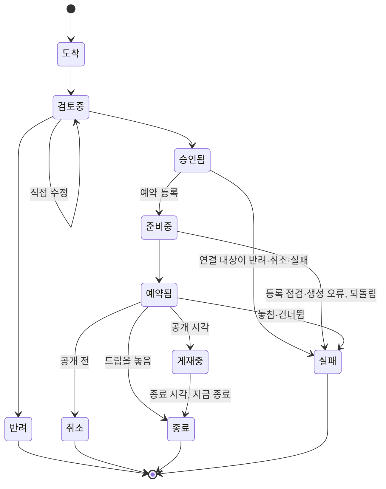

# JAM! 운영툴 PRD

> **상태: draft(2026-09-30 신설, 티켓 [20260930_1452](../../../tickets/p2-normal/20260930_1452_Admin_문서-체계-재작성-운영툴-PRD부터.md)).**
> 아직 만들지 않은 기능의 스펙이다. 현재 사실의 근거로 쓰지 않는다(절 머리에 「구현됨」 표지가 붙은 곳은 예외다). 구현 티켓이 끝날 때마다
> 해당 절을 사실로 바꾸고(§13), 모두 끝나면 `active`로 올린다.
>
> 설계 정본은 `jam-doc/planning/business-plan/07 JAM! 라이브 운영 블루프린트.md`(이하 07)이고, 이 문서는 07의 3.5와 4절을 07 절 순서대로
> 옮긴 스펙이다. 둘이 어긋나면 사용자 승인을 받아 07을 먼저 고친다(상위 티켓
> [20260930_1450](../../../tickets/p2-normal/20260930_1450_Feature_라이브-운영-체계-구현-07-블루프린트-상위.md) 진행 규칙 5).
> 상위 티켓이 닫히면 이 문서가 운영툴 동작의 정본이 된다. 결정의 경과와 근거는 07과 06 플랜에 있다.

## 1. 한 줄 정의

에이전트가 정기 루틴으로 제출한 한 주치 운영 묶음을, 사용자가 AI를 쓰지 않는 어드민 화면에서 보고 직접 고치거나 승인하면, 툴이 필요한
이미지를 만들고 자원을 예약 공개하며 모든 결정을 기록하고 슬랙에 이력을 알리는 도구.

## 2. 범위와 다른 문서의 관계

| 구분 | 이 문서에 담는 것 | 다른 문서가 맡는 것 |
|---|---|---|
| 형식 | 운영 묶음과 항목의 형식(§3) | 자원별 등록 필드: 각 자원의 PRD와 등록 형식 |
| 화면 | 화면 S1~S7의 역할과 구성(§6) | 화면 세부 설계: 채원(07 4.1). 1501·1502·1503이 이 문서의 해당 절에 채운다 |
| 데이터 | 개념 데이터(§10) | 실제 테이블 설계: 1455의 마이그레이션과 `docs/specs/prd/02_DATA_MODEL.md` |
| 기획 층 | 툴이 받는 쪽(제출 API, §11) | 주간·월간 루틴, 가드레일, 에이전트 정의: 07 3.2·3.3·3.6, 티켓 1504 |
| 기존 대시보드 | S1·S4가 가져올 것(§6) | 지금 대시보드의 동작: `docs/specs/prd/admin-ui/ADMIN_PRD.md` §5-7. 넓히는 개정은 1502 |

**전환 전 운영.** 이 툴로 바꾸기 전까지(티켓 1504) 화요일 주간 루틴과 목요일 카드 등록은 `docs/specs/prd/content-automation/PRD.md`의 절차대로
돈다. 그 문서의 해당 절에는 「전환 전까지 현재 절차」 표지를 붙였다.

## 3. 운영 묶음 (07 3.5)

- 한 주에 한 묶음을 낸다. 지금 배지·미션·홈피드 카드에 쓰는 등록 묶음(`bundle.json`) 형식을 넓힌다.
- **묶음:** 대상 주차, 검증하려는 가설, 항목 목록, 제출 에이전트, 루틴 실행 기록.
- **항목 공통:** 종류(홈피드 카드·미션·드랍 일정·레시피·JAM! 배지·컬렉션 런칭·패턴 제안), 패턴 번호와 손잡이 값, 공개·종료 시각, 대상
  세그먼트, 문안, 색, 연결(이 카드가 여는 미션 등), 세계관 검수 결과, 밸런스 판정, 「유저가 겪는 것」 쉬운 한 문장(§4).
- **항목 종류별 필드:** 각 자원의 등록 형식을 따른다.
- 형식에 맞지 않는 묶음은 받되 「형식 오류」 신호를 띄운다(§5).

### 3.1 제출 형식 (구현됨: 티켓 [20260930_1816](../../../tickets/p2-normal/20260930_1816_Admin_운영툴-골격-1-기획이-들어온다.md))

요청 본문은 JSON 한 벌이다. 기존 등록 묶음(`bundle.json`)의 `bundle_id`·`author`·`created_at`·`color_rationale_link`를 그대로 쓰고
`week`·`hypothesis`·`routine_run`·`is_sample`·`items[]`를 더했다. 검증 코드는 `jam-web/src/lib/admin/opsInbox/validate.ts`다.

**받을 수 없는 본문(400):** 본문이 JSON이 아니거나 최상위가 객체가 아님, `bundle_id`·`author`가 없거나 비어 있음, `bundle_id`가 200자·`author`가
100자를 넘음, `is_sample`이 있는데 `true`/`false`가 아님, `items`가 배열이 아님, `items`가 60개를 넘음, 본문이 1MB를 넘음(§11.1).
신원(`bundle_id`·`author`)과 시험 여부는 저장한 뒤 바로잡을 수 없어 받지 않는다(티켓 20260930_2100).
**저장하고 돌려주는 형식 오류:** 아래 표의 「검사」 열이 있는 필드가 틀린 경우다. 「경로: 사유」 해요체 문장(`items[2].kind: …`)으로 모아서 응답
`format_errors`에 담고, 묶음과 해당 항목의 `format_errors`에도 저장한다. 오류가 있어도 받고, 승인을 막지 않는다(§5).

| 위치 | 필드 | 검사 |
|---|---|---|
| 묶음 | `bundle_id`(필수) | 비어 있지 않은 문자열이고 유일하다. 앞뒤 공백은 저장할 때 뗀다 |
| 묶음 | `author`(필수) | 비어 있지 않은 문자열. 제출자가 적는 이름이라 권한 판단에 쓰지 않고 기록에만 남긴다 |
| 묶음 | `items`(필수) | 배열, 최대 60개(빈 배열 가능) |
| 묶음 | `week` | `YYYY-Www`(주 01~53). 예: `2026-W41`. 없어도 오류가 아니다 |
| 묶음 | `is_sample` | `true`/`false`(다른 값이면 400, 없으면 `false`). `true`면 시험 묶음이다(신호·결과·학습용 읽기에서 뺀다, 슬랙 글 앞에 「[시험]」) |
| 묶음 | `hypothesis`·`color_rationale_link`·`routine_run` | 있으면 형식만 본다(문자열·문자열·객체). `created_at`은 원본(`raw`)에만 남고 검사하지 않는다 |
| 항목 | `item_key`(필수) | 비어 있지 않은 문자열이고 묶음 안에서 겹치지 않는다(겹치면 뒤에 나온 항목이 오류) |
| 항목 | `kind`(필수) | `home_feed_card`·`mission`·`drop_schedule`·`recipe`·`jam_badge`·`collection_launch`·`pattern_proposal` 중 하나 |
| 항목 | `pattern_no` | 문자열 또는 숫자 |
| 항목 | `starts_at`·`ends_at` | 시간대가 붙은 ISO 8601(예: `2026-10-05T09:00:00+09:00`). 둘 다 있으면 `ends_at`이 더 늦어야 한다. 없어도 오류가 아니다 |
| 항목 | `user_experience`(필수) | 비어 있지 않은 문자열: 「유저가 겪는 것」 쉬운 한 문장(§4) |
| 항목 | `links` | 배열. 각 값은 같은 묶음 다른 항목의 `item_key`여야 한다(자기 자신과 없는 키는 오류) |
| 항목 | `world_review`(필수) | 객체 `{ world_related, winter_reviewed, reason }`. 셋 다 필수, 앞의 둘은 불리언, `reason`은 한 줄 문자열, `world_related`가 참이면 `winter_reviewed`도 참이어야 한다. 규칙은 홈피드 등록 묶음의 `world_review`와 같다(`registerHomeFeedBundle.mjs`, 테스트가 같은 입력으로 대조) |
| 항목 | `shape`·`exposure_tags`·`tribe_id`·`color_pending`, 묶음 `excluded_items` | 아래 「카드 칸과 뺀 항목」 표가 정한다 |
| 항목 | `knobs`·`segment`·`balance_check`·`copy`·`colors`·`image_spec`·`resource` | 검사하지 않고 항목 원본(`original`)에 그대로 저장한다. 종류별 세부 검증은 예약 등록 때 등록 전 검증(§8.4)이 한다. `segment`는 옛 칸이라 신호가 읽지 않는다(대상은 `exposure_tags`) |

- 형식에 이미지 파일 경로(`image.path`)와 `seed`는 없다. 이미지는 제출 뒤 운영툴이 만들므로 `image_spec`(이미지 지시)을 받는다(§8.8, 티켓 1501). 이 두 키가 들어와도 거절하지 않고 검사 없이 항목 원본(`original`)에 그대로 저장한다.
- 항목 배열의 순서는 `position`(0부터)으로 저장한다.

**드랍 일정(`drop_schedule`) 종류별 규칙 (구현됨: 티켓 [20261001_2051](../../../tickets/p1-high/20261001_2051_Service_앰비언트-드랍-예약-1-저장소와-실행.md)).**
제출 때의 형식 검사(`validate.ts`)는 `drop_schedule`의 `resource`를 보지 않고(위 표), 이 규칙은 예약 등록 때 등록 전 검증(§8.4)이 서버 함수로 적용한다.
검증 함수는 `jam-web/src/lib/ambient-drop/scheduleSpec.ts`의 `parseAmbientDropScheduleInput`이고, 항목의 `starts_at`을 `scheduled_at`으로 넘긴다.
- `starts_at`은 필수이고, 시간대가 붙은 ISO 8601이며, 한국 시각(KST) 정시이고, 지금보다 뒤여야 한다.
- `ends_at`이 있으면 형식 오류다. 드랍 일정은 놓은 뒤 내리지 않아 종료 시각이 없다(07 4.4·4.9).
- `resource`의 키는 6개다: `poi_ids`·`poi_category`·`badge_ids`·`collection_ids`·`per_poi_count`·`total_count`(`DROP_SCHEDULE_RESOURCE_KEYS`).
  `rarity_*` 같은 모르는 키는 무시한다. 예약에는 등급 비율을 두지 않는다.
- 지점은 하나만 고른다. `poi_ids`가 비어 있지 않으면 지점 직접 선택이다(`per_poi_count` 필수, `total_count`·`poi_category`가 있으면 오류).
  비어 있으면 지점 종류+개수다(`total_count` 필수, `poi_category`는 없으면 「전체 종류」, `per_poi_count`가 있으면 오류).
- 아이템은 하나만 고른다. `badge_ids`(아이템 직접 선택)와 `collection_ids`(컬렉션 선택) 중 정확히 하나만 비어 있지 않아야 한다.
- 개수(`per_poi_count`·`total_count`)는 1 이상의 정수다. 예약 1건이 놓는 드랍은 합계 100개까지다(지점 직접은 지점 수 × 지점당 개수). 임시값이고 넘으면 오류다.
- ID는 UUID 형식이고 중복은 하나로 합친다. `title`(이름)은 100자까지다.

**카드 칸과 뺀 항목 (구현됨: 티켓 [20261001_1152](../../../tickets/p2-normal/20261001_1152_Admin_운영-묶음-제출-형식에-모양-트라이브-대상-색대기-뺀항목-칸을-정한다.md)).**
§5의 겹침·단조로운 흐름·트라이브 거르기·「이미지 제작 필요」·「색 대기」·「에이전트가 뺀 항목」 신호가 읽는 칸이다. 형식 검사는 `validate.ts`,
칸 읽기는 `jam-web/src/lib/admin/opsInbox/fields.ts` 한 곳이다(신호와 화면은 `original`을 직접 읽지 않고 이 읽기 함수를 쓴다. 수정본이 있으면
수정본을 먼저 읽는다). 카드 모양 상수는 `jam-web/src/lib/today/shape.ts`다. 「모름」은 읽기 함수가 `'unknown'`을 돌려준다는 뜻이다.

| 위치 | 필드 | 형식 | 허용값·원천 | 필수 | 없을 때 읽는 값 | 형식이 틀릴 때 읽는 값 |
|---|---|---|---|---|---|---|
| 항목 | `shape` | 문자열 | `hero`·`poster`·`square`·`brief`·`list`(`lib/today/shape.ts`의 `CARD_SHAPES`). 이미지가 있는 모양은 `hero`·`poster`·`square` | `kind`가 `home_feed_card`면 필수. 다른 종류는 값이 있을 때만 검사 | 모름 | 모름 |
| 항목 | `exposure_tags` | 문자열 배열(1개 이상, 중복 없음) | `jam-web/src/lib/admin/today-sections.ts`의 `TODAY_EXPOSURE_TAG_OPTIONS`(전원 `all`, 신규 `new_user` 등). 오류 문장은 홈피드 등록 묶음 검사와 같다 | `home_feed_card`면 필수. 다른 종류는 값이 있을 때만 검사 | 모름 | 모름 |
| 항목 | `tribe_id` | UUID 문자열(null은 없음) | `tribes.id`. 형식 검사에 더해 제출·수정 때 `tribes` 목록에 있는지 본다 | 선택 | 없음(`null`) | 모름 |
| 항목 | `color_pending` | 불리언 | `true`면 「색 대기」 | 선택 | `false` | 모름 |
| 묶음(`raw`) | `excluded_items` | 객체 배열 | 원소마다 `reason`(필수, 비어 있지 않은 한 줄 — `world_review.reason`과 같은 규칙), `item_key`(선택, 문자열), `kind`(선택, 7종 중 하나), `stage`(선택, `world_review`·`balance_check`) | 선택 | 빈 목록(`[]`) | 모름(배열이 아니거나 원소 하나라도 틀리면 목록 전체) |

- 필수 칸이 없거나 값이 틀리면 「형식 오류」다. 받아서 저장하고 승인을 막지 않는다. `excluded_items` 오류는 묶음 오류에만 담고 어느 항목의
  `format_errors`에도 넣지 않는다.
- **옛 형식 묶음.** 칸이 없는 항목(옛 `segment`만 있는 항목)도 400 없이 받고 새 칸 오류만 붙으며 `segment`는 `original`에 그대로 남는다. 이미 저장된
  묶음(2026-10-01 DB 조회로 확인한 시험 묶음 1개·항목 3개, 실제 묶음은 없음)은 다시 검사하지 않고 읽을 때 모름으로 처리한다(모양·대상 모름, 트라이브
  없음, 색 대기 아님, 뺀 항목 없음). 그런 항목을 직접 고치면(§7.3) 새 규칙으로 다시 검사해 오류를 붙이되 저장은 막지 않는다.
- **트라이브 존재 확인.** 제출(§11.1)과 직접 수정·되돌리기(§7.3)는 `tribes` 테이블의 ID 목록을 조회해(`jam-web/src/lib/admin/opsInbox/tribes.ts`의
  `loadTribeIds`) `tribe_id`가 그 안에 있는지 본다. 같은 목록·같은 규칙이라 두 경로의 판정이 같다. 조회가 실패하면 저장하지 않고 500이다. 읽기 함수는
  형식만 보고 존재는 다시 보지 않는다.
- 07 3.6 「트라이브 연결은 필수」는 기획 층(에이전트)이 지키는 가드레일이고, 이 칸은 선택이다.

## 4. 사용성 원칙 (07 4.1)

화면 설계는 채원이 맡는다. 아래 여섯 가지가 모든 화면의 기준이다.

| 요청 | 설계에 반영하는 방식 |
|---|---|
| 쉽고 인터랙티브하게 | 한 화면에서 보고, 고치고, 승인까지 끝낸다. 고친 내용은 미리보기에 바로 보이고, 직접 수정은 되돌릴 수 있다. 승인·반려는 되돌리지 않고 누르기 전에 확인을 받는다(사용자 결정 2026-09-30, 티켓 20260930_1455) |
| 쉬운 문장으로 | 안내·상태·경고를 모두 쉬운 문장으로 쓴다. 내부 용어는 풀어 쓰고 필요할 때만 괄호로 붙인다(예: 「매일 자동으로 뿌리는 드랍(앰비언트 드랍)」). 항목마다 「유저가 겪는 것」 한 문장을 보여 준다(§3) |
| 진행 상황을 눈으로 | 기획마다 단계 표시줄(도착 → 검토 → 준비 → 예약 → 게재 → 종료)을 두고 지금 단계를 강조한다. 상태는 색만으로 나누지 않고 아이콘과 글을 함께 쓴다. S1·S2·S4가 같은 상태 표시를 쓴다(§7) |
| 오른쪽 서랍(Drawer) | 에셋 제너레이터를 부르거나 다른 컨텐츠와 연결할 때(카드가 여는 미션 고르기, 레시피 재료 확인 등)는 오른쪽 서랍에서 한다. 서랍이 열려도 원래 화면이 그대로 보인다 |
| 캘린더와 타임라인 | 일정표를 캘린더(월·주)와 타임라인(기간 막대) 두 보기로 바꿔 가며 본다. 타임라인은 미션 기간, 드랍 일정, 컬렉션 런칭 준비(D-28부터)처럼 기간이 있는 것을 흐름으로 보여 준다 |
| 신호 | 오류, 문제, 비어 있는 컨텐츠를 S1의 신호 영역에 모으고, S4와 S3에서도 그 자리에 표시한다(§5) |

## 5. 신호 (07 4.2)

신호는 모두 규칙으로 계산한다(AI 없음). 지금 어드민 대시보드의 신호·컨텐츠 공백 카드를 넓힌다. 「중단」 신호는 슬랙 `#jam-alert`에도 알린다.
신호는 승인을 막지 않는다. 막는 것은 §12의 안전장치뿐이다.

| 신호 | 언제 뜨나 | 수준 |
|---|---|---|
| 실행 실패 | 예약 등록 중 오류가 나서 되돌렸거나, 상태 맞추기가 항목을 실패로 바꿨다(드랍 놓침 등, §8.6) | 중단 |
| 예약 누락 | 공개 시각이 지났는데 공개되지 않았다 | 중단 |
| 루틴 실패 | 주간·월간 루틴이 기획안을 내지 못했다 | 중단 |
| 형식 오류 | 제출된 기획안이 형식에 맞지 않는다 | 주의 |
| 비어 있는 컨텐츠 | 「색 대기」 카드, 문안이나 이미지가 빈 항목, 게재 카드가 3장보다 적거나 5장보다 많은 날, 전원 대상 카드가 없는 날, 이미지가 없는 모양으로 편성된 대표 카드 | 주의 |
| 새 컨텐츠가 없는 날 | 그날 새로 게재를 시작하는 홈피드 카드가 한 장도 없다 | 주의 |
| 승인 마감 임박 | 공개 시각이 다가오는데 아직 승인되지 않았다. 승인했지만 예약 등록을 하지 않은 항목(§8.2)도 같은 마감으로 본다(티켓 [20261001_2204](../../../tickets/p2-normal/20261001_2204_Admin_승인됨-예약-등록-전-항목의-마감-신호.md)이 더한다) | 주의 |
| 밸런스 경고 | 밸런스 규칙(§5.2, S7)을 넘는 항목이 있다. 수치를 읽을 수 없는 항목은 「점검 못 함」(참고)으로 보인다 | 주의(규칙마다 참고로 낮출 수 있다) |
| 에이전트가 뺀 항목 | 세계관 검수나 밸런스 점검에서 「중단」이 나와 묶음에서 빠졌다(사유 표시) | 참고 |
| 겹침 | 같은 날 같은 패턴이나 트라이브가 겹치거나, 그날의 구성이 치우쳤다: 이미지가 있는 모양의 카드가 3장 이상, 이미지가 없는 카드가 0장, 신규 유저에게 보이는 운영 카드가 3장보다 많다(수치는 초기값, 사용자 결정 2026-09-30, 티켓 20260930_1453) | 참고 |
| 단조로운 흐름 | 최근 7일의 대표 카드에서 같은 패턴이나 트라이브가 3번 이상 나오거나, 같은 모양이 3일 연속 대표다 | 참고 |
| 획득 경로가 막힌 컬렉션 | 기간 한정 운영이 끝나 얻을 길이 없는 아이템이 있다(06 6.3) | 참고 |
| 행동 횟수 급증 | JAM! 배지의 행동 횟수 지표가 평소보다 크게 늘었다. 해석은 카즈하가 브리핑에서 한다 | 참고 |

**신호 계산 (구현됨, 화면 없음: 티켓 [20261001_1155](../../../tickets/p2-normal/20261001_1155_Admin_운영-홈-일정표-신호-1-신호-엔진.md)).** 코드는 `jam-web/src/lib/admin/opsSignals/`다.
`loadOpsSignals`가 데이터를 읽기만 하고(`today_cards`·`missions`·`ops_bundles`·`ops_bundle_items`·행동 건수), `computeOpsSignals`가 13종을 이 표의 순서로 돌려준다.
날짜별 구성(`buildDayCompositions`: 실제 카드·미션·운영 묶음 항목)도 함께 돌려주며 일정표(S1·S4)가 그것을 쓴다. 화면은 이 계산을 읽기만 한다.

- **신호의 세 상태.** 「뜸」(결과가 한 건 이상)·「안 뜸」·「확인 안 함」 가운데 하나다. 확인 안 함의 사유는 셋이다: 계산 규칙을 아직 만들지 않음(밸런스 경고는 티켓
  20260930_1459, 획득 경로가 막힌 컬렉션은 20260930_1503이 채운다), 점검을 아직 시작하지 않음(루틴 실패), 데이터를 읽지 못함. 조회가 실패하면 그 데이터에
  기대는 신호만 「확인하지 못했어요」가 되고 나머지는 계산한다. 신호가 안 뜬 것과 확인하지 못한 것을 섞지 않는다.
- **시험 묶음.** 기본은 모든 계산에서 뺀다. 포함 인자를 주면 들어가고 결과에 「시험」 표식이 붙는다. 루틴 실패는 인자와 관계없이 시험 묶음을 루틴 결과로 세지 않는다.
- **날짜 기준.** KST 달력이다. 하루 겹침은 `/admin/today`와 같다(시작 ≤ 그날 끝, 끝 ≥ 그날 시작). 검사 날짜는 이번 주 오늘부터 일요일까지이고, 다음 주는 금요일부터 본다.
  다음 주 기획(묶음의 `week`가 다음 주 ISO 주)이 이미 도착했으면 금요일 전에도 다음 주를 본다.
- **날짜 구성에 넣는 항목.** 실제 카드는 활성 카드 전부(노출 대상과 관계없이), 운영 묶음 항목은 반려·취소·실패를 뺀 나머지다(승인 전 항목도 센다). 공개 시각이 없으면 날짜에 올리지
  않는다. 종료 시각이 없으면 공개한 날 하루만 걸친다. 「패턴 제안」 항목은 넣지 않는다. 옛 카드의 모양은 `resolveShape`(`jam-web/src/lib/today/shape.ts`)가 정한 값이다.
  `created_resource`로 같은 것을 한 칸으로 합치는 일은 1500이 채운 뒤에 한다(그 전에는 실제 카드와 운영 묶음 카드를 별개로 센다).

| 신호 | 판정 규칙 |
|---|---|
| 실행 실패 | 최근 7일 안에 「실패」로 바뀐 항목(`updated_at` 기준) |
| 예약 누락 | 「예약됨」·「준비중」 항목의 공개 시각 + 30분이 지났다. 「승인됨」은 예약 등록 전이라 뺀다(예약 등록을 잊은 항목은 「승인 마감 임박」이 본다, 티켓 20261001_2204). 상태 맞추기(§8.6)가 10분마다 게재중으로 바꾸므로, 정상 공개된 항목은 30분 안에 이 신호에서 빠진다 |
| 루틴 실패 | 주간: 이번 주 화요일 0시 이후 받은 실제 묶음 가운데 「패턴 제안」이 아닌 항목이 있는 묶음이 화요일 12시까지 없다. 월간: 이번 달 1일 0시 이후 받은 실제 묶음 가운데 「패턴 제안」 항목이 있는 묶음이 1일 12시까지 없다. `routine_run`은 읽지 않는다. 점검 시작 시각이 정해지기 전(지금)은 「아직 확인하지 않아요」이고, 정해진 뒤에는 시작 시각 이후에 시작한 구간만 본다 |
| 형식 오류 | 끝나지 않은 묶음(받은 기획함 「결정할 것」·「진행 중」 탭)만 본다. 묶음이나 항목에 형식 오류 문장이 있으면 묶음 하나가 한 건이다 |
| 에이전트가 뺀 항목 | 끝나지 않은 묶음의 `excluded_items`. 목록을 읽을 수 없으면(「모름」) 그 묶음에 「뺀 항목 목록을 읽지 못했어요」를 띄운다 |
| 승인 마감 임박 | 결정 전(도착·검토중) 항목의 공개 시각이 지금부터 48시간 안이다. 이미 지났는데 결정 전인 항목도 같은 신호로 「공개 시각이 지났어요」라고 보인다 |
| 비어 있는 컨텐츠 | 검사 날짜마다 본다: 게재 카드(그날 걸치는 활성 카드 전부)가 3장 미만·5장 초과, 전원 대상 카드가 없음(노출 대상을 읽을 수 없는 카드가 있으면 띄우지 않는다), 대표 카드의 모양이 이미지 없는 모양. 항목마다 본다(처음 걸치는 검사 날짜에 한 번): 「색 대기」 카드, 문안이 빈 항목(운영 묶음 카드는 `copy`에 비어 있지 않은 문자열이 하나도 없음, 실제 카드는 제목이 빔), 이미지가 빈 항목 |
| 새 컨텐츠가 없는 날 | 그날 새로 게재를 시작하는 활성 카드가 0장이다 |
| 겹침 | 그날 시작하는 운영 묶음 항목끼리 같은 패턴이나 같은 트라이브가 두 건 이상(4주짜리 미션이 기간 내내 겹침으로 뜨지 않게 하고, 실제 카드에는 패턴·트라이브 칸이 없어 세지 않는다). 그날 보이는 홈피드 카드 가운데 이미지가 있는 모양이 3장 이상, 모양을 아는 카드가 있는데 이미지 없는 모양이 0장(모양을 모르는 카드는 세지 않는다), 신규 유저에게 보이는 카드(노출 대상에 `all`·`new_user`·`time_*`)가 3장 초과 |
| 단조로운 흐름 | 검사 날짜마다 그날까지 7일의 대표 카드를 본다. 같은 패턴이나 트라이브가 3번 이상 나오거나, 같은 모양이 3일 연속 대표다. 같은 값은 한 번만 알린다 |
| 행동 횟수 급증 | 지표 5개(믹스 시도·유저 드랍·픽업·미션 완료·컬렉션 완성)의 전체 유저 원시 건수다. 최근 7일 합계가 직전 4주 주평균의 2배 이상이고 지표별 최소 건수 이상이다. 믹스 시도는 성공·실패 로그를 더하고, 유저 드랍은 `poi_drops`에서 유저가 놓은 것(`source = 'user'`), 픽업은 `picked_up_at`이 기간 안인 `poi_drops`다 |
| 밸런스 경고 · 획득 경로가 막힌 컬렉션 | 계산 규칙 없음. 항상 「아직 확인하지 않아요」 |

- **대표 카드.** 그날 전원 대상(`all`) 카드 가운데 정렬이 가장 앞인 카드다. 실제 카드는 지금 정렬(`sort_order` 오름차순 → `starts_at` 내림차순), 운영 묶음 카드는
  `resource.sort_order`를 같은 줄에 놓고 값이 없으면 실제 카드 뒤에 제출 순서로 둔다. 노출 대상을 읽을 수 없는 카드는 대표가 될 수 없다.
- **「이미지 제작 필요」.** 신호가 아니라 표시다. 승인 전(도착·검토중·승인됨·준비중) 운영 묶음 항목의 모양이 이미지가 있는 모양인데 이미지가 없으면 붙는다. 승인을 막지 않는다.
  예약·게재 중인 항목이나 모양이 저장된 실제 카드가 이미지 모양인데 이미지가 없으면 「비어 있는 컨텐츠」의 「이미지가 빈 항목」이다. 모양 칸이 빈 옛 카드는 `resolveShape`가
  커버 유무를 이미 반영하므로 표시하지 않는다. 운영 묶음 항목의 「이미지가 있다」는 `resource.cover_image_url`이 비어 있지 않은 문자열인 경우다(제출 형식에 이미지 칸이 따로 없다).

### 5.1 홈피드 신호의 목표와 이유

홈피드의 목표는 카드가 한 장이라도 있는 것이 아니라 **매일 새 컨텐츠가 올라오고 단조롭지 않은 것**이다(사용자 결정, 2026-09-30).
대표 카드는 요일마다 편성하는 전원 대상 1픽 카드다.

| 신호 | 이유 |
|---|---|
| 새 컨텐츠가 없는 날 | 어제와 같은 홈을 보면 앱을 열 이유가 줄어든다. 매일 한 장 이상 새로 올라와야 한다 |
| 겹침 | 큰 카드가 같은 높이로 줄지어 서면 하루 홈이 단조롭다. 큰 카드 사이에 작은 카드가 끼고, 신규 유저의 홈이 운영 카드로 가득 차지 않아야 한다. 「신규 유저」의 기준은 1502에서 정한다 |
| 단조로운 흐름 | 한 주 내내 같은 트라이브나 같은 방식의 카드가 대표로 나오거나, 맨 위 대표 카드가 며칠째 같은 모양이면 홈이 단순해 보인다. 07 「겹침」은 같은 날만 보므로 여러 날에 걸친 반복은 이 신호가 본다 |
| 전원 대상 카드가 없는 날 | 빈 홈을 막는 최소 조건이다. 유저 상태에 따라 나오는 카드만 있는 날은 조건에 맞지 않는 유저의 홈이 비고, 날씨·특일 값이 저장되지 않으면 모두의 홈이 빈다. 2026-09-28~10-04 편성에서 10/1과 10/3이 이 위험이었다(티켓 [20260924_0809](../../../tickets/p2-normal/20260924_0809_Feature_매일-전원에게-카드-1장-이상-보장하는-편성-규칙.md)) |

- 「새 컨텐츠가 없는 날」과 「단조로운 흐름」의 수치(0장, 7일 중 3번, 3일 연속)는 초기값이다. 운영하며 조정하고, 조정할 수 있는 위치(S7 등)는 1502에서 정한다.
- 「전원 카드는 큰 카드(`large_thumbnail`)여야 한다」는 요건은 새 형식에서 **「대표 카드는 이미지가 있는 모양 가운데 하나이고, 같은 모양이 연달아
  대표가 되지 않는다」** 로 바꿨다(사용자 결정, 2026-09-30, 티켓 20260930_1453). 미션 소개 카드의 「항상 큰 카드」 규칙도 「이미지가 있는 모양」으로
  완화한다. 옛 요건의 출처는 0809가 아니라 티켓 20260926_1542(사용자 요청 「요일마다 큰 카드 1개 이상」을 전원 카드에 건다고 해석해 반영)와
  content-automation PRD §8 「요일별 큰 카드 규칙」이다. 1504 전환 전까지는 그 절차가 현재 절차로 돈다.
- 이미지가 필요한 모양(`hero`·`poster`·`square`)의 항목에 이미지가 없으면 「이미지 제작 필요」로 표시만 한다. 승인을 막거나 카드 모양을 바꾸지 않는다
  (사용자 결정, 2026-09-30, 티켓 20260930_1453). 카드 모양의 정의는 1453 「확정 설계」에 있고, 구현 뒤 홈피드 PRD로 옮긴다.
- 전환 전 등록 뒤 점검(전원 카드가 없는 날을 찾는 SQL)은 content-automation PRD §8-2에 현재 절차로 남아 있다. 전환 뒤에는 같은 조건을 이 신호가
  승인 전에 보여 준다.

**신호 기준값 표 (구현됨: 티켓 [20261001_1155](../../../tickets/p2-normal/20261001_1155_Admin_운영-홈-일정표-신호-1-신호-엔진.md), S7에서 바꾸는 부분은 티켓 [20260930_1459](../../../tickets/p2-normal/20260930_1459_Admin_밸런스-규칙-설계와-툴-경고.md) 조각 C).** 신호 규칙이 쓰는 숫자·시각의 전부다.
**이 표는 기본값이다.** 코드 원천은 `jam-web/src/lib/admin/opsSignals/thresholds.ts` 한 파일이고, `thresholds.test.ts`가 이 표와 코드 값을 대조한다(기본값을 바꾸면 둘을 함께 바꾼다).
S7(§6.2의 「신호 기준값」 구역)에서 바꾼 값만 DB(`ops_rules`, `rule_group = 'signal'`)에 남고 **바꾼 값이 이 표의 기본값보다 우선한다**. 기본값 행은 DB에 없고, 기본값으로 되돌리면 그 행을 지운다(사용자 결정, 2026-10-01).
신호 계산(`opsSignals/load.ts`)은 `overrides.ts`가 읽은 바꾼 값을 얹어 쓰고, 카드·미션을 읽는 범위(`monotonyWindowDays`)와 직전 기간 주 수(`actionSpikeBaselineWeeks`)도 그 값을 따른다.
「실측 아님」은 혜린이 추정한 초기값이라 운영하며 실제 값을 보고 조정한다. 행동 횟수 급증의 최소 건수는 카즈하가 2026-10-01에 실제 주간 값(9월 완료 3주)을
읽고 정했고 확신도가 보통이라 10월 말에 다시 본다. 조정하는 화면은 S7이다. 날짜·시각은 KST, 요일 번호는 0=일 … 6=토다.

| 기준값 | 값 | 단위 | 실측 | 신호 | 뜻 | 출처 |
|---|---|---|---|---|---|---|
| `failureLookbackDays` | 7 | 일 | 정한 값 | 실행 실패 | 「실패」로 바뀐 항목을 되돌아보는 기간 | 1155 A2 |
| `missedScheduleMinutes` | 30 | 분 | 실측 아님 | 예약 누락 | 공개 시각이 지난 뒤 누락으로 보기까지의 시간 | 혜린 추정(1502 Q5) |
| `weeklyRoutineWeekday` | 2 | 요일 번호 | 실측 아님 | 루틴 실패 | 주간 루틴 마감 요일(2=화요일) | 혜린 추정(1502 Q5) |
| `weeklyRoutineDeadlineHour` | 12 | 시 | 실측 아님 | 루틴 실패 | 주간 루틴 마감 시각(마감 요일의 몇 시) | 혜린 추정(1502 Q5) |
| `monthlyRoutineDay` | 1 | 일 | 실측 아님 | 루틴 실패 | 월간 루틴 마감 날짜(매월 며칠) | 혜린 추정(1502 Q5) |
| `monthlyRoutineDeadlineHour` | 12 | 시 | 실측 아님 | 루틴 실패 | 월간 루틴 마감 시각(마감 날짜의 몇 시) | 혜린 추정(1502 Q5) |
| `routineCheckStartsAt` | 없음 | 시각(ISO 8601) | 정한 값 | 루틴 실패 | 루틴 점검을 시작하는 시각(없으면 「아직 확인하지 않아요」, 1504가 첫 주간 루틴을 돌릴 때 채운다) | 1155 A1 |
| `approvalDeadlineHours` | 48 | 시간 | 실측 아님 | 승인 마감 임박 | 공개 시각 몇 시간 전까지 승인되지 않으면 띄우는지 | 혜린 추정(1502 Q5) |
| `nextWeekCheckFromWeekday` | 5 | 요일 번호 | 정한 값 | 비어 있는 컨텐츠 | 다음 주 편성을 검사하기 시작하는 요일(5=금요일, 그 전에도 다음 주 기획이 도착했으면 검사한다) | 0912, 1502 가정 15 |
| `minLiveCards` | 3 | 장 | 정한 값 | 비어 있는 컨텐츠 | 하루에 게재할 카드의 최소 장수(이보다 적으면 뜬다) | 07 4.2, 1502 가정 5 |
| `maxLiveCards` | 5 | 장 | 정한 값 | 비어 있는 컨텐츠 | 하루에 게재할 카드의 최대 장수(이보다 많으면 뜬다) | 07 4.2, 1502 가정 5 |
| `minNewContentCards` | 1 | 장 | 정한 값 | 새 컨텐츠가 없는 날 | 그날 새로 게재를 시작하는 홈피드 카드의 최소 장수(0장이면 뜬다) | PRD §5.1, 1502 가정 4 |
| `overlapImageShapeCards` | 3 | 장 | 정한 값 | 겹침 | 이미지가 있는 모양의 카드가 이만큼 이상이면 뜬다 | 07 4.2, 1502 가정 5 |
| `minNonImageShapeCards` | 1 | 장 | 정한 값 | 겹침 | 이미지가 없는 모양의 카드 최소 장수(0장이면 뜬다) | 07 4.2, 1502 가정 5 |
| `maxNewUserCards` | 3 | 장 | 정한 값 | 겹침 | 신규 유저에게 보이는 카드가 이보다 많으면 뜬다 | 07 4.2, 1502 가정 5 |
| `monotonyWindowDays` | 7 | 일 | 정한 값 | 단조로운 흐름 | 대표 카드를 되돌아보는 기간 | PRD §5.1, 1502 가정 4 |
| `monotonySamePatternCount` | 3 | 번 | 정한 값 | 단조로운 흐름 | 기간 안에서 같은 패턴·트라이브가 이만큼 이상 나오면 뜬다 | PRD §5.1, 1502 가정 4 |
| `monotonySameShapeDays` | 3 | 일 | 정한 값 | 단조로운 흐름 | 같은 모양이 이만큼 이상 연속 대표이면 뜬다 | PRD §5.1, 1502 가정 4 |
| `actionSpikeMultiplier` | 2 | 배 | 실측 아님 | 행동 횟수 급증 | 최근 7일 합계가 직전 주평균의 몇 배 이상이면 뜨는지 | 혜린 추정(1502 Q5) |
| `actionSpikeBaselineWeeks` | 4 | 주 | 실측 아님 | 행동 횟수 급증 | 주평균을 내는 직전 기간 | 혜린 추정(1502 Q5) |
| `actionSpikeMinMixAttempt` | 5 | 건 | 실측 아님 | 행동 횟수 급증 | 믹스 시도의 최소 건수(최근 7일 합계) | 카즈하 2026-10-01(1155 A10) |
| `actionSpikeMinUserDrop` | 15 | 건 | 실측 아님 | 행동 횟수 급증 | 유저 드랍의 최소 건수(최근 7일 합계) | 카즈하 2026-10-01(1155 A10) |
| `actionSpikeMinPickup` | 23 | 건 | 실측 아님 | 행동 횟수 급증 | 픽업의 최소 건수(최근 7일 합계) | 카즈하 2026-10-01(1155 A10) |
| `actionSpikeMinMissionComplete` | 2 | 건 | 실측 아님 | 행동 횟수 급증 | 미션 완료의 최소 건수(최근 7일 합계) | 카즈하 2026-10-01(1155 A10) |
| `actionSpikeMinCollectionComplete` | 2 | 건 | 실측 아님 | 행동 횟수 급증 | 컬렉션 완성의 최소 건수(최근 7일 합계) | 카즈하 2026-10-01(1155 A10) |

### 5.2 밸런스 규칙 (설계 승인: 티켓 [20260930_1459](../../../tickets/p2-normal/20260930_1459_Admin_밸런스-규칙-설계와-툴-경고.md), 2026-10-01)

07 3.6 가드레일 가운데 숫자로 잴 수 있는 것을 규칙으로 옮겼다. 툴은 AI 없이 이 규칙으로 「밸런스 경고」(§5)를 계산하고, 경고는 승인을 막지
않는다. 규칙은 묶음이 넘지 말아야 할 선이고, 드랍 확률과 포인트 보상 체계 자체는 바꾸지 않는다. 공개 전 판단은 혜린의 주간 밸런스 점검(1504)이,
공개 뒤 결과(과다 발급·파밍)는 카즈하가 맡는다(06 12.4의 5).

**규칙표.** 값은 S7에서 바꾸고, 배포 없이 다음 평가부터 반영된다. 「임시값」은 실측 없이 정한 값이라 화면에 「임시값·실측 전」 칩을 붙이고(R5는 종류마다 따로 표시한다),
실측 티켓 [20261001_1220](../../../tickets/p2-normal/20261001_1220_BadgeEngine_컬렉션-개방-속도와-완성-소요-실측.md)이 끝나면 다시 정한다. 경고 수준은 모두 「주의」로 시작하고 규칙마다 「참고」로 낮출 수 있다. 툴은 「중단」을 쓰지 않는다.

| # | 규칙 키 | 규칙 | 경고 조건 | 초기값 | 근거 |
|---|---|---|---|---|---|
| R1 | `open_collections_max` | 동시 개방 컬렉션 수 | 새 컬렉션을 여는 항목마다, 그 공개 시각에 노출 중일 컬렉션 수가 값을 넘는다 | 6 | 임시값(혜린 가정 6, 윈터안 9. 티켓 20260929_2226) |
| R2 | `weekly_new_collections_max` | 한 주 신규 개방 수 | 공개 시각이 같은 주(월~일 KST)에 드는 신규 개방 수가 값을 넘는다 | 1 | 임시값 |
| R3 | `rolling_new_collections_max` | 28일 신규 개방 수 | 공개 시각부터 거슬러 28일 안의 신규 개방 수가 값을 넘는다 | 2 | 임시값 |
| R4 | `launch_lead_days_min` | 개방 리드타임 | 공개 시각까지 남은 날이 값보다 적다 | 28 | 사용자 결정(06 3.2) |
| R5 | `point_reward_max` | 항목별 포인트 | 항목의 포인트가 종류별 값을 넘는다 | 횟수형 JAM! 배지 10, 달성형 JAM! 배지 100, 미션 50, 컬렉션 완성 20, 레시피 30 | 100·20·30은 2026-10-01 서비스의 같은 종류 최댓값, 10·50은 임시값(06 3.1 「기존 범위 안」) |
| R6 | `single_action_points` | 한 번의 행동으로 받는 포인트 합 | 미션·컬렉션 완성의 포인트와 그 보상 배지 포인트의 합이 같은 종류의 R5 값을 넘는다 | R5 값(따로 저장하지 않는다) | 보상이 겹쳐 지급된다(`docs/specs/prd/point-system/OBJECT_MODEL.md` 1.6) |
| R7 | `count_ladder_points` | 파밍 방지(횟수형 사다리 합) | 같은 계열(`family_key`) 횟수형 JAM! 배지의 단계별 포인트 합(이미 있는 단계 포함)이 R5의 달성형 값을 넘는다 | R5 값(따로 저장하지 않는다) | 계열 레벨형 배지는 단계마다 따로 발급된다(BADGE_ENGINE 2.14). 지표 부풀림은 O5 계산 방식이 막는다 |
| R8 | `economy_keys` | 경제 수치 불변 | 항목의 `resource`·`knobs`에 경제 정책 키가 들어 있다 | `drop_policy`·`combine_policy`에서 `id`·`updated_at`을 뺀 컬럼 이름(2026-10-01 기준 23개). S7에서는 읽기 전용이다 | 07 3.6 |

- 묶음 포인트 합계와 드랍 대상 컬렉션 수 규칙은 정할 근거가 없어 만들지 않았다. 등급 비율 규칙도 만들지 않았다(아이템이 모두 common이라 지금은 효과가 없다).

**평가 방식.**
- 기획 상세(S3)를 열 때와 운영 홈(S1)·일정표(S4)를 그릴 때 그 순간의 규칙 값과 서비스 상태로 계산하고, 결과를 저장하지 않는다. 직접 수정으로
  공개 시각이 바뀌거나 그사이 다른 컬렉션이 열려도 경고가 낡지 않는다.
- 항목 값은 수정본이 있으면 수정본, 없으면 제출 원본을 읽는다(§7.3). 반려된 항목은 세지 않는다. 끈 규칙은 계산하지 않는다.
- 다른 묶음의 항목까지 세는 규칙(R1~R3)은 시험이 아닌 묶음의 항목과 지금 평가하는 묶음의 항목만 센다. 시험 묶음끼리는 서로 세지 않는다.
- 수치를 읽을 수 없으면(필드가 없음, 숫자가 아님, 시각 형식 오류) 통과로 보지 않고 「점검 못 함」(참고)으로 보인다.
- 경고 문장은 무엇이, 얼마나 넘었는지, 기준이 무엇인지의 순서로 쓴다. 예: 「이번 주(10/12~10/18)에 새 컬렉션을 2개 열어요(10/12, 10/15). 한 주에
  1개까지가 기준이에요.」 임시값 규칙의 경고에는 문장 대신 「임시값·실측 전」 칩이 붙는다.
- 평가가 실패하면(규칙이나 서비스 상태를 읽지 못함, 규칙 테이블이 비어 있음) 기획 상세는 그대로 열리고 「밸런스를 확인하지 못했어요」 알림만
  보인다. 승인은 막지 않는다. 일부 규칙만 서비스 상태를 읽지 못하면 그 규칙만 「점검 못 함」이다.
- 시험 묶음의 경고는 기획 상세에서는 늘 보이고, 운영 홈·일정표에서는 「시험 묶음 포함해서 보기」 스위치를 켰을 때 「시험」 표시를 달고 보인다(1502와 같은 규칙).

**규칙이 읽는 자리.** 예약 등록 때의 등록 전 검증(§8.4)도 이 경로를 따른다. `resource`의 키 이름은 만들 자원 테이블의 컬럼 이름과
같다. 드랍 일정(`drop_schedule`)은 R8만 적용된다(아래 표에 행이 없다). 새 밸런스 규칙은 만들지 않았고, 예약 1건의 100개 상한은 밸런스 경고가 아니라 입력 검증이다(§3.1). 보상 배지는 `resource`의 배지 ID가 가리키는 기존 배지이거나, `links`로 이어진 같은 묶음의 `jam_badge` 항목이다.

| 종류(`kind`) | 읽는 자리 | 규칙 |
|---|---|---|
| `collection_launch` | `starts_at`(공개 시각), `ends_at`(종료 시각), `resource.reward_points`, 보상 배지(`resource.reward_badge_id`)의 `point_reward` | R1~R4, R5(컬렉션 완성), R6 |
| `mission` | `resource.reward_points`, 보상 배지(`resource.reward_badge_ids`)의 `point_reward` | R5(미션), R6 |
| `jam_badge` | `resource.point_reward`, `resource.condition_json`, `resource.family_key` | R5(횟수형·달성형), R7 |
| `recipe` | `resource.reward_points` | R5(레시피) |
| 모든 종류 | `resource`·`knobs`의 키 이름 | R8 |

- 횟수형 JAM! 배지는 `condition_json`에 JAM! 행동 지표 키(`JAM_ACTION_CONDITION_KEYS`) 가운데 `recipe_first_success`가 아닌 키가 있는 배지다.
  그 밖의 JAM! 배지는 달성형이다.
- R1의 「노출 중」은 컬렉션 노출 판정(`jam-web/src/lib/itembook/visibility.ts`의 노출 중)을 공개 시각 기준으로 쓴다. 이미 만들어진 컬렉션은 DB에서
  세고, 아직 만들어지지 않은 신규 개방(만들어진 자원 ID가 없는 `collection_launch` 항목)은 묶음 항목에서 센다. 열린 컬렉션 총수는 S7과 항목 상세에
  참고로 보인다.
- R2·R3의 신규 개방은 `collection_launch` 항목 수다. 기존 컬렉션에는 공개일 기록이 없어 툴이 기록한 항목부터 센다.
- R4의 기준 시각은 승인 전이면 지금, 승인 뒤면 승인 시각이다.
- R8의 키 목록은 23개로 확정이다(2026-10-01, 티켓 20261001_2051). 드랍 일정의 `resource` 키 6개(§3.1)와 겹치지 않으며, 겹침 방지 테스트 `jam-web/src/lib/ambient-drop/__tests__/schedule-r8-keys.test.ts`가 `207_ops_rules.sql`에서 키를 읽어 대조한다.

**조각 A 구현에서 정한 읽기 규칙 (티켓 20260930_1459).** 구현하며 모호한 곳을 이렇게 읽었다. 틀리면 이 문서와 코드(`balance/evaluate.ts`)를 함께 고친다.
- 결과의 「항목 키」는 항목 행 ID(`ops_bundle_items.id`)다. 제출자가 정하는 `item_key`는 겹칠 수 있어 쓰지 않는다. 반려·취소·실패한 항목은 세지도 점검하지도 않고, 다른 묶음의 항목에도 같다.
- 포인트 칸(`resource.reward_points`·`point_reward`)이 없으면 「점검 못 함」이고, 값이 `null`이면 포인트 없음(0)으로 읽는다. 숫자가 아니면 「점검 못 함」이다.
- R1은 이 항목의 공개 시각과 종료 시각을 모두 읽어야 한다(없으면 「점검 못 함」). 다른 개방의 종료 시각을 읽지 못하면 계속 열려 있는 것으로 센다. R2·R3·R4는 공개 시각만 본다.
- R4의 남은 일수는 소수점 아래를 버린다(10일 21시간이면 「10일」). 값과 같으면 통과다. 승인 뒤에는 「승인할 때 공개까지 N일이 남아 있었어요」로 쓴다.
- R6은 보상 배지(`resource`의 배지 ID 또는 `links`로 이어진 같은 묶음의 `jam_badge` 항목)가 있을 때만 따로 경고한다. 없으면 합이 항목 자신의 포인트와 같아 R5가 이미 본다. R6·R7은 R5가 꺼져 있어도 R5의 값을 따른다.
- R7은 계열 이름(`resource.family_key`)이 있는 횟수형 배지만 본다(계열이 없으면 사다리가 아니다). 이미 있는 같은 계열 배지는 횟수형으로 판정되는 것만 더한다.
- R8은 `resource`·`knobs`의 키를 안쪽 객체·배열까지(깊이 4) 훑는다. 키가 여러 개면 한 줄로 모은다.
- 묶음 알림 건수는 항목 줄과 묶음 줄을 모두 센 값이고 주의는 주의 줄, 참고는 참고 줄과 「점검 못 함」 줄이다. 5번째 탭은 항목 줄이 있는 항목 수다.

**조각 B 구현에서 정한 읽기 규칙 (티켓 20260930_1459).** 조각 A의 게이트가 넘긴 두 곳을 이렇게 바로잡았다.
- 다른 묶음의 신규 개방(`collection_launch`)은 만들어진 자원 ID가 있든 없든 모두 목록에 넣는다(시험이 아닌 묶음, 반려·취소·실패 항목 제외). **R2·R3은 이 목록을 모두 센다** — 이미 만든 개방이 주·28일 개수에서 빠지지 않는다. **R1은 DB의 열린 컬렉션과, 만들어진 자원 ID가 없는 개방 항목만** 더한다(만들어진 컬렉션은 DB에서 이미 세므로 두 번 세지 않는다).
- 평가할 `collection_launch` 항목이 없는 묶음(반려한 개방만 있는 묶음 포함)은 컬렉션·다른 묶음 조회를 건너뛴다. R1~R3은 그런 묶음에서 돌지 않으므로 「점검 못 함」이 되지 않는다.
- 설정 화면(S7)이 값을 바꿀 때의 확인 규칙은 §6.2·§11.5다. R6·R7·R8은 값을 바꾸지 않는다.

**1502와 나누는 자리.** 1459가 평가 함수와 결과 형식을 만들고, 1502의 운영 홈·일정표는 그 결과를 읽어 「밸런스 경고」 신호로 보여 준다. 규칙
계산을 따로 만들지 않는다.
- 결과 한 건: 규칙 키, 수준(참고·주의), 항목 키(묶음 전체면 비움), 쉬운 문장, 잰 값, 기준값, 임시값 여부.
- 평가 함수: 유효 항목(수정본 우선), 규칙 값, 현재 서비스 상태, 지금 시각을 받아 경고 목록, 「점검 못 함」 목록, 항목마다 확인한 켜 둔
  규칙 수를 돌려준다.
- 표시 부품: 경고 한 줄을 그리는 어드민 부품 하나를 기획 상세와 운영 홈·일정표·서랍이 함께 쓴다(1459 조각 A가 만든다).

## 6. 화면 (07 4.3)

| # | 화면 | 하는 일 | 지금 있는 것에서 가져올 것 |
|---|---|---|---|
| S1 | 운영 홈 | 이번 주 상태(승인 대기·예약됨·게재 중·실패 수)를 단계 표시로 보여 주고, 신호 영역(§5)과 최근 이력을 둔다 | 어드민 대시보드의 신호·컨텐츠 공백·경제 추이 |
| S2 | 받은 기획함 | 에이전트·루틴별 기획안 목록과 상태 | — |
| S3 | 기획 상세(단계 진행) | 한 화면에 단계 표시줄, 미리보기, 항목 편집, 검수·판정·신호, 다음 단계 버튼을 둔다. 에셋 제너레이터와 컨텐츠 연결은 오른쪽 서랍에서 한다. 한 주 묶음을 한 번에 승인하고 예외만 고친다 | 홈피드 카드 미리보기(`TodayPreviewModal`) |
| S4 | 일정표 | 캘린더(월·주)와 타임라인 두 보기. 모든 자원을 올리고 종류·트라이브·패턴으로 거른다. 칸마다 상태와 신호를 표시하고, 누르면 오른쪽 서랍에서 그 기획을 연다 | 어드민 대시보드의 주간 캘린더 |
| S5 | 패턴 사전 | 패턴 목록, 손잡이, 샘플, 취향 신호, 사용 이력, 결과, 패턴 제안 보기(승인은 S2·S3, §10.1) | — |
| S6 | 결과와 기록 | 패턴별 결과, 결정 기록, 컬렉션별 아이템 획득 경로(06 6.3) | — |
| S7 | 설정 | 밸런스 규칙 값(§5.2), 신호 기준값(§5), 슬랙 알림 대상, 제출 토큰 상태 | — |

S3는 세 구역과 서랍으로 나눈다. 위에는 단계 표시줄과 현재 단계의 다음 버튼이 있다. 왼쪽에는 실제 홈 순서대로 본 세로 미리보기가 있고,
가운데에는 항목 목록과 선택한 항목의 편집·검수·판정·신호가 있다. 이미지를 만들거나 다른 컨텐츠와 연결할 때는 오른쪽 서랍이 열린다. 한 주에
카드만 21~35장이 오므로(06 12.3), 묶음 단위로 한 번에 승인하는 흐름이 기본이다.

화면별 세부(구성 요소, 빈 상태, 오류 문구)는 채원의 설계를 거쳐 담당 티켓이 이 절 아래에 채운다. S2·S3은 1455(하위 1817·1818), S1·S4는 1502, 서랍과
미리보기는 1501, S5·S6은 1503, S7의 밸런스 규칙과 신호 기준값은 1459, S7의 슬랙 알림 대상과 제출 토큰 상태는 20261001_1221이다. S2·S3의 읽기 화면은 §6.1이고, S3의 결정 행동은 §7.3이다. S7의 밸런스 규칙·신호 기준값 구역은 §6.2다.

### 6.1 받은 기획함(S2)과 기획 상세(S3) 읽기 화면 (구현됨: 티켓 [20260930_1817](../../../tickets/p2-normal/20260930_1817_Admin_운영툴-골격-2-볼-수-있다.md))

**경로.** S2 `/admin/ops-inbox`, S3 `/admin/ops-inbox/[bundleId]`(`[bundleId]`는 운영 묶음의 DB 행 ID다. 제출자가 정한 `bundle_id`가 아니다).
사이드바 맨 위에 그룹 「라이브 운영」 › 「받은 기획함」이 있다. 두 화면은 서버에서 렌더하고 `loading.tsx`가 없다. 읽기만 한다 — 화면을 열거나 새로 고치는 것만으로
상태가 바뀌지 않는다(도착 → 검토중 전환은 §11.2가 따로 한다). 조회 코드는 `jam-web/src/lib/admin/opsInbox/query.ts`다.

**S2 받은 기획함.**

| 구성 요소 | 내용 |
|---|---|
| 머리 | 제목 「받은 기획함」, 부제 「에이전트가 보낸 한 주 기획을 확인하고 승인해요」 |
| 상태 탭 4개 | 전체 · 결정할 것(묶음 단계 도착·검토) · 진행 중(준비·예약·게재) · 끝남·멈춤(종료·반려·취소·실패). 탭 제목에 묶음 수가 붙는다. 탭을 바꾸면 1쪽으로 돌아간다. 검색·전체 선택·일괄 처리·내보내기는 없다 |
| 열 6개 | ① 주차·가설(주차 「41주차 (10/5~10/11)」와 가설 한 줄, 시험 묶음은 앞에 「시험」 칩. 주차가 없거나 형식이 틀리면 「주차 없음」) ② 에이전트(제출자가 적은 이름을 글자로만) ③ 상태(묶음 단계 칩, 검토 단계는 아랫줄 「결정 3/12」, 실패 항목이 있으면 「일부 실패」 칩) ④ 항목 수 ⑤ 형식 오류(묶음 오류 수 「3건」, 없으면 「없음」) ⑥ 받은 시각(KST 「10/1(목) 09:12」) |
| 새로 도착 | 묶음 단계가 도착이면 상태 칩이 「새로 도착」이고 그 행의 글자가 굵다 |
| 정렬·쪽 | 기본은 받은 시각 최신순. 머리 칸을 눌러 주차·항목·받은 시각으로 정렬한다(URL `sort`는 `received_at_desc`처럼 `열_asc`·`열_desc`이고 `-received_at` 표기도 읽는다). 묶음 상태는 항목에서 계산하므로 서버가 계산한 뒤 거르고 정렬하고 50건씩 자른다. 주차가 없는 묶음은 방향과 무관하게 맨 끝이다 |
| 행 | 행 어디를 눌러도 같은 탭에서 기획 상세로 간다 |
| 빈 상태 | 받은 기획이 0건: 「아직 받은 기획이 없어요」 / 「에이전트가 기획을 보내면 여기에 나타나요.」. 탭 결과가 0건: 「이 조건에 맞는 기획이 없어요」와 [전체 보기] |
| 오류 | 조회에 실패하면 어드민 오류 화면(`error.tsx`)이 받는다. 오류를 빈 목록으로 보이지 않는다 |

**S3 기획 상세.**

| 구성 요소 | 내용 |
|---|---|
| 머리 | [받은 기획함] 돌아가기 링크, 제목(대상 주차. `author`·`bundle_id`·`item_key`는 자기 신고라 제목으로 쓰지 않는다), 시험 묶음이면 「시험」 칩, 「에이전트 {이름}」, 가설(2줄까지) |
| 단계 표시줄 | 도착 → 검토 → 준비 → 예약 → 게재 → 종료 6단계(§7.1). 지난 단계는 채운 원과 체크, 지금 단계는 굵은 테두리 원과 굵은 글자(`aria-current="step"`, 숨은 글 「지금 단계」), 아직은 점선 원이고 지난 구간의 연결선만 실선이다. 단계 아래에 그 단계 항목 수(0이면 「-」) |
| 표시줄 밖 | 표시줄 아래 한 줄에 「검토에서 반려 2개」·「예약 단계에서 취소 1개」·「실패 1개」 칩(0인 것은 숨김, 아이콘과 글자). 묶음이 전부 반려·취소이면 표시줄 자리에 배너(「이 기획은 모두 반려됐어요」·「모두 취소됐어요」·「모두 반려되거나 취소됐어요」)이고, 전부 실패이면 모든 단계를 점선으로 그린다 |
| 알림 | 위에서 아래로: 형식 오류 요약(warning, 5건까지 보이고 나머지는 「더 보기」, 「n번째 항목」을 누르면 그 항목이 선택된다) / 밸런스 알림(§5.2: 「밸런스 경고 N건이 있어요」, 주의가 있으면 warning·참고뿐이면 기본 색, 항목 키가 없는 줄만 5건까지 문장으로 보이고 「경고 있는 항목만 보기」가 5번째 탭으로 옮긴다. 평가가 실패하면 「밸런스를 확인하지 못했어요…」 한 줄) / 「공개는 아직 연결 전이에요. 공개는 지금 쓰는 방법으로 해 주세요.」(티켓 1500이 공개를 잇기 전까지 늘 보인다. 1500 ⑤가 종류별 「아직 연결하지 않은 종류」 안내로 바꾸고 ⑪이 걷어 낸다, §8.2) / 전환 실패 「검토중으로 바꾸지 못했어요. 화면은 그대로 볼 수 있고, 새로 고치면 다시 시도해요.」 |
| 세 구역 | 미리보기 빈 틀(「미리보기는 곧 열려요」) · 가운데(탭 + 항목 목록 \| 상세) · 서랍 빈 틀. 서랍은 URL `?drawer=empty`일 때만 열리고(여는 버튼은 티켓 1501), 딤·포커스 가둠 없이 Esc와 「서랍 닫기」로 닫힌다. 서랍이 열려도 목록·상세는 그대로 보인다 |
| 반응형 | 컨테이너 폭 기준. 56rem 미만은 1열(표시줄 → 알림 → 목록 → 상세 → 미리보기 → 서랍), 68rem 이상에서 서랍이 열리면 3열로 밀어내고 그보다 좁으면 가운데 열 아래에 쌓인다. 가운데 열은 40rem 이상이면 목록 \| 상세 2단이다 |
| 가운데 탭 | 전체 · 결정할 것(도착·검토중) · 형식 오류(항목 오류가 있는 것) · 멈춘 것(반려·취소·실패) · 밸런스 경고(항목 줄이 있는 항목, 묶음 줄은 세지 않는다). 숫자가 붙는다 |
| 항목 목록 | 공개 시각(KST) 날짜별 묶음(머리줄 「10/6(화) · 3개」), 같은 날은 공개 시각 순, 공개 시각이 없는 항목은 맨 끝 「공개 시각이 없어요」. 행은 종류(아이콘과 글자) · 시각 · 상태 칩 · 형식 오류 칩 · 밸런스 칩(하나만: 주의가 있으면 「밸런스 주의 N」, 없고 참고·점검 못 함만 있으면 「밸런스 참고 N」) · 「유저가 겪는 것」 2줄이고, 누르면 선택된다(`?item={항목 ID}`). 선택 행은 왼쪽 굵은 선·배경·chevron·`aria-current`. 처음 선택은 결정 전 첫 항목(없으면 첫 행) |
| 상세 카드 | ① 종류·상태 칩·패턴 번호·손잡이 값 ② 형식 오류(경로는 쉬운 이름표로, 사유를 본문으로. 「형식 오류가 있어도 승인할 수 있어요…」 안내) ②′ 밸런스 경고(§5.2, 줄이 있을 때만. 수준 칩 「주의」·「참고」·「점검 못 함」과 문장, 임시값 규칙이면 「임시값·실측 전」 칩. 「경고가 있어도 승인할 수 있어요.」, 「밸런스 규칙 보기」(새 탭으로 §6.2의 그 규칙 카드 `#rule-<규칙 키>`), 편집 중이면 「고치는 중이에요…」) ③ 유저가 겪는 것 ④ 내용(문안·색 견본·공개/종료 시각·대상·연결. 연결은 눌러서 그 항목을 고른다) ⑤ 검수와 판정(세계관·윈터 검수, 「에이전트가 적은 밸런스 판정」은 「이름: 값」 글, 「툴 점검」 줄은 켜 둔 규칙 N개를 확인한 결과 — 경고 없음·경고 있음·적용 규칙 없음·반려·취소·실패한 항목·평가 실패를 말로 알리고, 컬렉션 런칭 항목에는 「지금 열린 컬렉션은 N개예요」) ⑥ 제출 원본(접힘) ⑦ 결정 기록(제출·승인·반려·수정·되돌림 줄, §7.3. 토큰 제출은 「에이전트(이름)가 제출했어요」, 슬랙 알림이 실패했으면 「슬랙 알림 실패」) |
| 빈 상태·오류 | 항목 0개 「이 기획에는 항목이 없어요」 / 탭 결과 0건 「이 조건에 맞는 항목이 없어요」와 [전체 보기] / 없는 ID 「찾을 수 없는 기획이에요」와 [받은 기획함으로] / 조회 실패는 어드민 오류 화면 |

- 상태는 색만으로 나누지 않는다. 칩은 아이콘과 글자이고, 반려·실패는 붉은 테두리와 글자뿐이다. 「형식 오류」는 처음 나올 때 「제출 형식에 맞지 않는 곳」이라는 툴팁이 풀어 준다.
- 제출 문자열은 HTML로 그리지 않는다(React 텍스트 노드로만). 색 견본은 값이 `#rrggbb`일 때만 그린다. 테스트가 소스를 훑어 지킨다.
- 결정 행동(승인·반려·일괄 승인·직접 수정·수정 되돌리기)과 그 확인창은 §7.3이고 경로는 §11.3·§11.4다. 미리보기·서랍의 내용은 티켓 1501이 채운다. 셸(`OpsBundleWorkspace`)은 그 자리를
  슬롯 7개(`barAction`·`rowLead`·`listHeader`·`notices`·`detailFooter`·`detailEdit`·`detailHistoryAction`)와 편집 초안(`draft`)으로 비워 두고, 슬롯은 함수라 서버 화면이 아니라
  client 래퍼(`OpsDecisionWorkspace`)가 채운다.

### 6.2 운영 설정(S7)의 밸런스 규칙·신호 기준값 구역 (구현됨: 티켓 [20260930_1459](../../../tickets/p2-normal/20260930_1459_Admin_밸런스-규칙-설계와-툴-경고.md) 조각 B·C)

**경로.** `/admin/ops-settings`. 사이드바 그룹 「라이브 운영」의 마지막 항목 「운영 설정」이고 헤더 제목도 「운영 설정」이다. 서버 컴포넌트가 규칙(`ops_rules`)과 지금 열린 컬렉션 수를
읽고(읽기만 한다), 값을 바꾸는 것은 구역 안의 카드(클라이언트)이며 §11.5의 `PATCH`로 저장한다. 구역은 탭이 아니라 세로로 쌓이고(`max-w-3xl` 한 열), 구역 목록은
`jam-web/src/app/admin/ops-settings/sections.tsx`의 배열 하나다(지금 「밸런스 규칙」 `balance`와 「신호 기준값」 `signals`). 구역을 더하는 일은 배열 한 줄과 구역 본문 컴포넌트 하나다(다음은 20261001_1221의 슬랙 알림 대상·제출 토큰 상태).
구역 이동 링크([밸런스 규칙] [신호 기준값])는 구역이 2개 이상일 때만 헤더 아래에 붙어 따라온다. 구역과 카드 앵커(`#rule-<규칙 키>`·`#signal-<신호 키>`)는 `scroll-mt-32`라서 이동할 때 제목이 헤더와 이동 링크 아래에 가려지지 않는다.
구역마다 `Suspense`와 `skeleton`으로 따로 읽어서 한 구역이 실패해도 다른 구역은 보인다.

| 구성 요소 | 내용 |
|---|---|
| 머리 | 제목 「운영 설정」, 부제 「운영툴이 알려 주는 기준을 확인하고 바꿔요」. 구역 「밸런스 규칙」(h2)과 설명 세 줄(기준을 넘으면 기획 상세에 경고가 뜨고 승인을 막지 않는다 / 값을 바꾸면 기획 상세를 다음에 열 때부터 반영되고 에이전트의 주간 밸런스 점검도 같은 값을 읽는다 / 주의는 눈에 띄게, 참고는 가볍게) |
| 그룹 3개(h3) | 컬렉션 개방(R1~R4) · 포인트 크기(R5~R7) · 경제 수치 불변(R8). 규칙 카드 8장은 규칙 순서이고 카드 앵커는 `#rule-<규칙 키>`다(S3의 「밸런스 규칙 보기」가 새 탭으로 이 앵커에 온다. 구역이 늦게 그려져도 그 카드로 스크롤한다) |
| 규칙 카드 | 카드 하나가 작은 `<form>`(Enter로 저장)이다. 제목 줄에 규칙 이름·「임시값·실측 전」 칩(임시값 표시가 켜진 칸이 있을 때)·「저장 전」 칩(바꾼 칸이 있을 때)·켜기 스위치와 글자 「켜짐」·「꺼짐」. 쉬운 설명, 값 칸, 경고 수준 선택(주의·참고), 값 아래 결과 문장, 임시값 체크, 마지막으로 바꾼 사람·시각과 직전 값, [저장하기]·[바꾼 내용 취소]·[직전 값으로 되돌리기] |
| 값 칸 | R1 「열어 둘 수 있는 컬렉션 최대 수」(개) · R2 「한 주에 새로 열 수 있는 컬렉션 최대 수」(개) · R3 「28일 동안 새로 열 수 있는 컬렉션 최대 수」(개) · R4 「공개까지 남아 있어야 하는 최소 일수」(일) · R5 종류 5줄(횟수형 JAM! 배지·달성형 JAM! 배지·미션·컬렉션 완성·레시피, 포인트, 줄마다 임시값 체크). R2·R3의 값은 허용하는 최대 수다 |
| 결과 문장 | 값을 고치는 동안 바로 바뀐다. R1 「열려 있을 컬렉션이 7개째가 되면 알려요」(값 6), R2 「한 주(월~일)에 2개째부터 알려요」(값 1), R3 「공개 시각부터 거슬러 28일 안에 3개째부터 알려요. 예약·게재 중인 다른 기획도 같이 세요」(값 2), R4 「공개까지 28일보다 적게 남으면 알려요」, R5 「N 포인트를 넘으면 알려요」. 칸이 잘못되면 문장 대신 오류 문장이 나온다 |
| R1 「지금 서비스」 상자 | 「지금 열린 컬렉션은 30개예요. 기준(6개)보다 24개 많아서 새 컬렉션을 여는 기획에는 주의가 계속 떠요.」 고치는 중인 값으로 바로 바뀐다. 기준과 같으면 「…새 컬렉션을 하나 더 열면 주의가 떠요.」, 기준보다 적으면 「…기준(N개)까지 K개 더 열 수 있어요.」. 열린 수를 못 읽으면 「열린 컬렉션 수를 읽지 못했어요」이고 저장은 막지 않는다 |
| R6·R7·R8 | 값 칸이 없다. R6은 「미션 50 포인트 · 컬렉션 완성 20 포인트」, R7은 「100 포인트」(달성형 값)를 읽기 전용으로 보이고 「항목별 포인트(R5)에서 바꿔요」 앵커가 R5 카드로 간다(R5를 저장하면 따라 바뀐다). R8은 경제 정책 키 이름 칩 목록과 「드랍 확률·믹스 정책의 값 키 이름이 항목에 있으면 알려요」. 세 규칙은 켜기와 경고 수준만 바꾼다 |
| 꺼짐 | 카드를 흐리게 하지 않고 「꺼 두면 이 규칙은 경고를 만들지 않아요」를 보인다. R8은 「꺼 두면 항목에 드랍 확률 같은 경제 수치가 들어 있어도 알려 주지 않아요」, R5는 더해서 「R5를 끄면 보상 배지가 없는 항목의 포인트 초과는 알려 주지 않아요」(R6만 켜 두면 보상 배지가 없는 항목은 어느 규칙에도 걸리지 않는다) |
| 구역 상태 | 로딩은 skeleton 카드 4장. 구역 조회 실패는 이 구역만 「밸런스 규칙을 불러오지 못했어요」 / 「서버에 문제가 있었을 수 있어요. 새로 고쳐 다시 불러와 주세요」와 [새로 고치기]. 규칙이 하나도 없으면 「밸런스 규칙이 아직 등록되지 않았어요」 / 「개발 쪽에 마이그레이션 적용을 요청해 주세요」 |

**저장 흐름.** 저장 전 확인창은 없다(서비스를 바꾸지 않고 직전 값으로 되돌릴 수 있다. 1818 원칙).
- 값 오류 문구: 빈 칸 「값을 적어 주세요」, 정수가 아님 「정수로 적어 주세요 (예: 6)」, R1~R4 「1 이상의 정수로 적어 주세요」, R5 「0 이상의 정수로 적어 주세요 (0이면 포인트가 있는 항목은 모두 알려요)」. 입력을 떠날 때 칸 아래에 한 줄(`aria-invalid`, `border-destructive`)로 보이고 [저장하기]는 비활성이다. 저장된 값부터 형식이 틀린 칸은 처음부터 문구가 보이고, 오류가 있는 채로 Enter로 저장을 시도하면 오류가 있는 칸의 문구가 모두 보인다. 서버 400의 칸별 오류도 같은 자리에 나온다. 서버와 화면이 같은 검증 함수(`balance/rules.ts`의 `validateRuleValue`)를 쓴다.
- 저장 중에는 「저장하는 중」이고 입력이 비활성이다. 성공하면 토스트(제목 「<규칙 이름> 기준을 바꿨어요」 / 「기획 상세를 다음에 열 때부터 반영돼요」), 1.2초 `bg-muted` 잔상, 마지막 변경·직전 값 줄 갱신, 화면 읽기 전용 알림 「저장했어요」다. 서버가 같은 값으로 본 저장(예: 「6」을 「06」으로 고친 경우, 응답 `changed: false`)은 아무것도 쓰지 않으므로 토스트·잔상·알림을 띄우지 않는다.
- 실패하면 카드 안 알림 「저장하지 못했어요」에 서버 문장(또는 서버에 닿지 못했을 때의 고정 문장)과 「입력한 값은 그대로 있어요」가 나오고 버튼이 「다시 저장하기」가 된다.
- 409(그사이 다른 곳에서 이 규칙이 바뀜)는 「그사이 다른 곳에서 이 규칙이 바뀌었어요. 최신 값을 불러온 뒤 다시 바꿔 주세요」와 [최신 값 불러오기](규칙을 다시 읽고 초안을 새 값으로 바꾼다)다.
- 임시값 표시가 켜진 칸의 값을 바꾸면 「값을 바꿨어요. 실측으로 정한 값이면 임시값 표시를 꺼 주세요」 힌트가 뜬다(저장은 막지 않는다).
- 마지막 줄은 「마지막으로 바꾼 사람 관리자 · 10/1(목) 15:20」과 「직전 값 6개」다. 한 번도 안 바꿨으면 「처음 값 그대로예요」 한 줄이고, 켜기·수준만 바꿨으면 직전 값 줄은 「값은 처음 그대로예요」다. 직전 값이 있으면 [직전 값으로 되돌리기]가 직전 값을 새 값으로 보내는 같은 저장을 한다.

**기기·접근성.** 스위치·체크박스 `<label>`은 `min-h-11`(44px), 입력은 `h-10`(카드 폭 40rem 미만 `h-11`)이고 카드 안은 컨테이너 쿼리로 40rem 미만에서 한 열(값 → 수준 → 임시값)이다. 입력은 `<label htmlFor>`, 오류·결과 문장은 `aria-describedby`로 잇는다. 탭 순서는 스위치 → 값 → 수준 → 임시값 → 저장하기다. 게이지·진행 막대·카드별 장식 아이콘·그라디언트·이모지는 쓰지 않고, 붉은색은 저장 실패와 잘못된 값에만 쓴다. 새 토큰과 MODULAR 컴포넌트는 없다(어드민 shadcn 시맨틱 토큰과 `Alert` 색만).

**신호 기준값 구역 (`signals`, 조각 C).** 신호 13종 가운데 기준값이 있는 신호 9장이 카드 한 장씩이다. 기본값은 §5.1 표가 원천이고 이 구역은 **바꾼 값만** 저장한다(§5.1).
서버 컴포넌트(`SignalSection`)가 기준값 25개의 현재 상태를 읽고(읽기만 한다), 값을 바꾸는 것은 카드(`OpsSignalCard`, 클라이언트)다. 화면의 검증과 서버의 검증은 같은 함수(`opsSignals/thresholdSettings.ts`)를 쓴다.

| 구성 요소 | 내용 |
|---|---|
| 머리 | 구역 「신호 기준값」(h2)과 설명 세 줄(운영 신호가 언제 뜨는지 정하는 숫자와 시각이고 신호는 승인을 막지 않는다 / 바꾼 값만 저장하고 나머지는 기본값을 쓰며 바꾼 값은 다음 신호 계산부터 반영된다 / 밸런스 경고의 기준은 「밸런스 규칙」 구역에서 바꾼다) |
| 그룹 3개(h3) | 신호 수준으로 나눈다. 「중단 신호」(실행 실패·예약 누락·루틴 실패) · 「주의 신호」(비어 있는 컨텐츠·새 컨텐츠가 없는 날·승인 마감 임박) · 「참고 신호」(겹침·단조로운 흐름·행동 횟수 급증) |
| 카드 | 앵커 `#signal-<신호 키>`, 카드 하나가 작은 `<form>`(Enter로 저장)이고 **저장은 카드 한 번에** 한다. 제목 줄에 신호 이름 · 「실측 아님」 칩 · 「바꾼 값 N」 칩 · 「저장 전」 칩. 결과 문장(값을 고치는 동안 바로 바뀌고, 칸이 하나라도 틀리면 문장 대신 칸 오류만 보인다) · 칸들(카드 폭 40rem 이상 2열) · 마지막 줄 · [저장하기]·[바꾼 내용 취소]. 신호를 끄는 칸은 두지 않는다 |
| 칸 | 기준값 25개 가운데 24개가 편집 칸, 1개(`routineCheckStartsAt`)가 읽기 전용이다. 이름표는 `thresholds.ts`의 `label`이고 요일 2칸·읽기 전용 시각·지표별 최소 건수 5칸만 화면용 문구다. 요일 칸은 Select, 나머지는 숫자 입력(`type="text"`, 배수 칸만 소수 키보드)이고 단위가 오른쪽에 붙는다. 지표별 최소 건수 5칸은 `<fieldset>` + `<legend>` 「지표별 최소 건수(최근 7일 합계)」 |
| 「실측 아님」 | 예약 누락·루틴 실패·승인 마감 임박·행동 횟수 급증 4장에만 칩(`muted` + 자 아이콘)과 안내 「기본값은 추정한 값이에요. 운영하면서 실제 수치를 보고 조정해요」가 붙는다. 칸의 성질이라 값을 바꿔도 남고 체크박스나 힌트는 없다(밸런스 규칙의 「임시값」과 다르다). 한 카드 안에서 섞이지 않는다 |
| 바꾼 칸 | 바꾼 칸에만 「바꾼 값이에요 · 기본값 30분」 줄(직전 값이 있고 기본값과 다르면 「 · 직전 값 45분」)과 [기본값으로 되돌리기](확인창 없이 그 칸의 행만 지운다. 변경 기록도 함께 사라진다)가 보인다. 제목 줄의 「바꾼 값 N」은 읽을 수 있는 바꾼 칸의 수다. 마지막 줄은 「마지막으로 바꾼 사람 관리자 · 10/1(목) 15:20」(바꾼 칸 가운데 가장 늦은 시각)이고, 바꾼 칸이 없으면 칸이 하나인 카드는 「기본값 그대로예요」, 여럿이면 「모두 기본값 그대로예요」다 |
| 읽기 전용 시각 | `routineCheckStartsAt`. 글만 보이고(값 있음 「10/6(화) 09:00」 · 없음 「아직 정해지지 않았어요」 · 못 읽음 「시각을 읽을 수 없어요」) 입력·되돌리기·저장·「바꾼 값 N」·마지막 변경의 대상이 아니다. 1504가 첫 주간 루틴을 돌릴 때 정한다 |

**칸 범위와 검증.** 정수 칸은 아래 범위(양 끝 포함)를 지킨다. 허용 범위의 코드 원천은 `thresholdSettings.ts`의 `FIELD_RULES`이고, `thresholdSettings.test.ts`가 이 표와 같은 범위를 고정한다(범위를 바꾸면 이 표와 테스트를 함께 바꾼다).

| 칸 | 범위 | 칸 | 범위 |
|---|---|---|---|
| `failureLookbackDays` | 1~30일 | `minNonImageShapeCards` | 1~20장 |
| `missedScheduleMinutes` | 1~1440분 | `overlapImageShapeCards` | 1~20장 |
| `weeklyRoutineWeekday` | 월~일(저장값 1~6·0) | `maxNewUserCards` | 1~20장 |
| `weeklyRoutineDeadlineHour`·`monthlyRoutineDeadlineHour` | 0~23시(한국 시각 24시간제, 0은 자정) | `monotonyWindowDays` | 2~14일 |
| `monthlyRoutineDay` | 1~28일(29일부터는 없는 달이 있다) | `monotonySamePatternCount` | 2~14번 |
| `approvalDeadlineHours` | 1~168시간 | `monotonySameShapeDays` | 2~14일 |
| `nextWeekCheckFromWeekday` | 월~토 6개(일요일 없음. 일요일에는 늘 다음 주도 검사한다) | `actionSpikeMultiplier` | 1.1~10배, 소수 첫째 자리까지 |
| `minLiveCards`·`maxLiveCards` | 1~20장 | `actionSpikeBaselineWeeks` | 1~12주 |
| `minNewContentCards` | 1~10장 | `actionSpikeMin*` 5개 | 1~10000건 |

- 값 오류 문구: 빈 칸 「값을 적어 주세요」, 정수가 아님 「정수로 적어 주세요 (예: <기본값>)」, 범위 밖 「<최소> 이상 <최대> 이하의 정수로 적어 주세요」(월간 날짜는 끝에 「 (29일부터는 없는 달이 있어요)」), 배수 「1.1 이상 10 이하의 숫자로 적어 주세요 (소수 첫째 자리까지, 예: 1.5)」, 요일 「요일을 골라 주세요」(다음 주 검사 요일은 「월요일부터 토요일 중에서 골라 주세요」).
- **맞물린 값**은 두 칸 이상을 함께 본다. 최소 장수 ≤ 최대 장수(「최소 장수는 최대 장수(5장)보다 클 수 없어요」 / 「최대 장수는 최소 장수(3장)보다 작을 수 없어요」), 같은 패턴 횟수·같은 모양 연속 일수 ≤ 되돌아보는 기간(「되돌아보는 기간(7일)보다 클 수 없어요」 / 「되돌아보는 기간은 <큰 값>일보다 짧을 수 없어요」). 관련 칸 모두에 오류가 나고 [저장하기]가 막힌다. 서버는 요청의 값과 저장된 값(없거나 읽을 수 없으면 기본값)을 합쳐서 확인하므로 한쪽만 따로 저장하는 요청도 400이다.
- 칸 확인은 **고친 칸만** 한다. 저장된 값을 읽을 수 없는 칸(범위 밖·0·모양 틀림)은 처음부터 「저장된 값을 읽을 수 없어요. 새 값을 적거나 기본값으로 되돌려 주세요」와 [기본값으로 되돌리기]가 보이지만 같은 카드의 다른 칸 저장을 막지 않는다. 신호 계산은 읽을 수 없는 행을 버리고 그 칸만 기본값을 쓴다.

**결과 문장 9개**(고치는 동안 바뀐다): 실행 실패 「최근 7일 안에 실패로 바뀐 항목이 있으면 알려요」 · 예약 누락 「공개 시각이 지나고 30분이 지나도 공개되지 않으면 알려요」 · 루틴 실패 「주간 루틴은 화요일 12시까지, 월간 루틴은 매월 1일 12시까지 기획안이 나오지 않으면 알려요」 · 비어 있는 컨텐츠 「하루에 게재하는 카드가 3장보다 적거나 5장보다 많은 날을 알려요. 다음 주 편성은 금요일부터 검사해요」 · 새 컨텐츠가 없는 날 「그날 새로 게재를 시작하는 홈피드 카드가 1장보다 적으면 알려요」 · 승인 마감 임박 「공개 시각 48시간 전까지 승인되지 않은 항목이 있으면 알려요」 · 겹침 「같은 날 이미지가 있는 모양의 카드가 3장 이상이거나, 이미지가 없는 모양의 카드가 1장보다 적거나, 신규 유저에게 보이는 카드가 3장보다 많으면 알려요」 · 단조로운 흐름 「최근 7일의 대표 카드에서 같은 패턴·트라이브가 3번 이상 나오거나 같은 모양이 3일 연속 대표이면 알려요」 · 행동 횟수 급증 「최근 7일 합계가 직전 4주 주평균의 2배 이상이고 지표별 최소 건수 이상이면 알려요」(숫자는 기본값 기준이다).

**저장 흐름.** 밸런스 규칙 카드와 같은 방식이고(저장 전 확인창 없음, 저장 중 입력 비활성, 실패·409 알림, 임시값 힌트만 없다) 다른 점만 적는다.
- 저장은 **고친 칸만** 보낸다(`PATCH /api/admin/ops-rules/signals/[signalKey]`, §11.5). 기본값과 같은 값은 행을 만들지 않고, 행이 있던 칸을 기본값으로 적으면 그 행을 지운다. 성공하면 토스트(제목 「<신호 이름> 기준을 바꿨어요」 / 「다음 신호 계산부터 반영돼요」), 1.2초 잔상, 「바꾼 값 N」·마지막 줄 갱신, 화면 읽기 전용 알림 「저장했어요」다. 서버가 같은 값으로 본 저장(`changed: false`)은 알리지 않는다.
- [기본값으로 되돌리기]는 그 칸의 행만 지우고(`DELETE …/signals/[signalKey]/[thresholdKey]`) **같은 카드 다른 칸의 입력 중 값은 남긴다**. 성공하면 토스트 「<신호 이름> 기준을 기본값으로 되돌렸어요」와 알림 「기본값으로 되돌렸어요」다.
- 409는 「그사이 다른 곳에서 이 신호의 기준값이 바뀌었어요. 최신 값을 불러온 뒤 다시 바꿔 주세요」와 [최신 값 불러오기](카드 초안 전체를 새로 만든다)다. 행이 없던 칸에 그사이 행이 생긴 경우도 같다.
- 구역 상태: 로딩은 skeleton 카드. 조회 실패는 이 구역만 「신호 기준값을 불러오지 못했어요」 / 「서버에 문제가 있었을 수 있어요. 새로 고쳐 다시 불러와 주세요」와 [새로 고치기]이고 **기본값을 현재 값처럼 보이지 않는다**. 바꾼 값 행이 없는 것이 정상이라 빈 상태는 없다. 밸런스 구역은 영향을 받지 않는다.

**기기·접근성.** Select에 `<label htmlFor>`를 잇고 오류·안내는 `aria-describedby`다. [기본값으로 되돌리기]와 Select 트리거는 44px(`min-h-11`·`h-11`)이다. 탭 순서는 칸 순서(입력 → 되돌리기) → [저장하기] → [바꾼 내용 취소]다. 320px 폭에서 가로 스크롤이 없고 게이지·그라디언트·이모지는 쓰지 않으며 붉은색은 잘못된 값과 저장 실패에만 쓴다. 새 토큰과 MODULAR 컴포넌트는 없다.

## 7. 기획의 상태 (07 4.4)

- 묶음 안의 항목은 각자 상태를 갖는다. 묶음의 상태는 저장하지 않고 항목들의 상태로 계산한다(§7.2).
- 연결된 항목(카드와 그 카드가 여는 미션)은 함께 예약하고, 예약 등록 중 하나가 실패하면 함께 되돌린다. 독립된 항목은 따로 되돌린다. 연결 그룹과 생성
  순서는 §8.3이다.
- 상태를 바꾸는 주체는 셋이다: 사람의 결정(§7.3), 예약 등록·취소·지금 종료(§8, §11.7), 10분마다 도는 상태 맞추기(§8.6). 화면 읽기는 상태를 바꾸지 않는다(§6.1).
- 「종료」는 운영 항목의 일이 끝났다는 뜻이고 자원을 지운다는 뜻이 아니다. 드랍 일정은 놓은 직후 종료로 닫는다(§8.6, 07 4.4).

### 7.1 단계 표시줄과 상태의 대응

§4의 단계 표시줄은 6단계이고 상태는 10개다. 07에 대응이 적혀 있지 않아 아래처럼 해석한다(07을 바꾸는 것이 아니라 밝히는 것이다).

| 표시줄 단계 | 상태 |
|---|---|
| 도착 | 도착 |
| 검토 | 검토중 |
| 준비 | 승인됨, 준비중 |
| 예약 | 예약됨 |
| 게재 | 게재중 |
| 종료 | 종료 |
| 표시줄 밖 | 반려, 취소, 실패. 마지막으로 도달한 단계와 함께 아이콘과 글로 표시한다. 표시 방식은 §6.1이다 |

### 7.2 묶음 상태 계산 (구현됨: 티켓 [20260930_1817](../../../tickets/p2-normal/20260930_1817_Admin_운영툴-골격-2-볼-수-있다.md))

묶음 상태는 항목 상태에서 계산한다(`jam-web/src/lib/admin/opsInbox/bundleStatus.ts`의 `computeBundleStatus`). 묶음 단계는 §7.1의 6단계이거나
표시줄 밖의 셋(반려·취소·실패)이다.

1. 반려·취소·실패 항목은 단계 계산에서 뺀다. 10개 밖 상태 값도 뺀다.
2. 남은 항목에 결정 전(도착·검토중)이 있으면, 전부 도착일 때만 「도착」이고 아니면 「검토」다.
3. 남은 항목이 모두 결정됐으면, 승인됨·준비중이 하나라도 있을 때 「준비」, 없고 게재중이 있으면 「게재」, 없고 예약됨이 있으면 「예약」, 전부 종료면 「종료」다.
4. 실패 항목이 있으면 단계와 별개로 「일부 실패」를 붙인다.
5. 남은 항목이 없으면(전부 반려·취소·실패), 실패가 있을 때 「실패」, 없고 취소가 있으면 「취소」(반려와 섞여도), 나머지는 「반려」다. 이때 「일부 실패」는 붙이지 않는다.
6. 계산에 쓸 항목이 없으면(항목 0개, 또는 전부 10개 밖 값) 「도착」이다.

- 1~3·4의 뼈대는 상위 티켓 20260930_1455의 가정 7이고, 5·6은 그 가정이 정하지 않은 빈틈을 티켓 1817이 메운 것이다.
- 가장 뒤처진 항목을 기준으로 삼지 않는 이유: 월요일 카드가 게재 중이고 일요일 카드가 예약 상태인 묶음을 뒤처진 항목 기준으로 잡으면 한 주 내내 「예약」으로 보인다.
- 묶음 목록의 상태 탭(§6.1)은 묶음 단계로 나눈다: 결정할 것=도착·검토, 진행 중=준비·예약·게재, 끝남·멈춤=종료·반려·취소·실패.
- 상태 열의 「결정 3/12」는 도착·검토중이 아닌 항목 수 / 전체 항목 수다.

### 7.3 결정 행동 (구현됨: 티켓 [20260930_1818](../../../tickets/p2-normal/20260930_1818_Admin_운영툴-골격-3-결정할-수-있다.md))

기획 상세(S3)에서 **검토중** 항목에 할 수 있는 행동이다. 그 밖의 상태에서는 버튼 자리에 「승인한 항목은 여기서 고칠 수 없어요」 같은 안내 글만 나온다.
모든 행동은 결정 기록에 남고(§10), 응답 뒤 슬랙 `#jam-report`에 알린다(§9). 처리 코드는 `jam-web/src/lib/admin/opsInbox/decide.ts`(서버 전용)와 `edit.ts`(순수 계산)다.

| 행동 | 상태 전이 | 결정 기록 `action` | 사유 | 확인 |
|---|---|---|---|---|
| 승인 | 검토중 → 승인됨(여기서 멈춘다. 예약은 [N개 예약 등록하기]로 한 번 더 확인하고 한다, §8.2) | `approve` | 없음 | 확인창 「이 항목을 승인할까요?」 |
| 반려 | 검토중 → 반려 | `reject` | 필수. 공백을 뗀 1~500자 | 확인창(이유 입력). 반려는 되돌릴 수 없다 |
| 일괄 승인 | 체크한 검토중 항목 전부 검토중 → 승인됨 | `approve`(항목마다 1행, 같은 `batch_id`) | 없음 | 요약 창 「11개 승인, 1개 제외」가 곧 확인이다 |
| 직접 수정 | 검토중 유지 | `edit`(`diff`에 바뀐 칸 전후) | 선택. 500자까지 | 없음(저장 뒤 10초 동안 토스트의 [되돌리기]) |
| 수정 되돌리기 | 검토중 유지 | `revert`(`diff`는 이번에 실제로 바뀐 전 → 후) | 없음 | 없음 |

- **승인은 되돌릴 수 없다.** 승인됨에서 준비중으로 가는 것은 예약 등록(§8.2)이다. 예약 등록 화면이 생기기 전까지(티켓 1500 ⑤) 승인 창과 알림에 「공개는 아직 연결 전이에요. 공개는 지금 쓰는 방법으로 해 주세요.」가 있다. 승인한 뒤 예약 등록 전에 고치거나 거둘 방법은 없다. 예약하지 않고 두면 「승인 마감 임박」 신호가 알린다(§5).
- **형식 오류가 있는 항목도 승인할 수 있다.** 승인 창이 오류 목록을 warning 상자로 보여 주고 「그래도 승인할 수 있어요」라고 알린다(상위 티켓 결정 Q3).
- **일괄 승인의 체크.** 체크박스는 검토중 항목에만 있다. 기본 체크는 형식 오류가 없는 검토중 항목이고, 형식 오류 항목은 기본 해제(제외)다. 사람이 바꾼 체크는 그 항목이 서버에서 바뀌기
  전까지만 유지된다(수정으로 형식 오류가 사라지면 기본값으로 돌아간다). 요약 창의 「제외할 것」은 체크하지 않은 검토중 항목이고 이유는 「형식 오류가 있어요」 또는 「체크를 풀었어요」다.
- **같은 항목을 두 번 결정해도 한 번만 반영된다.** 상태 바꾸기는 `status = 'reviewing'` 조건부 update라서 나중에 온 요청은 바뀐 행이 없어 409 「이미 다른 곳에서 처리한 항목이에요.」이고
  결정 기록도 1행이다. 결정 기록 저장이 실패하면 방금 바꾼 상태를 되돌리고 500이다.
- **결정 기록은 추가만 한다.** insert만 하고, 슬랙 결과 열(`slack_result`)만 뒤에 채운다. 행위자(`actor`)는 관리자 ID이고 화면은 「관리자가 …」로 그린다.
- **일괄 승인의 결과.** 응답 `approved`(실제로 승인한 수)·`skipped`(요청했지만 그 사이 이미 처리된 수)·`excluded`(요청하지 않은 검토중 항목 수). 하나도 바뀌지 않으면 409다.
  결과 토스트는 「11개를 승인했어요」, 건너뛴 것이 있으면 「10개 승인, 1개는 이미 처리돼 건너뛰었어요」다.
- **결정 뒤 화면.** 창이 닫히고 토스트가 뜨고 행 칩이 바뀐다. 항목 하나를 결정했으면 상세가 목록 순서상 다음 결정 전(검토중) 항목으로 넘어간다. 실패는 창 안 인라인이고 창은 그대로 둔다.

**직접 수정.** 상세 카드가 그 자리에서 편집 모드가 된다(모달·서랍이 아니다). 초안은 셸의 `draft`에 둔다.

- 고칠 수 있는 칸은 여섯 갈래뿐이다(상위 티켓 가정 13): 문안(`copy.<키>`, 제출된 문안 키마다 한 칸), 색(`colors.<키>`, `#rrggbb`), 공개 시각(`starts_at`), 종료 시각(`ends_at`),
  대상(`segment`, 글로 제출된 것만), 「유저가 겪는 것」(`user_experience`). 그 밖의 경로는 400으로 거절한다. 새 키를 더할 수 없다(이미 제출된 키의 값만 바꾼다). 종류·패턴·손잡이·연결·검수·판정은
  읽기 전용이고 「고칠 수 없어요」 툴팁이 붙는다. 시각은 KST로 보여 주고 서버에는 UTC ISO 문자열로 보낸다. 시각을 비우는 수정은 받지 않는다.
- **제출 원본(`original`)은 어떤 경우에도 바뀌지 않는다.** 수정은 수정본(`edited`)에만 쓴다. 수정본은 **최상위 키 덮어쓰기**다: `copy`·`colors`는 합친 객체 전체를 넣고, 값이 원본과 같아지면
  그 키를 뺀다. `starts_at`·`ends_at` 열도 함께 갱신한다.
- 바뀐 칸이 없으면 [저장하기]가 비활성이고, 서버도 400 「바뀐 내용이 없어요.」다. 수정 전후 차이는 「문안 · body: 전 → 후」 한 줄씩 보인다.
- **저장 때 형식을 다시 검사한다.** 고친 칸에 걸린 오류(공개·종료 시각은 한 묶음으로 본다)는 저장을 막고 400 `fieldErrors`로 칸별 문장을 돌려준다. 그 밖의 오류는 항목 형식 오류를
  새 결과로 바꾸고, 묶음 형식 오류 목록에서 그 항목의 줄(`items[n].`로 시작)을 새 결과로 바꾼다. 그래서 이미 있던 오류를 고치면 형식 오류 표시가 사라진다.
- **동시 수정.** 항목 update는 `updated_at`이 화면이 본 값(`expectedUpdatedAt`)일 때만 한다. 어긋나면 409다. 초안을 연 뒤 항목이 바뀌었으면 화면이 저장을 막고 다시 열도록 안내한다.

**수정 되돌리기.** 같은 동작이 두 곳이다: 저장 토스트의 [되돌리기] 버튼(10초 동안)과 상세 결정 기록 머리의 「마지막 수정 되돌리기」(되돌릴 수정이 남은 검토중 항목만). 확인창은 없다.

- 그 항목의 결정 기록을 오래된 순으로 훑어 `edit`는 쌓고 `revert`는 꺼낸다. 남은 맨 위 `edit`가 되돌릴 대상이다(`findRevertTarget`). 한 번에 한 단계이고 다시 하기는 없다.
- 대상 수정의 「전」 값을 지금 값 위에 적용하고 `revert` 결정 기록을 남긴다. 화면에는 「수정을 되돌렸어요」와 「되돌림」 태그의 줄이 새로 생기고 그 줄에는 버튼이 없다.
- 검토중이 아니거나 되돌릴 수정이 없으면 409다. 슬랙에도 수정 글로 알린다(「수정했어요(되돌림)」).

**시험 묶음 지우기.** 시험 묶음(`is_sample`)일 때만 기획 상세 머리 오른쪽 「...」 메뉴에 「시험 묶음 지우기」가 있고, 확인 문구(「시험 묶음 삭제」)를 직접 입력해야 지워진다. 묶음 행을
지우면 항목과 결정 기록이 함께 지워진다. 시험이 아닌 묶음은 지울 수 없다(결정 기록은 에이전트의 학습 재료다). 경로는 §11.4다.

## 8. 승인하면 일어나는 일 (07 4.5)

> **설계 확정, 구현 전(티켓 [20261001_2205](../../../tickets/p2-normal/20261001_2205_Infra_운영툴-자원-연결-1-문서-계약-선행-수정.md), 상위 1500 ①).** 1500 시작 검토의 사용자 결정 Q1~Q5와
> 가정 G1~G15(티켓 [20260930_1500](../../../tickets/p2-normal/20260930_1500_Admin_운영툴-자원-연결-예약-공개-취소-되돌림.md) 「주요 의사결정」)를 계약으로 옮겼다. 구현은 1500의 조각 ②~⑫가
> 하고, 조각이 끝날 때마다 해당 하위 절 머리에 「구현됨」을 붙인다(§13 C행). 구현된 것은 §8.5의 서버 함수와, 하위 절 머리에 「구현됨」이 붙은 부분이다.

승인은 「승인됨」에서 멈춘다. 사용자가 [N개 예약 등록하기]로 한 번 더 확인해야 자원이 만들어진다(Q1).

1. **사전 점검**(쓰기 없음): 예약할 항목, 기다리는 항목, 못 하는 항목과 이유를 요약창에 보인다(§8.2).
2. **선점**: 예약할 항목마다 「승인됨 → 준비중」을 조건부로 바꾼다. 이미 바뀐 항목은 건너뛴다(§12).
3. **등록 전 검증**: 지금 등록 스크립트의 `--dry-run`과 같은 DB 검사(참조 ID 존재·중복)와 종류별 형식 검사(§8.4)를 한다.
4. **생성**: 연결 그룹(§8.3)마다 참조당하는 쪽부터 자원을 하나씩 만들고, 만든 자원의 ID를 `created_resource`에 적는다(§8.5). 하나라도 실패하면 그 그룹에서
   이번에 만든 자원을 역순으로 지우고 그룹 전체를 「실패」로 둔다.
5. **결과**: 성공한 항목은 「예약됨」이다. 결정 기록을 남기고(§10) 슬랙에 알린다(§9). 그 뒤의 상태는 10분마다 도는 상태 맞추기가 맞춘다(§8.6).

### 8.1 종류별 생성 표

| 종류(`kind`) | 만드는 자원 | 만드는 방법 | 공개 시각이 들어가는 칸 | 종료 시각(G10) | 공개 전 취소(§8.7) | 공개 뒤(§8.7) | 조각 |
|---|---|---|---|---|---|---|---|
| `home_feed_card` | `today_cards` 1행 | insert. 카드 등록 스크립트의 변환(`buildTodayCardInsertPayload`)과 같다 | `starts_at` | `ends_at`. 없으면 공개한 날 23:59:59 KST로 채운다(`ends_at`이 NOT NULL이고, §5의 신호도 하루로 본다) | 행 삭제 | 지금 종료(`ends_at` = 지금) | ④ |
| `mission` | `missions` 1행 | insert. 미션 등록 스크립트의 변환(`buildMissionInsertPayload`)과 같다 | `starts_at`(`exposure_mode = 'start_date'` 고정) | `ends_at`. 없으면 상시(NULL) | 행 삭제 | 지금 종료(`ends_at` = 지금) | ⑥ |
| `jam_badge` | `badges` 1행(`type = 'activity'`, `admin_category = 'jam'`) | insert. 어드민 배지 생성 API의 변환(`jam-web/src/lib/admin/badge-insert-payload.ts`)과 같다 | `valid_from` | `valid_until`. 없으면 상시 | 행 삭제 | 지금 종료(`valid_until` = 지금) | ⑨ |
| `collection_launch` | `item_books` 1행. 틀만 만든다(Q4) | insert | `valid_from` | `valid_until`. 없으면 상시 | 행 삭제 | 지금 종료(`valid_until` = 지금) | ⑩ |
| `recipe` | `combination_recipes` 1행과 슬롯 | 서버 함수 `createRecipeWithSlots`(§8.5) | `valid_from` | `valid_until`. 없으면 상시(마이그레이션 213, 영향 티켓 20261002_0710) | `cancelScheduledRecipe`(삭제, 삭제 가드를 거친다) | 지금 종료(`valid_until` = 지금) | ⑧ |
| `drop_schedule` | `ambient_drop_schedules` 1행 | 서버 함수 `createAmbientDropSchedule`(§8.5) | `scheduled_at` | 없다. 있으면 형식 오류 | `cancelScheduledAmbientDrop` | 놓은 직후 항목을 종료로 닫는다(§8.6). 버튼 없음 | ⑧ |
| `pattern_proposal` | 예약 등록 대상이 아니다. 승인할 때 패턴 사전에 들어간다(§10.1, 1503 ⑪) | — | — | — | — | — | — |

- 행 삭제는 지우기 전에 참조를 확인한다. 참조가 하나라도 있거나 확인하지 못하면 지우지 않는다. 확인하는 참조 목록은 등록 스크립트 `--undo`와 같고,
  원본은 `jam-web/src/lib/admin/registerChecks/references.ts`다(배지 `BADGE_UNDO_REFERENCE_TABLES`·`BADGE_UNDO_ARRAY_REFERENCE_COLUMNS`, 미션 `MISSION_UNDO_REFERENCE_TABLES`,
  홈피드 `HOME_FEED_UNDO_REFERENCE_TABLES`와 판별 함수 `findBadgeUndoReferences`·`findMissionUndoReferences`·`findHomeFeedUndoReferences`). 등록 전 DB 검사 세 함수도 같은 폴더에 있고
  스크립트가 그것을 부른다(티켓 20261002_0827, G2의 앞 절반). 순수 검사·페이로드 함수의 이전은 ②-2다.
- 조각을 아직 만들지 않은 종류는 사전 점검에서 「아직 연결하지 않은 종류」로 막는다(§8.2). 그 항목은 「승인됨」에 남는다.

### 8.2 예약 등록과 사전 점검

> **구현됨(사전 점검, 티켓 [20261002_1122](../../../tickets/p2-normal/20261002_1122_Admin_운영툴-자원-연결-3a-연결-그룹과-사전-점검.md), 상위 1500 ③-a).**
> `jam-web/src/lib/admin/opsInbox/execute/precheck.ts`의 `precheckBundle(items, { now, handlers })`가 아래 표대로 「승인됨」 항목을 나눈다. DB에 접근하지 않는 순수 함수이고, ③-b의 실행 API와 ⑤의 화면(N)이 같은
> 함수를 쓴다. 결과는 `{ ready, waiting, blocked: [{ id, reasons }], failClose: [{ id, reason }], excluded, groups, warnings }`다. `groups`는 그룹마다 생성 순서(`itemIds`), 이번에 만들 항목(`executeIds`),
> 채울 칸 계획(`linkPlan`: 가리키는 항목 ID → `{ field, mode, targetItemIds }`)을 싣는다. 종류별 핸들러 계약과 빈 레지스트리 `EXECUTE_HANDLERS`는 같은 폴더의 `handlers.ts`다.
> 레지스트리가 비어 있어 지금 실제 묶음의 승인 항목은 모두 「아직 연결하지 않은 종류예요」로 막힌다. 종류별 핸들러는 ④ 이후 조각이 붙인다.
> - 한 항목에 둘 이상이 걸리면 못 하는 항목 > 기다리는 중 > 실패로 닫을 항목 순으로 정한다. 그룹에 못 하는 항목이 있으면 나머지 승인 항목은 「연결된 항목을 예약할 수 없어요」로 막힌다.
>   실패로 닫을 항목은 그룹 전체로 퍼지지 않는다(그 항목과, 그 항목을 가리키는 항목만이다).
> - 제출 때 남은 형식 오류(`format_errors`)만으로는 막지 않는다. §8.4 변환·검사가 실행 때 걸러 낸다.
> - `pattern_proposal` 승인 항목은 네 분류 밖이다. `excluded`로 따로 돌려주고 N에 세지 않는다(최종 상태는 1503 ⑪이 정한다).
> - G6 경계는 공개 시각 − 지금 ≤ 10분이면 막는다. 정확히 10분 남아도 막는다(`EXECUTE_LEAD_MS`). 공개 시각은 밸런스 평가의 `readTimeValue`와 같은 규칙으로 읽는다(항목 값이 ISO면 그 값, 비었으면 행 칸).
> - 그룹 안 공개 시각이 서로 달라도 막지 않고 경고만 한다(G4). 같은 그룹에 이미 예약·게재 중인 항목은 실행 대상이 아니고 연결 대상으로만 쓰며, 만든 ID는 `created_resource`에서 읽는다.
>   그 ID를 읽을 수 없으면 칸을 채울 수 없는 것이라 막는다.

**버튼.** 기획 상세의 단계 표시줄 오른쪽(`barAction` 슬롯, §6.1)에 「승인됨」 항목이 하나라도 있으면 [N개 예약 등록하기]가 생긴다. N은 사전 점검의 「예약할 항목」 수다.

**사전 점검(쓰기 없음).** 이 묶음의 「승인됨」 항목을 넷으로 나눈다. 판정은 연결 그룹(§8.3) 단위다. 그룹의 한 항목이 기다리거나 막히면 같은 그룹의 승인됨 항목도
모두 기다리거나 막힌다.

| 분류 | 조건 | 결과 |
|---|---|---|
| 예약할 항목 | 아래 셋에 해당하지 않는다 | 실행 대상 |
| 기다리는 중 | 그룹 안에 결정 전(도착·검토중) 항목이 있다(G4) | 「승인됨」 유지. 요약창에 「연결된 항목이 아직 결정 전이에요」 |
| 못 하는 항목 | 공개 시각이 없다, 공개 시각이 지났거나 지금부터 10분 안이다(G6), 아직 연결하지 않은 종류다, 연결 쌍의 칸을 채울 수 없다(§8.3) | 「승인됨」 유지. 요약창에 이유. 「바로 공개」는 없다 |
| 실패로 닫을 항목 | 가리키는 연결 대상이 반려·취소·실패다 | 실행하면 「실패」(사유 예: 「연결된 미션이 반려됐어요」) |

- 그룹 안의 공개 시각이 서로 달라도 막지 않고 요약창에 경고만 보인다(G4). 예: 카드가 미션보다 먼저 공개되면 카드가 아직 보이지 않는 미션을 가리킨다.
- 글자 수 상한(1453 확정 설계: `hero` 22·`poster` 18·`square` 22·`brief` 28·`list` 22자, 홈피드 PRD §6)은 경고만 한다(G15).
- `pattern_no`가 사전 번호 형식(`^P[0-9]{2,}$`)이 아니면 카드의 `pattern_no` 칸을 비우고 경고한다(G11). 제출 때 거르는 일은 영향 티켓 20261001_2057이 한다.
- 표에 없는 `copy`·`resource` 키와 툴이 정하는 칸에 들어온 값은 경고만 한다(§8.4).

**요약창.** 공개 시각 순 목록, 함께 예약되는 연결 묶음(한 덩어리로 보인다), 기다리는 항목과 못 하는 항목의 이유, 실패로 닫을 항목, 경고가 있다. JAM! 배지가 있으면
「공개되면 약 N명에게 P포인트」를 미리 센다(Q3. 공개 예정 배지를 세는 재평가 미리보기는 영향 티켓 20261001_2203, 화면은 ⑨). 시험 묶음이면 「시험 묶음이라 자원은 만들지 않아요」(§8.8).
[예약 등록하기]가 확인이다.

**실행.**
- 단위는 요약창이 보인 「예약할 항목」 전부다(G13). 요청이 그 항목 ID 목록을 싣고, 서버는 사전 점검을 다시 해서 지금도 예약할 수 있는 항목만 실행한다. 그사이 바뀐 항목은
  건너뛰고 응답에 알린다.
- **선점.** 항목마다 `status = 'approved'` 조건부 update로 「준비중」을 차지한다. 하나도 차지하지 못하면 409다(같은 묶음을 두 번 눌렀을 때).
- **등록 전 검증.** 종류별 형식(§8.4)과 DB 검사다. 승인 때 경고만 하고 넘어간 형식 오류(1455 결정 Q3)도 여기서 걸린다. 걸린 항목이 있는 그룹 전체가 「실패」이고 다른
  그룹은 계속한다(Q2. 1500 완료 조건 4번의 답).
- **생성.** 그룹마다 §8.3의 순서로 하나씩 만든다. 한 트랜잭션이 아니다(G3). 실패하면 그 그룹에서 이번 실행이 만든 자원만 역순으로 지운다(지우기 전 참조 확인은 §8.1).
  이전 실행에서 이미 예약된 연결 대상은 건드리지 않는다.
- **한도.** 한 번에 60개까지이고 요청 시간 60초(`maxDuration`) 안에서 끝낸다(G13). 끝나지 못해 「준비중」에 남은 항목은 상태 맞추기가 정리한다(§8.6).
- **실패 사유**는 항목 옆 상태 칩, 결정 기록(`fail`, §10), 슬랙 `#jam-alert`(§9)에 남는다. 실패한 항목은 그 자리에서 끝난다. 고치려면 다음 기획안으로 다시 내거나 기존 어드민에서
  직접 만든다(Q2).

### 8.3 연결 그룹과 생성 순서

> **구현됨(연결 그룹·생성 순서, 티켓 [20261002_1122](../../../tickets/p2-normal/20261002_1122_Admin_운영툴-자원-연결-3a-연결-그룹과-사전-점검.md), 상위 1500 ③-a).**
> `jam-web/src/lib/admin/opsInbox/execute/groups.ts`가 아래 표를 데이터로 갖는다(`LINK_PAIRS`: 가리키는 종류·대상 종류·채우는 칸·단일/덧붙임, `CREATION_KIND_ORDER`). `buildLinkGroups(items)`가 그룹을,
> `orderForCreation(group)`·`orderForUndo(group)`가 생성·되돌림 순서를, `planLinkFills(group)`이 가리키는 항목마다 채울 칸과 충돌(§8.2 「못 하는 항목」)을, `referencersOf(items, stoppedIds)`가 실패로 닫을 항목을 만든다.
> - 반려·취소·실패한 항목은 그룹을 만들 때 뺀다. 멈춘 항목을 직접 또는 다른 항목을 거쳐 가리키는 승인 항목은 「실패로 닫을 항목」이고, 멈춘 항목이 가리키기만 하는(참조당하는) 항목은 실패가 아니다
>   (반려된 카드가 여는 미션은 그대로 예약할 수 있다). 가리키는 쪽은 `links`를 누가 적었는지가 아니라 종류 쌍으로 정한다.
> - `item_key`가 겹치거나 `links`가 없는 키·자기 자신·겹친 키를 가리키는 항목은 못 하는 항목이고, 그 그룹 전체가 「연결을 읽을 수 없어요」로 함께 막힌다. 제출 때는 형식 오류로만 남는다(`validate.ts`).
> - 표의 단일 칸에 대상이 둘 이상이면 못 한다. `jam_badge` → `recipe`는 대상의 `recipe_id`로 덮는 칸이라 `resource`의 같은 값은 충돌이 아니지만, 레시피가 둘 이상이면 못 한다.
> - 표의 `jam_badge` → `recipe` 쌍에서 배지 `valid_from`을 레시피 공개 시각으로 맞추는 일과 항목 `starts_at`이 다를 때의 경고는 ⑨가 한다(이 조각은 칸 채우기 계획까지다).

`links`로 이어진 항목끼리 한 그룹이다. 방향과 관계없이 이어진 항목을 모두 모은다. 그룹은 함께 예약하고, 예약 등록 중 하나가 실패하면 함께 되돌린다(07 4.4).

**종류 쌍 표.** `links`에는 그 항목이 가리키는 항목을 적는다(카드가 여는 미션이면 카드의 `links`에 미션의 `item_key`). 쌍은 두 항목의 종류로 정해지므로 반대쪽 항목에
적어도 같은 쌍으로 읽는다. 표에 있는 쌍은 가리키는 쪽 자원의 칸을 대상이 만든 ID로 채운다. 표에 없는 쌍은 그룹으로만 묶고 칸을 채우지 않는다.

| 가리키는 항목 | 가리키는 대상 | 채우는 칸 | 채우는 방식 |
|---|---|---|---|
| `home_feed_card` | `mission` | `today_cards.mission_id` | 대상의 `mission_id`. 카드 하나가 미션 둘 이상을 가리키거나 `resource.mission_id`도 있으면 못 하는 항목 |
| `home_feed_card` | `jam_badge` | `today_cards.badge_ids` | `resource.badge_ids` 뒤에 대상의 `badge_id`를 더한다 |
| `home_feed_card` | `collection_launch` | `today_cards.item_book_id` | 대상의 `item_book_id`. 둘 이상이거나 `resource.item_book_id`도 있으면 못 하는 항목 |
| `mission` | `jam_badge` | `missions.reward_badge_ids` | `resource.reward_badge_ids` 뒤에 더한다 |
| `collection_launch` | `jam_badge` | `item_books.reward_badge_id` | 대상의 `badge_id`. 둘 이상이거나 `resource.reward_badge_id`도 있으면 못 하는 항목 |
| `drop_schedule` | `collection_launch` | 드랍 예약의 `collection_ids` | 컬렉션 선택(`resource.collection_ids`)이면 뒤에 더한다. 아이템 직접 선택(`resource.badge_ids`)이면 못 하는 항목 |
| `jam_badge` | `recipe` | `badges.condition_json.recipe_first_success.recipe_id` | 대상의 `recipe_id`로 덮는다. 배지의 `valid_from`은 레시피의 공개 시각으로 맞추고, 항목의 `starts_at`과 다르면 경고한다(다르면 배지가 레시피보다 먼저 목록에 보인다, 1458 메모) |

- 레시피 공개 카드(카드 → 레시피)의 칸은 ⑫가 DB를 넓힐 때 이 표에 더한다. 그 전에는 그룹으로만 묶인다.
- 밸런스 규칙의 보상 배지 읽기(§5.2 「규칙이 읽는 자리」)도 이 표의 `mission`·`collection_launch` → `jam_badge` 쌍과 같은 뜻이다.

**생성 순서.** 참조당하는 쪽이 먼저다. 종류 순서로 정한다: `recipe` → `jam_badge` → `collection_launch` → `mission` → `drop_schedule` → `home_feed_card`. 같은 종류끼리는
제출 순서(`position`)다. 되돌림은 그 역순이다.
- 드랍 예약이 컬렉션 뒤인 이유: 드랍의 대상 판정이 예정 시각 기준이라 그 시각에 노출 중인 컬렉션이어야 한다(§8.5).
- 이 순서는 표의 쌍을 모두 만족한다. 쌍을 더할 때는 순서도 함께 확인한다.

**그룹이 적용되는 곳.** 예약 등록과 그 실패의 되돌림이다. 공개 전 취소와 지금 종료는 §8.7의 참조 규칙을 따른다.

### 8.4 종류별 등록 형식

운영 항목에서 자원 칸을 읽는 규칙이다. ②(등록 전 검증 공용화)가 항목을 등록 형식으로 바꾸는 함수를 만들고, 검증은 지금의 등록 스크립트·어드민 API와 같은 함수를 쓴다.

> **구현됨(카드·미션, 티켓 [20261002_1028](../../../tickets/p2-normal/20261002_1028_Admin_운영툴-자원-연결-2-2b-운영-항목을-카드-미션-등록-형식으로-바꾼다.md), 상위 1500 ②-2b).**
> `jam-web/src/lib/admin/opsInbox/registerInput.ts`의 `toTodayCardRegisterInput`(카드)·`toMissionRegisterInput`(미션)이 아래 표대로 읽어 `today_cards`·`missions` insert 값을 만든다.
> 결과는 `{ payload, errors, warnings, linkFields }`이고, 오류가 하나라도 있으면 `payload`는 null이다. DB에 접근하지 않는다(쓰기는 ③·④·⑥). JAM! 배지·컬렉션·레시피·드랍 일정은 이 함수가 읽지 않는다(⑨~⑧).
> - 이미지: 운영툴이 만드는 행의 `image_source`는 null이다. 대표 이미지 주소(`resource.cover_image_url`·`resource.image_url`)가 없으면 null이다. 이미지 제작 경로 표시는 1501이 정한다.
> - 카드의 `created_by`는 예약 등록을 실행한 관리자 ID다(변환 함수의 인자 `actorId`).
> - 카드의 `pattern_no`는 등록 스크립트 페이로드의 키가 아니라 이 변환이 덧붙인다(G11). 사전 번호 형식이면 쓰고, 아니면 비우고 경고한다.
> - 카드 종료 시각이 없으면 공개한 날의 끝(23:59:59.999 KST)으로 채운다. 신호 계산(§5 「날짜 구성에 넣는 항목」)과 같은 값이다.
> - 검사 오류 문장(`card.title: …`·`mission.condition_json: …`)은 등록 스크립트와 같고, 함수는 문장을 그대로 두고 운영 항목 경로(`copy.title`·`resource.template_type`·`starts_at`·`shape` 등)를 함께 돌려준다. 화면 표기는 ⑤가 정한다.
> - 연결로 채우는 칸(`mission_id`·`badge_ids`·`item_book_id`·`reward_badge_ids`, §8.3)은 호출부가 `linkedIds`로 넘기고, 결과의 `linkFields`가 채운 칸을 알린다. 등록 전 DB 검사에는 `withoutLinkedFields(payload, linkFields, linkedIds)`로 그 칸을 뺀 사본을 넘겨
>   (배열 칸은 `linkedIds`의 연결 몫만 빼고 `resource` 몫은 남긴다)
>   그 ID의 존재 확인을 건너뛴다(같은 실행에서 만들어질 ID라 생성 순서가 존재를 보장한다). 형식·필수 참조 검사에는 미리 정한 UUID를 `linkedIds`로 넘겨 통과시킨다(G3).
> - 제목 글자 수가 모양별 상한(`jam-web/src/lib/today/shape.ts`의 `CARD_TITLE_MAX_LENGTH`)을 넘으면 경고만 한다(G15).
> - `jam_badge` 행의 `activity_types`(JAM! 배지는 종목과 함께 쓰지 않는다는 어드민 폼 규칙과 맞는지)는 ⑨에서 정한다.

**공통 규칙.**
- 값은 수정본이 있으면 수정본, 없으면 제출 원본에서 읽는다(§7.3).
- **항목 공통 칸이 먼저다.** 공개·종료 시각은 항목의 `starts_at`·`ends_at`, 카드의 모양·노출 대상과 컬렉션의 트라이브는 §3.1의 칸(`shape`·`exposure_tags`·`tribe_id`)에서
  읽는다. `resource`에 같은 칸이 또 있으면 공통 칸을 쓰고 경고한다.
- **글자 칸은 `copy`에서 읽는다.** S3의 직접 수정이 고칠 수 있는 문안이 `copy`이기 때문이다(§7.3). `copy`의 키 이름은 자원의 칸 이름이다. `copy`에 없으면 `resource`의 같은
  키를 읽는다.
- **그 밖의 칸은 `resource`에서 읽는다.** 키 이름은 자원 테이블의 칼럼 이름이고(§5.2와 같다), 레시피와 드랍 일정은 서버 함수의 입력 키다.
- 표에 없는 키는 무시하고 경고한다. 툴이 정하는 값(아래 표의 마지막 열, `id`, `created_at`)은 `resource`에 있어도 무시하고 경고한다. 연결로 채우는 칸은 §8.3을 따른다.
- `colors`·`image_spec`은 이미지 제작(1501)이 읽고 예약 등록은 읽지 않는다. `knobs`·`segment`·`balance_check`·`world_review`도 읽지 않는다.

| 종류 | 공통 칸 | `copy` | `resource` | 툴이 정하는 값 |
|---|---|---|---|---|
| `home_feed_card` | `starts_at`(필수), `ends_at`(없으면 G10), `shape`(필수), `exposure_tags`(필수), `pattern_no`(G11) | `title`(필수), `subtitle`, `description`(40자), `body_markdown`, `region_label` | `template_type`(필수), `layout_type`, `title_in_image`, `cover_image_url`, `badge_ids`, `mission_id`, `item_book_id`, `ranking_mode_id`, `content_type_id`, `target_href`, `sort_order` | `is_active = true`. `layout_type`이 없으면 템플릿의 추천값 |
| `mission` | `starts_at`(필수), `ends_at` | `title`(필수), `description`(필수), `condition_text` | `mission_type`(필수), `condition_json`(필수), `reward_points`, `reward_badge_ids`, `status_display_type`, `visible_rank_count`, `max_completions`, `gate_axis`, `gate_stage`, `visibility_rule_json`, `image_url` | `exposure_mode = 'start_date'`, `exposure_at`·`reward_type`·`reward_id`·`gated_badge_id`는 NULL(미션 등록 스크립트와 같다) |
| `jam_badge` | `starts_at`(필수, `valid_from`으로), `ends_at`(`valid_until`로) | `name`(필수), `description`(필수) | `condition_json`(필수), `point_reward`, `rarity`, `level`, `family_key`, `sort_order`, `activity_types`, `image_url` | `type = 'activity'`, `admin_category = 'jam'` |
| `collection_launch` | `starts_at`(필수, `valid_from`으로), `ends_at`(`valid_until`로), `tribe_id` | `name`(필수), `description`, `story_text` | `image_url`(대표 이미지 주소), `reward_points`, `reward_badge_id` | `is_active = true` |
| `recipe` | `starts_at`(필수, `valid_from`으로), `ends_at`(`valid_until`로) | `name`(필수) | `slots`(필수, `[{ badge_type, allowed_badge_ids }]`), `reward_points`, `reward_badge_ids`(아이템 배지만) | — |
| `drop_schedule` | `starts_at`(필수, `scheduled_at`으로). `ends_at`이 있으면 형식 오류 | `title`(100자) | §3.1의 6개 키 | — |

- **종류별 검사.** 카드는 홈피드 등록 묶음의 카드 검사(`jam-web/src/lib/admin/registerChecks/homeFeedFields.ts`의 `validateCard`: 템플릿별로 쓰지 않는 칸과 필수 참조, 노출 태그, 설명문 40자)이고
  이미지는 보지 않는다(§8.8). 미션은 미션 등록 묶음 검사(`registerChecks/missionFields.ts`의 `validateMission`)다. 두 검사가 쓰는 정규식·보조 함수는 `registerChecks/bundleRules.ts`에 있고,
  등록 스크립트(`registerHomeFeedBundle.mjs`·`registerMissionBundle.mjs`)는 같은 함수를 부른다(티켓 20261002_1027). JAM! 배지는 어드민 배지 검증(`jam-web/src/lib/admin/badge-validation.ts`, `recipe_first_success`의 레시피 존재 포함), 레시피는
  `normalizeRecipePayload`와 슬롯 후보 배지 존재 확인, 드랍 일정은 `parseAmbientDropScheduleInput`(§3.1)이다. 컬렉션 틀은 트라이브와 보상 배지의 존재를 본다.
- 레시피 보상·슬롯 배지가 아직 열리지 않은 컬렉션 소속이면 사전 점검에서 막는다(1458 메모, ⑧). 레시피만 열려도 그 배지를 얻을 수 있기 때문이다.
- 컬렉션의 아이템 배지는 지금처럼 기존 어드민에서 공개 전에 채운다(Q4). 아이템 배지가 없는 컬렉션은 공개 전 점검이 알린다(⑩).

### 8.5 `created_resource` 키 계약과 서버 함수

`ops_bundle_items.created_resource`(JSONB)는 그 항목이 만든 자원을 가리킨다. 신호(§5)·밸런스(§5.2)·일정표·미리보기·상태 맞추기(§8.6)는 모두 이 키로 실제 자원을 찾는다.

| 종류 | 키 | 값 |
|---|---|---|
| `home_feed_card` | `today_card_id` | `today_cards.id` |
| `mission` | `mission_id` | `missions.id` |
| `jam_badge` | `badge_id` | `badges.id` |
| `collection_launch` | `item_book_id` | `item_books.id` |
| `recipe` | `recipe_id` | `combination_recipes.id` |
| `drop_schedule` | `ambient_drop_schedule_id` | `ambient_drop_schedules.id` |
| 시험 묶음의 모든 종류 | `sample` | `true`. 자원 ID 키는 없다(§8.8) |

- 키는 종류마다 하나이고 값은 UUID 문자열이다. 다른 키를 더하지 않는다. 레시피의 「가장 먼저 성공」 배지는 레시피 항목에 두지 않고, 그 배지를 만드는 `jam_badge` 항목의
  `badge_id`다(§8.3의 `jam_badge` → `recipe` 쌍). 밸런스 규칙 R5·R7이 그 배지를 `jam_badge` 항목으로 세기 때문이다(§5.2).
- **ID를 먼저 적는다(G3).** 카드·미션·배지·컬렉션은 만들기 전에 UUID를 정해 `created_resource`에 적고 그 ID로 insert한다(등록 스크립트가 이미지 경로 때문에 ID를 먼저 정하는
  것과 같다). 그래서 생성 도중에 요청이 끊겨도 「준비중」 항목이 가리키는 ID로 남은 자원을 찾아 지울 수 있다(§8.6).
- 레시피와 드랍 예약은 서버 함수가 ID를 정하므로 만든 직후 적는다. 적기 전에 실패하면 방금 만든 자원을 바로 지운다. 서버 함수에 ID 인자를 더할지는 ⑧이 정한다.
- NULL은 아직 만들지 않았다는 뜻이다. 취소·실패로 자원을 지운 뒤에도 키는 남긴다(무엇을 만들었다가 지웠는지 남는다). 자원이 지금 있는지는 항목 상태와 자원 조회로 판단한다.
- **이 키를 읽는 곳.** 1153·1156은 날짜별 구성에서 실제 카드와 운영 항목을 한 칸으로 합친다(§5 「날짜 구성에 넣는 항목」, 합치기 전에는 같은 카드를 두 번 센다). 밸런스
  평가는 지금 평가하는 묶음의 `collection_launch` 항목도 `item_book_id`가 있으면 DB에서 세므로 항목에서 다시 세지 않는다(`jam-web/src/lib/admin/opsInbox/balance/evaluate.ts`, ⑩,
  1459 메모). 1501은 이미지를 이 키가 가리키는 자원에 쓴다(§8.8).

**구현된 서버 함수.** 드랍 일정과 레시피는 HTTP가 아니라 서버 함수를 부른다.
- 드랍 일정(O6, 티켓 20261001_2051): `jam-web/src/lib/ambient-drop/scheduleStore.ts`의 `createAmbientDropSchedule`(만들기: 검증 → 예정 시각 기준 대상 판정 → 저장),
  `cancelScheduledAmbientDrop`(공개 전 취소, 실행 중·뒤는 409), `rescheduleAmbientDrop`(공개 전 시각 수정, 놓침으로 읽히면 409), `getAmbientDropSchedule`(상태 읽기, 파생 상태
  `missed`·`stalled` 포함). 1500은 시각 수정을 부르지 않는다(G14). 같은 묶음이면 컬렉션 생성이 드랍 예약보다 먼저다(등록 판정이 예정 시각 기준이라 그 시각에 노출 중인 컬렉션이어야 한다).
- 레시피(O16, 티켓 20261001_1158): `jam-web/src/lib/admin/recipe-write.ts`의 `createRecipeWithSlots`(공개 시각을 넣어 생성), `cancelScheduledRecipe`(공개 전 취소 = 삭제, 삭제 가드를
  거치고 공개된 뒤에는 409), `recipeReleaseState`(공개 중 / 공개 예정 / 종료됨 판정). 종료 시각(`valid_until`, 마이그레이션 213)과 「종료됨」 판정은 영향 티켓 20261002_0710이 더했다(사용자 결정 2026-10-02).
  `createRecipeWithSlots`는 `valid_until`을 받아 공개 시각보다 늦은지 확인하고(어기면 400, `assertValidPeriod`), ⑧은 레시피 항목의 `ends_at`을 `valid_until`로 넘긴다.

### 8.6 상태 맞추기 (10분)

- **주체.** 공개를 일으키는 실행 주체는 없다. 자원은 공개 시각이 되면 저절로 보인다. 크론이 10분마다 실제 자원을 읽어 항목 상태를 맞추고 공개·종료를 슬랙에 알린다(G7).
  매시가 아니라 10분인 이유: 「예약 누락」 신호가 공개 시각 + 30분이라(§5), 한 시간마다 맞추면 정상 공개를 누락으로 잘못 알린다. 크론 경로와 `vercel.json`, `docs/specs/prd/04_PROJECT_SPEC.md`의
  크론 문장은 ⑦이 정한다.
- **대상.** 「준비중」·「예약됨」·「게재중」 항목이다. 시험 묶음은 §8.8의 규칙을 따른다.
- **화면 읽기와 나눈다.** 화면을 열거나 새로 고치는 것만으로 상태가 바뀌지 않는다(§6.1). 1502의 매시 점검(티켓 20261001_1154)은 이 맞추기를 먼저 부르고 신호를 계산한다(그러지
  않으면 정상 공개를 예약 누락으로 오판한다). 매시 점검은 실행 실패를 따로 알리지 않는다.

| 지금 상태 | 읽은 자원 | 바꾸는 상태 | 결정 기록 |
|---|---|---|---|
| 예약됨 | 자원이 있고 유저 화면의 공개 판정이 참이다(카드 `starts_at`, 미션 `isMissionExposed`, 배지·컬렉션 `valid_from`, 레시피 `recipeReleaseState`) | 게재중 | 남기지 않는다 |
| 게재중 | 자원의 종료 시각이 지났다 | 종료 | 남기지 않는다 |
| 예약됨(드랍) | 드랍 예약의 `status`가 `done`(놓음) | 종료(G9). 놓인 드랍은 그대로다 | 남기지 않는다 |
| 예약됨(드랍) | `skipped`·`failed`·`missed`(파생 포함) | 실패 | `fail`. 사유는 「드랍을 놓지 못했어요」와 상태 이름 |
| 예약됨 | 자원이 없다(드랍은 `canceled`). 운영툴 밖에서 지웠거나 취소했다 | 취소 | `cancel`. 사유 「운영툴 밖에서 지워졌어요」 |
| 게재중 | 자원이 없다 | 종료 | `end`. 같은 사유 |
| 예약됨·게재중 | 자원의 공개·종료 시각이 항목의 시각과 다르다(기존 어드민이나 2154 화면에서 바꿈) | 바꾸지 않는다(G8) | `external_change`. `diff`에 전후 시각. 같은 차이는 한 번만 남긴다 |
| 준비중 | 「준비중」으로 바뀐 지 10분이 지났다(요청 60초 안에 끝나지 못함) | 실패 | `fail`. 사유 「예약 등록이 끝나지 않았어요」. `created_resource`가 가리키는 자원이 있으면 지운다(지우기 전 참조 확인) |

- 결정 기록을 남기지 않는 전이(게재 시작, 종료 시각 도달, 드랍 놓음)는 사람의 결정이 아니라 자원의 시각이 정한 일이다. 상태 맞추기가 남기는 행의 행위자는 `system:reconcile`이다.
- 자동으로 되돌리지 않는다. 밖에서 바뀐 자원을 운영 항목에 맞춰 고치지도, 운영 항목을 자원에 맞춰 고치지도 않는다(G8).
- 종료 시각이 없는 미션·JAM! 배지·컬렉션·레시피는 상시라 「지금 종료」(§8.7)를 누를 때까지 게재중이다. 레시피의 종료 시각(`valid_until`)은 영향 티켓 20261002_0710이
  더했다(사용자 결정 2026-10-02). 레시피 항목이 그 칸을 채우는 일은 ⑧이 한다.
- **슬랙.** 한 번 돌 때 공개·종료가 있으면 `#jam-report`에 요약 한 건(예: 「3개 공개, 2개 종료」), 실패와 밖에서 지워짐이 있으면 `#jam-alert`에 한 건이다. 바뀐 것이 없으면 보내지
  않는다. 결과는 서버 로그와, 결정 기록이 있는 전이에서는 그 행의 `slack_result`에 남는다.

### 8.7 공개 전 취소와 지금 종료

**공개 전 취소**(항목이 「예약됨」이고 자원이 아직 공개 전).
- 자원을 지운다(§8.1의 「공개 전 취소」 열). 레시피·드랍은 서버 함수를 부르고, 나머지는 참조를 확인한 뒤 행을 지운다.
- **가리키는 항목도 함께 취소한다.** 취소하는 항목을 `links`로 가리키는 항목은 칸이 대상을 잃으므로 함께 취소한다(미션을 취소하면 그 미션을 여는 카드도). 확인창이 함께 취소될
  항목을 보인다. 그 가운데 이미 게재 중인 항목이 있으면 아무것도 취소하지 않고 409다(예: 「이 미션을 여는 카드가 이미 게재 중이에요. 카드를 먼저 종료해 주세요.」). 가리키는 대상은
  그대로 둔다(카드를 취소해도 미션은 남는다).
- 운영툴 밖의 자원이 참조하고 있으면(기존 어드민에서 만든 카드가 이 미션을 가리키는 등) 지우지 않고 409다.
- 공개 시각이 지났는데 상태 맞추기가 아직 「게재중」으로 바꾸지 않은 항목은 취소하지 않는다. 서버가 자원의 공개 판정을 다시 보고 409로 돌려보낸다.
- 확인창은 되돌릴 수 없다는 것을 알린다. 사유는 선택이고 500자까지다. 결정 기록은 `cancel`(함께 취소한 항목마다 1행, 같은 `batch_id`), 슬랙은 `#jam-report`다.

**지금 종료**(Q5, ⑪. 항목이 「게재중」).
- 홈피드 카드·미션·JAM! 배지·컬렉션·레시피에 있다. 자원의 종료 시각 칸을 지금으로 바꾼다(§8.1의 「공개 뒤」 열). 받은 배지와 진행 기록은 그대로다.
- 드랍에는 버튼이 없고 안내만 보인다(놓인 드랍은 내리지 않는다).
- 그 항목만 종료한다. 그 항목을 가리키는 게재 중 항목이 있으면 확인창이 알리고(예: 「이 미션을 여는 카드 1장은 계속 보여요」) 함께 종료하지는 않는다.
- 결정 기록은 `end`, 슬랙은 `#jam-report`다. 확인창을 거친다.
- 미션을 일찍 끝낼 때 마감·순위 알림 배치(`jam-web/src/lib/notifications/batch/missions.ts`)에 주는 영향은 ⑪ 착수 때 확인한다.

**공통.** 관리자 로그인만 한다(G13). 예약 등록 뒤에 공개 시각을 바꾸는 기능은 없다. 바꾸려면 취소하고 새로 낸다(G14).

### 8.8 시험 묶음과 이미지

- **시험 묶음(`is_sample`).** 예약 등록은 사전 점검과 등록 전 검증까지 실제로 하고 자원은 만들지 않는다(G5). 성공한 항목은 「예약됨」이 되고 `created_resource`는
  `{ "sample": true }`다. 상태 맞추기는 자원 대신 항목의 시각만 보고 바꾼다(공개 시각에 게재중, 종료 시각에 종료, 드랍은 공개 시각에 종료). 취소는 자원 작업 없이 상태만 바꾼다.
  결정 기록은 같게 남고 슬랙 글 앞에 「[시험]」이 붙는다.
- 라이브 확인은 시험 묶음이 아니라 먼 미래 시각의 진짜 항목을 예약하고 바로 취소해서 한다(1500 ⑤ 직후의 사용자 확인 지점).
- **이미지는 예약을 막지 않는다(G1).** 예약 등록은 이미지를 만들지 않는다. 카드는 `resource.cover_image_url`, 미션·배지·컬렉션은 `resource.image_url`이 있으면 넣고 없으면 비운 채
  예약한다. 이미지가 필요한 모양인데 비어 있으면 「이미지가 빈 항목」 신호가 알린다(§5, 승인을 막지 않는다).
- 이미지는 오른쪽 서랍(1501)에서 만들어 `created_resource`가 가리키는 자원에 쓰고, 예약한 뒤에도 쓸 수 있다. 되돌리거나 취소할 때 저장소의 이미지 파일을 정리하는 책임은 1501에 있다.

## 9. 슬랙 이력 알림 (07 4.6)

> 구현됨: 도착 알림(티켓 20260930_1816), 결정 알림(티켓 20260930_1818). 나머지 이벤트는 아래 표의 「구현」 열을 따른다.

| 이벤트 | 채널 | 담당 티켓 | 구현 |
|---|---|---|---|
| 기획안 도착(에이전트, 주차, 항목 수, 형식 오류 수. 시험 묶음이면 앞에 「[시험]」) | `#jam-report` | 20260930_1816 | 구현됨 |
| 승인·반려·일괄 승인·직접 수정·수정 되돌리기(시험 묶음이면 앞에 「[시험]」) | `#jam-report` | 20260930_1818 | 구현됨 |
| 예약 등록(실행 한 번에 요약 한 건. 예: 「11개 예약 등록, 1개 제외」, 실패가 있으면 「, 1개 실패」) | `#jam-report` | 20260930_1500 ③ | 없음 |
| 공개 전 취소(함께 취소한 항목을 한 건에), 지금 종료 | `#jam-report` | 20260930_1500 ③·⑪ | 없음 |
| 공개·종료(상태 맞추기 한 번에 요약 한 건, 바뀐 것이 있을 때만, §8.6) | `#jam-report` | 20260930_1500 ⑦ | 없음 |
| 실패와 되돌림(예약 등록 실패, 상태 맞추기의 실패·밖에서 지워짐) | `#jam-alert` | 20260930_1500 ③·⑦ | 없음 |
| 루틴 실행 결과 | 성공은 `#jam-report`, 실패는 `#jam-alert` | 20260930_1504 | 없음 |

- 슬랙은 알림만 한다. 버튼과 댓글 처리는 두지 않는다(06 11.7의 2). 지금 절차의 「슬랙 글에 '등록'이라고 답하는 승인」은 이 툴의 승인으로 바뀐다.
- 툴 서버가 슬랙에 게시하는 코드는 `jam-web/src/lib/admin/opsInbox/slack.ts`다. Vercel 환경변수 `SLACK_BOT_TOKEN`, `SLACK_CHANNEL_JAM_REPORT`,
  `SLACK_CHANNEL_JAM_ALERT`를 읽는다(표는 `docs/specs/prd/04_PROJECT_SPEC.md` 환경변수). 값이 없으면 게시를 건너뛰고 결정 기록에 `not_configured`를 남긴다.
- 게시는 DB에 저장한 **뒤에** 응답이 나간 다음(`after`) 한다. 게시가 실패해도(환경변수 없음, 네트워크 오류, 슬랙이 `ok: false`로 답함) 제출은
  성공이고, 결과는 결정 기록의 `slack_result`(`{ channel, ok, error? }`)에 남고 서버 로그에도 남는다. 자동 재시도와 「다시 보내기」 버튼은 두지 않는다.
- 제출 문자열(에이전트 이름 등)은 슬랙 특수문자(`&`·`<`·`>`)를 이스케이프해서 넣고, 길이는 60자로 자른다.
- **결정 글 형식**(`formatDecisionMessage`, 티켓 1818). 항목 이름은 「종류 · 공개 시각(KST)」이다(`author`·`item_key`는 자기 신고라 쓰지 않는다). 시험 묶음이면 맨 앞에 「[시험]」이다.

  | 결정 | 글 |
  |---|---|
  | 승인 | `승인했어요 · 홈피드 카드 · 10/5(월) 09:00` |
  | 반려 | `반려했어요 · {항목 이름} · 사유: {사유 100자까지}` |
  | 일괄 승인 | `일괄 승인했어요 · 11개 승인, 1개 제외` 한 건(그 사이 처리된 것이 있으면 `, N개는 이미 처리돼 건너뜀`). 항목마다 보내지 않는다 |
  | 직접 수정 | `수정했어요 · {항목 이름} · 바뀐 칸: 문안 · body, 공개 시각`(칸 이름만, 값은 싣지 않는다. 8칸을 넘으면 `외 N칸`) |
  | 수정 되돌리기 | `수정했어요(되돌림) · {항목 이름} · 바뀐 칸: …` |
- 결정 글의 게시 시점과 실패 처리는 도착 글과 같다. 결과는 그 결정 기록의 `slack_result`에 채우고, 일괄 승인은 같은 `batch_id`의 모든 행에 채운다.
- 채널 ID의 단일 원천은 `.claude/skills/jam-work/references/scheduled-jobs.md`의 「Slack 알림」 절이다.

## 10. 데이터 (07 4.7)

> 구현됨: 받은 기획함 테이블 3개(티켓 20260930_1816, 마이그레이션 198, 2026-09-30 적용). 밸런스 규칙 테이블 `ops_rules`는 마이그레이션 `207_ops_rules.sql`(티켓 20260930_1459 조각 A)이고, 적용은 §13의 H행에 적는다. 패턴 사전 테이블 3개는 마이그레이션 `210_ops_patterns.sql`(티켓 1503 ①)이고, 적용은 §13의 E행에 적는다.

| 데이터 | 내용 |
|---|---|
| 운영 묶음 | 주차, 가설, 제출 에이전트, 제출 원본, 시험 표시, 형식 오류. 상태는 저장하지 않고 항목 상태에서 계산한다(§7) |
| 묶음 항목 | 종류, 패턴 번호, 손잡이 값, 제출 원본, 수정본, 상태, 승인 뒤 만들어진 자원의 ID |
| 결정 기록 | 누가, 언제, 무엇을(제출·승인·반려·수정·수정 되돌림. 예약 등록·취소·종료·실패·밖에서 바뀜은 티켓 1500이 더한다), 수정 전후 차이, 사유, 슬랙 알림 결과 |
| 패턴 사전 | 패턴 이름, 작동 원리, 유저가 겪는 것, 쓰는 메뉴·옵션과 샘플별 구현, 쓰는 카드 모양, 손잡이 5종(조건·장소·시간·보상은 열 수 있는 값과 닫은 값, 트라이브는 규칙과 예시), 샘플(주·보조 장치·걸침), 주의점, 상태(사용 중·쉬는 중·보관) |
| 취향 신호 | 패턴 번호(없으면 공통), 방향 이름, 이유, 추정/확정, 근거 반려 기록 |
| 공통 규칙 | 번호, 제목, 본문(모든 패턴에 적용) |
| 밸런스 규칙 | 규칙 키, 묶음(밸런스·신호), 값(임시값 여부 포함, R5는 종류마다), 경고 수준, 켜기, 바꾼 사람·시각, 직전 값. 1502의 신호 기준값도 같은 테이블에 두되 **바꾼 값만** 행으로 남긴다(`rule_group = 'signal'`, 키 = 기준값 키, 값 `{"value": <값>}`, 경고 수준·켜기는 자리값 `warn`·`true`). 기본값은 §5.1 표와 코드에만 있고 시드가 없다(1459 조각 C, 마이그레이션 없음) |

- 기존 자원(홈피드 카드·미션·레시피·드랍·배지)의 구조는 그대로 두고, 묶음 항목이 만들어진 자원을 가리킨다.
- **받은 기획함 테이블 3개**(운영 묶음 `ops_bundles`, 묶음 항목 `ops_bundle_items`, 결정 기록 `ops_decisions`)는
  `jam-web/supabase/migrations/198_ops_inbox.sql`이다(티켓 20260930_1816). 컬럼은 `docs/specs/prd/02_DATA_MODEL.md` §12가 단일 원천이다.
  RLS는 켜고 정책은 만들지 않는다(서비스 롤 전용). 항목의 제출 원본(`original`)은 바꾸지 않고, 수정본(`edited`)은 티켓 1818이 채운다(§7.3). 만들어진 자원 ID(`created_resource`)는
  티켓 1500이 채우고 키 계약은 §8.5다. 결정 기록은 추가만 한다. 제출은 묶음 하나에 결정 기록 `submit` 1행을 남기고, 행위자는 토큰 제출이면
  `token:<author>`, 관리자 로그인이면 관리자 ID다.
- **결정 기록 `action` 값.** 구현된 값은 `submit`·`approve`·`reject`·`edit`·`revert`다. 티켓 1500이 아래 다섯을 더한다(설계 확정, 티켓 20261001_2205). `action`에는 CHECK가 없어
  마이그레이션이 필요 없다(마이그레이션 198). 행위자는 관리자 ID이고, 상태 맞추기(§8.6)가 남기는 행은 `system:reconcile`이다.

  | `action` | 언제 | 행 | 사유(`reason`) |
  |---|---|---|---|
  | `execute` | 예약 등록으로 「예약됨」이 됐다(§8.2) | 예약된 항목마다 1행, 같은 `batch_id` | 없음 |
  | `cancel` | 공개 전 취소(§8.7). 운영툴 밖에서 지워진 공개 전 자원도 | 함께 취소한 항목마다 1행, 같은 `batch_id` | 선택. 밖에서 지워졌으면 「운영툴 밖에서 지워졌어요」 |
  | `end` | 지금 종료(§8.7). 운영툴 밖에서 지워진 게재 중 자원도 | 1행 | 선택. 밖에서 지워졌으면 같은 사유 |
  | `fail` | 예약 등록 실패와 그 되돌림, 연결 대상이 반려·취소·실패, 드랍 놓침·건너뜀, 멈춘 준비중(§8.2·§8.6) | 실패한 항목마다 1행. 예약 등록 중이면 그 실행의 `batch_id` | 필수. 화면과 슬랙에 그대로 보인다 |
  | `external_change` | 운영툴 밖에서 자원의 공개·종료 시각이 바뀌었다. 상태는 바꾸지 않는다(§8.6) | 1행. `diff`에 전후 시각 | 없음 |

  게재 시작·종료 시각 도달·드랍 놓음은 결정 기록을 남기지 않는다(§8.6). 패턴 제안 승인(1503 ⑪)이 쓰는 값은 그 티켓이 더한다.
- 패턴 사전 테이블 3개(`ops_patterns`·`ops_pattern_taste_signals`·`ops_pattern_common_rules`)는 서비스 롤 전용이다. 밸런스 규칙 테이블은 서비스 롤 전용이고, 규칙의 근거 문장은 DB에 두지 않고 §5.2에만 둔다. DB 변경은 마이그레이션 파일로 남기고 사용자 승인 뒤에 실행한다.

### 10.1 운영 패턴 사전의 원천과 문서 표기

- **원천은 툴(DB)이다**(06 11.7의 4). 에이전트는 툴의 읽기 API로 패턴을 가져오고(§11), 사용자는 S5에서 패턴을 만들고 고친다. 패턴 제안은 받은 기획함에서 다른 항목처럼 승인하고, 승인하는 순간 사전에 들어간다.
- **이 문서에는 구조와 규칙만 둔다.** 패턴 한 건의 항목은 위 표의 「패턴 사전」 행이다. 패턴 본문(이름·원리·손잡이·샘플)은 여기에 적지 않는다.
- **툴이 생기기 전 원고:** 첫 패턴 15~20개(티켓 1454)는 `jam-doc/planning/content/`에 원고 문서로 쓰고 사용자 승인을 받는다. 툴에 입력한 뒤에는
  그 문서의 머리말을 `source_of_truth: db`와 입력일 `snapshot`으로 바꿔 「원천은 툴, 이 문서는 입력일 기준 사본」임을 밝힌다(사용자 결정,
  2026-09-30). 레시피 문서와 같은 방식이다.
- **패턴 번호:** `P01`~`P18`, 새 패턴은 다음 번호(P19~). 번호는 재사용하지 않고 지우지 않는다(보관만). 홈피드 유형 번호 T01과 구분한다.
- **상태 3값:** 사용 중(조합 뽑기에 나온다) · 쉬는 중(사전과 읽기 응답에는 있고 조합 뽑기에서만 빠진다, 이유 한 줄 필수) · 보관(S5 목록에서 기본 숨김, 읽기 응답
  기본 제외, 조합 뽑기 제외, 번호와 기록은 남는다, 보관한 패턴의 취향 신호는 에이전트가 계속 읽는다). 승인한 제안은 「사용 중」으로 들어간다. 초기 입력은 P14만
  「쉬는 중」(필요한 기능 O12·O14 대기)이다.
- **패턴 제안 승인 흐름:** 받은 기획함 승인 → 같은 요청에서 사전 입력(실패하면 승인도 되돌린다) → S5에는 「승인 대기 제안 N건」 링크만 둔다(구현은 ⑪).
- **취향 신호의 추정과 확정:** 폐기 43개의 이유는 처음에 「추정」이다. 운영자가 S5에서 이유를 고치고 확정하면 「확정」이 되고, 같은 패턴 항목의 반려 기록 하나를
  근거로 붙일 수 있다(반려 창은 바꾸지 않는다). 읽기 응답은 추정과 확정을 구분해 싣는다.
- **읽기 응답 규칙:** 관리자 ID(`updated_by`·`confirmed_by`)를 싣지 않는다. 시험 묶음은 읽기 토큰에서 항상 뺀다.
- **카드·이벤트 패턴 칸:** `today_cards.pattern_no`와 `today_card_events.pattern_no`(마이그레이션 211)는 운영 항목의 패턴 번호 복사본이다. CHECK·FK 없음, 옛
  카드와 옛 기록은 NULL이다. 채우는 쪽은 카드를 만드는 1500이고 기록하는 쪽은 ⑥이다.

## 11. API (07 4.8)

| API | 방향 | 인증 |
|---|---|---|
| 기획안 제출 | 에이전트 → 툴 | 기존 자동화 토큰. 07 4.8대로 이 경로 하나에만 쓰기를 여는 예외를 만든다 |
| 패턴 사전·조합 뽑기·결정 기록·결과·획득 경로 읽기 | 에이전트 → 툴 | 기존 자동화 토큰(읽기) |
| 밸런스 규칙 읽기 | 에이전트 → 툴 | 기존 자동화 토큰(읽기). 혜린의 주간 밸런스 점검(1504)이 툴과 같은 값을 읽는다 |
| 승인·수정·취소·실행, 설정(S7) 변경 | 사용자 → 툴 | 관리자 로그인 |

제출 경로와 요청·응답은 §11.1이고(티켓 20260930_1816), 기획 상세를 열 때 도착 항목을 검토중으로 바꾸는 요청은 §11.2다(티켓 20260930_1817). 승인·반려·일괄 승인·직접 수정·되돌리기는 §11.3,
시험 묶음 지우기는 §11.4다(티켓 20260930_1818). 패턴 사전 읽기는 §11.6이다(티켓 20261001_2134). 조합 뽑기·결정 기록·결과·획득 경로 읽기의 경로와 형식은 1503에서 정해 이 절에 적는다. 밸런스 규칙 읽기와 설정 변경은 §11.5다(티켓 20260930_1459). 예약 등록·공개 전 취소·지금 종료는 §11.7, 상태 맞추기 크론은 §11.8이다(티켓 1500).

### 11.1 기획안 제출 `POST /api/admin/ops-inbox` (구현됨: 티켓 20260930_1816)

**인증.** 둘 중 하나다.

1. **읽기 토큰:** 헤더 `x-admin-read-token`이 환경변수 `ADMIN_API_READ_TOKEN`과 같고, 메서드가 `POST`이고, 경로가 `/api/admin/ops-inbox`와 **정확히
   같을 때**(뒤에 `/`나 다른 글자가 붙으면 안 된다) 통과한다. 토큰의 쓰기가 열리는 유일한 곳이다. 경로와 메서드는 상수 하나
   (`jam-web/src/lib/admin/opsInbox/constants.ts`)를 `proxy.ts`와 라우트가 같은 판정 함수(`isOpsInboxTokenRequest`)로 쓴다. 토큰으로 이 경로 밖의
   어드민 경로에 POST·PUT·PATCH·DELETE를 보내면 모두 거부된다(proxy가 로그인으로 리다이렉트한다. 라우트에 닿아도 `requireAdminRead`는 GET만 통과시키고,
   토큰 쓰기 검사를 부르는 라우트가 제출 라우트 하나뿐임을 계약 테스트가 확인한다).
   토큰을 가진 루틴은 어느 것이든 제출할 수 있다.
2. **관리자 로그인 세션.** 그 밖의 요청은 관리자 세션을 확인한다(`requireOpsInboxSubmit`, `jam-web/src/lib/admin/opsInbox/auth.ts`).

**요청.** `Content-Type: application/json` 본문 한 벌. 형식은 §3.1이다.

**처리 순서와 응답.**

| 상태 | 언제 | 본문 |
|---|---|---|
| 201 | 새 묶음을 저장했다 | `{ status: 'created', id, bundle_id, item_count, format_errors }`. `format_errors`는 「경로: 사유」 문자열 배열(비어 있으면 형식 오류 없음) |
| 200 | 같은 `bundle_id`가 이미 있고 내용이 같다(키 순서만 달라도 같다) | `{ status: 'duplicate', message: '이미 받았어요.', id, bundle_id, item_count, format_errors }`. 저장도 슬랙 알림도 다시 하지 않는다 |
| 400 | 본문이 1MB를 넘음(글자 수가 아니라 바이트), JSON이 아님, 필수 형식이 맞지 않음(§3.1) | `{ error }`. 필수 형식이면 `details`에 사유 목록 |
| 307 | 쿠키 없는 요청(에이전트가 보내는 형태)이 토큰 없이, 또는 틀린 토큰으로 왔다. `proxy.ts`가 라우트에 닿기 전에 `/login`(`STAGING_MODE`면 `/api/dev-login`)으로 리다이렉트한다 | 없음. 루틴은 3xx 응답을 인증 실패로 다룬다 |
| 403 | 로그인은 했지만 관리자가 아닌 세션이다 | `{ error }` |
| 409 | 같은 `bundle_id`가 이미 있는데 내용이 다르다 | `{ error, id, bundle_id }`. 기존 묶음을 덮어쓰지 않는다. 고친 내용은 새 `bundle_id`로 보낸다 |
| 429 | 최근 1시간에 받은 묶음이 20건 이상이다 | `{ error }` |
| 500 | 저장하지 못했다 | `{ error }`. 묶음을 넣은 뒤 항목이나 결정 기록 저장이 실패하면 넣은 묶음을 지워 되돌린다. 트라이브 목록을 읽지 못해도(§3.1) 아무것도 저장하지 않고 500이다 — 같은 본문을 다시 보내면 된다 |

- 순서: 인증 → 본문 크기 → JSON → 트라이브 목록 조회(§3.1) → 필수 형식(400) → 시간당 한도(429) → 같은 `bundle_id` 확인(200·409) → 묶음 → 항목 → 결정 기록 저장 → 응답 →
  응답 뒤 슬랙 도착 글(§9).
- 초기 상한은 본문 1MB, 항목 60개, 시간당 20건이다(카드 21~35장 기준 추정값, 상수는 `constants.ts`). 시간당 제출 수는 서버 인스턴스별 메모리가
  아니라 DB(`ops_bundles.received_at`)로 센다.
- 같은 주차에 묶음이 둘 이상 있어도 받는다. 동시 제출은 `bundle_id` 유일 제약으로 막고, 진 쪽은 위 200·409 규칙으로 처리한다.
- 항목은 모두 `arrived`(도착) 상태로 저장한다. 도착 → 검토중 전환은 §11.2다. 승인·반려·수정은 §11.3이다.

### 11.2 기획 상세 열기 `POST /api/admin/ops-inbox/[bundleId]/open` (구현됨: 티켓 [20260930_1817](../../../tickets/p2-normal/20260930_1817_Admin_운영툴-골격-2-볼-수-있다.md))

사용자가 기획 상세(S3)를 처음 열면 화면이 이 요청을 **따로 한 번** 보낸다. 상세를 그리는 읽기는 상태를 바꾸지 않는다. 열어 보지 않은 묶음은 「새로 도착」으로 남는다.

- **인증:** 관리자 로그인 세션만 통과한다(`getAdminUser`). 읽기 토큰으로는 이 경로에 닿기 전에 `proxy.ts`가 로그인으로 돌려보낸다(토큰 쓰기 예외는 §11.1의 제출 경로 하나뿐이다).
- **동작:** 그 묶음에서 `status = 'arrived'`인 항목만 `reviewing`으로 바꾸고 `updated_at`을 갱신한다. 여러 번 불러도, 여러 탭에서 동시에 불러도 결과가 같고 이미 결정된
  항목은 건드리지 않는다. 결정 기록은 남기지 않는다(기록 대상은 제출·승인·반려·수정이다).
- **응답:** 200 `{ ok: true, changed }`(`changed`는 바뀐 항목 수, 이미 열었으면 0) · 400 `[bundleId]`가 UUID가 아님 · 403 관리자가 아님 · 404 없는 묶음 · 500 저장하지 못함.
- 요청이 실패하면 화면은 알림만 띄우고(§6.1) 그대로 볼 수 있다. 새로 고치면 다시 시도한다.

### 11.3 결정하기 `POST /api/admin/ops-inbox/[bundleId]/decisions` (구현됨: 티켓 [20260930_1818](../../../tickets/p2-normal/20260930_1818_Admin_운영툴-골격-3-결정할-수-있다.md))

승인·반려·일괄 승인·직접 수정·수정 되돌리기를 한 경로로 받는다. 행동의 규칙과 상태 전이는 §7.3이다.

- **인증:** 관리자 로그인 세션만 통과한다(`getAdminUser`). 읽기 토큰으로는 이 경로에 닿기 전에 `proxy.ts`가 로그인으로 돌려보낸다(토큰 쓰기 예외는 §11.1의 제출 경로 하나뿐이다).
- **요청:** `Content-Type: application/json`, 본문 256KB까지. `[bundleId]`는 운영 묶음의 DB 행 ID(UUID)다.

  | `action` | 본문 |
  |---|---|
  | `approve` | `{ action, itemId }` |
  | `reject` | `{ action, itemId, reason }` — 이유 필수 |
  | `bulk_approve` | `{ action, itemIds }` — 이 묶음의 항목 ID 1~60개 |
  | `edit` | `{ action, itemId, values, reason?, expectedUpdatedAt }` — `values`는 바뀐 칸만 경로 → 새 값(예: `{ "copy.body": "…", "starts_at": "2026-10-05T00:00:00.000Z" }`), `expectedUpdatedAt`은 화면이 본 항목의 `updated_at` |
  | `revert` | `{ action, itemId }` |
- **응답:**

  | 상태 | 언제 | 본문 |
  |---|---|---|
  | 200 | 처리했다 | 승인·반려 `{ ok: true, status }` · 일괄 승인 `{ ok: true, approved, skipped, excluded }` · 수정·되돌리기 `{ ok: true, updatedAt, changed }`(`changed`는 바뀐 칸 경로 목록) |
  | 400 | JSON이 아님·본문이 큼, 알 수 없는 `action`, ID 형식이 틀림, 반려 이유가 없거나 500자를 넘음, 승인할 항목이 없거나 60개를 넘음, 이 묶음의 항목이 아님, 바뀐 내용이 없음, 고칠 수 없는 칸·형식이 틀린 칸 | `{ error }`. 칸 오류이면 `{ error, fieldErrors }`(칸 경로 또는 `copy`·`colors`·`starts_at`·`ends_at`·`user_experience` → 문장) |
  | 403 | 관리자가 아니다 | `{ error }` |
  | 404 | 없는 묶음·항목 | `{ error }` |
  | 409 | 검토중이 아니다(다른 곳에서 먼저 처리), `expectedUpdatedAt`이 어긋남, 일괄 승인에서 하나도 바뀌지 않음, 되돌릴 수정이 없음 | `{ error }`. 일괄 승인이면 `approved`·`skipped`·`excluded`도 싣는다 |
  | 500 | 저장하지 못했다 | `{ error }`. DB 오류 원문은 싣지 않고 서버 로그에만 남긴다 |
- **처리 순서:** 인증 → 본문 → 조건부 update(상태 또는 수정본) → 결정 기록 insert(실패하면 방금 바꾼 것을 되돌리고 500) → 응답 → 응답 뒤 슬랙 결정 글(§9)과 `slack_result` 채우기. 슬랙이 실패해도
  응답과 결정은 그대로다.

### 11.4 시험 묶음 지우기 `DELETE /api/admin/ops-inbox/[bundleId]` (구현됨: 티켓 [20260930_1818](../../../tickets/p2-normal/20260930_1818_Admin_운영툴-골격-3-결정할-수-있다.md))

- **인증:** 관리자 로그인 세션만 통과한다(§11.3과 같다).
- **동작:** 시험 묶음(`is_sample`)만 지운다. 묶음 행을 지우면 항목과 결정 기록이 함께 지워진다(`ON DELETE CASCADE`, 마이그레이션 198).
- **응답:** 200 `{ ok: true }` · 400 `[bundleId]`가 UUID가 아님 · 403 관리자가 아니거나 시험 묶음이 아님 · 404 없는 묶음 · 500 지우지 못함.

### 11.5 규칙 읽기·바꾸기 `GET /api/admin/ops-rules`, `PATCH /api/admin/ops-rules/[ruleKey]`, 신호 기준값 `PATCH …/signals/[signalKey]`·`DELETE …/signals/[signalKey]/[thresholdKey]` (구현됨: 티켓 [20260930_1459](../../../tickets/p2-normal/20260930_1459_Admin_밸런스-규칙-설계와-툴-경고.md) 조각 B·C)

읽기와 바꾸기는 파일이 갈라져 있다(`jam-web/src/app/api/admin/ops-rules/route.ts`, `[ruleKey]/route.ts`, `signals/[signalKey]/route.ts`, `signals/[signalKey]/[thresholdKey]/route.ts`). 밸런스 규칙의 처리는 `jam-web/src/lib/admin/opsInbox/balance/save.ts`, 신호 기준값의 처리는 `jam-web/src/lib/admin/opsSignals/saveThresholds.ts`다.

**읽기 `GET /api/admin/ops-rules?group=balance`**
- **인증:** 관리자 세션 또는 어드민 읽기 토큰(`requireAdminRead`, GET 전용). 혜린의 주간 밸런스 점검(1504)이 이 경로로 툴과 같은 값을 읽는다. 쓰기 메서드는 두지 않는다.
- **쿼리:** `group`은 `balance`(기본)나 `signal`이고 그 밖의 값은 400이다.
- **응답(`group=balance`):** 200 `{ group, rules: [{ ruleKey, group, value, level, enabled, updatedAt, edited, previousValue }] }`. 밸런스 규칙은 R1~R8 순서다. `value`의 모양은 `docs/specs/prd/02_DATA_MODEL.md` §12의 `ops_rules` 행과 같고, `level`은 `info`(참고)·`warn`(주의)이다. 규칙이 아직 없으면 `rules`가 빈 목록이다. 500은 고정 문장이고 원문을 싣지 않는다.
- **응답(`group=signal`):** 200 `{ group, rules: [{ ruleKey, group, signal, readOnly, value, defaultValue, changed, unreadable, previousValue, updatedAt }] }`. §5.1의 기준값 25개 전부이고 표의 순서다. `ruleKey`는 기준값 키, `value`는 지금 신호 계산이 쓰는 값(바꾼 값을 읽을 수 있으면 그 값, 아니면 기본값), `changed`는 바꾼 값 행이 있는지, `unreadable`은 행은 있는데 범위 밖·모양 틀림으로 읽을 수 없는지(이때 계산은 기본값을 쓴다), `previousValue`는 직전 값(첫 저장은 기본값, 없거나 읽을 수 없으면 `null`), `updatedAt`은 행의 수정 시각(행이 없으면 `null`)이다. 혜린의 주간 점검(1504)이 이 경로로 지금 기준값을 읽는다.
- **관리자 사용자 ID는 두 그룹 모두 응답에 싣지 않는다.** 읽기 토큰으로 읽는 응답에 사용자 ID가 나가지 않도록 `updated_by`를 읽지도 돌려주지도 않고, 바꾼 적이 있는지(`edited`·`changed`)만 알린다. 화면의 「처음 값 그대로예요」는 `edited`가 정한다(티켓 20260930_1459 조각 B 게이트 발견물).

**바꾸기 `PATCH /api/admin/ops-rules/[ruleKey]`**
- **인증:** 관리자 로그인 세션만 통과한다(`getAdminUser`). **읽기 토큰으로는 쓸 수 없다** — 토큰 쓰기 예외는 §11.1의 제출 경로 하나뿐이다(`token-write-contract.test.ts`가 소스로 지킨다).
- **본문:** `{ value?, level?, enabled?, expectedUpdatedAt }`. 바꿀 것만 보낸다(`value`·`level`·`enabled` 가운데 하나 이상). `expectedUpdatedAt`은 화면이 본 규칙의 `updatedAt`이다. 본문 상한은 16KB이다.
- **검증:** R1~R3 `value.max`와 R4 `value.min_days`는 1 이상의 정수, R5 `value.kinds`의 다섯 종류 `max`는 0 이상의 정수이고 모든 `provisional`은 불리언이다. R6·R7·R8은 `value`를 받지 않는다(켜기·`level`만 바꾼다). `level`은 `info`·`warn`, `enabled`는 불리언이다. 모르는 칸은 버리고 저장 모양은 서버가 만든다.
- **동작:** 수정 시각이 `expectedUpdatedAt`과 같을 때만 쓰는 조건부 update다. 값이 바뀌면 이전 값을 `previous_value`에 넣고, 저장할 때마다 `updated_by`(관리자 ID)·`updated_at`을 채운다. 켜기·수준만 바뀌면 `previous_value`는 그대로다. 현재 값과 모두 같으면 쓰지 않는다(`changed: false`). 「직전 값으로 되돌리기」는 화면이 `previousValue`를 새 값으로 보내는 같은 저장이다. 결과는 다음 평가(기획 상세를 열 때)부터 반영된다.
- **응답:** 200 `{ rule, changed }` · 400 `{ error, fieldErrors? }`(`fieldErrors`는 칸 경로 → 문장: `max`·`min_days`·`kinds.<종류>.max`·`provisional`, 값 전체의 오류는 `value`) · 403 관리자가 아님 · 404 없는 규칙(밸런스 규칙 8개가 아닌 키 포함) · 409 그사이 다른 곳에서 바뀜 · 500 저장하지 못함.

**신호 기준값 저장 `PATCH /api/admin/ops-rules/signals/[signalKey]`** (카드 한 장)
- **인증:** 관리자 로그인 세션만 통과한다(`getAdminUser`). **읽기 토큰으로는 쓸 수 없다**(`token-write-contract.test.ts`가 소스로 지킨다).
- **본문:** `{ values, expectedUpdatedAt }`. `values`는 바꿀 칸(기준값 키 → 새 값, 숫자)이고 카드의 편집 칸이어야 한다. `expectedUpdatedAt`은 `values`의 키마다 화면이 본 행의 수정 시각이며 행이 없으면 `null`이다. 본문 상한은 16KB다. `signalKey`는 기준값이 있는 신호 9종(`execution_failed`·`missed_schedule`·`routine_failed`·`empty_content`·`no_new_content`·`approval_deadline`·`overlap`·`monotony`·`action_spike`)이다.
- **검증:** 카드의 칸 전부를 먼저 확인하고 하나라도 틀리면 400이며 아무것도 쓰지 않는다. 칸 범위는 §6.2의 표와 같다. 맞물린 값은 요청의 값과 저장된 값(없거나 읽을 수 없으면 기본값)을 합쳐서 확인한다(한쪽만 따로 보내도 400). 읽기 전용 칸(`routineCheckStartsAt`)과 카드에 없는 칸은 400이다.
- **동작:** 칸별 `expectedUpdatedAt`을 현재 행과 견주고 다르면 409다(행이 없던 칸에 행이 생긴 경우, 행이 사라진 경우 포함). 기본값과 다른 값은 한 번의 upsert로(`level = 'warn'`·`enabled = true`는 자리값, `previous_value`는 기존 저장값이고 첫 저장은 기본값, `updated_by`·`updated_at`을 채운다), 기본값과 같아진 값은 있던 행을 한 번의 delete로 지운다. 기본값과 같은 값은 행을 만들지 않고, 현재 값과 같으면 쓰지 않는다(`changed: false`). 한계: 읽은 뒤 쓰기 전 사이와 upsert·delete 두 문장 사이의 동시 수정은 막지 못한다(관리자 1명 운영이라 감수한다).
- **응답:** 200 `{ thresholds, changed }`(`thresholds`는 카드 칸 전부의 저장 뒤 상태. 수정 시각은 DB가 돌려준 값이다) · 400 `{ error, fieldErrors? }`(`fieldErrors`는 기준값 키 → 문장) · 403 · 404 없는 신호 · 409 · 500.

**신호 기준값 한 칸 되돌리기 `DELETE /api/admin/ops-rules/signals/[signalKey]/[thresholdKey]?expectedUpdatedAt=<그 칸 행의 수정 시각>`**
- **인증:** 관리자 로그인 세션만 통과한다. 읽기 토큰으로는 쓸 수 없다.
- **동작:** 그 칸의 행만 지운다(변경 기록도 함께 사라진다). `updated_at` 조건이 걸린 한 문장 delete라서 행이 없거나 그사이 바뀌었으면 0행이고 409다. 읽기 전용 칸은 거부한다.
- **응답:** 200 `{ threshold }`(기본값 그대로가 된 칸) · 400 읽기 전용 칸·수정 시각 없음 · 403 · 404 없는 신호·칸(다른 신호의 칸 포함) · 409 · 500.

### 11.6 패턴 사전 읽기 `GET /api/admin/ops-patterns`, `GET /api/admin/ops-patterns/[patternNo]` (구현됨: 티켓 [20261001_2134](../../../tickets/p2-normal/20261001_2134_API_운영툴-패턴-사전-2-읽기-API.md))

읽기 함수는 `jam-web/src/lib/admin/opsPatterns/read.ts` 한 곳이고(패턴 거르기·조합 뽑기가 같은 함수를 다시 쓴다), 라우트 두 개(`jam-web/src/app/api/admin/ops-patterns/route.ts`, `[patternNo]/route.ts`)는 그 함수만 부른다. 에이전트(1504의 주간 루틴)는 DB에 닿지 않고 이 경로로 사전을 읽는다.

- **인증:** 관리자 세션 또는 어드민 읽기 토큰(`requireAdminRead`, GET 전용). **쓰기 메서드는 두지 않는다**(패턴 만들기·고치기는 §10.1의 S5, 티켓 ⑩a).
- **목록 `GET /api/admin/ops-patterns`:** 쿼리 `includeArchived=true`일 때만 보관(`archived`) 패턴을 싣는다(그 밖의 값은 기본, 사용 중·쉬는 중만). 200 `{ patterns, commonRules, tasteSignals }` — 사전 전체를 한 번 호출로 읽는다.
  - `patterns`: 패턴 번호의 숫자 순서(P09 < P10 < P100). 항목은 상세와 같은 칸을 모두 싣는다.
  - `commonRules`: 공통 규칙 전부, `ruleNo` 순서.
  - `tasteSignals`: 취향 신호 **전부**. 공통(`patternNo: null`)이 먼저, 그다음 패턴 번호의 숫자 순서, 같은 패턴 안에서는 `sortOrder` 순서다. **보관한 패턴의 취향 신호도 싣는다**(§10.1).
  - 테이블이 비어 있으면(시드 전) 세 목록이 모두 빈 배열이다(오류 아님).
- **상세 `GET /api/admin/ops-patterns/[patternNo]`:** 200 `{ pattern, tasteSignals }`(그 패턴의 취향 신호만, `sortOrder` 순서). `patternNo`가 `P01` 형식(`P` + 숫자 두 자리 이상)이 아니면 400, 없는 번호면 404다. 보관한 패턴도 번호로 직접 읽으면 돌려준다(번호와 기록은 남는다).
- **패턴 칸:** `patternNo`·`name`·`principle`·`userExperience`·`menus`·`samples`·`cardShapes`·`knobs`·`pitfalls`·`status`·`statusLabel`(사용 중·쉬는 중·보관)·`pauseReason`·`origin`·`originItemId`·`createdAt`·`updatedAt`. JSONB(`samples`·`cardShapes`·`knobs`)는 DB 값을 그대로 넘긴다.
- **취향 신호 칸:** `id`·`patternNo`·`name`·`reason`·`basis`(`estimate` 추정·`confirmed` 확정)·`evidenceDecisionId`·`confirmedAt`·`sortOrder`. **공통 규칙 칸:** `ruleNo`·`title`·`body`·`updatedAt`.
- **관리자 ID(`updated_by`·`confirmed_by`)는 응답에 싣지 않는다.** select 목록에서부터 빼서 읽지도 돌려주지도 않는다(§11.5와 같은 원칙, §10.1 「읽기 응답 규칙」).
- **오류:** 조회 실패는 500이고 고정 문장 하나만 싣는다(원문은 서버 로그 `[admin/ops-patterns]`에만 남는다).

### 11.7 예약 등록·공개 전 취소·지금 종료 (설계 확정, 구현 전: 티켓 1500 ③·⑤·⑪)

동작 규칙은 §8.2·§8.7이다. 세부 응답 칸은 구현 조각이 이 절에 채운다.

- **인증:** 관리자 로그인 세션만 통과한다(`getAdminUser`). 읽기 토큰으로는 이 경로에 닿기 전에 `proxy.ts`가 로그인으로 돌려보낸다. 토큰 쓰기 예외는 §11.1의 제출 경로
  하나뿐이고 늘리지 않는다(G13, `token-write-contract.test.ts`).
- **처리 순서:** 인증 → 본문 → 조건부 상태 update(선점) → 자원 작업 → 결정 기록 → 응답 → 응답 뒤 슬랙(§9). 슬랙이 실패해도 응답과 결정은 그대로다(§11.3과 같다).
  500 응답에는 DB 오류 원문을 싣지 않는다.

| 경로 | 본문 | 성공 | 주요 실패 |
|---|---|---|---|
| `POST /api/admin/ops-inbox/[bundleId]/execute` | 사전 점검 `{ dryRun: true }` | 200. 예약할 항목·기다리는 항목·못 하는 항목(이유)·실패로 닫을 항목·연결 묶음·경고. 쓰기 없음 | 400 · 403 · 404 |
| 같은 경로 | 실행 `{ itemIds }`(요약창이 보인 예약할 항목, 1~60개) | 200. 예약한 항목, 실패한 항목(이유), 건너뛴 항목 | 409 하나도 선점하지 못함(이미 실행됨) · 400 · 403 · 404 · 500 |
| `POST /api/admin/ops-inbox/[bundleId]/items/[itemId]/cancel` | `{ reason? }`(500자까지) | 200. 함께 취소한 항목 ID 목록 | 409 예약됨이 아님·이미 공개됨·가리키는 항목이 게재 중·밖의 참조가 있음 · 403 · 404 · 500 |
| `POST /api/admin/ops-inbox/[bundleId]/items/[itemId]/end` | `{ reason? }`(500자까지) | 200 | 409 게재중이 아님·지금 종료가 없는 종류(드랍) · 403 · 404 · 500 |

- 실행 요청은 `maxDuration` 60초다. 시험 묶음도 같은 경로이고 자원 작업만 건너뛴다(§8.8).

### 11.8 상태 맞추기 크론 (설계 확정, 구현 전: 티켓 1500 ⑦)

10분마다 도는 크론 하나가 §8.6의 표대로 항목 상태를 맞춘다. 크론 인증은 다른 크론과 같은 방식이다. 경로·`vercel.json` 일정·`docs/specs/prd/04_PROJECT_SPEC.md`의 크론 문장은 ⑦이
정해 이 절에 적는다. 1502의 매시 점검(티켓 20261001_1154)은 같은 맞추기 함수를 먼저 부른다.

## 12. 안전장치 (07 4.9)

- 제출 토큰으로는 받은 기획함에만 쓸 수 있다. 토큰이 새더라도 승인 없이는 아무것도 실행되지 않는다.
- 승인과 실행(예약 등록·취소·종료)은 관리자 로그인으로만 한다(§11.7). 토큰 쓰기 예외를 늘리지 않는다.
- 같은 항목을 두 번 실행하지 않는다. 예약 등록은 항목마다 「승인됨 → 준비중」을 조건부로 차지하고 시작하므로, 같은 묶음을 두 번 눌러도 두 번째는 409다(§8.2).
- 공개 시각 전에는 취소할 수 있다(자원을 지운다, §8.7). 공개된 뒤에는 「지금 종료」로 내린다(종료 시각을 지금으로 바꾼다). 홈피드 카드·미션·JAM! 배지·컬렉션에 있고, 이미 받은
  배지와 진행 기록은 그대로다. 유저가 이미 주운 배지는 회수할 수 없다(티켓 20260929_2226 확인 사항).
- 드랍 일정은 놓은 뒤 내리지 않는다. 안 주워진 드랍은 만료 없이 남는다(시스템 드랍은 만료가 없다, BADGE_ENGINE §3.12). 운영 항목은 놓은 직후 종료로 닫는다(§8.6). 드랍에는
  「지금 종료」가 없다. 레시피는 종료 시각을 두어 다른 자원처럼 내린다(영향 티켓 20261002_0710).
- 실패한 예약 등록은 이번에 만든 자원을 역순으로 지우고, 지우기 전에 참조를 확인한다(§8.1·§8.2). 자원을 지울 때 참조를 확인하지 못하면 지우지 않는다.

## 13. 구현 현황

담당 티켓은 상위 티켓 20260930_1450의 하위 티켓 표를 따르고, 끝나면 이 표의 상태와 해당 절을 사실로 바꾼다. 「없음」이 아닌 행에서
사실로 바뀐 절에는 머리에 「구현됨」 표지가 있다.

| 07 인벤토리 | 이 문서의 절 | 담당 티켓 | 상태 |
|---|---|---|---|
| A 운영툴 골격 | §3, §7, §9, §10(묶음·항목·결정 기록), §11(제출), S2·S3 | 20260930_1455(하위 1816·1817·1818) | 구현됨(결정 화면의 로컬 실렌더 확인 전): 1816 구현(§3.1 제출 형식, §9 도착 알림, §10 테이블 3개, §11.1 제출 API. 마이그레이션 198은 2026-09-30 적용). 1817 구현(§7.2 묶음 상태 계산, §6.1 S2·S3 읽기 화면, §11.2 도착 → 검토중 전환). 1818 구현(§7.3 승인·반려·일괄 승인·직접 수정·수정 되돌리기·시험 묶음 지우기, §9 결정 글, §11.3·§11.4 결정·삭제 API) |
| B 운영 홈·일정표·신호 | §5, S1·S4 | 20260930_1502 | 선행 구현: 20261001_1152가 §3.1의 카드 칸(`shape`·`exposure_tags`·`tribe_id`·`color_pending`, 묶음 `excluded_items`)과 칸 읽기 함수 `fields.ts`를 만들었다. 20261001_1155가 신호 엔진(신호 13종 계산·날짜별 구성·시험 묶음 포함 여부·기준값 한 곳, `jam-web/src/lib/admin/opsSignals/`)을 만들었다(§5 계산 규칙, §5.1 기준값 표). 화면(S1·S4)과 중단 신호 알림은 아직 없음 |
| C 자원 연결 | §8, §9(예약 등록·공개·종료·실패 알림), §10(결정 기록 값), §11.7·§11.8 | 20260930_1500 | 설계 확정: ①(티켓 20261001_2205)이 §8의 계약(종류별 생성 표·등록 형식·`links` 종류 쌍·`created_resource` 키·상태 맞추기·취소·종료·시험 묶음)과 §10의 `action` 값, §11.7·§11.8의 경로를 정했다. 구현은 ②~⑫. 드랍 일정·레시피 서버 함수(§8.5)는 1457·1458이 구현했다 |
| D 미리보기·이미지 | §8의 1, 서랍, S3 미리보기 | 20260930_1501 | 없음 |
| E 패턴 사전·학습 | §10.1, §11(읽기), S5·S6 | 20260930_1503 | ① 문서·마이그레이션 210·211 적용(2026-10-01, 패턴 사전 3테이블 RLS 활성·정책 0개, 카드·이벤트 `pattern_no` 칸 추가 확인). ② 읽기 API 구현(§11.6, 티켓 20261001_2134: 목록·상세 GET, 읽기 토큰 인증, 관리자 ID 비노출, DB 변경 없음). 시드·조합 뽑기부터는 ③~⑬ |
| H 밸런스 규칙 | §5.2, S7, 「밸런스 경고」 신호 | 20260930_1459 | 구현됨(2026-10-01 티켓 CLOSED). 설계 승인(2026-10-01, §5.2). 조각 A 구현(S3 기획 상세의 경고 표시: `jam-web/src/lib/admin/opsInbox/balance/`의 평가·`query.ts` 연결·§6.1 화면. 규칙 테이블 마이그레이션 `207_ops_rules.sql`은 2026-10-01 적용). 조각 B 구현(S7 운영 설정 화면 §6.2, 규칙 읽기·바꾸기 API §11.5, 조각 A 게이트 발견물 ① R1과 R2·R3의 개방 입력 분리 ② 개방 항목 없는 묶음의 조회 생략 ③ R5 끔 안내 문구. DB 변경 없음). 조각 C 구현(S7 「신호 기준값」 구역 §6.2, 신호 기준값 읽기·저장·되돌리기 API §11.5, 신호 계산이 바꾼 값을 읽는 `opsSignals/overrides.ts`와 `load.ts` 연결 §5.1, 조각 B 게이트 발견물 응답에서 관리자 사용자 ID 제거. 바꾼 값만 저장해 DB 변경 없음) 마감 확인: 규칙을 넘는 시험 묶음에서 기획 상세 경고, S7 값 변경 반영을 실렌더로 확인했다. 운영 홈·일정표의 「밸런스 경고」 표시는 1502(1156·1153) |
